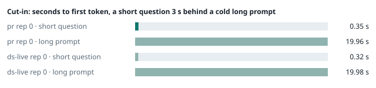

### Evidence: pr vs ds-live

| target | role | image / artifact | model | settings that differ from the control |
|---|---|---|---|---|
| `pr` | candidate | `tensorfold-dsv41:pr-47b1db12` (e9bcfaf10a77) | `DeepSeek-V4.1-Flash-1017` | - |
| `ds-live` | control | `tensorfold-dsv41:native-f72a456798db` (e9bcfaf10a77) | `DeepSeek-V4.1-Flash-1017` | baseline |

Conditions: fabric ring; order: counterbalanced: A B, then B A per repetition; repetitions: 1; kit 7c2f27e.
Restore: live restored.

#### smoke

| target | rep | arithmetic | greedy repeat equal | stream matches | first token (stream) | errors |
|---|---|---|---|---|---|---|
| `pr` | 0 | ✓ | ✓ | ✓ | 0.093 s | - |
| `ds-live` | 0 | ✓ | ✓ | ✓ | 0.092 s | - |

machine state after the suite

- `pr` rep 0: `{"head": {"gpus": ["0, NVIDIA GB10, 2177 MHz, 52, [N/A], [N/A], 91 %"], "load": "load average: 3.19, 1.84, 1.32", "mem_available_mb": "28348"}}`
- `ds-live` rep 0: `{"head": {"gpus": ["0, NVIDIA GB10, 2177 MHz, 55, [N/A], [N/A], 85 %"], "load": "load average: 3.88, 3.37, 2.13", "mem_available_mb": "28421"}}`

#### boundary

**19 of 19** greedy reply hashes identical, `pr` against `ds-live`, over 1 repetition(s).

| rep | prompt | tokens (pr / ds-live) | `pr` | `ds-live` | same |
|---|---|---|---|---|---|
| 0 | len5 | 5 / 5 | `38127fef0fbb` | `38127fef0fbb` | ✓ |
| 0 | len2047 | 2047 / 2047 | `8488ccfbcf35` | `8488ccfbcf35` | ✓ |
| 0 | len2048 | 2048 / 2048 | `c5ac2fb76516` | `c5ac2fb76516` | ✓ |
| 0 | len2049 | 2049 / 2049 | `6766401c9caa` | `6766401c9caa` | ✓ |
| 0 | len4095 | 4095 / 4095 | `ed9e5086f520` | `ed9e5086f520` | ✓ |
| 0 | len4096 | 4096 / 4096 | `52584e31f990` | `52584e31f990` | ✓ |
| 0 | len4097 | 4097 / 4097 | `1a71db317ee7` | `1a71db317ee7` | ✓ |
| 0 | len6143 | 6143 / 6143 | `2f9626e9baf5` | `2f9626e9baf5` | ✓ |
| 0 | len6144 | 6144 / 6144 | `11933f2d4bd7` | `11933f2d4bd7` | ✓ |
| 0 | len6145 | 6145 / 6145 | `7aa2f63b2547` | `7aa2f63b2547` | ✓ |
| 0 | len8193 | 8193 / 8193 | `2ef3dc011922` | `2ef3dc011922` | ✓ |
| 0 | len12289 | 12289 / 12289 | `4fcfbd64881f` | `4fcfbd64881f` | ✓ |
| 0 | pfx_base | 5124 / 5124 | `52afe4842e5d` | `52afe4842e5d` | ✓ |
| 0 | pfx_div3072 | 3376 / 3376 | `64d23fe171dc` | `64d23fe171dc` | ✓ |
| 0 | pfx_div2044 | 2348 / 2348 | `16db99ba02f2` | `16db99ba02f2` | ✓ |
| 0 | pfx_div4092 | 4396 / 4396 | `63798c5ba36c` | `63798c5ba36c` | ✓ |
| 0 | pfx_div4093 | 4397 / 4397 | `6b1cfc31884d` | `6b1cfc31884d` | ✓ |
| 0 | pfx_base_again | 5124 / 5124 | `52afe4842e5d` | `52afe4842e5d` | ✓ |
| 0 | pfx_extend | 6660 / 6660 | `357a869fef18` | `357a869fef18` | ✓ |

machine state after the suite

- `pr` rep 0: `{"head": {"gpus": ["0, NVIDIA GB10, 2171 MHz, 64, [N/A], [N/A], 96 %"], "load": "load average: 4.17, 2.24, 1.47", "mem_available_mb": "27961"}}`
- `ds-live` rep 0: `{"head": {"gpus": ["0, NVIDIA GB10, 2171 MHz, 66, [N/A], [N/A], 96 %"], "load": "load average: 4.69, 3.63, 2.26", "mem_available_mb": "27987"}}`

#### cutin

`pr` rep 0: short question first token **0.35 s** (rounds 0.326–0.362), long prompt first token 19.96 s (rounds 19.943–20.031); 3 rounds
`ds-live` rep 0: short question first token **0.32 s** (rounds 0.299–0.344), long prompt first token 19.98 s (rounds 19.916–20.06); 3 rounds

machine state after the suite

- `pr` rep 0: `{"head": {"gpus": ["0, NVIDIA GB10, 2184 MHz, 69, [N/A], [N/A], 70 %"], "load": "load average: 5.95, 3.11, 1.82", "mem_available_mb": "27921"}}`
- `ds-live` rep 0: `{"head": {"gpus": ["0, NVIDIA GB10, 2177 MHz, 67, [N/A], [N/A], 79 %"], "load": "load average: 6.00, 4.25, 2.58", "mem_available_mb": "27879"}}`

#### What this run does not show

- errors, canary mismatches and resource growth over time with client aborts (`soak` did not run)
- a clean pair exit and recovery after an injected read fault (`fault` did not run)
- throughput and latency against a control (`bench` did not run)
- <!-- add: paths only checked by reading, faults not injected, configurations not run -->

_Generated by inference-agent-kit `report.py` from `20261030T024010/results.json`._
