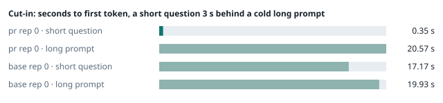
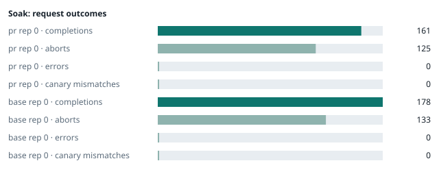

### Evidence: pr vs base

| target | role | image / artifact | model | settings that differ from the control |
|---|---|---|---|---|
| `pr` | candidate | `tensorfold-dsv41:pr-43ac2931` (e9bcfaf10a77) | `DeepSeek-V4.1-Flash-1017` | - |
| `base` | control | `tensorfold-dsv41:base-f0f86906` (3014a9d4e74f) | `DeepSeek-V4.1-Flash-1017` | baseline |

Conditions: fabric ring; order: counterbalanced: A B, then B A per repetition; repetitions: 1; kit 7b44de6.
Restore: live restored.

#### smoke

| target | rep | arithmetic | greedy repeat equal | stream matches | first token (stream) | errors |
|---|---|---|---|---|---|---|
| `pr` | 0 | ✓ | ✓ | ✓ | 0.09 s | - |
| `base` | 0 | ✓ | ✓ | ✓ | 0.098 s | - |

machine state after the suite

- `pr` rep 0: `{"head": {"gpus": ["0, NVIDIA GB10, 2184 MHz, 54, [N/A], [N/A], 84 %"], "load": "load average: 3.61, 1.96, 0.98", "mem_available_mb": "28525"}}`
- `base` rep 0: `{"head": {"gpus": ["0, NVIDIA GB10, 2177 MHz, 58, [N/A], [N/A], 59 %"], "load": "load average: 3.75, 4.85, 3.77", "mem_available_mb": "28551"}}`

#### boundary

**19 of 19** greedy reply hashes identical, `pr` against `base`, over 1 repetition(s).

| rep | prompt | tokens (pr / base) | `pr` | `base` | same |
|---|---|---|---|---|---|
| 0 | len5 | 5 / 5 | `38127fef0fbb` | `38127fef0fbb` | ✓ |
| 0 | len2047 | 2047 / 2047 | `8488ccfbcf35` | `8488ccfbcf35` | ✓ |
| 0 | len2048 | 2048 / 2048 | `c5ac2fb76516` | `c5ac2fb76516` | ✓ |
| 0 | len2049 | 2049 / 2049 | `6766401c9caa` | `6766401c9caa` | ✓ |
| 0 | len4095 | 4095 / 4095 | `ed9e5086f520` | `ed9e5086f520` | ✓ |
| 0 | len4096 | 4096 / 4096 | `52584e31f990` | `52584e31f990` | ✓ |
| 0 | len4097 | 4097 / 4097 | `1a71db317ee7` | `1a71db317ee7` | ✓ |
| 0 | len6143 | 6143 / 6143 | `2f9626e9baf5` | `2f9626e9baf5` | ✓ |
| 0 | len6144 | 6144 / 6144 | `11933f2d4bd7` | `11933f2d4bd7` | ✓ |
| 0 | len6145 | 6145 / 6145 | `7aa2f63b2547` | `7aa2f63b2547` | ✓ |
| 0 | len8193 | 8193 / 8193 | `2ef3dc011922` | `2ef3dc011922` | ✓ |
| 0 | len12289 | 12289 / 12289 | `4fcfbd64881f` | `4fcfbd64881f` | ✓ |
| 0 | pfx_base | 5124 / 5124 | `52afe4842e5d` | `52afe4842e5d` | ✓ |
| 0 | pfx_div3072 | 3376 / 3376 | `64d23fe171dc` | `64d23fe171dc` | ✓ |
| 0 | pfx_div2044 | 2348 / 2348 | `16db99ba02f2` | `16db99ba02f2` | ✓ |
| 0 | pfx_div4092 | 4396 / 4396 | `63798c5ba36c` | `63798c5ba36c` | ✓ |
| 0 | pfx_div4093 | 4397 / 4397 | `6b1cfc31884d` | `6b1cfc31884d` | ✓ |
| 0 | pfx_base_again | 5124 / 5124 | `52afe4842e5d` | `52afe4842e5d` | ✓ |
| 0 | pfx_extend | 6660 / 6660 | `357a869fef18` | `357a869fef18` | ✓ |

machine state after the suite

- `pr` rep 0: `{"head": {"gpus": ["0, NVIDIA GB10, 2171 MHz, 63, [N/A], [N/A], 96 %"], "load": "load average: 4.79, 2.45, 1.18", "mem_available_mb": "28159"}}`
- `base` rep 0: `{"head": {"gpus": ["0, NVIDIA GB10, 2171 MHz, 63, [N/A], [N/A], 94 %"], "load": "load average: 5.05, 5.05, 3.89", "mem_available_mb": "28031"}}`

#### cutin

`pr` rep 0: short question first token **0.35 s** (rounds 0.35–0.382), long prompt first token 20.57 s (rounds 19.969–20.692); 3 rounds
`base` rep 0: short question first token **17.17 s** (rounds 17.03–18.379), long prompt first token 19.93 s (rounds 19.779–20.047); 3 rounds

machine state after the suite

- `pr` rep 0: `{"head": {"gpus": ["0, NVIDIA GB10, 2177 MHz, 65, [N/A], [N/A], 9 %"], "load": "load average: 5.83, 3.27, 1.56", "mem_available_mb": "28070"}}`
- `base` rep 0: `{"head": {"gpus": ["0, NVIDIA GB10, 2171 MHz, 68, [N/A], [N/A], 96 %"], "load": "load average: 6.37, 5.42, 4.09", "mem_available_mb": "27968"}}`

#### soak

`pr` rep 0: 161 completions, 125 client aborts, **0 errors**, 57 canary checks with **0 mismatches**
  machine samples, first and last: `{"head": {"gpus": ["0, NVIDIA GB10, 2177 MHz, 66, [N/A], [N/A], 96 %"], "load": "load average: 5.83, 3.27, 1.56", "mem_available_mb": "28056"}}` → `{"head": {"gpus": ["0, NVIDIA GB10, 2177 MHz, 69, [N/A], [N/A], 96 %"], "load": "load average: 6.06, 5.74, 3.66", "mem_available_mb": "26667"}}`
`base` rep 0: 178 completions, 133 client aborts, **0 errors**, 64 canary checks with **0 mismatches**
  machine samples, first and last: `{"head": {"gpus": ["0, NVIDIA GB10, 2177 MHz, 68, [N/A], [N/A], 36 %"], "load": "load average: 6.37, 5.42, 4.09", "mem_available_mb": "27929"}}` → `{"head": {"gpus": ["0, NVIDIA GB10, 2171 MHz, 68, [N/A], [N/A], 96 %"], "load": "load average: 5.93, 5.96, 4.99", "mem_available_mb": "26459"}}`

machine state after the suite

- `pr` rep 0: `{"head": {"gpus": ["0, NVIDIA GB10, 2184 MHz, 60, [N/A], [N/A], 0 %"], "load": "load average: 5.31, 5.65, 3.77", "mem_available_mb": "26711"}}`
- `base` rep 0: `{"head": {"gpus": ["0, NVIDIA GB10, 2184 MHz, 61, [N/A], [N/A], 0 %"], "load": "load average: 5.16, 5.80, 5.01", "mem_available_mb": "26494"}}`

#### What this run does not show

- a clean pair exit and recovery after an injected read fault (`fault` did not run)
- throughput and latency against a control (`bench` did not run)
- <!-- add: paths only checked by reading, faults not injected, configurations not run -->

_Generated by inference-agent-kit `report.py` from `20261030T040631/results.json`._
