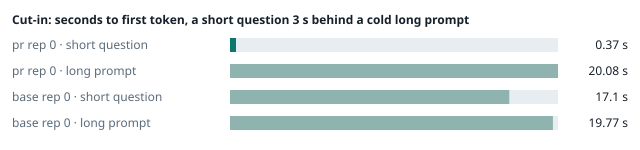
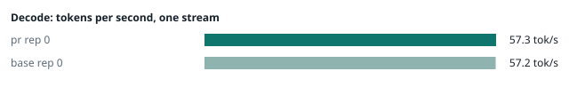
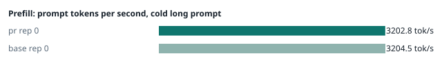
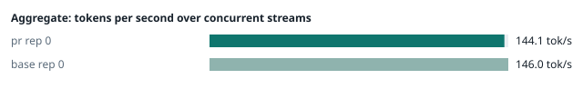
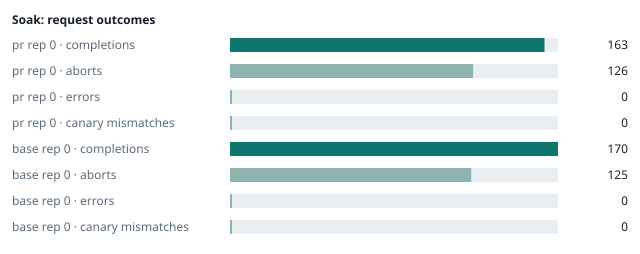

### Evidence: pr vs base

| target | role | image / artifact | model | settings that differ from the control |
|---|---|---|---|---|
| `pr` | candidate | `tensorfold-dsv41:pr-dd0d3397` (e9bcfaf10a77) | `DeepSeek-V4.1-Flash-1017` | - |
| `base` | control | `tensorfold-dsv41:base-f0f86906` (3014a9d4e74f) | `DeepSeek-V4.1-Flash-1017` | baseline |

Conditions: fabric ring; order: A then B, one repetition (no reverse order: pass --opt reps=2 for a counterbalanced run); repetitions: 1; kit 092a840.
Restore: live restored.

#### smoke

| target | rep | arithmetic | greedy repeat equal | stream matches | JSON mode | first token (stream) | errors |
|---|---|---|---|---|---|---|---|
| `pr` | 0 | ✓ | ✓ | ✓ | ✓ | 0.092 s | - |
| `base` | 0 | ✓ | ✓ | ✓ | ✓ | 0.091 s | - |

machine state after the suite

- `pr` rep 0: `{"head": {"gpus": ["0, NVIDIA GB10, 2184 MHz, 52, [N/A], [N/A], 80 %"], "load": "load average: 3.78, 1.98, 2.35", "mem_available_mb": "26734"}}`
- `base` rep 0: `{"head": {"gpus": ["0, NVIDIA GB10, 2177 MHz, 57, [N/A], [N/A], 0 %"], "load": "load average: 4.12, 5.02, 4.39", "mem_available_mb": "27064"}}`

#### boundary

**19 of 19** greedy reply hashes identical, `pr` against `base`, over 1 repetition(s).

| rep | prompt | tokens (pr / base) | `pr` | `base` | same |
|---|---|---|---|---|---|
| 0 | len5 | 5 / 5 | `38127fef0fbb` | `38127fef0fbb` | ✓ |
| 0 | len2047 | 2047 / 2047 | `8488ccfbcf35` | `8488ccfbcf35` | ✓ |
| 0 | len2048 | 2048 / 2048 | `c5ac2fb76516` | `c5ac2fb76516` | ✓ |
| 0 | len2049 | 2049 / 2049 | `6766401c9caa` | `6766401c9caa` | ✓ |
| 0 | len4095 | 4095 / 4095 | `ed9e5086f520` | `ed9e5086f520` | ✓ |
| 0 | len4096 | 4096 / 4096 | `52584e31f990` | `52584e31f990` | ✓ |
| 0 | len4097 | 4097 / 4097 | `1a71db317ee7` | `1a71db317ee7` | ✓ |
| 0 | len6143 | 6143 / 6143 | `2f9626e9baf5` | `2f9626e9baf5` | ✓ |
| 0 | len6144 | 6144 / 6144 | `11933f2d4bd7` | `11933f2d4bd7` | ✓ |
| 0 | len6145 | 6145 / 6145 | `7aa2f63b2547` | `7aa2f63b2547` | ✓ |
| 0 | len8193 | 8193 / 8193 | `2ef3dc011922` | `2ef3dc011922` | ✓ |
| 0 | len12289 | 12289 / 12289 | `4fcfbd64881f` | `4fcfbd64881f` | ✓ |
| 0 | pfx_base | 5124 / 5124 | `52afe4842e5d` | `52afe4842e5d` | ✓ |
| 0 | pfx_div3072 | 3376 / 3376 | `64d23fe171dc` | `64d23fe171dc` | ✓ |
| 0 | pfx_div2044 | 2348 / 2348 | `16db99ba02f2` | `16db99ba02f2` | ✓ |
| 0 | pfx_div4092 | 4396 / 4396 | `63798c5ba36c` | `63798c5ba36c` | ✓ |
| 0 | pfx_div4093 | 4397 / 4397 | `6b1cfc31884d` | `6b1cfc31884d` | ✓ |
| 0 | pfx_base_again | 5124 / 5124 | `52afe4842e5d` | `52afe4842e5d` | ✓ |
| 0 | pfx_extend | 6660 / 6660 | `357a869fef18` | `357a869fef18` | ✓ |

machine state after the suite

- `pr` rep 0: `{"head": {"gpus": ["0, NVIDIA GB10, 2171 MHz, 64, [N/A], [N/A], 96 %"], "load": "load average: 4.68, 2.40, 2.48", "mem_available_mb": "27697"}}`
- `base` rep 0: `{"head": {"gpus": ["0, NVIDIA GB10, 2171 MHz, 65, [N/A], [N/A], 96 %"], "load": "load average: 5.21, 5.21, 4.47", "mem_available_mb": "27715"}}`

#### cutin

`pr` rep 0: short question first token **0.37 s** (rounds 0.34–0.452), long prompt first token 20.08 s (rounds 19.973–20.228); 3 rounds
`base` rep 0: short question first token **17.1 s** (rounds 16.898–17.149), long prompt first token 19.77 s (rounds 19.655–19.873); 3 rounds

machine state after the suite

- `pr` rep 0: `{"head": {"gpus": ["0, NVIDIA GB10, 2177 MHz, 66, [N/A], [N/A], 96 %"], "load": "load average: 6.13, 3.21, 2.76", "mem_available_mb": "27630"}}`
- `base` rep 0: `{"head": {"gpus": ["0, NVIDIA GB10, 2184 MHz, 70, [N/A], [N/A], 96 %"], "load": "load average: 6.63, 5.64, 4.67", "mem_available_mb": "27676"}}`

#### perf

| target | rep | decode tok/s, one stream | prefill tok/s, cold long prompt | aggregate tok/s, concurrent streams | errors |
|---|---|---|---|---|---|
| `pr` | 0 | **57.3** (55.8–60.9) | **3202.8** (3149.0–3207.9; 12004 tokens) | **144.1** (139.5–148.2; 4 streams) | - |
| `base` | 0 | **57.2** (55.6–58.8) | **3204.5** (3196.0–3210.5; 12004 tokens) | **146.0** (143.1–153.2; 4 streams) | - |

`pr` against `base`: decode +0.2%, prefill -0.1%, aggregate -1.3% (medians over repetitions; the verdict counts a difference only beyond the rounds' spread, at least ±3 %).

machine state after the suite

- `pr` rep 0: `{"head": {"gpus": ["0, NVIDIA GB10, 2177 MHz, 64, [N/A], [N/A], 28 %"], "load": "load average: 5.63, 3.41, 2.84", "mem_available_mb": "27358"}}`
- `base` rep 0: `{"head": {"gpus": ["0, NVIDIA GB10, 2171 MHz, 68, [N/A], [N/A], 96 %"], "load": "load average: 6.15, 5.63, 4.70", "mem_available_mb": "27392"}}`

#### soak

`pr` rep 0: 163 completions, 126 client aborts, **0 errors**, 57 canary checks with **0 mismatches**
  machine samples, first and last: `{"head": {"gpus": ["0, NVIDIA GB10, 2177 MHz, 65, [N/A], [N/A], 89 %"], "load": "load average: 5.18, 3.36, 2.82", "mem_available_mb": "27330"}}` → `{"head": {"gpus": ["0, NVIDIA GB10, 2177 MHz, 71, [N/A], [N/A], 96 %"], "load": "load average: 6.28, 5.80, 4.38", "mem_available_mb": "26181"}}`
`base` rep 0: 170 completions, 125 client aborts, **0 errors**, 57 canary checks with **0 mismatches**
  machine samples, first and last: `{"head": {"gpus": ["0, NVIDIA GB10, 2177 MHz, 65, [N/A], [N/A], 0 %"], "load": "load average: 5.89, 5.59, 4.70", "mem_available_mb": "27335"}}` → `{"head": {"gpus": ["0, NVIDIA GB10, 2184 MHz, 73, [N/A], [N/A], 96 %"], "load": "load average: 6.29, 6.02, 5.32", "mem_available_mb": "25871"}}`

machine state after the suite

- `pr` rep 0: `{"head": {"gpus": ["0, NVIDIA GB10, 2184 MHz, 60, [N/A], [N/A], 0 %"], "load": "load average: 5.45, 5.72, 4.45", "mem_available_mb": "26171"}}`
- `base` rep 0: `{"head": {"gpus": ["0, NVIDIA GB10, 2177 MHz, 66, [N/A], [N/A], 0 %"], "load": "load average: 5.67, 5.94, 5.35", "mem_available_mb": "25747"}}`

#### What this run does not show

- a clean pair exit and recovery after an injected read fault (`fault` did not run)
- throughput and latency against a control (`bench` did not run)
- <!-- add: paths only checked by reading, faults not injected, configurations not run -->

_Generated by inference-agent-kit `report.py` from `20261031T003619/results.json`._
