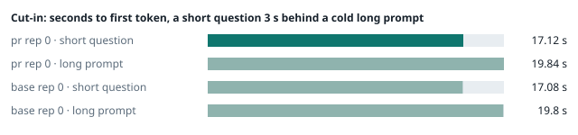
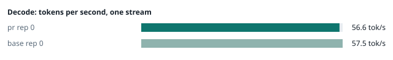
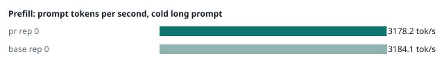
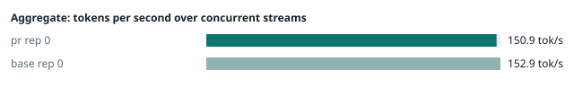
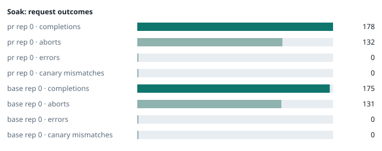

### Evidence: pr vs base

| target | role | image / artifact | model | settings that differ from the control |
|---|---|---|---|---|
| `pr` | candidate | `tensorfold-dsv41:pr-de6b2438` (e9bcfaf10a77) | `DeepSeek-V4.1-Flash-1017` | - |
| `base` | control | `tensorfold-dsv41:base-476bbc77` (3014a9d4e74f) | `DeepSeek-V4.1-Flash-1017` | baseline |

Conditions: fabric ring; order: A then B, one repetition (no reverse order: pass --opt reps=2 for a counterbalanced run); repetitions: 1; kit 7444231.
Restore: live restored (verified: API answers, running artifact is live's).

#### smoke

| target | rep | arithmetic | greedy repeat equal | stream matches | JSON mode | first token (stream) | errors |
|---|---|---|---|---|---|---|---|
| `pr` | 0 | ✓ | ✓ | ✓ | ✓ | 0.091 s | - |
| `base` | 0 | ✓ | ✓ | ✓ | ✓ | 0.098 s | - |

machine state after the suite

- `pr` rep 0: `{"head": {"gpus": ["0, NVIDIA GB10, 2177 MHz, 57, [N/A], [N/A], 82 %"], "load": "load average: 3.78, 4.18, 4.65", "mem_available_mb": "27650"}}`
- `base` rep 0: `{"head": {"gpus": ["0, NVIDIA GB10, 2177 MHz, 57, [N/A], [N/A], 0 %"], "load": "load average: 3.74, 4.84, 5.07", "mem_available_mb": "26714"}}`

#### boundary

**19 of 19** greedy reply hashes identical, `pr` against `base`, over 1 repetition(s).

| rep | prompt | tokens (pr / base) | `pr` | `base` | same |
|---|---|---|---|---|---|
| 0 | len5 | 5 / 5 | `38127fef0fbb` | `38127fef0fbb` | ✓ |
| 0 | len2047 | 2047 / 2047 | `8488ccfbcf35` | `8488ccfbcf35` | ✓ |
| 0 | len2048 | 2048 / 2048 | `c5ac2fb76516` | `c5ac2fb76516` | ✓ |
| 0 | len2049 | 2049 / 2049 | `6766401c9caa` | `6766401c9caa` | ✓ |
| 0 | len4095 | 4095 / 4095 | `ed9e5086f520` | `ed9e5086f520` | ✓ |
| 0 | len4096 | 4096 / 4096 | `52584e31f990` | `52584e31f990` | ✓ |
| 0 | len4097 | 4097 / 4097 | `1a71db317ee7` | `1a71db317ee7` | ✓ |
| 0 | len6143 | 6143 / 6143 | `2f9626e9baf5` | `2f9626e9baf5` | ✓ |
| 0 | len6144 | 6144 / 6144 | `11933f2d4bd7` | `11933f2d4bd7` | ✓ |
| 0 | len6145 | 6145 / 6145 | `7aa2f63b2547` | `7aa2f63b2547` | ✓ |
| 0 | len8193 | 8193 / 8193 | `2ef3dc011922` | `2ef3dc011922` | ✓ |
| 0 | len12289 | 12289 / 12289 | `4fcfbd64881f` | `4fcfbd64881f` | ✓ |
| 0 | pfx_base | 5124 / 5124 | `52afe4842e5d` | `52afe4842e5d` | ✓ |
| 0 | pfx_div3072 | 3376 / 3376 | `64d23fe171dc` | `64d23fe171dc` | ✓ |
| 0 | pfx_div2044 | 2348 / 2348 | `16db99ba02f2` | `16db99ba02f2` | ✓ |
| 0 | pfx_div4092 | 4396 / 4396 | `63798c5ba36c` | `63798c5ba36c` | ✓ |
| 0 | pfx_div4093 | 4397 / 4397 | `6b1cfc31884d` | `6b1cfc31884d` | ✓ |
| 0 | pfx_base_again | 5124 / 5124 | `52afe4842e5d` | `52afe4842e5d` | ✓ |
| 0 | pfx_extend | 6660 / 6660 | `357a869fef18` | `357a869fef18` | ✓ |

machine state after the suite

- `pr` rep 0: `{"head": {"gpus": ["0, NVIDIA GB10, 2171 MHz, 64, [N/A], [N/A], 12 %"], "load": "load average: 4.90, 4.40, 4.71", "mem_available_mb": "27367"}}`
- `base` rep 0: `{"head": {"gpus": ["0, NVIDIA GB10, 2171 MHz, 67, [N/A], [N/A], 96 %"], "load": "load average: 4.62, 4.93, 5.09", "mem_available_mb": "27325"}}`

#### cutin

`pr` rep 0: short question first token **17.12 s** (rounds 17.116–17.129), long prompt first token 19.84 s (rounds 19.838–19.864); 3 rounds
`base` rep 0: short question first token **17.08 s** (rounds 16.935–17.216), long prompt first token 19.8 s (rounds 19.691–19.936); 3 rounds

machine state after the suite

- `pr` rep 0: `{"head": {"gpus": ["0, NVIDIA GB10, 2184 MHz, 67, [N/A], [N/A], 96 %"], "load": "load average: 5.92, 4.84, 4.85", "mem_available_mb": "27240"}}`
- `base` rep 0: `{"head": {"gpus": ["0, NVIDIA GB10, 2184 MHz, 69, [N/A], [N/A], 96 %"], "load": "load average: 6.34, 5.37, 5.24", "mem_available_mb": "27234"}}`

#### perf

| target | rep | decode tok/s, one stream | prefill tok/s, cold long prompt | aggregate tok/s, concurrent streams | errors |
|---|---|---|---|---|---|
| `pr` | 0 | **56.6** (55.9–60.4) | **3178.2** (3177.3–3183.2; 12004 tokens) | **150.9** (143.5–160.0; 4 streams) | - |
| `base` | 0 | **57.5** (55.8–60.5) | **3184.1** (3095.4–3198.5; 12004 tokens) | **152.9** (143.4–157.4; 4 streams) | - |

`pr` against `base`: decode -1.6%, prefill -0.2%, aggregate -1.3% (medians over repetitions; the verdict counts a difference only beyond the rounds' spread, at least ±3 %).

machine state after the suite

- `pr` rep 0: `{"head": {"gpus": ["0, NVIDIA GB10, 2177 MHz, 66, [N/A], [N/A], 96 %"], "load": "load average: 5.42, 4.83, 4.84", "mem_available_mb": "26976"}}`
- `base` rep 0: `{"head": {"gpus": ["0, NVIDIA GB10, 2171 MHz, 68, [N/A], [N/A], 96 %"], "load": "load average: 5.89, 5.38, 5.24", "mem_available_mb": "26938"}}`

#### startup

`pr`: 167.0 s from the switch to the API answering (1 start(s))
`base`: 167.1 s from the switch to the API answering (1 start(s))

#### soak

`pr` rep 0: 178 completions, 132 client aborts, **0 errors**, 64 canary checks with **0 mismatches**
  machine samples, first and last: `{"head": {"gpus": ["0, NVIDIA GB10, 2177 MHz, 66, [N/A], [N/A], 0 %"], "load": "load average: 5.42, 4.83, 4.84", "mem_available_mb": "26930"}}` → `{"head": {"gpus": ["0, NVIDIA GB10, 2171 MHz, 70, [N/A], [N/A], 96 %"], "load": "load average: 6.24, 5.90, 5.39", "mem_available_mb": "25813"}}`
`base` rep 0: 175 completions, 131 client aborts, **0 errors**, 59 canary checks with **0 mismatches**
  machine samples, first and last: `{"head": {"gpus": ["0, NVIDIA GB10, 2177 MHz, 66, [N/A], [N/A], 38 %"], "load": "load average: 5.89, 5.38, 5.24", "mem_available_mb": "27069"}}` → `{"head": {"gpus": ["0, NVIDIA GB10, 2184 MHz, 71, [N/A], [N/A], 96 %"], "load": "load average: 6.29, 6.18, 5.75", "mem_available_mb": "25794"}}`

machine state after the suite

- `pr` rep 0: `{"head": {"gpus": ["0, NVIDIA GB10, 2184 MHz, 62, [N/A], [N/A], 0 %"], "load": "load average: 5.16, 5.69, 5.35", "mem_available_mb": "25659"}}`
- `base` rep 0: `{"head": {"gpus": ["0, NVIDIA GB10, 2184 MHz, 60, [N/A], [N/A], 0 %"], "load": "load average: 5.81, 6.11, 5.75", "mem_available_mb": "25648"}}`

#### the pull request's own tests

**confirmed** — 3 test file(s) added or changed by the PR (`tests/test_scripts.py`, `tests/test_start_smoke.py`, `tests/test_stop_health.py`): on the PR **passes** (exit 0), on the base with the PR's tests copied in **fails** (exit 1).

- PR: `............................................. [ 58%] ................................                         [100%] 77 passed, 43 subtests passed in 28.87s`
- base + PR tests: `FAILED tests/test_stop_health.py::StopHealth::test_transport_failure_is_unknown - AssertionError: 'could not read the open requests from /health' not found in '[stop.sh] DRY_RUN=1: would stop and remove dsv41-1017-tf here, on w1, on w2, on w3 (up to 30s); nothing is stopped\n[dry-run] rank 0 here:\n`

#### What this run does not show

- a clean pair exit and recovery after an injected read fault (`fault` did not run)
- an external benchmark against a control (The Grill or similar) (`bench` did not run)
- <!-- add: paths only checked by reading, faults not injected, configurations not run -->

_Generated by inference-agent-kit `report.py` from `20261031T222146/results.json`._
