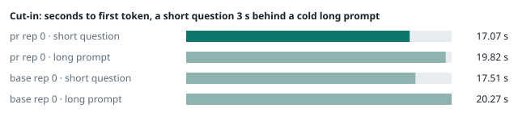
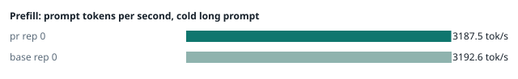
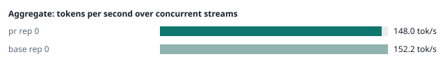
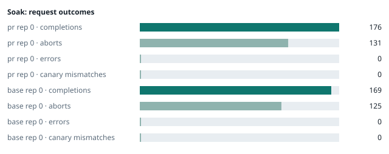

### Evidence: pr vs base

| target | role | image / artifact | model | settings that differ from the control |
|---|---|---|---|---|
| `pr` | candidate | `tensorfold-dsv41:pr-aa8c64eb` (e9bcfaf10a77) | `DeepSeek-V4.1-Flash-1017` | - |
| `base` | control | `tensorfold-dsv41:base-476bbc77` (3014a9d4e74f) | `DeepSeek-V4.1-Flash-1017` | baseline |

Conditions: fabric ring; order: A then B, one repetition (no reverse order: pass --opt reps=2 for a counterbalanced run); repetitions: 1; kit cf8a85a.
Restore: live restored (verified: API answers, running artifact is live's).

#### smoke

| target | rep | arithmetic | greedy repeat equal | stream matches | JSON mode | first token (stream) | errors |
|---|---|---|---|---|---|---|---|
| `pr` | 0 | ✓ | ✓ | ✓ | ✓ | 0.091 s | - |
| `base` | 0 | ✓ | ✓ | ✓ | ✓ | 0.091 s | - |

machine state after the suite

- `pr` rep 0: `{"head": {"gpus": ["0, NVIDIA GB10, 2177 MHz, 58, [N/A], [N/A], 82 %"], "load": "load average: 3.81, 4.07, 4.98", "mem_available_mb": "26712"}}`
- `base` rep 0: `{"head": {"gpus": ["0, NVIDIA GB10, 2177 MHz, 62, [N/A], [N/A], 94 %"], "load": "load average: 4.57, 5.71, 5.73", "mem_available_mb": "26792"}}`

#### boundary

**19 of 19** greedy reply hashes identical, `pr` against `base`, over 1 repetition(s).

| rep | prompt | tokens (pr / base) | `pr` | `base` | same |
|---|---|---|---|---|---|
| 0 | len5 | 5 / 5 | `38127fef0fbb` | `38127fef0fbb` | ✓ |
| 0 | len2047 | 2047 / 2047 | `8488ccfbcf35` | `8488ccfbcf35` | ✓ |
| 0 | len2048 | 2048 / 2048 | `c5ac2fb76516` | `c5ac2fb76516` | ✓ |
| 0 | len2049 | 2049 / 2049 | `6766401c9caa` | `6766401c9caa` | ✓ |
| 0 | len4095 | 4095 / 4095 | `ed9e5086f520` | `ed9e5086f520` | ✓ |
| 0 | len4096 | 4096 / 4096 | `52584e31f990` | `52584e31f990` | ✓ |
| 0 | len4097 | 4097 / 4097 | `1a71db317ee7` | `1a71db317ee7` | ✓ |
| 0 | len6143 | 6143 / 6143 | `2f9626e9baf5` | `2f9626e9baf5` | ✓ |
| 0 | len6144 | 6144 / 6144 | `11933f2d4bd7` | `11933f2d4bd7` | ✓ |
| 0 | len6145 | 6145 / 6145 | `7aa2f63b2547` | `7aa2f63b2547` | ✓ |
| 0 | len8193 | 8193 / 8193 | `2ef3dc011922` | `2ef3dc011922` | ✓ |
| 0 | len12289 | 12289 / 12289 | `4fcfbd64881f` | `4fcfbd64881f` | ✓ |
| 0 | pfx_base | 5124 / 5124 | `52afe4842e5d` | `52afe4842e5d` | ✓ |
| 0 | pfx_div3072 | 3376 / 3376 | `64d23fe171dc` | `64d23fe171dc` | ✓ |
| 0 | pfx_div2044 | 2348 / 2348 | `16db99ba02f2` | `16db99ba02f2` | ✓ |
| 0 | pfx_div4092 | 4396 / 4396 | `63798c5ba36c` | `63798c5ba36c` | ✓ |
| 0 | pfx_div4093 | 4397 / 4397 | `6b1cfc31884d` | `6b1cfc31884d` | ✓ |
| 0 | pfx_base_again | 5124 / 5124 | `52afe4842e5d` | `52afe4842e5d` | ✓ |
| 0 | pfx_extend | 6660 / 6660 | `357a869fef18` | `357a869fef18` | ✓ |

machine state after the suite

- `pr` rep 0: `{"head": {"gpus": ["0, NVIDIA GB10, 2171 MHz, 63, [N/A], [N/A], 0 %"], "load": "load average: 4.38, 4.17, 4.98", "mem_available_mb": "27279"}}`
- `base` rep 0: `{"head": {"gpus": ["0, NVIDIA GB10, 2171 MHz, 68, [N/A], [N/A], 96 %"], "load": "load average: 5.63, 5.84, 5.77", "mem_available_mb": "27222"}}`

#### cutin

`pr` rep 0: short question first token **17.07 s** (rounds 16.974–17.33), long prompt first token 19.82 s (rounds 19.695–20.034); 3 rounds
`base` rep 0: short question first token **17.51 s** (rounds 17.263–18.142), long prompt first token 20.27 s (rounds 19.889–20.82); 3 rounds

machine state after the suite

- `pr` rep 0: `{"head": {"gpus": ["0, NVIDIA GB10, 2177 MHz, 67, [N/A], [N/A], 79 %"], "load": "load average: 6.53, 4.81, 5.15", "mem_available_mb": "27188"}}`
- `base` rep 0: `{"head": {"gpus": ["0, NVIDIA GB10, 2177 MHz, 72, [N/A], [N/A], 96 %"], "load": "load average: 7.25, 6.29, 5.93", "mem_available_mb": "27184"}}`

#### perf

| target | rep | decode tok/s, one stream | prefill tok/s, cold long prompt | aggregate tok/s, concurrent streams | errors |
|---|---|---|---|---|---|
| `pr` | 0 | **56.3** (55.3–60.2) | **3187.5** (3149.8–3190.9; 12004 tokens) | **148.0** (140.3–153.0; 4 streams) | - |
| `base` | 0 | **57.1** (55.8–60.8) | **3192.6** (2744.4–3208.8; 12004 tokens) | **152.2** (141.3–153.4; 4 streams) | - |

`pr` against `base`: decode -1.4%, prefill -0.2%, aggregate -2.8% (medians over repetitions; the verdict counts a difference only beyond the rounds' spread, at least ±3 %).

machine state after the suite

- `pr` rep 0: `{"head": {"gpus": ["0, NVIDIA GB10, 2171 MHz, 66, [N/A], [N/A], 0 %"], "load": "load average: 6.03, 4.88, 5.16", "mem_available_mb": "26918"}}`
- `base` rep 0: `{"head": {"gpus": ["0, NVIDIA GB10, 2177 MHz, 69, [N/A], [N/A], 96 %"], "load": "load average: 6.58, 6.23, 5.93", "mem_available_mb": "27042"}}`

#### startup

`pr`: 166.5 s from the switch to the API answering (1 start(s))
`base`: 167.4 s from the switch to the API answering (1 start(s))

#### soak

`pr` rep 0: 176 completions, 131 client aborts, **0 errors**, 63 canary checks with **0 mismatches**
  machine samples, first and last: `{"head": {"gpus": ["0, NVIDIA GB10, 2177 MHz, 67, [N/A], [N/A], 39 %"], "load": "load average: 6.03, 4.88, 5.16", "mem_available_mb": "26877"}}` → `{"head": {"gpus": ["0, NVIDIA GB10, 2171 MHz, 71, [N/A], [N/A], 96 %"], "load": "load average: 7.46, 6.62, 5.92", "mem_available_mb": "25627"}}`
`base` rep 0: 169 completions, 125 client aborts, **0 errors**, 59 canary checks with **0 mismatches**
  machine samples, first and last: `{"head": {"gpus": ["0, NVIDIA GB10, 2177 MHz, 66, [N/A], [N/A], 83 %"], "load": "load average: 6.58, 6.23, 5.93", "mem_available_mb": "26934"}}` → `{"head": {"gpus": ["0, NVIDIA GB10, 2177 MHz, 71, [N/A], [N/A], 96 %"], "load": "load average: 6.20, 6.53, 6.27", "mem_available_mb": "25660"}}`

machine state after the suite

- `pr` rep 0: `{"head": {"gpus": ["0, NVIDIA GB10, 2177 MHz, 64, [N/A], [N/A], 0 %"], "load": "load average: 6.76, 6.65, 5.99", "mem_available_mb": "25623"}}`
- `base` rep 0: `{"head": {"gpus": ["0, NVIDIA GB10, 2184 MHz, 60, [N/A], [N/A], 0 %"], "load": "load average: 5.44, 6.33, 6.22", "mem_available_mb": "25573"}}`

#### the pull request's own tests

**confirmed** — 1 test file(s) added or changed by the PR (`tests/test_mesh_bootstrap.py`): on the PR **passes** (exit 0), on the base with the PR's tests copied in **fails** (exit 1).

- PR: `.....                                                                  [100%] 5 passed, 2 subtests passed in 0.43s`
- base + PR tests: `- {0: 'management0', 1: 'management1', 2: 'management2', 3: 'management3'} + {0: 'fabric0', 1: 'fabric1', 2: 'fabric2', 3: 'fabric3'} 3 failed, 2 passed, 2 subtests passed in 0.47s`

#### What this run does not show

- a clean pair exit and recovery after an injected read fault (`fault` did not run)
- an external benchmark against a control (The Grill or similar) (`bench` did not run)
- <!-- add: paths only checked by reading, faults not injected, configurations not run -->

_Generated by inference-agent-kit `report.py` from `20261031T233244/results.json`._
