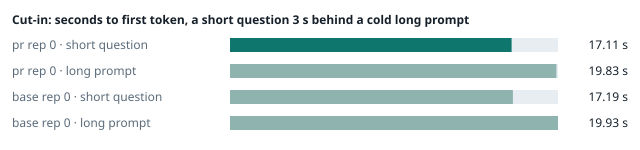
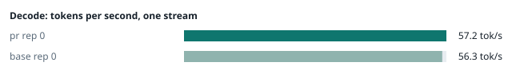
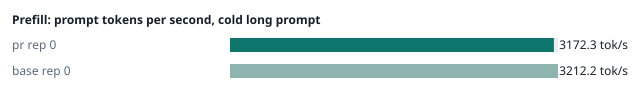
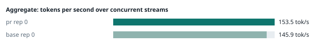
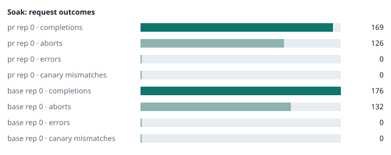

### Evidence: pr vs base

| target | role | image / artifact | model | settings that differ from the control |
|---|---|---|---|---|
| `pr` | candidate | `tensorfold-dsv41:pr-c695a11e` (e9bcfaf10a77) | `DeepSeek-V4.1-Flash-1017` | - |
| `base` | control | `tensorfold-dsv41:base-476bbc77` (3014a9d4e74f) | `DeepSeek-V4.1-Flash-1017` | baseline |

Conditions: fabric ring; order: A then B, one repetition (no reverse order: pass --opt reps=2 for a counterbalanced run); repetitions: 1; kit cf8a85a.
Restore: live restored (verified: API answers, running artifact is live's).

#### smoke

| target | rep | arithmetic | greedy repeat equal | stream matches | JSON mode | first token (stream) | errors |
|---|---|---|---|---|---|---|---|
| `pr` | 0 | ✓ | ✓ | ✓ | ✓ | 0.089 s | - |
| `base` | 0 | ✓ | ✓ | ✓ | ✓ | 0.105 s | - |

machine state after the suite

- `pr` rep 0: `{"head": {"gpus": ["0, NVIDIA GB10, 2177 MHz, 59, [N/A], [N/A], 80 %"], "load": "load average: 2.97, 3.76, 4.99", "mem_available_mb": "26790"}}`
- `base` rep 0: `{"head": {"gpus": ["0, NVIDIA GB10, 2177 MHz, 62, [N/A], [N/A], 94 %"], "load": "load average: 3.60, 4.94, 5.34", "mem_available_mb": "26758"}}`

#### boundary

**19 of 19** greedy reply hashes identical, `pr` against `base`, over 1 repetition(s).

| rep | prompt | tokens (pr / base) | `pr` | `base` | same |
|---|---|---|---|---|---|
| 0 | len5 | 5 / 5 | `38127fef0fbb` | `38127fef0fbb` | ✓ |
| 0 | len2047 | 2047 / 2047 | `8488ccfbcf35` | `8488ccfbcf35` | ✓ |
| 0 | len2048 | 2048 / 2048 | `c5ac2fb76516` | `c5ac2fb76516` | ✓ |
| 0 | len2049 | 2049 / 2049 | `6766401c9caa` | `6766401c9caa` | ✓ |
| 0 | len4095 | 4095 / 4095 | `ed9e5086f520` | `ed9e5086f520` | ✓ |
| 0 | len4096 | 4096 / 4096 | `52584e31f990` | `52584e31f990` | ✓ |
| 0 | len4097 | 4097 / 4097 | `1a71db317ee7` | `1a71db317ee7` | ✓ |
| 0 | len6143 | 6143 / 6143 | `2f9626e9baf5` | `2f9626e9baf5` | ✓ |
| 0 | len6144 | 6144 / 6144 | `11933f2d4bd7` | `11933f2d4bd7` | ✓ |
| 0 | len6145 | 6145 / 6145 | `7aa2f63b2547` | `7aa2f63b2547` | ✓ |
| 0 | len8193 | 8193 / 8193 | `2ef3dc011922` | `2ef3dc011922` | ✓ |
| 0 | len12289 | 12289 / 12289 | `4fcfbd64881f` | `4fcfbd64881f` | ✓ |
| 0 | pfx_base | 5124 / 5124 | `52afe4842e5d` | `52afe4842e5d` | ✓ |
| 0 | pfx_div3072 | 3376 / 3376 | `64d23fe171dc` | `64d23fe171dc` | ✓ |
| 0 | pfx_div2044 | 2348 / 2348 | `16db99ba02f2` | `16db99ba02f2` | ✓ |
| 0 | pfx_div4092 | 4396 / 4396 | `63798c5ba36c` | `63798c5ba36c` | ✓ |
| 0 | pfx_div4093 | 4397 / 4397 | `6b1cfc31884d` | `6b1cfc31884d` | ✓ |
| 0 | pfx_base_again | 5124 / 5124 | `52afe4842e5d` | `52afe4842e5d` | ✓ |
| 0 | pfx_extend | 6660 / 6660 | `357a869fef18` | `357a869fef18` | ✓ |

machine state after the suite

- `pr` rep 0: `{"head": {"gpus": ["0, NVIDIA GB10, 2171 MHz, 64, [N/A], [N/A], 0 %"], "load": "load average: 4.18, 3.98, 5.02", "mem_available_mb": "27334"}}`
- `base` rep 0: `{"head": {"gpus": ["0, NVIDIA GB10, 2177 MHz, 66, [N/A], [N/A], 93 %"], "load": "load average: 4.48, 5.01, 5.35", "mem_available_mb": "27301"}}`

#### cutin

`pr` rep 0: short question first token **17.11 s** (rounds 17.021–17.113), long prompt first token 19.83 s (rounds 19.769–19.835); 3 rounds
`base` rep 0: short question first token **17.19 s** (rounds 16.878–17.73), long prompt first token 19.93 s (rounds 19.588–20.437); 3 rounds

machine state after the suite

- `pr` rep 0: `{"head": {"gpus": ["0, NVIDIA GB10, 2177 MHz, 71, [N/A], [N/A], 79 %"], "load": "load average: 5.95, 4.57, 5.16", "mem_available_mb": "27154"}}`
- `base` rep 0: `{"head": {"gpus": ["0, NVIDIA GB10, 2184 MHz, 72, [N/A], [N/A], 88 %"], "load": "load average: 6.32, 5.45, 5.48", "mem_available_mb": "27178"}}`

#### perf

| target | rep | decode tok/s, one stream | prefill tok/s, cold long prompt | aggregate tok/s, concurrent streams | errors |
|---|---|---|---|---|---|
| `pr` | 0 | **57.2** (55.7–60.3) | **3172.3** (3158.9–3179.0; 12004 tokens) | **153.5** (144.0–158.3; 4 streams) | - |
| `base` | 0 | **56.3** (55.4–60.3) | **3212.2** (3207.9–3213.9; 12004 tokens) | **145.9** (130.2–157.4; 4 streams) | - |

`pr` against `base`: decode +1.6%, prefill -1.2%, aggregate +5.2% (medians over repetitions; the verdict counts a difference only beyond the rounds' spread, at least ±3 %).

machine state after the suite

- `pr` rep 0: `{"head": {"gpus": ["0, NVIDIA GB10, 2177 MHz, 66, [N/A], [N/A], 94 %"], "load": "load average: 5.75, 4.68, 5.17", "mem_available_mb": "26912"}}`
- `base` rep 0: `{"head": {"gpus": ["0, NVIDIA GB10, 2177 MHz, 67, [N/A], [N/A], 0 %"], "load": "load average: 6.03, 5.48, 5.49", "mem_available_mb": "26934"}}`

#### startup

`pr`: 174.0 s from the switch to the API answering (1 start(s))
`base`: 167.5 s from the switch to the API answering (1 start(s))

#### soak

`pr` rep 0: 169 completions, 126 client aborts, **0 errors**, 61 canary checks with **0 mismatches**
  machine samples, first and last: `{"head": {"gpus": ["0, NVIDIA GB10, 2177 MHz, 67, [N/A], [N/A], 0 %"], "load": "load average: 5.75, 4.68, 5.17", "mem_available_mb": "26899"}}` → `{"head": {"gpus": ["0, NVIDIA GB10, 2184 MHz, 76, [N/A], [N/A], 96 %"], "load": "load average: 6.23, 6.15, 5.73", "mem_available_mb": "25692"}}`
`base` rep 0: 176 completions, 132 client aborts, **0 errors**, 61 canary checks with **0 mismatches**
  machine samples, first and last: `{"head": {"gpus": ["0, NVIDIA GB10, 2177 MHz, 68, [N/A], [N/A], 96 %"], "load": "load average: 6.10, 5.50, 5.50", "mem_available_mb": "26872"}}` → `{"head": {"gpus": ["0, NVIDIA GB10, 2177 MHz, 70, [N/A], [N/A], 96 %"], "load": "load average: 6.75, 6.51, 6.05", "mem_available_mb": "25674"}}`

machine state after the suite

- `pr` rep 0: `{"head": {"gpus": ["0, NVIDIA GB10, 2177 MHz, 63, [N/A], [N/A], 0 %"], "load": "load average: 4.96, 5.91, 5.68", "mem_available_mb": "25631"}}`
- `base` rep 0: `{"head": {"gpus": ["0, NVIDIA GB10, 2184 MHz, 61, [N/A], [N/A], 0 %"], "load": "load average: 5.26, 6.18, 5.97", "mem_available_mb": "25612"}}`

#### the pull request's own tests

**confirmed** — 1 test file(s) added or changed by the PR (`tests/test_scripts.py`): on the PR **passes** (exit 0), on the base with the PR's tests copied in **fails** (exit 1).

- PR: `...................................                          [100%] 35 passed, 12 subtests passed in 7.55s`
- base + PR tests: `=========================== short test summary info ============================ FAILED tests/test_scripts.py::StartRestart::test_a_worker_reads_its_weight_file_from_its_disk_when_its_copy_matches - ValueError: not enough values to unpack (expected 2, got 1) 1 failed, 34 passed, 12 subtests passed i`

#### What this run does not show

- a clean pair exit and recovery after an injected read fault (`fault` did not run)
- an external benchmark against a control (The Grill or similar) (`bench` did not run)
- <!-- add: paths only checked by reading, faults not injected, configurations not run -->

_Generated by inference-agent-kit `report.py` from `20261101T000735/results.json`._
