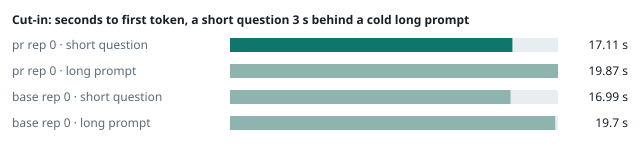
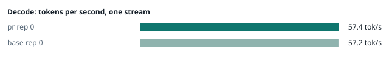
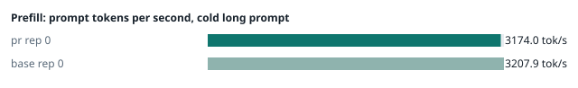
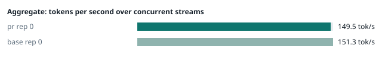
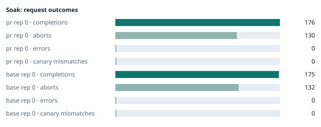

### Evidence: pr vs base

| target | role | image / artifact | model | settings that differ from the control |
|---|---|---|---|---|
| `pr` | candidate | `tensorfold-dsv41:pr-bc614182` (6bd1bc5ac472) | `DeepSeek-V4.1-Flash-1017` | - |
| `base` | control | `tensorfold-dsv41:base-476bbc77` (3014a9d4e74f) | `DeepSeek-V4.1-Flash-1017` | baseline |

Conditions: fabric ring; order: A then B, one repetition (no reverse order: pass --opt reps=2 for a counterbalanced run); repetitions: 1; kit cf8a85a.
Restore: live restored (verified: API answers, running artifact is live's).

#### smoke

| target | rep | arithmetic | greedy repeat equal | stream matches | JSON mode | first token (stream) | errors |
|---|---|---|---|---|---|---|---|
| `pr` | 0 | ✓ | ✓ | ✓ | ✓ | 0.091 s | - |
| `base` | 0 | ✓ | ✓ | ✓ | ✓ | 0.09 s | - |

machine state after the suite

- `pr` rep 0: `{"head": {"gpus": ["0, NVIDIA GB10, 2184 MHz, 53, [N/A], [N/A], 31 %"], "load": "load average: 3.55, 2.06, 2.19", "mem_available_mb": "27359"}}`
- `base` rep 0: `{"head": {"gpus": ["0, NVIDIA GB10, 2177 MHz, 56, [N/A], [N/A], 16 %"], "load": "load average: 3.79, 5.40, 4.58", "mem_available_mb": "27262"}}`

#### boundary

**19 of 19** greedy reply hashes identical, `pr` against `base`, over 1 repetition(s).

| rep | prompt | tokens (pr / base) | `pr` | `base` | same |
|---|---|---|---|---|---|
| 0 | len5 | 5 / 5 | `38127fef0fbb` | `38127fef0fbb` | ✓ |
| 0 | len2047 | 2047 / 2047 | `8488ccfbcf35` | `8488ccfbcf35` | ✓ |
| 0 | len2048 | 2048 / 2048 | `c5ac2fb76516` | `c5ac2fb76516` | ✓ |
| 0 | len2049 | 2049 / 2049 | `6766401c9caa` | `6766401c9caa` | ✓ |
| 0 | len4095 | 4095 / 4095 | `ed9e5086f520` | `ed9e5086f520` | ✓ |
| 0 | len4096 | 4096 / 4096 | `52584e31f990` | `52584e31f990` | ✓ |
| 0 | len4097 | 4097 / 4097 | `1a71db317ee7` | `1a71db317ee7` | ✓ |
| 0 | len6143 | 6143 / 6143 | `2f9626e9baf5` | `2f9626e9baf5` | ✓ |
| 0 | len6144 | 6144 / 6144 | `11933f2d4bd7` | `11933f2d4bd7` | ✓ |
| 0 | len6145 | 6145 / 6145 | `7aa2f63b2547` | `7aa2f63b2547` | ✓ |
| 0 | len8193 | 8193 / 8193 | `2ef3dc011922` | `2ef3dc011922` | ✓ |
| 0 | len12289 | 12289 / 12289 | `4fcfbd64881f` | `4fcfbd64881f` | ✓ |
| 0 | pfx_base | 5124 / 5124 | `52afe4842e5d` | `52afe4842e5d` | ✓ |
| 0 | pfx_div3072 | 3376 / 3376 | `64d23fe171dc` | `64d23fe171dc` | ✓ |
| 0 | pfx_div2044 | 2348 / 2348 | `16db99ba02f2` | `16db99ba02f2` | ✓ |
| 0 | pfx_div4092 | 4396 / 4396 | `63798c5ba36c` | `63798c5ba36c` | ✓ |
| 0 | pfx_div4093 | 4397 / 4397 | `6b1cfc31884d` | `6b1cfc31884d` | ✓ |
| 0 | pfx_base_again | 5124 / 5124 | `52afe4842e5d` | `52afe4842e5d` | ✓ |
| 0 | pfx_extend | 6660 / 6660 | `357a869fef18` | `357a869fef18` | ✓ |

machine state after the suite

- `pr` rep 0: `{"head": {"gpus": ["0, NVIDIA GB10, 2171 MHz, 61, [N/A], [N/A], 0 %"], "load": "load average: 4.53, 2.47, 2.33", "mem_available_mb": "27783"}}`
- `base` rep 0: `{"head": {"gpus": ["0, NVIDIA GB10, 2177 MHz, 63, [N/A], [N/A], 0 %"], "load": "load average: 5.23, 5.59, 4.68", "mem_available_mb": "27781"}}`

#### cutin

`pr` rep 0: short question first token **17.11 s** (rounds 17.067–17.195), long prompt first token 19.87 s (rounds 19.787–19.916); 3 rounds
`base` rep 0: short question first token **16.99 s** (rounds 16.929–17.141), long prompt first token 19.7 s (rounds 19.679–19.874); 3 rounds

machine state after the suite

- `pr` rep 0: `{"head": {"gpus": ["0, NVIDIA GB10, 2177 MHz, 65, [N/A], [N/A], 96 %"], "load": "load average: 6.43, 3.40, 2.66", "mem_available_mb": "27676"}}`
- `base` rep 0: `{"head": {"gpus": ["0, NVIDIA GB10, 2177 MHz, 66, [N/A], [N/A], 0 %"], "load": "load average: 6.98, 6.04, 4.90", "mem_available_mb": "27677"}}`

#### perf

| target | rep | decode tok/s, one stream | prefill tok/s, cold long prompt | aggregate tok/s, concurrent streams | errors |
|---|---|---|---|---|---|
| `pr` | 0 | **57.4** (56.1–60.2) | **3174.0** (3159.8–3177.3; 12004 tokens) | **149.5** (138.8–150.3; 4 streams) | - |
| `base` | 0 | **57.2** (55.9–60.7) | **3207.9** (3196.0–3216.5; 12004 tokens) | **151.3** (140.1–158.3; 4 streams) | - |

`pr` against `base`: decode +0.3%, prefill -1.1%, aggregate -1.2% (medians over repetitions; the verdict counts a difference only beyond the rounds' spread, at least ±3 %).

machine state after the suite

- `pr` rep 0: `{"head": {"gpus": ["0, NVIDIA GB10, 2171 MHz, 63, [N/A], [N/A], 0 %"], "load": "load average: 5.72, 3.59, 2.75", "mem_available_mb": "27414"}}`
- `base` rep 0: `{"head": {"gpus": ["0, NVIDIA GB10, 2171 MHz, 65, [N/A], [N/A], 0 %"], "load": "load average: 6.25, 5.99, 4.93", "mem_available_mb": "27334"}}`

#### startup

`pr`: 169.0 s from the switch to the API answering (1 start(s))
`base`: 168.3 s from the switch to the API answering (1 start(s))

#### soak

`pr` rep 0: 176 completions, 130 client aborts, **0 errors**, 64 canary checks with **0 mismatches**
  machine samples, first and last: `{"head": {"gpus": ["0, NVIDIA GB10, 2177 MHz, 63, [N/A], [N/A], 33 %"], "load": "load average: 5.72, 3.59, 2.75", "mem_available_mb": "27380"}}` → `{"head": {"gpus": ["0, NVIDIA GB10, 2177 MHz, 70, [N/A], [N/A], 96 %"], "load": "load average: 6.94, 6.22, 4.50", "mem_available_mb": "26096"}}`
`base` rep 0: 175 completions, 132 client aborts, **0 errors**, 60 canary checks with **0 mismatches**
  machine samples, first and last: `{"head": {"gpus": ["0, NVIDIA GB10, 2177 MHz, 65, [N/A], [N/A], 87 %"], "load": "load average: 6.25, 5.99, 4.93", "mem_available_mb": "27315"}}` → `{"head": {"gpus": ["0, NVIDIA GB10, 2177 MHz, 66, [N/A], [N/A], 96 %"], "load": "load average: 6.57, 6.38, 5.60", "mem_available_mb": "26231"}}`

machine state after the suite

- `pr` rep 0: `{"head": {"gpus": ["0, NVIDIA GB10, 2184 MHz, 61, [N/A], [N/A], 0 %"], "load": "load average: 6.62, 6.33, 4.65", "mem_available_mb": "26121"}}`
- `base` rep 0: `{"head": {"gpus": ["0, NVIDIA GB10, 2184 MHz, 60, [N/A], [N/A], 0 %"], "load": "load average: 5.70, 6.23, 5.60", "mem_available_mb": "26081"}}`

#### repro

| target | role | rep | exit | outcome | expected | as expected |
|---|---|---|---|---|---|---|
| `pr` | candidate | 0 | 0 | passes | passes | ✓ |
| `base` | control | 0 | 1 | fails | fails | ✓ |

**Reproduced on the control and gone on the candidate** (every repetition).

Command: `bash claim.sh {api} {model} {logcmd}`

output of the script (tail)

- `pr` rep 0: `lls>" completion_tokens=7 token_sha=df49fda146b1 tool_parse_warning=None   ok   prose before the closer: not flagged log lines with the warning: 4   log: [tensorfold] warning: chatcmpl-3e2a4db5fc98b2ca49427815fc1c7984 tool_parse_warning=orphan_dsml_closers   log: [tensorfold] warning: chatcmpl-9b0e78781eb24c68aff20dfd7a23c98c tool_parse_warning=orphan_dsml_closers   log: [tensorfold] warning: chatcmpl-cc6fc6022bb0ab1f5f745c7eaeb90ece tool_parse_warning=orphan_dsml_closers   log: [tensorfold] warning: chatcmpl-6fcbb084e929d43694277cbe8cc897c4 tool_parse_warning=orphan_dsml_closers CLAIM: holds `
- `base` rep 0: `dsml_closers   ok   V4.1: same token_sha and completion_tokens whole vs stream V4 closers, no tools, whole: status=200 finish=stop tool_calls=False content="</\uff5cDSML\uff5c parameter></\uff5cDSML\uff5c invoke></\uff5cDSML\uff5c calls>" completion_tokens=13 token_sha=3cd6a834e61b tool_parse_warning=None   ok   no tools: same closers, not flagged prose then closer, tools, whole: status=200 finish=stop tool_calls=False content="Example: </\uff5cDSML\uff5c calls>" completion_tokens=7 token_sha=df49fda146b1 tool_parse_warning=None   ok   prose before the closer: not flagged CLAIM: does not hold `

machine state after the suite

- `pr` rep 0: `{"head": {"gpus": ["0, NVIDIA GB10, 2177 MHz, 61, [N/A], [N/A], 96 %"], "load": "load average: 6.57, 6.33, 4.65", "mem_available_mb": "26046"}}`
- `base` rep 0: `{"head": {"gpus": ["0, NVIDIA GB10, 2177 MHz, 64, [N/A], [N/A], 87 %"], "load": "load average: 5.57, 6.19, 5.59", "mem_available_mb": "26080"}}`

#### the pull request's own tests

The pull request adds or changes no test file under `tests/`.

#### What this run does not show

- a clean pair exit and recovery after an injected read fault (`fault` did not run)
- an external benchmark against a control (The Grill or similar) (`bench` did not run)
- <!-- add: paths only checked by reading, faults not injected, configurations not run -->

_Generated by inference-agent-kit `report.py` from `20261101T061513/results.json`._
