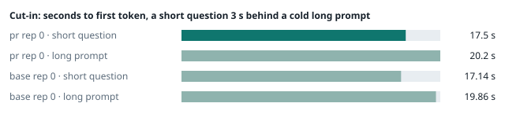
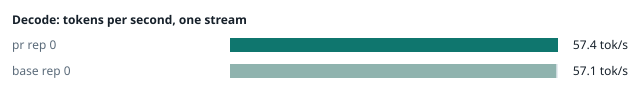
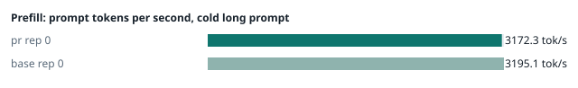
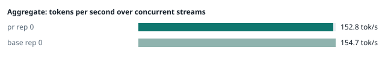
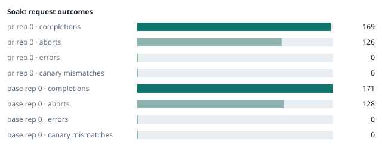

### Evidence: pr vs base

| target | role | image / artifact | model | settings that differ from the control |
|---|---|---|---|---|
| `pr` | candidate | `tensorfold-dsv41:pr-4570ca2a` (131accd2e56a) | `DeepSeek-V4.1-Flash-1017` | - |
| `base` | control | `tensorfold-dsv41:base-476bbc77` (3014a9d4e74f) | `DeepSeek-V4.1-Flash-1017` | baseline |

Conditions: fabric ring; order: A then B, one repetition (no reverse order: pass --opt reps=2 for a counterbalanced run); repetitions: 1; kit cf8a85a.
Restore: live restored (verified: API answers, running artifact is live's).

#### smoke

| target | rep | arithmetic | greedy repeat equal | stream matches | JSON mode | first token (stream) | errors |
|---|---|---|---|---|---|---|---|
| `pr` | 0 | ✓ | ✓ | ✓ | ✓ | 0.091 s | - |
| `base` | 0 | ✓ | ✓ | ✓ | ✓ | 0.092 s | - |

machine state after the suite

- `pr` rep 0: `{"head": {"gpus": ["0, NVIDIA GB10, 2184 MHz, 51, [N/A], [N/A], 22 %"], "load": "load average: 4.41, 2.72, 2.95", "mem_available_mb": "27433"}}`
- `base` rep 0: `{"head": {"gpus": ["0, NVIDIA GB10, 2184 MHz, 55, [N/A], [N/A], 0 %"], "load": "load average: 3.28, 4.83, 4.63", "mem_available_mb": "27456"}}`

#### boundary

**19 of 19** greedy reply hashes identical, `pr` against `base`, over 1 repetition(s).

| rep | prompt | tokens (pr / base) | `pr` | `base` | same |
|---|---|---|---|---|---|
| 0 | len5 | 5 / 5 | `38127fef0fbb` | `38127fef0fbb` | ✓ |
| 0 | len2047 | 2047 / 2047 | `8488ccfbcf35` | `8488ccfbcf35` | ✓ |
| 0 | len2048 | 2048 / 2048 | `c5ac2fb76516` | `c5ac2fb76516` | ✓ |
| 0 | len2049 | 2049 / 2049 | `6766401c9caa` | `6766401c9caa` | ✓ |
| 0 | len4095 | 4095 / 4095 | `ed9e5086f520` | `ed9e5086f520` | ✓ |
| 0 | len4096 | 4096 / 4096 | `52584e31f990` | `52584e31f990` | ✓ |
| 0 | len4097 | 4097 / 4097 | `1a71db317ee7` | `1a71db317ee7` | ✓ |
| 0 | len6143 | 6143 / 6143 | `2f9626e9baf5` | `2f9626e9baf5` | ✓ |
| 0 | len6144 | 6144 / 6144 | `11933f2d4bd7` | `11933f2d4bd7` | ✓ |
| 0 | len6145 | 6145 / 6145 | `7aa2f63b2547` | `7aa2f63b2547` | ✓ |
| 0 | len8193 | 8193 / 8193 | `2ef3dc011922` | `2ef3dc011922` | ✓ |
| 0 | len12289 | 12289 / 12289 | `4fcfbd64881f` | `4fcfbd64881f` | ✓ |
| 0 | pfx_base | 5124 / 5124 | `52afe4842e5d` | `52afe4842e5d` | ✓ |
| 0 | pfx_div3072 | 3376 / 3376 | `64d23fe171dc` | `64d23fe171dc` | ✓ |
| 0 | pfx_div2044 | 2348 / 2348 | `16db99ba02f2` | `16db99ba02f2` | ✓ |
| 0 | pfx_div4092 | 4396 / 4396 | `63798c5ba36c` | `63798c5ba36c` | ✓ |
| 0 | pfx_div4093 | 4397 / 4397 | `6b1cfc31884d` | `6b1cfc31884d` | ✓ |
| 0 | pfx_base_again | 5124 / 5124 | `52afe4842e5d` | `52afe4842e5d` | ✓ |
| 0 | pfx_extend | 6660 / 6660 | `357a869fef18` | `357a869fef18` | ✓ |

machine state after the suite

- `pr` rep 0: `{"head": {"gpus": ["0, NVIDIA GB10, 2171 MHz, 62, [N/A], [N/A], 85 %"], "load": "load average: 5.47, 3.18, 3.10", "mem_available_mb": "27885"}}`
- `base` rep 0: `{"head": {"gpus": ["0, NVIDIA GB10, 2171 MHz, 66, [N/A], [N/A], 96 %"], "load": "load average: 4.27, 4.89, 4.66", "mem_available_mb": "27874"}}`

#### cutin

`pr` rep 0: short question first token **17.5 s** (rounds 17.032–17.888), long prompt first token 20.2 s (rounds 19.78–20.623); 3 rounds
`base` rep 0: short question first token **17.14 s** (rounds 16.994–17.148), long prompt first token 19.86 s (rounds 19.701–19.879); 3 rounds

machine state after the suite

- `pr` rep 0: `{"head": {"gpus": ["0, NVIDIA GB10, 2177 MHz, 67, [N/A], [N/A], 96 %"], "load": "load average: 6.58, 3.96, 3.37", "mem_available_mb": "27850"}}`
- `base` rep 0: `{"head": {"gpus": ["0, NVIDIA GB10, 2184 MHz, 70, [N/A], [N/A], 85 %"], "load": "load average: 6.15, 5.32, 4.82", "mem_available_mb": "27875"}}`

#### perf

| target | rep | decode tok/s, one stream | prefill tok/s, cold long prompt | aggregate tok/s, concurrent streams | errors |
|---|---|---|---|---|---|
| `pr` | 0 | **57.4** (55.8–60.6) | **3172.3** (2722.6–3190.9; 12004 tokens) | **152.8** (140.2–158.8; 4 streams) | - |
| `base` | 0 | **57.1** (55.1–60.6) | **3195.1** (3189.2–3198.5; 12004 tokens) | **154.7** (142.6–158.3; 4 streams) | - |

`pr` against `base`: decode +0.5%, prefill -0.7%, aggregate -1.2% (medians over repetitions; the verdict counts a difference only beyond the rounds' spread, at least ±3 %).

machine state after the suite

- `pr` rep 0: `{"head": {"gpus": ["0, NVIDIA GB10, 2171 MHz, 65, [N/A], [N/A], 96 %"], "load": "load average: 6.15, 4.16, 3.46", "mem_available_mb": "27629"}}`
- `base` rep 0: `{"head": {"gpus": ["0, NVIDIA GB10, 2171 MHz, 68, [N/A], [N/A], 95 %"], "load": "load average: 5.62, 5.28, 4.83", "mem_available_mb": "27557"}}`

#### startup

`pr`: 166.2 s from the switch to the API answering (1 start(s))
`base`: 168.4 s from the switch to the API answering (1 start(s))

#### soak

`pr` rep 0: 169 completions, 126 client aborts, **0 errors**, 61 canary checks with **0 mismatches**
  machine samples, first and last: `{"head": {"gpus": ["0, NVIDIA GB10, 2184 MHz, 65, [N/A], [N/A], 96 %"], "load": "load average: 6.15, 4.16, 3.46", "mem_available_mb": "27542"}}` → `{"head": {"gpus": ["0, NVIDIA GB10, 2177 MHz, 72, [N/A], [N/A], 96 %"], "load": "load average: 6.76, 6.22, 4.89", "mem_available_mb": "26366"}}`
`base` rep 0: 171 completions, 128 client aborts, **0 errors**, 61 canary checks with **0 mismatches**
  machine samples, first and last: `{"head": {"gpus": ["0, NVIDIA GB10, 2177 MHz, 65, [N/A], [N/A], 0 %"], "load": "load average: 5.62, 5.28, 4.83", "mem_available_mb": "27540"}}` → `{"head": {"gpus": ["0, NVIDIA GB10, 2177 MHz, 73, [N/A], [N/A], 96 %"], "load": "load average: 6.47, 6.32, 5.59", "mem_available_mb": "26343"}}`

machine state after the suite

- `pr` rep 0: `{"head": {"gpus": ["0, NVIDIA GB10, 2184 MHz, 60, [N/A], [N/A], 0 %"], "load": "load average: 5.35, 5.99, 4.90", "mem_available_mb": "26283"}}`
- `base` rep 0: `{"head": {"gpus": ["0, NVIDIA GB10, 2184 MHz, 61, [N/A], [N/A], 0 %"], "load": "load average: 5.65, 6.16, 5.59", "mem_available_mb": "26308"}}`

#### repro

| target | role | rep | exit | outcome | expected | as expected |
|---|---|---|---|---|---|---|
| `pr` | candidate | 0 | 0 | passes | passes | ✓ |
| `base` | control | 0 | 1 | fails | fails | ✓ |

**Reproduced on the control and gone on the candidate** (every repetition).

Command: `bash claim.sh {api} {model} {logcmd}`

output of the script (tail)

- `pr` rep 0: `json_schema whole: status=200 finish=stop tool_calls=0 content="{\"name\": \"get_weather\", \"arguments\": {\"city\": \"Oslo\"}}" -> ok json_schema stream: status=200 finish=stop tool_calls=0 content="{\"name\": \"get_weather\", \"arguments\": {\"city\": \"Oslo\"}}" -> ok guided_json whole: status=200 finish=stop tool_calls=0 content="{\"name\": \"get_weather\", \"arguments\": {\"city\": \"Oslo\"}}" -> ok control tool call: status=200 finish=tool_calls calls=['get_weather'] -> ok CLAIM: holds `
- `base` rep 0: `json_schema whole: status=200 finish=tool_calls tool_calls=1 content=null -> FAIL json_schema stream: status=200 finish=tool_calls tool_calls=2 content="{\"name\": \"get_weather\", \"arguments\": {\"city\": \"Oslo\"}}" -> FAIL guided_json whole: status=200 finish=tool_calls tool_calls=1 content=null -> FAIL control tool call: status=200 finish=tool_calls calls=['get_weather'] -> ok CLAIM: does not hold `

machine state after the suite

- `pr` rep 0: `{"head": {"gpus": ["0, NVIDIA GB10, 2177 MHz, 64, [N/A], [N/A], 96 %"], "load": "load average: 5.35, 5.99, 4.90", "mem_available_mb": "26288"}}`
- `base` rep 0: `{"head": {"gpus": ["0, NVIDIA GB10, 2171 MHz, 64, [N/A], [N/A], 96 %"], "load": "load average: 5.65, 6.16, 5.59", "mem_available_mb": "26294"}}`

#### the pull request's own tests

The pull request adds or changes no test file under `tests/`.

#### What this run does not show

- a clean pair exit and recovery after an injected read fault (`fault` did not run)
- an external benchmark against a control (The Grill or similar) (`bench` did not run)
- <!-- add: paths only checked by reading, faults not injected, configurations not run -->

_Generated by inference-agent-kit `report.py` from `20261101T070403/results.json`._
