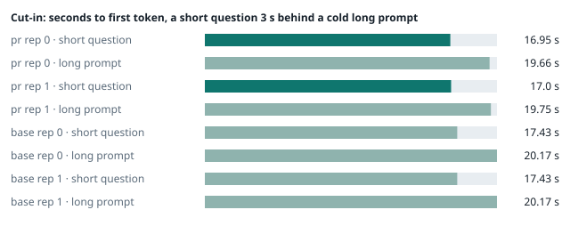
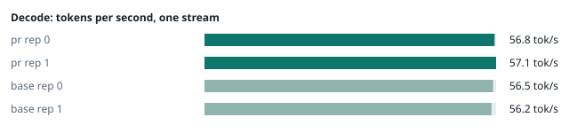
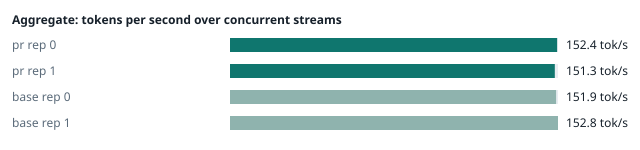
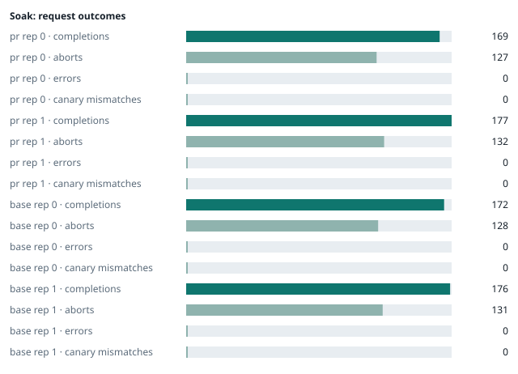

### Evidence: pr vs base

| target | role | image / artifact | model | settings that differ from the control |
|---|---|---|---|---|
| `pr` | candidate | `tensorfold-dsv41:pr-c0e63585` (e01defb80ec3) | `DeepSeek-V4.1-Flash-1017` | - |
| `base` | control | `tensorfold-dsv41:base-476bbc77` (3014a9d4e74f) | `DeepSeek-V4.1-Flash-1017` | baseline |

Conditions: fabric ring; order: counterbalanced over 2 repetitions: A B, then B A; repetitions: 2; kit cf8a85a.
Restore: live restored (verified: API answers, running artifact is live's).

#### smoke

| target | rep | arithmetic | greedy repeat equal | stream matches | JSON mode | first token (stream) | errors |
|---|---|---|---|---|---|---|---|
| `pr` | 0 | ✓ | ✓ | ✓ | ✓ | 0.092 s | - |
| `pr` | 1 | ✓ | ✓ | ✓ | ✓ | 0.095 s | - |
| `base` | 0 | ✓ | ✓ | ✓ | ✓ | 0.093 s | - |
| `base` | 1 | ✓ | ✓ | ✓ | ✓ | 0.099 s | - |

machine state after the suite

- `pr` rep 0: `{"head": {"gpus": ["0, NVIDIA GB10, 2184 MHz, 53, [N/A], [N/A], 95 %"], "load": "load average: 4.30, 2.19, 2.09", "mem_available_mb": "27665"}}`
- `pr` rep 1: `{"head": {"gpus": ["0, NVIDIA GB10, 2177 MHz, 56, [N/A], [N/A], 0 %"], "load": "load average: 4.29, 5.45, 5.84", "mem_available_mb": "27680"}}`
- `base` rep 0: `{"head": {"gpus": ["0, NVIDIA GB10, 2184 MHz, 57, [N/A], [N/A], 94 %"], "load": "load average: 4.75, 5.75, 4.80", "mem_available_mb": "27604"}}`
- `base` rep 1: `{"head": {"gpus": ["0, NVIDIA GB10, 2177 MHz, 61, [N/A], [N/A], 92 %"], "load": "load average: 5.42, 6.33, 5.77", "mem_available_mb": "26400"}}`

#### boundary

**38 of 38** greedy reply hashes identical, `pr` against `base`, over 2 repetition(s).

| rep | prompt | tokens (pr / base) | `pr` | `base` | same |
|---|---|---|---|---|---|
| 0 | len5 | 5 / 5 | `38127fef0fbb` | `38127fef0fbb` | ✓ |
| 0 | len2047 | 2047 / 2047 | `8488ccfbcf35` | `8488ccfbcf35` | ✓ |
| 0 | len2048 | 2048 / 2048 | `c5ac2fb76516` | `c5ac2fb76516` | ✓ |
| 0 | len2049 | 2049 / 2049 | `6766401c9caa` | `6766401c9caa` | ✓ |
| 0 | len4095 | 4095 / 4095 | `ed9e5086f520` | `ed9e5086f520` | ✓ |
| 0 | len4096 | 4096 / 4096 | `52584e31f990` | `52584e31f990` | ✓ |
| 0 | len4097 | 4097 / 4097 | `1a71db317ee7` | `1a71db317ee7` | ✓ |
| 0 | len6143 | 6143 / 6143 | `2f9626e9baf5` | `2f9626e9baf5` | ✓ |
| 0 | len6144 | 6144 / 6144 | `11933f2d4bd7` | `11933f2d4bd7` | ✓ |
| 0 | len6145 | 6145 / 6145 | `7aa2f63b2547` | `7aa2f63b2547` | ✓ |
| 0 | len8193 | 8193 / 8193 | `2ef3dc011922` | `2ef3dc011922` | ✓ |
| 0 | len12289 | 12289 / 12289 | `4fcfbd64881f` | `4fcfbd64881f` | ✓ |
| 0 | pfx_base | 5124 / 5124 | `52afe4842e5d` | `52afe4842e5d` | ✓ |
| 0 | pfx_div3072 | 3376 / 3376 | `64d23fe171dc` | `64d23fe171dc` | ✓ |
| 0 | pfx_div2044 | 2348 / 2348 | `16db99ba02f2` | `16db99ba02f2` | ✓ |
| 0 | pfx_div4092 | 4396 / 4396 | `63798c5ba36c` | `63798c5ba36c` | ✓ |
| 0 | pfx_div4093 | 4397 / 4397 | `6b1cfc31884d` | `6b1cfc31884d` | ✓ |
| 0 | pfx_base_again | 5124 / 5124 | `52afe4842e5d` | `52afe4842e5d` | ✓ |
| 0 | pfx_extend | 6660 / 6660 | `357a869fef18` | `357a869fef18` | ✓ |
| 1 | len5 | 5 / 5 | `38127fef0fbb` | `38127fef0fbb` | ✓ |
| 1 | len2047 | 2047 / 2047 | `8488ccfbcf35` | `8488ccfbcf35` | ✓ |
| 1 | len2048 | 2048 / 2048 | `c5ac2fb76516` | `c5ac2fb76516` | ✓ |
| 1 | len2049 | 2049 / 2049 | `6766401c9caa` | `6766401c9caa` | ✓ |
| 1 | len4095 | 4095 / 4095 | `ed9e5086f520` | `ed9e5086f520` | ✓ |
| 1 | len4096 | 4096 / 4096 | `52584e31f990` | `52584e31f990` | ✓ |
| 1 | len4097 | 4097 / 4097 | `1a71db317ee7` | `1a71db317ee7` | ✓ |
| 1 | len6143 | 6143 / 6143 | `2f9626e9baf5` | `2f9626e9baf5` | ✓ |
| 1 | len6144 | 6144 / 6144 | `11933f2d4bd7` | `11933f2d4bd7` | ✓ |
| 1 | len6145 | 6145 / 6145 | `7aa2f63b2547` | `7aa2f63b2547` | ✓ |
| 1 | len8193 | 8193 / 8193 | `2ef3dc011922` | `2ef3dc011922` | ✓ |
| 1 | len12289 | 12289 / 12289 | `4fcfbd64881f` | `4fcfbd64881f` | ✓ |
| 1 | pfx_base | 5124 / 5124 | `52afe4842e5d` | `52afe4842e5d` | ✓ |
| 1 | pfx_div3072 | 3376 / 3376 | `64d23fe171dc` | `64d23fe171dc` | ✓ |
| 1 | pfx_div2044 | 2348 / 2348 | `16db99ba02f2` | `16db99ba02f2` | ✓ |
| 1 | pfx_div4092 | 4396 / 4396 | `63798c5ba36c` | `63798c5ba36c` | ✓ |
| 1 | pfx_div4093 | 4397 / 4397 | `6b1cfc31884d` | `6b1cfc31884d` | ✓ |
| 1 | pfx_base_again | 5124 / 5124 | `52afe4842e5d` | `52afe4842e5d` | ✓ |
| 1 | pfx_extend | 6660 / 6660 | `357a869fef18` | `357a869fef18` | ✓ |

machine state after the suite

- `pr` rep 0: `{"head": {"gpus": ["0, NVIDIA GB10, 2171 MHz, 62, [N/A], [N/A], 96 %"], "load": "load average: 5.73, 2.76, 2.29", "mem_available_mb": "27976"}}`
- `pr` rep 1: `{"head": {"gpus": ["0, NVIDIA GB10, 2171 MHz, 66, [N/A], [N/A], 96 %"], "load": "load average: 5.31, 5.59, 5.88", "mem_available_mb": "28014"}}`
- `base` rep 0: `{"head": {"gpus": ["0, NVIDIA GB10, 2171 MHz, 63, [N/A], [N/A], 0 %"], "load": "load average: 5.33, 5.79, 4.85", "mem_available_mb": "28096"}}`
- `base` rep 1: `{"head": {"gpus": ["0, NVIDIA GB10, 2171 MHz, 66, [N/A], [N/A], 0 %"], "load": "load average: 5.83, 6.34, 5.80", "mem_available_mb": "26428"}}`

#### cutin

`pr` rep 0: short question first token **16.95 s** (rounds 16.927–16.949), long prompt first token 19.66 s (rounds 19.614–19.692); 3 rounds
`pr` rep 1: short question first token **17.0 s** (rounds 16.96–17.034), long prompt first token 19.75 s (rounds 19.672–19.765); 3 rounds
`base` rep 0: short question first token **17.43 s** (rounds 17.195–17.554), long prompt first token 20.17 s (rounds 19.926–20.267); 3 rounds
`base` rep 1: short question first token **17.43 s** (rounds 17.037–17.457), long prompt first token 20.17 s (rounds 19.781–20.176); 3 rounds

machine state after the suite

- `pr` rep 0: `{"head": {"gpus": ["0, NVIDIA GB10, 2177 MHz, 69, [N/A], [N/A], 90 %"], "load": "load average: 6.76, 3.62, 2.61", "mem_available_mb": "28022"}}`
- `pr` rep 1: `{"head": {"gpus": ["0, NVIDIA GB10, 2184 MHz, 70, [N/A], [N/A], 79 %"], "load": "load average: 6.76, 5.98, 6.00", "mem_available_mb": "27929"}}`
- `base` rep 0: `{"head": {"gpus": ["0, NVIDIA GB10, 2177 MHz, 69, [N/A], [N/A], 86 %"], "load": "load average: 6.65, 6.12, 5.03", "mem_available_mb": "27953"}}`
- `base` rep 1: `{"head": {"gpus": ["0, NVIDIA GB10, 2184 MHz, 68, [N/A], [N/A], 0 %"], "load": "load average: 6.68, 6.51, 5.90", "mem_available_mb": "26393"}}`

#### perf

| target | rep | decode tok/s, one stream | prefill tok/s, cold long prompt | aggregate tok/s, concurrent streams | errors |
|---|---|---|---|---|---|
| `pr` | 0 | **56.8** (55.2–60.7) | **3194.3** (3171.5–3196.8; 12004 tokens) | **152.4** (141.2–157.4; 4 streams) | - |
| `pr` | 1 | **57.1** (54.9–60.3) | **3195.1** (3192.6–3201.9; 12004 tokens) | **151.3** (142.0–158.0; 4 streams) | - |
| `base` | 0 | **56.5** (54.3–60.4) | **3177.3** (2989.8–3193.4; 12004 tokens) | **151.9** (136.5–157.9; 4 streams) | - |
| `base` | 1 | **56.2** (54.7–60.2) | **3168.1** (2972.0–3190.0; 12004 tokens) | **152.8** (147.9–155.0; 4 streams) | - |

`pr` against `base`: decode +1.1%, prefill +0.7%, aggregate -0.3% (medians over repetitions; the verdict counts a difference only beyond the rounds' spread, at least ±3 %).

machine state after the suite

- `pr` rep 0: `{"head": {"gpus": ["0, NVIDIA GB10, 2177 MHz, 63, [N/A], [N/A], 95 %"], "load": "load average: 6.02, 3.79, 2.71", "mem_available_mb": "27706"}}`
- `pr` rep 1: `{"head": {"gpus": ["0, NVIDIA GB10, 2177 MHz, 65, [N/A], [N/A], 96 %"], "load": "load average: 5.70, 5.81, 5.94", "mem_available_mb": "27621"}}`
- `base` rep 0: `{"head": {"gpus": ["0, NVIDIA GB10, 2171 MHz, 64, [N/A], [N/A], 96 %"], "load": "load average: 6.06, 6.02, 5.04", "mem_available_mb": "27603"}}`
- `base` rep 1: `{"head": {"gpus": ["0, NVIDIA GB10, 2177 MHz, 65, [N/A], [N/A], 96 %"], "load": "load average: 6.22, 6.41, 5.89", "mem_available_mb": "26381"}}`

#### startup

`pr`: 166.5 s, 167.6 s from the switch to the API answering (2 start(s))
`base`: 168.7 s from the switch to the API answering (1 start(s))

#### soak

`pr` rep 0: 169 completions, 127 client aborts, **0 errors**, 61 canary checks with **0 mismatches**
  machine samples, first and last: `{"head": {"gpus": ["0, NVIDIA GB10, 2177 MHz, 63, [N/A], [N/A], 0 %"], "load": "load average: 6.34, 3.90, 2.75", "mem_available_mb": "27683"}}` → `{"head": {"gpus": ["0, NVIDIA GB10, 2177 MHz, 72, [N/A], [N/A], 96 %"], "load": "load average: 7.34, 6.65, 4.74", "mem_available_mb": "26496"}}`
`pr` rep 1: 177 completions, 132 client aborts, **0 errors**, 61 canary checks with **0 mismatches**
  machine samples, first and last: `{"head": {"gpus": ["0, NVIDIA GB10, 2177 MHz, 66, [N/A], [N/A], 0 %"], "load": "load average: 5.70, 5.81, 5.94", "mem_available_mb": "27618"}}` → `{"head": {"gpus": ["0, NVIDIA GB10, 2177 MHz, 71, [N/A], [N/A], 96 %"], "load": "load average: 6.03, 6.14, 6.07", "mem_available_mb": "26393"}}`
`base` rep 0: 172 completions, 128 client aborts, **0 errors**, 58 canary checks with **0 mismatches**
  machine samples, first and last: `{"head": {"gpus": ["0, NVIDIA GB10, 2177 MHz, 68, [N/A], [N/A], 0 %"], "load": "load average: 6.06, 6.02, 5.04", "mem_available_mb": "27588"}}` → `{"head": {"gpus": ["0, NVIDIA GB10, 2177 MHz, 70, [N/A], [N/A], 96 %"], "load": "load average: 6.61, 6.63, 5.82", "mem_available_mb": "26488"}}`
`base` rep 1: 176 completions, 131 client aborts, **0 errors**, 63 canary checks with **0 mismatches**
  machine samples, first and last: `{"head": {"gpus": ["0, NVIDIA GB10, 2177 MHz, 65, [N/A], [N/A], 0 %"], "load": "load average: 6.22, 6.41, 5.89", "mem_available_mb": "26364"}}` → `{"head": {"gpus": ["0, NVIDIA GB10, 2177 MHz, 66, [N/A], [N/A], 96 %"], "load": "load average: 6.38, 6.54, 6.20", "mem_available_mb": "26360"}}`

machine state after the suite

- `pr` rep 0: `{"head": {"gpus": ["0, NVIDIA GB10, 2184 MHz, 61, [N/A], [N/A], 0 %"], "load": "load average: 6.27, 6.53, 4.82", "mem_available_mb": "26342"}}`
- `pr` rep 1: `{"head": {"gpus": ["0, NVIDIA GB10, 2184 MHz, 61, [N/A], [N/A], 0 %"], "load": "load average: 5.78, 6.09, 6.06", "mem_available_mb": "26334"}}`
- `base` rep 0: `{"head": {"gpus": ["0, NVIDIA GB10, 2184 MHz, 60, [N/A], [N/A], 0 %"], "load": "load average: 5.46, 6.35, 5.78", "mem_available_mb": "26401"}}`
- `base` rep 1: `{"head": {"gpus": ["0, NVIDIA GB10, 2184 MHz, 61, [N/A], [N/A], 0 %"], "load": "load average: 6.38, 6.55, 6.23", "mem_available_mb": "26360"}}`

#### the pull request's own tests

The pull request adds or changes no test file under `tests/`.

#### What this run does not show

- a clean pair exit and recovery after an injected read fault (`fault` did not run)
- an external benchmark against a control (The Grill or similar) (`bench` did not run)
- <!-- add: paths only checked by reading, faults not injected, configurations not run -->

_Generated by inference-agent-kit `report.py` from `20261101T075826/results.json`._
