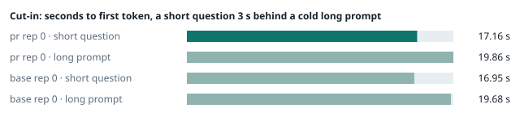
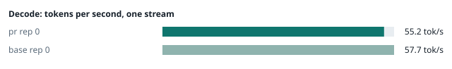
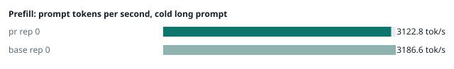
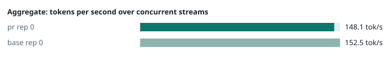
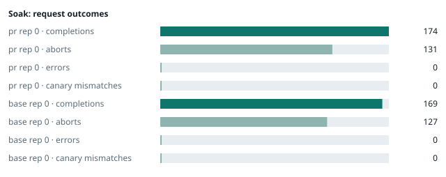

### Evidence: pr vs base

| target | role | image / artifact | model | settings that differ from the control |
|---|---|---|---|---|
| `pr` | candidate | `tensorfold-dsv41:pr-5384fe1e` (c19b9fa52529) | `DeepSeek-V4.1-Flash-1017` | - |
| `base` | control | `tensorfold-dsv41:base-476bbc77` (3014a9d4e74f) | `DeepSeek-V4.1-Flash-1017` | baseline |

Conditions: fabric ring; order: A then B, one repetition (no reverse order: pass --opt reps=2 for a counterbalanced run); repetitions: 1; kit cf8a85a.
Restore: live restored (verified: API answers, running artifact is live's).

#### smoke

| target | rep | arithmetic | greedy repeat equal | stream matches | JSON mode | first token (stream) | errors |
|---|---|---|---|---|---|---|---|
| `pr` | 0 | ✓ | ✓ | ✓ | ✓ | 0.09 s | - |
| `base` | 0 | ✓ | ✓ | ✓ | ✓ | 0.092 s | - |

machine state after the suite

- `pr` rep 0: `{"head": {"gpus": ["0, NVIDIA GB10, 2184 MHz, 55, [N/A], [N/A], 96 %"], "load": "load average: 6.68, 2.70, 1.29", "mem_available_mb": "27673"}}`
- `base` rep 0: `{"head": {"gpus": ["0, NVIDIA GB10, 2177 MHz, 57, [N/A], [N/A], 89 %"], "load": "load average: 3.59, 5.06, 4.10", "mem_available_mb": "27692"}}`

#### boundary

**19 of 19** greedy reply hashes identical, `pr` against `base`, over 1 repetition(s).

| rep | prompt | tokens (pr / base) | `pr` | `base` | same |
|---|---|---|---|---|---|
| 0 | len5 | 5 / 5 | `38127fef0fbb` | `38127fef0fbb` | ✓ |
| 0 | len2047 | 2047 / 2047 | `8488ccfbcf35` | `8488ccfbcf35` | ✓ |
| 0 | len2048 | 2048 / 2048 | `c5ac2fb76516` | `c5ac2fb76516` | ✓ |
| 0 | len2049 | 2049 / 2049 | `6766401c9caa` | `6766401c9caa` | ✓ |
| 0 | len4095 | 4095 / 4095 | `ed9e5086f520` | `ed9e5086f520` | ✓ |
| 0 | len4096 | 4096 / 4096 | `52584e31f990` | `52584e31f990` | ✓ |
| 0 | len4097 | 4097 / 4097 | `1a71db317ee7` | `1a71db317ee7` | ✓ |
| 0 | len6143 | 6143 / 6143 | `2f9626e9baf5` | `2f9626e9baf5` | ✓ |
| 0 | len6144 | 6144 / 6144 | `11933f2d4bd7` | `11933f2d4bd7` | ✓ |
| 0 | len6145 | 6145 / 6145 | `7aa2f63b2547` | `7aa2f63b2547` | ✓ |
| 0 | len8193 | 8193 / 8193 | `2ef3dc011922` | `2ef3dc011922` | ✓ |
| 0 | len12289 | 12289 / 12289 | `4fcfbd64881f` | `4fcfbd64881f` | ✓ |
| 0 | pfx_base | 5124 / 5124 | `52afe4842e5d` | `52afe4842e5d` | ✓ |
| 0 | pfx_div3072 | 3376 / 3376 | `64d23fe171dc` | `64d23fe171dc` | ✓ |
| 0 | pfx_div2044 | 2348 / 2348 | `16db99ba02f2` | `16db99ba02f2` | ✓ |
| 0 | pfx_div4092 | 4396 / 4396 | `63798c5ba36c` | `63798c5ba36c` | ✓ |
| 0 | pfx_div4093 | 4397 / 4397 | `6b1cfc31884d` | `6b1cfc31884d` | ✓ |
| 0 | pfx_base_again | 5124 / 5124 | `52afe4842e5d` | `52afe4842e5d` | ✓ |
| 0 | pfx_extend | 6660 / 6660 | `357a869fef18` | `357a869fef18` | ✓ |

machine state after the suite

- `pr` rep 0: `{"head": {"gpus": ["0, NVIDIA GB10, 2171 MHz, 63, [N/A], [N/A], 96 %"], "load": "load average: 6.62, 3.13, 1.49", "mem_available_mb": "27376"}}`
- `base` rep 0: `{"head": {"gpus": ["0, NVIDIA GB10, 2171 MHz, 66, [N/A], [N/A], 96 %"], "load": "load average: 5.03, 5.26, 4.20", "mem_available_mb": "27302"}}`

#### cutin

`pr` rep 0: short question first token **17.16 s** (rounds 16.993–17.322), long prompt first token 19.86 s (rounds 19.701–20.078); 3 rounds
`base` rep 0: short question first token **16.95 s** (rounds 16.928–16.989), long prompt first token 19.68 s (rounds 19.685–19.686); 3 rounds

machine state after the suite

- `pr` rep 0: `{"head": {"gpus": ["0, NVIDIA GB10, 2177 MHz, 65, [N/A], [N/A], 96 %"], "load": "load average: 7.29, 3.97, 1.88", "mem_available_mb": "27280"}}`
- `base` rep 0: `{"head": {"gpus": ["0, NVIDIA GB10, 2177 MHz, 69, [N/A], [N/A], 96 %"], "load": "load average: 6.41, 5.68, 4.42", "mem_available_mb": "27259"}}`

#### perf

| target | rep | decode tok/s, one stream | prefill tok/s, cold long prompt | aggregate tok/s, concurrent streams | errors |
|---|---|---|---|---|---|
| `pr` | 0 | **55.2** (55.2–60.0) | **3122.8** (3105.0–3158.1; 12004 tokens) | **148.1** (140.9–152.9; 4 streams) | - |
| `base` | 0 | **57.7** (56.1–60.6) | **3186.6** (3154.0–3190.0; 12004 tokens) | **152.5** (140.2–158.3; 4 streams) | - |

`pr` against `base`: decode -4.3%, prefill -2.0%, aggregate -2.9% (medians over repetitions; the verdict counts a difference only beyond the rounds' spread, at least ±3 %).

machine state after the suite

- `pr` rep 0: `{"head": {"gpus": ["0, NVIDIA GB10, 2171 MHz, 66, [N/A], [N/A], 96 %"], "load": "load average: 6.31, 4.12, 2.02", "mem_available_mb": "26955"}}`
- `base` rep 0: `{"head": {"gpus": ["0, NVIDIA GB10, 2171 MHz, 64, [N/A], [N/A], 0 %"], "load": "load average: 6.09, 5.69, 4.47", "mem_available_mb": "26995"}}`

#### startup

`pr`: 101.8 s from the switch to the API answering (1 start(s))
`base`: 167.4 s from the switch to the API answering (1 start(s))

#### soak

`pr` rep 0: 174 completions, 131 client aborts, **0 errors**, 62 canary checks with **0 mismatches**
  machine samples, first and last: `{"head": {"gpus": ["0, NVIDIA GB10, 2177 MHz, 63, [N/A], [N/A], 0 %"], "load": "load average: 6.31, 4.12, 2.02", "mem_available_mb": "26942"}}` → `{"head": {"gpus": ["0, NVIDIA GB10, 2177 MHz, 68, [N/A], [N/A], 96 %"], "load": "load average: 6.77, 6.17, 4.06", "mem_available_mb": "25828"}}`
`base` rep 0: 169 completions, 127 client aborts, **0 errors**, 61 canary checks with **0 mismatches**
  machine samples, first and last: `{"head": {"gpus": ["0, NVIDIA GB10, 2177 MHz, 65, [N/A], [N/A], 56 %"], "load": "load average: 6.09, 5.69, 4.47", "mem_available_mb": "26918"}}` → `{"head": {"gpus": ["0, NVIDIA GB10, 2177 MHz, 71, [N/A], [N/A], 96 %"], "load": "load average: 6.71, 6.37, 5.36", "mem_available_mb": "25798"}}`

machine state after the suite

- `pr` rep 0: `{"head": {"gpus": ["0, NVIDIA GB10, 2184 MHz, 57, [N/A], [N/A], 0 %"], "load": "load average: 6.06, 6.18, 4.20", "mem_available_mb": "25764"}}`
- `base` rep 0: `{"head": {"gpus": ["0, NVIDIA GB10, 2184 MHz, 61, [N/A], [N/A], 0 %"], "load": "load average: 5.70, 6.21, 5.37", "mem_available_mb": "25709"}}`

#### the pull request's own tests

**confirmed** — 7 test file(s) added or changed by the PR (`tests/test_launcher_locks.py`, `tests/test_mesh_bootstrap.py`, `tests/test_prepare_image.py`, `tests/test_scripts.py`, `tests/test_start_smoke.py`, `tests/test_start_urls.py`, `tests/test_stop_health.py`): on the PR **passes** (exit 0), on the base with the PR's tests copied in **fails** (exit 1).

- PR: `............................................... [ 43%] .............................................................                                                        [100%] 108 passed, 53 subtests passed in 37.64s`
- base + PR tests: `FAILED tests/test_stop_health.py::StopHealth::test_transport_failure_is_unknown - AssertionError: 'could not read the open requests from /health' not found in '[stop.sh] DRY_RUN=1: would stop and remove dsv41-1017-tf here, on w1, on w2, on w3 (up to 30s); nothing is stopped\n[dry-run] rank 0 here:\n`

#### What this run does not show

- a clean pair exit and recovery after an injected read fault (`fault` did not run)
- an external benchmark against a control (The Grill or similar) (`bench` did not run)
- <!-- add: paths only checked by reading, faults not injected, configurations not run -->

_Generated by inference-agent-kit `report.py` from `20261101T135752/results.json`._
