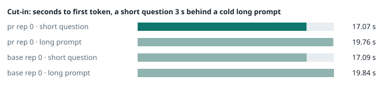
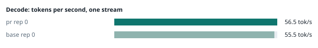
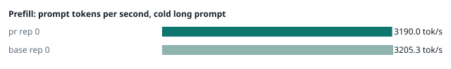
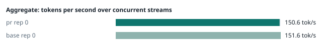
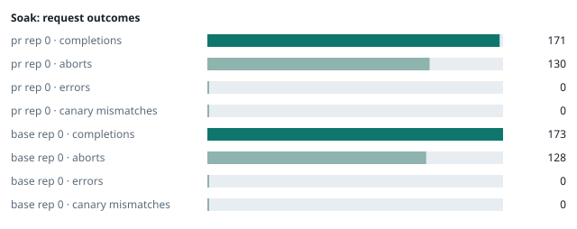

### Evidence: pr vs base

| target | role | image / artifact | model | settings that differ from the control |
|---|---|---|---|---|
| `pr` | candidate | `tensorfold-dsv41:pr-f2e3fd77` (c19b9fa52529) | `DeepSeek-V4.1-Flash-1017` | - |
| `base` | control | `tensorfold-dsv41:base-fcef6cf2` (5a94966d9621) | `DeepSeek-V4.1-Flash-1017` | baseline |

Conditions: fabric ring; order: A then B, one repetition (no reverse order: pass --opt reps=2 for a counterbalanced run); repetitions: 1; kit cf8a85a.
Restore: live restored (verified: API answers, running artifact is live's).

#### smoke

| target | rep | arithmetic | greedy repeat equal | stream matches | JSON mode | first token (stream) | errors |
|---|---|---|---|---|---|---|---|
| `pr` | 0 | ✓ | ✓ | ✓ | ✓ | 0.09 s | - |
| `base` | 0 | ✓ | ✓ | ✓ | ✓ | 0.089 s | - |

machine state after the suite

- `pr` rep 0: `{"head": {"gpus": ["0, NVIDIA GB10, 2184 MHz, 57, [N/A], [N/A], 84 %"], "load": "load average: 6.97, 2.86, 1.64", "mem_available_mb": "27989"}}`
- `base` rep 0: `{"head": {"gpus": ["0, NVIDIA GB10, 2177 MHz, 62, [N/A], [N/A], 37 %"], "load": "load average: 7.95, 6.84, 4.76", "mem_available_mb": "27094"}}`

#### boundary

**19 of 19** greedy reply hashes identical, `pr` against `base`, over 1 repetition(s).

| rep | prompt | tokens (pr / base) | `pr` | `base` | same |
|---|---|---|---|---|---|
| 0 | len5 | 5 / 5 | `38127fef0fbb` | `38127fef0fbb` | ✓ |
| 0 | len2047 | 2047 / 2047 | `8488ccfbcf35` | `8488ccfbcf35` | ✓ |
| 0 | len2048 | 2048 / 2048 | `c5ac2fb76516` | `c5ac2fb76516` | ✓ |
| 0 | len2049 | 2049 / 2049 | `6766401c9caa` | `6766401c9caa` | ✓ |
| 0 | len4095 | 4095 / 4095 | `ed9e5086f520` | `ed9e5086f520` | ✓ |
| 0 | len4096 | 4096 / 4096 | `52584e31f990` | `52584e31f990` | ✓ |
| 0 | len4097 | 4097 / 4097 | `1a71db317ee7` | `1a71db317ee7` | ✓ |
| 0 | len6143 | 6143 / 6143 | `2f9626e9baf5` | `2f9626e9baf5` | ✓ |
| 0 | len6144 | 6144 / 6144 | `11933f2d4bd7` | `11933f2d4bd7` | ✓ |
| 0 | len6145 | 6145 / 6145 | `7aa2f63b2547` | `7aa2f63b2547` | ✓ |
| 0 | len8193 | 8193 / 8193 | `2ef3dc011922` | `2ef3dc011922` | ✓ |
| 0 | len12289 | 12289 / 12289 | `4fcfbd64881f` | `4fcfbd64881f` | ✓ |
| 0 | pfx_base | 5124 / 5124 | `52afe4842e5d` | `52afe4842e5d` | ✓ |
| 0 | pfx_div3072 | 3376 / 3376 | `64d23fe171dc` | `64d23fe171dc` | ✓ |
| 0 | pfx_div2044 | 2348 / 2348 | `16db99ba02f2` | `16db99ba02f2` | ✓ |
| 0 | pfx_div4092 | 4396 / 4396 | `63798c5ba36c` | `63798c5ba36c` | ✓ |
| 0 | pfx_div4093 | 4397 / 4397 | `6b1cfc31884d` | `6b1cfc31884d` | ✓ |
| 0 | pfx_base_again | 5124 / 5124 | `52afe4842e5d` | `52afe4842e5d` | ✓ |
| 0 | pfx_extend | 6660 / 6660 | `357a869fef18` | `357a869fef18` | ✓ |

machine state after the suite

- `pr` rep 0: `{"head": {"gpus": ["0, NVIDIA GB10, 2171 MHz, 63, [N/A], [N/A], 0 %"], "load": "load average: 6.60, 3.24, 1.81", "mem_available_mb": "27635"}}`
- `base` rep 0: `{"head": {"gpus": ["0, NVIDIA GB10, 2171 MHz, 69, [N/A], [N/A], 96 %"], "load": "load average: 6.65, 6.67, 4.78", "mem_available_mb": "27666"}}`

#### cutin

`pr` rep 0: short question first token **17.07 s** (rounds 16.896–17.233), long prompt first token 19.76 s (rounds 19.633–19.947); 3 rounds
`base` rep 0: short question first token **17.09 s** (rounds 16.912–17.273), long prompt first token 19.84 s (rounds 19.623–19.979); 3 rounds

machine state after the suite

- `pr` rep 0: `{"head": {"gpus": ["0, NVIDIA GB10, 2184 MHz, 67, [N/A], [N/A], 79 %"], "load": "load average: 7.12, 3.99, 2.16", "mem_available_mb": "27584"}}`
- `base` rep 0: `{"head": {"gpus": ["0, NVIDIA GB10, 2177 MHz, 68, [N/A], [N/A], 0 %"], "load": "load average: 7.39, 6.87, 4.97", "mem_available_mb": "27531"}}`

#### perf

| target | rep | decode tok/s, one stream | prefill tok/s, cold long prompt | aggregate tok/s, concurrent streams | errors |
|---|---|---|---|---|---|
| `pr` | 0 | **56.5** (55.6–60.1) | **3190.0** (3179.0–3191.7; 12004 tokens) | **150.6** (141.0–156.2; 4 streams) | - |
| `base` | 0 | **55.5** (55.3–60.2) | **3205.3** (3198.5–3207.1; 12004 tokens) | **151.6** (141.2–156.6; 4 streams) | - |

`pr` against `base`: decode +1.8%, prefill -0.5%, aggregate -0.7% (medians over repetitions; the verdict counts a difference only beyond the rounds' spread, at least ±3 %).

machine state after the suite

- `pr` rep 0: `{"head": {"gpus": ["0, NVIDIA GB10, 2171 MHz, 67, [N/A], [N/A], 96 %"], "load": "load average: 6.50, 4.19, 2.30", "mem_available_mb": "27277"}}`
- `base` rep 0: `{"head": {"gpus": ["0, NVIDIA GB10, 2171 MHz, 69, [N/A], [N/A], 96 %"], "load": "load average: 6.51, 6.71, 4.99", "mem_available_mb": "27304"}}`

#### startup

`pr`: 101.4 s from the switch to the API answering (1 start(s))
`base`: 100.8 s from the switch to the API answering (1 start(s))

#### soak

`pr` rep 0: 171 completions, 130 client aborts, **0 errors**, 61 canary checks with **0 mismatches**
  machine samples, first and last: `{"head": {"gpus": ["0, NVIDIA GB10, 2177 MHz, 67, [N/A], [N/A], 96 %"], "load": "load average: 6.30, 4.19, 2.31", "mem_available_mb": "27217"}}` → `{"head": {"gpus": ["0, NVIDIA GB10, 2184 MHz, 72, [N/A], [N/A], 96 %"], "load": "load average: 6.70, 6.21, 4.21", "mem_available_mb": "26110"}}`
`base` rep 0: 173 completions, 128 client aborts, **0 errors**, 58 canary checks with **0 mismatches**
  machine samples, first and last: `{"head": {"gpus": ["0, NVIDIA GB10, 2177 MHz, 66, [N/A], [N/A], 0 %"], "load": "load average: 6.51, 6.71, 4.99", "mem_available_mb": "27246"}}` → `{"head": {"gpus": ["0, NVIDIA GB10, 2184 MHz, 73, [N/A], [N/A], 95 %"], "load": "load average: 7.30, 6.77, 5.77", "mem_available_mb": "26048"}}`

machine state after the suite

- `pr` rep 0: `{"head": {"gpus": ["0, NVIDIA GB10, 2177 MHz, 64, [N/A], [N/A], 0 %"], "load": "load average: 5.91, 6.11, 4.31", "mem_available_mb": "25997"}}`
- `base` rep 0: `{"head": {"gpus": ["0, NVIDIA GB10, 2177 MHz, 63, [N/A], [N/A], 0 %"], "load": "load average: 6.15, 6.60, 5.78", "mem_available_mb": "25951"}}`

#### the pull request's own tests

**confirmed** — 1 test file(s) added or changed by the PR (`tests/test_scripts.py`): on the PR **passes** (exit 0), on the base with the PR's tests copied in **fails** (exit 1).

- PR: `............................................... [ 77%] ..............                                                     [100%] 61 passed, 31 subtests passed in 22.99s`
- base + PR tests: `FAILED tests/test_scripts.py::LauncherHint::test_launcher_fits_the_fabric - AssertionError: 127 != 0 : /usr/bin/bash: line 5: launcher: command not found FAILED tests/test_scripts.py::LauncherHint::test_prepare_names_the_launcher_for_the_fabric_it_found - AssertionError: 'Start the server with ./sta`

#### What this run does not show

- a clean pair exit and recovery after an injected read fault (`fault` did not run)
- an external benchmark against a control (The Grill or similar) (`bench` did not run)
- <!-- add: paths only checked by reading, faults not injected, configurations not run -->

_Generated by inference-agent-kit `report.py` from `20261101T154242/results.json`._
