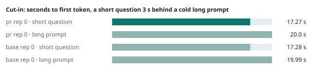
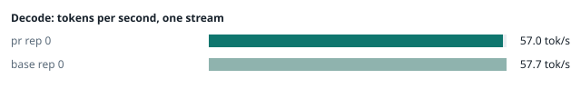
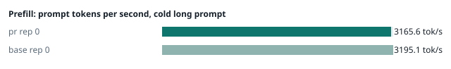
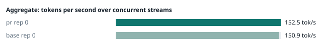
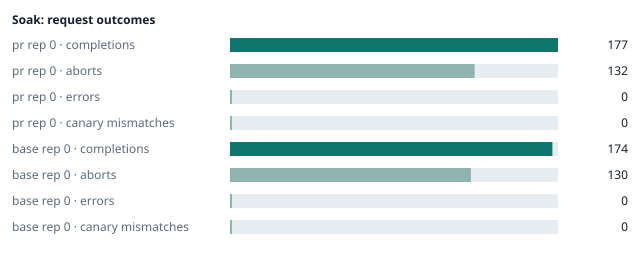

### Evidence: pr vs base

| target | role | image / artifact | model | settings that differ from the control |
|---|---|---|---|---|
| `pr` | candidate | `tensorfold-dsv41:pr-9f02691a` (30d83f4cb62c) | `DeepSeek-V4.1-Flash-1017` | - |
| `base` | control | `tensorfold-dsv41:base-fcef6cf2` (5a94966d9621) | `DeepSeek-V4.1-Flash-1017` | baseline |

Conditions: fabric ring; order: A then B, one repetition (no reverse order: pass --opt reps=2 for a counterbalanced run); repetitions: 1; kit cf8a85a.
Restore: live restored (verified: API answers, running artifact is live's).

#### smoke

| target | rep | arithmetic | greedy repeat equal | stream matches | JSON mode | first token (stream) | errors |
|---|---|---|---|---|---|---|---|
| `pr` | 0 | ✓ | ✓ | ✓ | ✓ | 0.089 s | - |
| `base` | 0 | ✓ | ✓ | ✓ | ✓ | 0.091 s | - |

machine state after the suite

- `pr` rep 0: `{"head": {"gpus": ["0, NVIDIA GB10, 2177 MHz, 56, [N/A], [N/A], 77 %"], "load": "load average: 6.83, 2.84, 2.67", "mem_available_mb": "27446"}}`
- `base` rep 0: `{"head": {"gpus": ["0, NVIDIA GB10, 2184 MHz, 60, [N/A], [N/A], 0 %"], "load": "load average: 7.40, 6.68, 5.14", "mem_available_mb": "27458"}}`

#### boundary

**19 of 19** greedy reply hashes identical, `pr` against `base`, over 1 repetition(s).

| rep | prompt | tokens (pr / base) | `pr` | `base` | same |
|---|---|---|---|---|---|
| 0 | len5 | 5 / 5 | `38127fef0fbb` | `38127fef0fbb` | ✓ |
| 0 | len2047 | 2047 / 2047 | `8488ccfbcf35` | `8488ccfbcf35` | ✓ |
| 0 | len2048 | 2048 / 2048 | `c5ac2fb76516` | `c5ac2fb76516` | ✓ |
| 0 | len2049 | 2049 / 2049 | `6766401c9caa` | `6766401c9caa` | ✓ |
| 0 | len4095 | 4095 / 4095 | `ed9e5086f520` | `ed9e5086f520` | ✓ |
| 0 | len4096 | 4096 / 4096 | `52584e31f990` | `52584e31f990` | ✓ |
| 0 | len4097 | 4097 / 4097 | `1a71db317ee7` | `1a71db317ee7` | ✓ |
| 0 | len6143 | 6143 / 6143 | `2f9626e9baf5` | `2f9626e9baf5` | ✓ |
| 0 | len6144 | 6144 / 6144 | `11933f2d4bd7` | `11933f2d4bd7` | ✓ |
| 0 | len6145 | 6145 / 6145 | `7aa2f63b2547` | `7aa2f63b2547` | ✓ |
| 0 | len8193 | 8193 / 8193 | `2ef3dc011922` | `2ef3dc011922` | ✓ |
| 0 | len12289 | 12289 / 12289 | `4fcfbd64881f` | `4fcfbd64881f` | ✓ |
| 0 | pfx_base | 5124 / 5124 | `52afe4842e5d` | `52afe4842e5d` | ✓ |
| 0 | pfx_div3072 | 3376 / 3376 | `64d23fe171dc` | `64d23fe171dc` | ✓ |
| 0 | pfx_div2044 | 2348 / 2348 | `16db99ba02f2` | `16db99ba02f2` | ✓ |
| 0 | pfx_div4092 | 4396 / 4396 | `63798c5ba36c` | `63798c5ba36c` | ✓ |
| 0 | pfx_div4093 | 4397 / 4397 | `6b1cfc31884d` | `6b1cfc31884d` | ✓ |
| 0 | pfx_base_again | 5124 / 5124 | `52afe4842e5d` | `52afe4842e5d` | ✓ |
| 0 | pfx_extend | 6660 / 6660 | `357a869fef18` | `357a869fef18` | ✓ |

machine state after the suite

- `pr` rep 0: `{"head": {"gpus": ["0, NVIDIA GB10, 2177 MHz, 63, [N/A], [N/A], 11 %"], "load": "load average: 6.48, 3.19, 2.80", "mem_available_mb": "27750"}}`
- `base` rep 0: `{"head": {"gpus": ["0, NVIDIA GB10, 2171 MHz, 69, [N/A], [N/A], 96 %"], "load": "load average: 6.80, 6.61, 5.17", "mem_available_mb": "27821"}}`

#### cutin

`pr` rep 0: short question first token **17.27 s** (rounds 16.999–17.391), long prompt first token 20.0 s (rounds 19.714–20.15); 3 rounds
`base` rep 0: short question first token **17.28 s** (rounds 16.864–17.643), long prompt first token 19.99 s (rounds 19.624–20.382); 3 rounds

machine state after the suite

- `pr` rep 0: `{"head": {"gpus": ["0, NVIDIA GB10, 2184 MHz, 70, [N/A], [N/A], 96 %"], "load": "load average: 6.94, 4.01, 3.11", "mem_available_mb": "27745"}}`
- `base` rep 0: `{"head": {"gpus": ["0, NVIDIA GB10, 2184 MHz, 70, [N/A], [N/A], 6 %"], "load": "load average: 7.16, 6.74, 5.31", "mem_available_mb": "27688"}}`

#### perf

| target | rep | decode tok/s, one stream | prefill tok/s, cold long prompt | aggregate tok/s, concurrent streams | errors |
|---|---|---|---|---|---|
| `pr` | 0 | **57.0** (56.0–60.9) | **3165.6** (3158.9–3195.1; 12004 tokens) | **152.5** (139.3–152.8; 4 streams) | - |
| `base` | 0 | **57.7** (56.2–58.1) | **3195.1** (3193.4–3198.5; 12004 tokens) | **150.9** (141.1–152.4; 4 streams) | - |

`pr` against `base`: decode -1.2%, prefill -0.9%, aggregate +1.1% (medians over repetitions; the verdict counts a difference only beyond the rounds' spread, at least ±3 %).

machine state after the suite

- `pr` rep 0: `{"head": {"gpus": ["0, NVIDIA GB10, 2171 MHz, 67, [N/A], [N/A], 96 %"], "load": "load average: 6.15, 4.12, 3.18", "mem_available_mb": "27449"}}`
- `base` rep 0: `{"head": {"gpus": ["0, NVIDIA GB10, 2171 MHz, 67, [N/A], [N/A], 95 %"], "load": "load average: 6.26, 6.57, 5.30", "mem_available_mb": "27415"}}`

#### startup

`pr`: 100.1 s from the switch to the API answering (1 start(s))
`base`: 100.3 s from the switch to the API answering (1 start(s))

#### soak

`pr` rep 0: 177 completions, 132 client aborts, **0 errors**, 62 canary checks with **0 mismatches**
  machine samples, first and last: `{"head": {"gpus": ["0, NVIDIA GB10, 2177 MHz, 66, [N/A], [N/A], 30 %"], "load": "load average: 6.15, 4.12, 3.18", "mem_available_mb": "27419"}}` → `{"head": {"gpus": ["0, NVIDIA GB10, 2177 MHz, 70, [N/A], [N/A], 96 %"], "load": "load average: 7.14, 6.34, 4.77", "mem_available_mb": "26228"}}`
`base` rep 0: 174 completions, 130 client aborts, **0 errors**, 61 canary checks with **0 mismatches**
  machine samples, first and last: `{"head": {"gpus": ["0, NVIDIA GB10, 2177 MHz, 67, [N/A], [N/A], 0 %"], "load": "load average: 5.84, 6.47, 5.28", "mem_available_mb": "27376"}}` → `{"head": {"gpus": ["0, NVIDIA GB10, 2177 MHz, 70, [N/A], [N/A], 96 %"], "load": "load average: 6.49, 6.56, 5.86", "mem_available_mb": "26215"}}`

machine state after the suite

- `pr` rep 0: `{"head": {"gpus": ["0, NVIDIA GB10, 2177 MHz, 62, [N/A], [N/A], 0 %"], "load": "load average: 5.66, 6.11, 4.79", "mem_available_mb": "26142"}}`
- `base` rep 0: `{"head": {"gpus": ["0, NVIDIA GB10, 2184 MHz, 59, [N/A], [N/A], 0 %"], "load": "load average: 6.03, 6.48, 5.88", "mem_available_mb": "26145"}}`

#### the pull request's own tests

The pull request adds or changes no test file under `tests/`.

#### What this run does not show

- a clean pair exit and recovery after an injected read fault (`fault` did not run)
- an external benchmark against a control (The Grill or similar) (`bench` did not run)
- <!-- add: paths only checked by reading, faults not injected, configurations not run -->

_Generated by inference-agent-kit `report.py` from `20261101T163205/results.json`._
