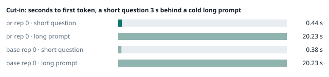
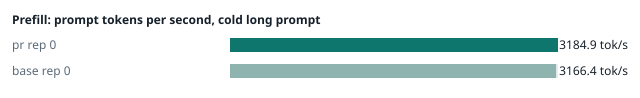
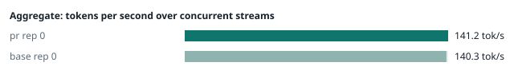
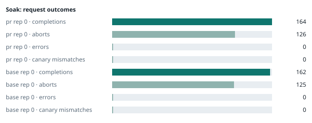

### Evidence: pr vs base

| target | role | image / artifact | model | settings that differ from the control |
|---|---|---|---|---|
| `pr` | candidate | `tensorfold-dsv41:pr-0430154e` (17f50370b8ea) | `DeepSeek-V4.1-Flash-1017` | - |
| `base` | control | `tensorfold-dsv41:base-476bbc77` (3014a9d4e74f) | `DeepSeek-V4.1-Flash-1017` | baseline |

Conditions: fabric ring; order: A then B, one repetition (no reverse order: pass --opt reps=2 for a counterbalanced run); repetitions: 1; kit c66ae62.
Restore: live restored (verified: API answers, running artifact is live's).

#### smoke

| target | rep | arithmetic | greedy repeat equal | stream matches | JSON mode | first token (stream) | errors |
|---|---|---|---|---|---|---|---|
| `pr` | 0 | ✓ | ✓ | ✓ | ✓ | 0.092 s | - |
| `base` | 0 | ✓ | ✓ | ✓ | ✓ | 0.09 s | - |

machine state after the suite

- `pr` rep 0: `{"head": {"gpus": ["0, NVIDIA GB10, 2184 MHz, 51, [N/A], [N/A], 8 %"], "load": "load average: 3.64, 1.81, 0.99", "mem_available_mb": "27545"}}`
- `base` rep 0: `{"head": {"gpus": ["0, NVIDIA GB10, 2177 MHz, 58, [N/A], [N/A], 91 %"], "load": "load average: 4.02, 5.27, 4.16", "mem_available_mb": "28268"}}`

#### boundary

**19 of 19** greedy reply hashes identical, `pr` against `base`, over 1 repetition(s).

| rep | prompt | tokens (pr / base) | `pr` | `base` | same |
|---|---|---|---|---|---|
| 0 | len5 | 5 / 5 | `38127fef0fbb` | `38127fef0fbb` | ✓ |
| 0 | len2047 | 2047 / 2047 | `8488ccfbcf35` | `8488ccfbcf35` | ✓ |
| 0 | len2048 | 2048 / 2048 | `c5ac2fb76516` | `c5ac2fb76516` | ✓ |
| 0 | len2049 | 2049 / 2049 | `6766401c9caa` | `6766401c9caa` | ✓ |
| 0 | len4095 | 4095 / 4095 | `ed9e5086f520` | `ed9e5086f520` | ✓ |
| 0 | len4096 | 4096 / 4096 | `52584e31f990` | `52584e31f990` | ✓ |
| 0 | len4097 | 4097 / 4097 | `1a71db317ee7` | `1a71db317ee7` | ✓ |
| 0 | len6143 | 6143 / 6143 | `2f9626e9baf5` | `2f9626e9baf5` | ✓ |
| 0 | len6144 | 6144 / 6144 | `11933f2d4bd7` | `11933f2d4bd7` | ✓ |
| 0 | len6145 | 6145 / 6145 | `7aa2f63b2547` | `7aa2f63b2547` | ✓ |
| 0 | len8193 | 8193 / 8193 | `2ef3dc011922` | `2ef3dc011922` | ✓ |
| 0 | len12289 | 12289 / 12289 | `4fcfbd64881f` | `4fcfbd64881f` | ✓ |
| 0 | pfx_base | 5124 / 5124 | `52afe4842e5d` | `52afe4842e5d` | ✓ |
| 0 | pfx_div3072 | 3376 / 3376 | `64d23fe171dc` | `64d23fe171dc` | ✓ |
| 0 | pfx_div2044 | 2348 / 2348 | `16db99ba02f2` | `16db99ba02f2` | ✓ |
| 0 | pfx_div4092 | 4396 / 4396 | `63798c5ba36c` | `63798c5ba36c` | ✓ |
| 0 | pfx_div4093 | 4397 / 4397 | `6b1cfc31884d` | `6b1cfc31884d` | ✓ |
| 0 | pfx_base_again | 5124 / 5124 | `52afe4842e5d` | `52afe4842e5d` | ✓ |
| 0 | pfx_extend | 6660 / 6660 | `357a869fef18` | `357a869fef18` | ✓ |

machine state after the suite

- `pr` rep 0: `{"head": {"gpus": ["0, NVIDIA GB10, 2177 MHz, 61, [N/A], [N/A], 0 %"], "load": "load average: 4.97, 2.36, 1.20", "mem_available_mb": "27874"}}`
- `base` rep 0: `{"head": {"gpus": ["0, NVIDIA GB10, 2171 MHz, 62, [N/A], [N/A], 0 %"], "load": "load average: 5.39, 5.46, 4.26", "mem_available_mb": "27931"}}`

#### cutin

`pr` rep 0: short question first token **0.44 s** (rounds 0.398–0.483), long prompt first token 20.23 s (rounds 20.162–20.495); 3 rounds; admitted during the long prefill in 3 of 3 rounds
`base` rep 0: short question first token **0.38 s** (rounds 0.359–0.409), long prompt first token 20.23 s (rounds 20.079–20.306); 3 rounds; admitted during the long prefill in 3 of 3 rounds

machine state after the suite

- `pr` rep 0: `{"head": {"gpus": ["0, NVIDIA GB10, 2177 MHz, 70, [N/A], [N/A], 96 %"], "load": "load average: 6.77, 3.36, 1.62", "mem_available_mb": "27811"}}`
- `base` rep 0: `{"head": {"gpus": ["0, NVIDIA GB10, 2177 MHz, 67, [N/A], [N/A], 0 %"], "load": "load average: 7.39, 6.02, 4.53", "mem_available_mb": "27817"}}`

#### perf

| target | rep | decode tok/s, one stream | prefill tok/s, cold long prompt | aggregate tok/s, concurrent streams | errors |
|---|---|---|---|---|---|
| `pr` | 0 | **56.9** (53.4–60.9) | **3184.9** (3164.8–3194.3; 12004 tokens) | **141.2** (128.1–144.5; 4 streams) | - |
| `base` | 0 | **56.7** (55.9–60.2) | **3166.4** (3064.6–3180.7; 12004 tokens) | **140.3** (137.4–142.6; 4 streams) | - |

`pr` against `base`: decode +0.4%, prefill +0.6%, aggregate +0.6% (medians over repetitions; the verdict counts a difference only beyond the rounds' spread, at least ±3 %).

machine state after the suite

- `pr` rep 0: `{"head": {"gpus": ["0, NVIDIA GB10, 2171 MHz, 66, [N/A], [N/A], 96 %"], "load": "load average: 6.37, 3.69, 1.80", "mem_available_mb": "27530"}}`
- `base` rep 0: `{"head": {"gpus": ["0, NVIDIA GB10, 2171 MHz, 67, [N/A], [N/A], 96 %"], "load": "load average: 6.51, 5.97, 4.58", "mem_available_mb": "27425"}}`

#### startup

`pr`: 172.0 s from the switch to the API answering (1 start(s))
`base`: 168.3 s from the switch to the API answering (1 start(s))

#### soak

`pr` rep 0: 164 completions, 126 client aborts, **0 errors**, 57 canary checks with **0 mismatches**
  machine samples, first and last: `{"head": {"gpus": ["0, NVIDIA GB10, 2184 MHz, 62, [N/A], [N/A], 0 %"], "load": "load average: 6.37, 3.69, 1.80", "mem_available_mb": "27493"}}` → `{"head": {"gpus": ["0, NVIDIA GB10, 2177 MHz, 70, [N/A], [N/A], 96 %"], "load": "load average: 6.37, 6.19, 4.03", "mem_available_mb": "26301"}}`
`base` rep 0: 162 completions, 125 client aborts, **0 errors**, 57 canary checks with **0 mismatches**
  machine samples, first and last: `{"head": {"gpus": ["0, NVIDIA GB10, 2177 MHz, 65, [N/A], [N/A], 40 %"], "load": "load average: 6.51, 5.97, 4.58", "mem_available_mb": "27408"}}` → `{"head": {"gpus": ["0, NVIDIA GB10, 2177 MHz, 69, [N/A], [N/A], 96 %"], "load": "load average: 6.20, 6.45, 5.53", "mem_available_mb": "26343"}}`

machine state after the suite

- `pr` rep 0: `{"head": {"gpus": ["0, NVIDIA GB10, 2184 MHz, 60, [N/A], [N/A], 0 %"], "load": "load average: 6.37, 6.27, 4.19", "mem_available_mb": "26397"}}`
- `base` rep 0: `{"head": {"gpus": ["0, NVIDIA GB10, 2184 MHz, 61, [N/A], [N/A], 0 %"], "load": "load average: 5.70, 6.29, 5.53", "mem_available_mb": "26350"}}`

#### repro

| target | role | rep | exit | outcome | expected | as expected |
|---|---|---|---|---|---|---|
| `pr` | candidate | 0 | 0 | passes | passes | ✓ |
| `base` | control | 0 | 1 | fails | fails | ✓ |

**Reproduced on the control and gone on the candidate** (every repetition).

Command: `bash claim.sh {api} {model} {logcmd}`

output of the script (tail)

- `pr` rep 0: `fold"}]}' GET with body, then GET: the next request on the kept connection parsed from its own request line DELETE with body, then GET: first  -> 404 '{"error": {"message": "no stored response has id \'resp_claim0044_does_not_exist\'", "type": "invalid_request_error", "param": "response_id", "code": null}}' DELETE with body, then GET: second -> 200 '{"object": "list", "data": [{"id": "DeepSeek-V4.1-Flash-1017", "object": "model", "created": 1793563332, "owned_by": "tensorfold"}]}' DELETE with body, then GET: the next request on the kept connection parsed from its own request line CLAIM: holds `
- `base` rep 0: `ssage": "no stored response has id \'resp_claim0044_does_not_exist\'", "type": "invalid_request_error", "param": "response_id", "code": null}}' DELETE with body, then GET: second -> 501 '<!DOCTYPE HTML>\n<html lang="en">\n    <head>\n        <meta charset="utf-8">\n        <style type="text/css">\n            :root {\n                color-scheme: lig' DELETE with body, then GET: error page says: 
Message: Unsupported method ('probe=0044&amp;scanner=1GET').
 DELETE with body, then GET: the next request on the kept connection failed with the probe's bytes in the reply CLAIM: does not hold `

machine state after the suite

- `pr` rep 0: `{"head": {"gpus": ["0, NVIDIA GB10, 2184 MHz, 60, [N/A], [N/A], 0 %"], "load": "load average: 6.18, 6.23, 4.19", "mem_available_mb": "26373"}}`
- `base` rep 0: `{"head": {"gpus": ["0, NVIDIA GB10, 2184 MHz, 60, [N/A], [N/A], 0 %"], "load": "load average: 5.70, 6.29, 5.53", "mem_available_mb": "26348"}}`

#### the pull request's own tests

The pull request adds or changes no test file under `tests/`.

#### What this run does not show

- a clean pair exit and recovery after an injected read fault (`fault` did not run)
- an external benchmark against a control (The Grill or similar) (`bench` did not run)
- <!-- add: paths only checked by reading, faults not injected, configurations not run -->

_Generated by inference-agent-kit `report.py` from `20261101T194649/results.json`._
