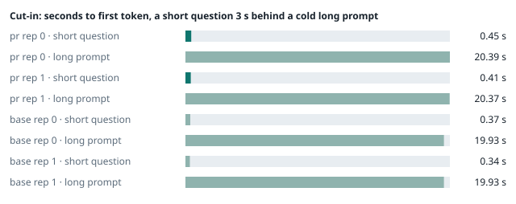
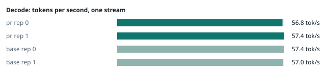
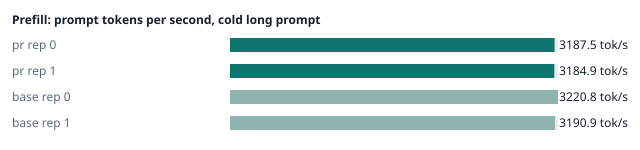
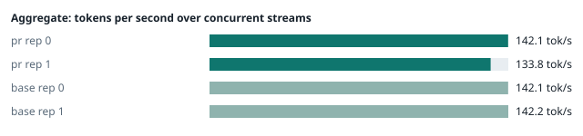
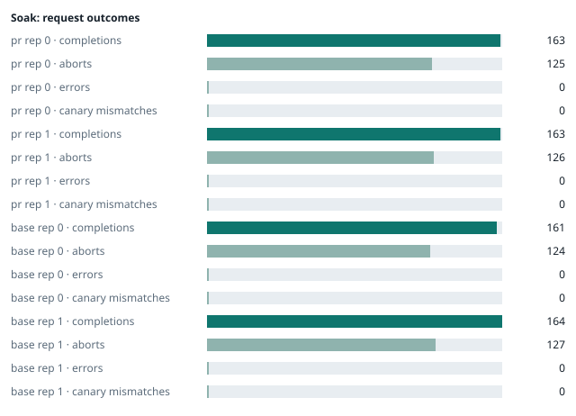

### Evidence: pr vs base

| target | role | image / artifact | model | settings that differ from the control |
|---|---|---|---|---|
| `pr` | candidate | `tensorfold-dsv41:pr-0430154e` (17f50370b8ea) | `DeepSeek-V4.1-Flash-1017` | - |
| `base` | control | `tensorfold-dsv41:base-476bbc77` (3014a9d4e74f) | `DeepSeek-V4.1-Flash-1017` | baseline |

Conditions: fabric ring; order: counterbalanced over 2 repetitions: A B, then B A; repetitions: 2; kit 21101d7.
Restore: live restored (verified: API answers, running artifact is live's).

#### smoke

| target | rep | arithmetic | greedy repeat equal | stream matches | JSON mode | first token (stream) | errors |
|---|---|---|---|---|---|---|---|
| `pr` | 0 | ✓ | ✓ | ✓ | ✓ | 0.089 s | - |
| `pr` | 1 | ✓ | ✓ | ✓ | ✓ | 0.092 s | - |
| `base` | 0 | ✓ | ✓ | ✓ | ✓ | 0.089 s | - |
| `base` | 1 | ✓ | ✓ | ✓ | ✓ | 0.099 s | - |

machine state after the suite

- `pr` rep 0: `{"head": {"gpus": ["0, NVIDIA GB10, 2177 MHz, 54, [N/A], [N/A], 0 %"], "load": "load average: 4.28, 4.09, 5.09", "mem_available_mb": "28121"}}`
- `pr` rep 1: `{"head": {"gpus": ["0, NVIDIA GB10, 2184 MHz, 58, [N/A], [N/A], 81 %"], "load": "load average: 4.37, 5.66, 6.23", "mem_available_mb": "27044"}}`
- `base` rep 0: `{"head": {"gpus": ["0, NVIDIA GB10, 2177 MHz, 58, [N/A], [N/A], 94 %"], "load": "load average: 3.20, 4.94, 5.43", "mem_available_mb": "27387"}}`
- `base` rep 1: `{"head": {"gpus": ["0, NVIDIA GB10, 2177 MHz, 64, [N/A], [N/A], 86 %"], "load": "load average: 6.53, 6.84, 6.28", "mem_available_mb": "26223"}}`

#### boundary

**38 of 38** greedy reply hashes identical, `pr` against `base`, over 2 repetition(s).

| rep | prompt | tokens (pr / base) | `pr` | `base` | same |
|---|---|---|---|---|---|
| 0 | len5 | 5 / 5 | `38127fef0fbb` | `38127fef0fbb` | ✓ |
| 0 | len2047 | 2047 / 2047 | `8488ccfbcf35` | `8488ccfbcf35` | ✓ |
| 0 | len2048 | 2048 / 2048 | `c5ac2fb76516` | `c5ac2fb76516` | ✓ |
| 0 | len2049 | 2049 / 2049 | `6766401c9caa` | `6766401c9caa` | ✓ |
| 0 | len4095 | 4095 / 4095 | `ed9e5086f520` | `ed9e5086f520` | ✓ |
| 0 | len4096 | 4096 / 4096 | `52584e31f990` | `52584e31f990` | ✓ |
| 0 | len4097 | 4097 / 4097 | `1a71db317ee7` | `1a71db317ee7` | ✓ |
| 0 | len6143 | 6143 / 6143 | `2f9626e9baf5` | `2f9626e9baf5` | ✓ |
| 0 | len6144 | 6144 / 6144 | `11933f2d4bd7` | `11933f2d4bd7` | ✓ |
| 0 | len6145 | 6145 / 6145 | `7aa2f63b2547` | `7aa2f63b2547` | ✓ |
| 0 | len8193 | 8193 / 8193 | `2ef3dc011922` | `2ef3dc011922` | ✓ |
| 0 | len12289 | 12289 / 12289 | `4fcfbd64881f` | `4fcfbd64881f` | ✓ |
| 0 | pfx_base | 5124 / 5124 | `52afe4842e5d` | `52afe4842e5d` | ✓ |
| 0 | pfx_div3072 | 3376 / 3376 | `64d23fe171dc` | `64d23fe171dc` | ✓ |
| 0 | pfx_div2044 | 2348 / 2348 | `16db99ba02f2` | `16db99ba02f2` | ✓ |
| 0 | pfx_div4092 | 4396 / 4396 | `63798c5ba36c` | `63798c5ba36c` | ✓ |
| 0 | pfx_div4093 | 4397 / 4397 | `6b1cfc31884d` | `6b1cfc31884d` | ✓ |
| 0 | pfx_base_again | 5124 / 5124 | `52afe4842e5d` | `52afe4842e5d` | ✓ |
| 0 | pfx_extend | 6660 / 6660 | `357a869fef18` | `357a869fef18` | ✓ |
| 1 | len5 | 5 / 5 | `38127fef0fbb` | `38127fef0fbb` | ✓ |
| 1 | len2047 | 2047 / 2047 | `8488ccfbcf35` | `8488ccfbcf35` | ✓ |
| 1 | len2048 | 2048 / 2048 | `c5ac2fb76516` | `c5ac2fb76516` | ✓ |
| 1 | len2049 | 2049 / 2049 | `6766401c9caa` | `6766401c9caa` | ✓ |
| 1 | len4095 | 4095 / 4095 | `ed9e5086f520` | `ed9e5086f520` | ✓ |
| 1 | len4096 | 4096 / 4096 | `52584e31f990` | `52584e31f990` | ✓ |
| 1 | len4097 | 4097 / 4097 | `1a71db317ee7` | `1a71db317ee7` | ✓ |
| 1 | len6143 | 6143 / 6143 | `2f9626e9baf5` | `2f9626e9baf5` | ✓ |
| 1 | len6144 | 6144 / 6144 | `11933f2d4bd7` | `11933f2d4bd7` | ✓ |
| 1 | len6145 | 6145 / 6145 | `7aa2f63b2547` | `7aa2f63b2547` | ✓ |
| 1 | len8193 | 8193 / 8193 | `2ef3dc011922` | `2ef3dc011922` | ✓ |
| 1 | len12289 | 12289 / 12289 | `4fcfbd64881f` | `4fcfbd64881f` | ✓ |
| 1 | pfx_base | 5124 / 5124 | `52afe4842e5d` | `52afe4842e5d` | ✓ |
| 1 | pfx_div3072 | 3376 / 3376 | `64d23fe171dc` | `64d23fe171dc` | ✓ |
| 1 | pfx_div2044 | 2348 / 2348 | `16db99ba02f2` | `16db99ba02f2` | ✓ |
| 1 | pfx_div4092 | 4396 / 4396 | `63798c5ba36c` | `63798c5ba36c` | ✓ |
| 1 | pfx_div4093 | 4397 / 4397 | `6b1cfc31884d` | `6b1cfc31884d` | ✓ |
| 1 | pfx_base_again | 5124 / 5124 | `52afe4842e5d` | `52afe4842e5d` | ✓ |
| 1 | pfx_extend | 6660 / 6660 | `357a869fef18` | `357a869fef18` | ✓ |

machine state after the suite

- `pr` rep 0: `{"head": {"gpus": ["0, NVIDIA GB10, 2177 MHz, 62, [N/A], [N/A], 92 %"], "load": "load average: 5.39, 4.41, 5.16", "mem_available_mb": "27876"}}`
- `pr` rep 1: `{"head": {"gpus": ["0, NVIDIA GB10, 2171 MHz, 66, [N/A], [N/A], 96 %"], "load": "load average: 5.44, 5.78, 6.25", "mem_available_mb": "27824"}}`
- `base` rep 0: `{"head": {"gpus": ["0, NVIDIA GB10, 2177 MHz, 64, [N/A], [N/A], 0 %"], "load": "load average: 4.77, 5.14, 5.48", "mem_available_mb": "27769"}}`
- `base` rep 1: `{"head": {"gpus": ["0, NVIDIA GB10, 2171 MHz, 67, [N/A], [N/A], 96 %"], "load": "load average: 6.25, 6.73, 6.27", "mem_available_mb": "26217"}}`

#### cutin

`pr` rep 0: short question first token **0.45 s** (rounds 0.363–0.479), long prompt first token 20.39 s (rounds 20.09–20.432); 3 rounds; admitted during the long prefill in 3 of 3 rounds
`pr` rep 1: short question first token **0.41 s** (rounds 0.386–0.45), long prompt first token 20.37 s (rounds 20.105–20.486); 3 rounds; admitted during the long prefill in 3 of 3 rounds
`base` rep 0: short question first token **0.37 s** (rounds 0.313–0.433), long prompt first token 19.93 s (rounds 19.878–19.989); 3 rounds; admitted during the long prefill in 3 of 3 rounds
`base` rep 1: short question first token **0.34 s** (rounds 0.334–0.378), long prompt first token 19.93 s (rounds 19.902–19.948); 3 rounds; admitted during the long prefill in 3 of 3 rounds

machine state after the suite

- `pr` rep 0: `{"head": {"gpus": ["0, NVIDIA GB10, 2177 MHz, 71, [N/A], [N/A], 96 %"], "load": "load average: 6.65, 4.96, 5.30", "mem_available_mb": "27743"}}`
- `pr` rep 1: `{"head": {"gpus": ["0, NVIDIA GB10, 2184 MHz, 70, [N/A], [N/A], 96 %"], "load": "load average: 6.76, 6.14, 6.35", "mem_available_mb": "27699"}}`
- `base` rep 0: `{"head": {"gpus": ["0, NVIDIA GB10, 2184 MHz, 70, [N/A], [N/A], 79 %"], "load": "load average: 6.59, 5.60, 5.62", "mem_available_mb": "27743"}}`
- `base` rep 1: `{"head": {"gpus": ["0, NVIDIA GB10, 2184 MHz, 68, [N/A], [N/A], 0 %"], "load": "load average: 7.31, 6.97, 6.38", "mem_available_mb": "26270"}}`

#### perf

| target | rep | decode tok/s, one stream | prefill tok/s, cold long prompt | aggregate tok/s, concurrent streams | errors |
|---|---|---|---|---|---|
| `pr` | 0 | **56.8** (55.0–57.2) | **3187.5** (2964.7–3201.1; 12004 tokens) | **142.1** (139.1–152.5; 4 streams) | - |
| `pr` | 1 | **57.4** (55.6–60.6) | **3184.9** (3184.1–3195.1; 12004 tokens) | **133.8** (131.7–150.7; 4 streams) | - |
| `base` | 0 | **57.4** (55.9–60.8) | **3220.8** (3214.8–3222.6; 12004 tokens) | **142.1** (137.2–147.0; 4 streams) | - |
| `base` | 1 | **57.0** (55.4–60.9) | **3190.9** (3189.2–3210.5; 12004 tokens) | **142.2** (142.0–145.4; 4 streams) | - |

`pr` against `base`: decode -0.2%, prefill -0.6%, aggregate -3.0% (medians over repetitions; the verdict counts a difference only beyond the rounds' spread, at least ±3 %).

machine state after the suite

- `pr` rep 0: `{"head": {"gpus": ["0, NVIDIA GB10, 2171 MHz, 64, [N/A], [N/A], 0 %"], "load": "load average: 5.61, 4.91, 5.27", "mem_available_mb": "27383"}}`
- `pr` rep 1: `{"head": {"gpus": ["0, NVIDIA GB10, 2171 MHz, 67, [N/A], [N/A], 96 %"], "load": "load average: 7.17, 6.29, 6.39", "mem_available_mb": "27403"}}`
- `base` rep 0: `{"head": {"gpus": ["0, NVIDIA GB10, 2177 MHz, 67, [N/A], [N/A], 96 %"], "load": "load average: 5.67, 5.51, 5.59", "mem_available_mb": "27402"}}`
- `base` rep 1: `{"head": {"gpus": ["0, NVIDIA GB10, 2171 MHz, 66, [N/A], [N/A], 96 %"], "load": "load average: 6.61, 6.86, 6.37", "mem_available_mb": "26269"}}`

#### startup

`pr`: 167.4 s, 166.2 s from the switch to the API answering (2 start(s))
`base`: 166.9 s from the switch to the API answering (1 start(s))

#### soak

`pr` rep 0: 163 completions, 125 client aborts, **0 errors**, 57 canary checks with **0 mismatches**
  machine samples, first and last: `{"head": {"gpus": ["0, NVIDIA GB10, 2177 MHz, 66, [N/A], [N/A], 70 %"], "load": "load average: 5.61, 4.91, 5.27", "mem_available_mb": "27351"}}` → `{"head": {"gpus": ["0, NVIDIA GB10, 2177 MHz, 67, [N/A], [N/A], 96 %"], "load": "load average: 6.56, 6.35, 5.88", "mem_available_mb": "26214"}}`
`pr` rep 1: 163 completions, 126 client aborts, **0 errors**, 57 canary checks with **0 mismatches**
  machine samples, first and last: `{"head": {"gpus": ["0, NVIDIA GB10, 2177 MHz, 64, [N/A], [N/A], 0 %"], "load": "load average: 7.17, 6.29, 6.39", "mem_available_mb": "27404"}}` → `{"head": {"gpus": ["0, NVIDIA GB10, 2177 MHz, 70, [N/A], [N/A], 96 %"], "load": "load average: 6.37, 6.33, 6.36", "mem_available_mb": "26189"}}`
`base` rep 0: 161 completions, 124 client aborts, **0 errors**, 57 canary checks with **0 mismatches**
  machine samples, first and last: `{"head": {"gpus": ["0, NVIDIA GB10, 2177 MHz, 67, [N/A], [N/A], 0 %"], "load": "load average: 5.67, 5.51, 5.59", "mem_available_mb": "27366"}}` → `{"head": {"gpus": ["0, NVIDIA GB10, 2177 MHz, 69, [N/A], [N/A], 96 %"], "load": "load average: 7.60, 6.97, 6.28", "mem_available_mb": "26239"}}`
`base` rep 1: 164 completions, 127 client aborts, **0 errors**, 58 canary checks with **0 mismatches**
  machine samples, first and last: `{"head": {"gpus": ["0, NVIDIA GB10, 2177 MHz, 67, [N/A], [N/A], 0 %"], "load": "load average: 6.61, 6.86, 6.37", "mem_available_mb": "26231"}}` → `{"head": {"gpus": ["0, NVIDIA GB10, 2177 MHz, 71, [N/A], [N/A], 96 %"], "load": "load average: 6.71, 7.09, 6.74", "mem_available_mb": "26109"}}`

machine state after the suite

- `pr` rep 0: `{"head": {"gpus": ["0, NVIDIA GB10, 2184 MHz, 60, [N/A], [N/A], 0 %"], "load": "load average: 5.54, 6.19, 5.86", "mem_available_mb": "26288"}}`
- `pr` rep 1: `{"head": {"gpus": ["0, NVIDIA GB10, 2184 MHz, 61, [N/A], [N/A], 0 %"], "load": "load average: 5.96, 6.26, 6.34", "mem_available_mb": "26259"}}`
- `base` rep 0: `{"head": {"gpus": ["0, NVIDIA GB10, 2184 MHz, 61, [N/A], [N/A], 0 %"], "load": "load average: 6.40, 6.82, 6.27", "mem_available_mb": "26300"}}`
- `base` rep 1: `{"head": {"gpus": ["0, NVIDIA GB10, 2184 MHz, 61, [N/A], [N/A], 0 %"], "load": "load average: 6.07, 6.88, 6.69", "mem_available_mb": "26213"}}`

#### repro

| target | role | rep | exit | outcome | expected | as expected |
|---|---|---|---|---|---|---|
| `pr` | candidate | 0 | 0 | passes | passes | ✓ |
| `pr` | candidate | 1 | 0 | passes | passes | ✓ |
| `base` | control | 0 | 1 | fails | fails | ✓ |
| `base` | control | 1 | 1 | fails | fails | ✓ |

**Reproduced on the control and gone on the candidate** (every repetition).

Command: `bash claim.sh {api} {model} {logcmd}`

output of the script (tail)

- `pr` rep 0: `93fdc5447bd0", "object": "response", "deleted": true}' [as promised] DELETE stored with body: #2 GET /responses/<stored> -> 404 '{"error": {"message": "no stored response has id \'resp_ef5abbe89b7578525eb993fdc5447bd0\'", "type": "invalid_request_error", "param": "response_id", "c' [as promised] DELETE stored with body: #3 GET /models -> 200 '{"object": "list", "data": [{"id": "DeepSeek-V4.1-Flash-1017", "object": "model", "created": 1793569561, "owned_by": "tensorfold"}]}' [as promised] DELETE stored with body: every reply on the kept connection is what the bodyless request gets CLAIM: holds `
- `pr` rep 1: `cda7469965a2", "object": "response", "deleted": true}' [as promised] DELETE stored with body: #2 GET /responses/<stored> -> 404 '{"error": {"message": "no stored response has id \'resp_87873b1679711c695c78cda7469965a2\'", "type": "invalid_request_error", "param": "response_id", "c' [as promised] DELETE stored with body: #3 GET /models -> 200 '{"object": "list", "data": [{"id": "DeepSeek-V4.1-Flash-1017", "object": "model", "created": 1793572144, "owned_by": "tensorfold"}]}' [as promised] DELETE stored with body: every reply on the kept connection is what the bodyless request gets CLAIM: holds `
- `base` rep 0: `d> -> 501 '<!DOCTYPE HTML>\n<html lang="en">\n    <head>\n        <meta charset="utf-8">\n        <style type="text/css">\n            :root {\n                color-s' [WRONG] DELETE stored with body: #2 error page says: 
Message: Unsupported method ('probe=0044&amp;scanner=1GET').
 DELETE stored with body: #2 the reply carries the previous request's body bytes DELETE stored with body: #3 GET /models -> None 'no reply on this connection: connection closed by server' [WRONG] DELETE stored with body: a reply on the kept connection is not what the pull request promises CLAIM: does not hold `
- `base` rep 1: `d> -> 501 '<!DOCTYPE HTML>\n<html lang="en">\n    <head>\n        <meta charset="utf-8">\n        <style type="text/css">\n            :root {\n                color-s' [WRONG] DELETE stored with body: #2 error page says: 
Message: Unsupported method ('probe=0044&amp;scanner=1GET').
 DELETE stored with body: #2 the reply carries the previous request's body bytes DELETE stored with body: #3 GET /models -> None 'no reply on this connection: connection closed by server' [WRONG] DELETE stored with body: a reply on the kept connection is not what the pull request promises CLAIM: does not hold `

machine state after the suite

- `pr` rep 0: `{"head": {"gpus": ["0, NVIDIA GB10, 2177 MHz, 62, [N/A], [N/A], 0 %"], "load": "load average: 5.54, 6.19, 5.86", "mem_available_mb": "26268"}}`
- `pr` rep 1: `{"head": {"gpus": ["0, NVIDIA GB10, 2177 MHz, 63, [N/A], [N/A], 88 %"], "load": "load average: 5.56, 6.18, 6.31", "mem_available_mb": "26234"}}`
- `base` rep 0: `{"head": {"gpus": ["0, NVIDIA GB10, 2184 MHz, 62, [N/A], [N/A], 44 %"], "load": "load average: 6.40, 6.82, 6.27", "mem_available_mb": "26245"}}`
- `base` rep 1: `{"head": {"gpus": ["0, NVIDIA GB10, 2184 MHz, 61, [N/A], [N/A], 0 %"], "load": "load average: 6.07, 6.88, 6.69", "mem_available_mb": "26218"}}`

#### the pull request's own tests

The pull request adds or changes no test file under `tests/`.

#### What this run does not show

- a clean pair exit and recovery after an injected read fault (`fault` did not run)
- an external benchmark against a control (The Grill or similar) (`bench` did not run)
- <!-- add: paths only checked by reading, faults not injected, configurations not run -->

_Generated by inference-agent-kit `report.py` from `20261101T213043/results.json`._
