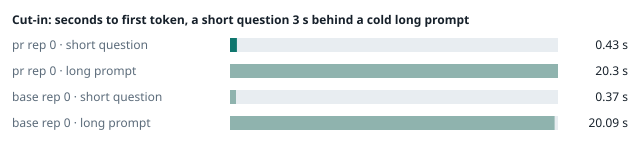
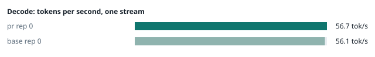
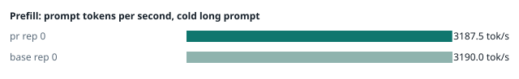
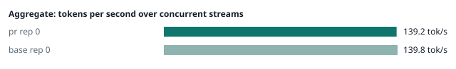
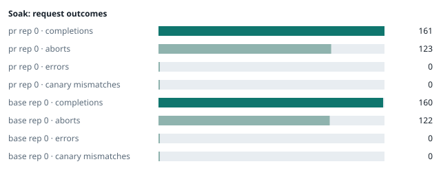

### Evidence: pr vs base

| target | role | image / artifact | model | settings that differ from the control |
|---|---|---|---|---|
| `pr` | candidate | `tensorfold-dsv41:pr-f2e3fd77` (c19b9fa52529) | `DeepSeek-V4.1-Flash-1017` | - |
| `base` | control | `tensorfold-dsv41:base-fcef6cf2` (5a94966d9621) | `DeepSeek-V4.1-Flash-1017` | baseline |

Conditions: fabric ring; order: A then B, one repetition (no reverse order: pass --opt reps=2 for a counterbalanced run); repetitions: 1; kit 1fa0a4e.
Restore: live restored (verified: API answers, running artifact is live's).

#### smoke

| target | rep | arithmetic | greedy repeat equal | stream matches | JSON mode | first token (stream) | errors |
|---|---|---|---|---|---|---|---|
| `pr` | 0 | ✓ | ✓ | ✓ | ✓ | 0.092 s | - |
| `base` | 0 | ✓ | ✓ | ✓ | ✓ | 0.092 s | - |

machine state after the suite

- `pr` rep 0: `{"head": {"gpus": ["0, NVIDIA GB10, 2177 MHz, 54, [N/A], [N/A], 93 %"], "load": "load average: 6.69, 2.92, 3.01", "mem_available_mb": "27376"}}`
- `base` rep 0: `{"head": {"gpus": ["0, NVIDIA GB10, 2177 MHz, 58, [N/A], [N/A], 15 %"], "load": "load average: 8.02, 6.76, 5.25", "mem_available_mb": "27436"}}`

#### boundary

**19 of 19** greedy reply hashes identical, `pr` against `base`, over 1 repetition(s).

| rep | prompt | tokens (pr / base) | `pr` | `base` | same |
|---|---|---|---|---|---|
| 0 | len5 | 5 / 5 | `38127fef0fbb` | `38127fef0fbb` | ✓ |
| 0 | len2047 | 2047 / 2047 | `8488ccfbcf35` | `8488ccfbcf35` | ✓ |
| 0 | len2048 | 2048 / 2048 | `c5ac2fb76516` | `c5ac2fb76516` | ✓ |
| 0 | len2049 | 2049 / 2049 | `6766401c9caa` | `6766401c9caa` | ✓ |
| 0 | len4095 | 4095 / 4095 | `ed9e5086f520` | `ed9e5086f520` | ✓ |
| 0 | len4096 | 4096 / 4096 | `52584e31f990` | `52584e31f990` | ✓ |
| 0 | len4097 | 4097 / 4097 | `1a71db317ee7` | `1a71db317ee7` | ✓ |
| 0 | len6143 | 6143 / 6143 | `2f9626e9baf5` | `2f9626e9baf5` | ✓ |
| 0 | len6144 | 6144 / 6144 | `11933f2d4bd7` | `11933f2d4bd7` | ✓ |
| 0 | len6145 | 6145 / 6145 | `7aa2f63b2547` | `7aa2f63b2547` | ✓ |
| 0 | len8193 | 8193 / 8193 | `2ef3dc011922` | `2ef3dc011922` | ✓ |
| 0 | len12289 | 12289 / 12289 | `4fcfbd64881f` | `4fcfbd64881f` | ✓ |
| 0 | pfx_base | 5124 / 5124 | `52afe4842e5d` | `52afe4842e5d` | ✓ |
| 0 | pfx_div3072 | 3376 / 3376 | `64d23fe171dc` | `64d23fe171dc` | ✓ |
| 0 | pfx_div2044 | 2348 / 2348 | `16db99ba02f2` | `16db99ba02f2` | ✓ |
| 0 | pfx_div4092 | 4396 / 4396 | `63798c5ba36c` | `63798c5ba36c` | ✓ |
| 0 | pfx_div4093 | 4397 / 4397 | `6b1cfc31884d` | `6b1cfc31884d` | ✓ |
| 0 | pfx_base_again | 5124 / 5124 | `52afe4842e5d` | `52afe4842e5d` | ✓ |
| 0 | pfx_extend | 6660 / 6660 | `357a869fef18` | `357a869fef18` | ✓ |

machine state after the suite

- `pr` rep 0: `{"head": {"gpus": ["0, NVIDIA GB10, 2171 MHz, 62, [N/A], [N/A], 96 %"], "load": "load average: 6.51, 3.30, 3.13", "mem_available_mb": "27768"}}`
- `base` rep 0: `{"head": {"gpus": ["0, NVIDIA GB10, 2171 MHz, 66, [N/A], [N/A], 96 %"], "load": "load average: 7.61, 6.79, 5.32", "mem_available_mb": "27748"}}`

#### cutin

`pr` rep 0: short question first token **0.43 s** (rounds 0.407–0.438), long prompt first token 20.3 s (rounds 20.084–20.332); 3 rounds; admitted during the long prefill in 3 of 3 rounds
`base` rep 0: short question first token **0.37 s** (rounds 0.361–0.423), long prompt first token 20.09 s (rounds 19.965–20.161); 3 rounds; admitted during the long prefill in 3 of 3 rounds

machine state after the suite

- `pr` rep 0: `{"head": {"gpus": ["0, NVIDIA GB10, 2177 MHz, 65, [N/A], [N/A], 0 %"], "load": "load average: 7.18, 4.18, 3.45", "mem_available_mb": "27688"}}`
- `base` rep 0: `{"head": {"gpus": ["0, NVIDIA GB10, 2184 MHz, 73, [N/A], [N/A], 96 %"], "load": "load average: 7.47, 6.91, 5.45", "mem_available_mb": "27668"}}`

#### perf

| target | rep | decode tok/s, one stream | prefill tok/s, cold long prompt | aggregate tok/s, concurrent streams | errors |
|---|---|---|---|---|---|
| `pr` | 0 | **56.7** (55.7–58.6) | **3187.5** (3086.7–3192.6; 12004 tokens) | **139.2** (136.6–140.5; 4 streams) | - |
| `base` | 0 | **56.1** (55.0–60.1) | **3190.0** (3186.6–3226.9; 12004 tokens) | **139.8** (133.0–143.3; 4 streams) | - |

`pr` against `base`: decode +1.1%, prefill -0.1%, aggregate -0.4% (medians over repetitions; the verdict counts a difference only beyond the rounds' spread, at least ±3 %).

machine state after the suite

- `pr` rep 0: `{"head": {"gpus": ["0, NVIDIA GB10, 2171 MHz, 65, [N/A], [N/A], 96 %"], "load": "load average: 6.56, 4.35, 3.54", "mem_available_mb": "27374"}}`
- `base` rep 0: `{"head": {"gpus": ["0, NVIDIA GB10, 2177 MHz, 65, [N/A], [N/A], 0 %"], "load": "load average: 6.51, 6.73, 5.45", "mem_available_mb": "27400"}}`

#### startup

`pr`: 100.5 s from the switch to the API answering (1 start(s))
`base`: 99.8 s from the switch to the API answering (1 start(s))

#### soak

`pr` rep 0: 161 completions, 123 client aborts, **0 errors**, 57 canary checks with **0 mismatches**
  machine samples, first and last: `{"head": {"gpus": ["0, NVIDIA GB10, 2177 MHz, 66, [N/A], [N/A], 0 %"], "load": "load average: 6.56, 4.35, 3.54", "mem_available_mb": "27343"}}` → `{"head": {"gpus": ["0, NVIDIA GB10, 2177 MHz, 69, [N/A], [N/A], 96 %"], "load": "load average: 6.06, 6.01, 4.78", "mem_available_mb": "26201"}}`
`base` rep 0: 160 completions, 122 client aborts, **0 errors**, 56 canary checks with **0 mismatches**
  machine samples, first and last: `{"head": {"gpus": ["0, NVIDIA GB10, 2177 MHz, 67, [N/A], [N/A], 96 %"], "load": "load average: 6.51, 6.73, 5.45", "mem_available_mb": "27386"}}` → `{"head": {"gpus": ["0, NVIDIA GB10, 2177 MHz, 67, [N/A], [N/A], 96 %"], "load": "load average: 6.44, 6.42, 5.85", "mem_available_mb": "26241"}}`

machine state after the suite

- `pr` rep 0: `{"head": {"gpus": ["0, NVIDIA GB10, 2184 MHz, 60, [N/A], [N/A], 0 %"], "load": "load average: 5.83, 6.01, 4.86", "mem_available_mb": "26255"}}`
- `base` rep 0: `{"head": {"gpus": ["0, NVIDIA GB10, 2184 MHz, 61, [N/A], [N/A], 0 %"], "load": "load average: 5.57, 6.25, 5.83", "mem_available_mb": "26253"}}`

#### the pull request's own tests

**confirmed** — 1 test file(s) added or changed by the PR (`tests/test_scripts.py`): on the PR **passes** (exit 0), on the base with the PR's tests copied in **fails** (exit 1).

- PR: `............................................... [ 77%] ..............                                                     [100%] 61 passed, 31 subtests passed in 23.07s`
- base + PR tests: `FAILED tests/test_scripts.py::LauncherHint::test_launcher_fits_the_fabric - AssertionError: 127 != 0 : /usr/bin/bash: line 5: launcher: command not found FAILED tests/test_scripts.py::LauncherHint::test_prepare_names_the_launcher_for_the_fabric_it_found - AssertionError: 'Start the server with ./sta`

#### What this run does not show

- a clean pair exit and recovery after an injected read fault (`fault` did not run)
- an external benchmark against a control (The Grill or similar) (`bench` did not run)
- <!-- add: paths only checked by reading, faults not injected, configurations not run -->

_Generated by inference-agent-kit `report.py` from `20261101T224813/results.json`._
