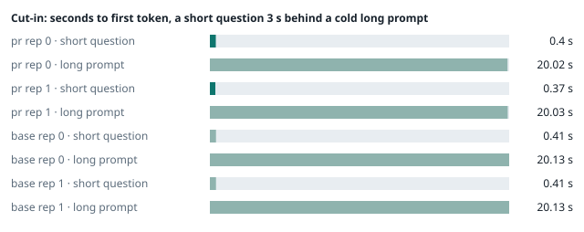
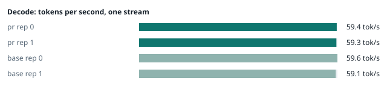
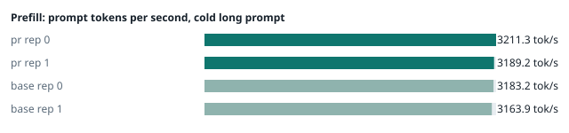
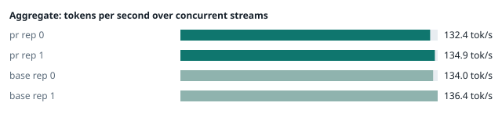
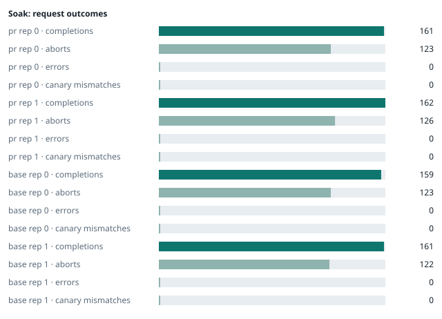

### Evidence: pr vs base

| target | role | image / artifact | model | settings that differ from the control |
|---|---|---|---|---|
| `pr` | candidate | `tensorfold-dsv41:pr-776cfb96` (b88c8236502f) | `DeepSeek-V4.1-Flash-1017` | - |
| `base` | control | `tensorfold-dsv41:base-fcef6cf2` (5a94966d9621) | `DeepSeek-V4.1-Flash-1017` | baseline |

Conditions: fabric ring; order: counterbalanced over 2 repetitions: A B, then B A; repetitions: 2; kit 3223f4d.
Restore: live restored (verified: API answers, running artifact is live's).

#### smoke

| target | rep | arithmetic | greedy repeat equal | stream matches | JSON mode | first token (stream) | errors |
|---|---|---|---|---|---|---|---|
| `pr` | 0 | ✓ | ✓ | ✓ | ✓ | 0.116 s | - |
| `pr` | 1 | ✓ | ✓ | ✓ | ✓ | 0.093 s | - |
| `base` | 0 | ✓ | ✓ | ✓ | ✓ | 0.091 s | - |
| `base` | 1 | ✓ | ✓ | ✓ | ✓ | 0.092 s | - |

machine state after the suite

- `pr` rep 0: `{"head": {"gpus": ["0, NVIDIA GB10, 2177 MHz, 57, [N/A], [N/A], 83 %"], "load": "load average: 7.35, 4.29, 4.29", "container": "92 pids 3.01GiB / 121.7GiB", "mem_available_mb": "28452"}}`
- `pr` rep 1: `{"head": {"gpus": ["0, NVIDIA GB10, 2184 MHz, 58, [N/A], [N/A], 0 %"], "load": "load average: 7.04, 6.04, 6.11", "container": "92 pids 3.037GiB / 121.7GiB", "mem_available_mb": "28302"}}`
- `base` rep 0: `{"head": {"gpus": ["0, NVIDIA GB10, 2184 MHz, 55, [N/A], [N/A], 0 %"], "load": "load average: 6.97, 5.52, 5.19", "container": "92 pids 3.042GiB / 121.7GiB", "mem_available_mb": "28494"}}`
- `base` rep 1: `{"head": {"gpus": ["0, NVIDIA GB10, 2177 MHz, 59, [N/A], [N/A], 93 %"], "load": "load average: 3.24, 5.14, 5.57", "container": "92 pids 4.216GiB / 121.7GiB", "mem_available_mb": "25993"}}`

#### boundary

**38 of 38** greedy reply hashes identical, `pr` against `base`, over 2 repetition(s).

| rep | prompt | tokens (pr / base) | `pr` | `base` | same |
|---|---|---|---|---|---|
| 0 | len5 | 5 / 5 | `38127fef0fbb` | `38127fef0fbb` | ✓ |
| 0 | len2047 | 2047 / 2047 | `8488ccfbcf35` | `8488ccfbcf35` | ✓ |
| 0 | len2048 | 2048 / 2048 | `c5ac2fb76516` | `c5ac2fb76516` | ✓ |
| 0 | len2049 | 2049 / 2049 | `6766401c9caa` | `6766401c9caa` | ✓ |
| 0 | len4095 | 4095 / 4095 | `ed9e5086f520` | `ed9e5086f520` | ✓ |
| 0 | len4096 | 4096 / 4096 | `52584e31f990` | `52584e31f990` | ✓ |
| 0 | len4097 | 4097 / 4097 | `1a71db317ee7` | `1a71db317ee7` | ✓ |
| 0 | len6143 | 6143 / 6143 | `2f9626e9baf5` | `2f9626e9baf5` | ✓ |
| 0 | len6144 | 6144 / 6144 | `11933f2d4bd7` | `11933f2d4bd7` | ✓ |
| 0 | len6145 | 6145 / 6145 | `7aa2f63b2547` | `7aa2f63b2547` | ✓ |
| 0 | len8193 | 8193 / 8193 | `2ef3dc011922` | `2ef3dc011922` | ✓ |
| 0 | len12289 | 12289 / 12289 | `4fcfbd64881f` | `4fcfbd64881f` | ✓ |
| 0 | pfx_base | 5124 / 5124 | `52afe4842e5d` | `52afe4842e5d` | ✓ |
| 0 | pfx_div3072 | 3376 / 3376 | `64d23fe171dc` | `64d23fe171dc` | ✓ |
| 0 | pfx_div2044 | 2348 / 2348 | `16db99ba02f2` | `16db99ba02f2` | ✓ |
| 0 | pfx_div4092 | 4396 / 4396 | `63798c5ba36c` | `63798c5ba36c` | ✓ |
| 0 | pfx_div4093 | 4397 / 4397 | `6b1cfc31884d` | `6b1cfc31884d` | ✓ |
| 0 | pfx_base_again | 5124 / 5124 | `52afe4842e5d` | `52afe4842e5d` | ✓ |
| 0 | pfx_extend | 6660 / 6660 | `357a869fef18` | `357a869fef18` | ✓ |
| 1 | len5 | 5 / 5 | `38127fef0fbb` | `38127fef0fbb` | ✓ |
| 1 | len2047 | 2047 / 2047 | `8488ccfbcf35` | `8488ccfbcf35` | ✓ |
| 1 | len2048 | 2048 / 2048 | `c5ac2fb76516` | `c5ac2fb76516` | ✓ |
| 1 | len2049 | 2049 / 2049 | `6766401c9caa` | `6766401c9caa` | ✓ |
| 1 | len4095 | 4095 / 4095 | `ed9e5086f520` | `ed9e5086f520` | ✓ |
| 1 | len4096 | 4096 / 4096 | `52584e31f990` | `52584e31f990` | ✓ |
| 1 | len4097 | 4097 / 4097 | `1a71db317ee7` | `1a71db317ee7` | ✓ |
| 1 | len6143 | 6143 / 6143 | `2f9626e9baf5` | `2f9626e9baf5` | ✓ |
| 1 | len6144 | 6144 / 6144 | `11933f2d4bd7` | `11933f2d4bd7` | ✓ |
| 1 | len6145 | 6145 / 6145 | `7aa2f63b2547` | `7aa2f63b2547` | ✓ |
| 1 | len8193 | 8193 / 8193 | `2ef3dc011922` | `2ef3dc011922` | ✓ |
| 1 | len12289 | 12289 / 12289 | `4fcfbd64881f` | `4fcfbd64881f` | ✓ |
| 1 | pfx_base | 5124 / 5124 | `52afe4842e5d` | `52afe4842e5d` | ✓ |
| 1 | pfx_div3072 | 3376 / 3376 | `64d23fe171dc` | `64d23fe171dc` | ✓ |
| 1 | pfx_div2044 | 2348 / 2348 | `16db99ba02f2` | `16db99ba02f2` | ✓ |
| 1 | pfx_div4092 | 4396 / 4396 | `63798c5ba36c` | `63798c5ba36c` | ✓ |
| 1 | pfx_div4093 | 4397 / 4397 | `6b1cfc31884d` | `6b1cfc31884d` | ✓ |
| 1 | pfx_base_again | 5124 / 5124 | `52afe4842e5d` | `52afe4842e5d` | ✓ |
| 1 | pfx_extend | 6660 / 6660 | `357a869fef18` | `357a869fef18` | ✓ |

machine state after the suite

- `pr` rep 0: `{"head": {"gpus": ["0, NVIDIA GB10, 2171 MHz, 62, [N/A], [N/A], 0 %"], "load": "load average: 6.88, 4.51, 4.36", "container": "92 pids 3.152GiB / 121.7GiB", "mem_available_mb": "28068"}}`
- `pr` rep 1: `{"head": {"gpus": ["0, NVIDIA GB10, 2177 MHz, 64, [N/A], [N/A], 0 %"], "load": "load average: 6.62, 6.05, 6.11", "container": "92 pids 3.18GiB / 121.7GiB", "mem_available_mb": "28116"}}`
- `base` rep 0: `{"head": {"gpus": ["0, NVIDIA GB10, 2177 MHz, 63, [N/A], [N/A], 86 %"], "load": "load average: 6.06, 5.46, 5.18", "container": "92 pids 3.185GiB / 121.7GiB", "mem_available_mb": "28036"}}`
- `base` rep 1: `{"head": {"gpus": ["0, NVIDIA GB10, 2171 MHz, 68, [N/A], [N/A], 96 %"], "load": "load average: 5.18, 5.38, 5.63", "container": "92 pids 4.216GiB / 121.7GiB", "mem_available_mb": "25982"}}`

#### cutin

`pr` rep 0: short question first token **0.4 s** (rounds 0.361–0.404), long prompt first token 20.02 s (rounds 20.018–20.088); 3 rounds; admitted during the long prefill in 3 of 3 rounds
`pr` rep 1: short question first token **0.37 s** (rounds 0.344–0.387), long prompt first token 20.03 s (rounds 19.959–20.138); 3 rounds; admitted during the long prefill in 3 of 3 rounds
`base` rep 0: short question first token **0.41 s** (rounds 0.381–0.44), long prompt first token 20.13 s (rounds 20.094–20.151); 3 rounds; admitted during the long prefill in 3 of 3 rounds
`base` rep 1: short question first token **0.41 s** (rounds 0.401–0.417), long prompt first token 20.13 s (rounds 20.118–20.135); 3 rounds; admitted during the long prefill in 3 of 3 rounds

machine state after the suite

- `pr` rep 0: `{"head": {"gpus": ["0, NVIDIA GB10, 2184 MHz, 71, [N/A], [N/A], 96 %"], "load": "load average: 7.03, 4.98, 4.54", "container": "92 pids 3.194GiB / 121.7GiB", "mem_available_mb": "28032"}}`
- `pr` rep 1: `{"head": {"gpus": ["0, NVIDIA GB10, 2177 MHz, 67, [N/A], [N/A], 0 %"], "load": "load average: 7.13, 6.25, 6.17", "container": "92 pids 3.208GiB / 121.7GiB", "mem_available_mb": "28016"}}`
- `base` rep 0: `{"head": {"gpus": ["0, NVIDIA GB10, 2184 MHz, 68, [N/A], [N/A], 96 %"], "load": "load average: 7.26, 5.91, 5.36", "container": "92 pids 3.226GiB / 121.7GiB", "mem_available_mb": "27913"}}`
- `base` rep 1: `{"head": {"gpus": ["0, NVIDIA GB10, 2177 MHz, 68, [N/A], [N/A], 0 %"], "load": "load average: 7.13, 5.92, 5.80", "container": "92 pids 4.218GiB / 121.7GiB", "mem_available_mb": "26036"}}`

#### perf

| target | rep | decode tok/s, one stream | prefill tok/s, cold long prompt | aggregate tok/s, concurrent streams | errors |
|---|---|---|---|---|---|
| `pr` | 0 | **59.4** (56.3–60.0) | **3211.3** (3195.1–3219.1; 12004 tokens) | **132.4** (126.0–133.0; 4 streams) | - |
| `pr` | 1 | **59.3** (56.2–61.4) | **3189.2** (3183.2–3196.0; 12004 tokens) | **134.9** (129.6–138.4; 4 streams) | - |
| `base` | 0 | **59.6** (56.8–60.3) | **3183.2** (3178.2–3185.8; 12004 tokens) | **134.0** (126.6–138.3; 4 streams) | - |
| `base` | 1 | **59.1** (56.0–61.1) | **3163.9** (3161.4–3165.6; 12004 tokens) | **136.4** (129.4–146.2; 4 streams) | - |

`pr` against `base`: decode +0.0%, prefill +0.8%, aggregate -1.1% (medians over repetitions; the verdict counts a difference only beyond the rounds' spread, at least ±3 %).

machine state after the suite

- `pr` rep 0: `{"head": {"gpus": ["0, NVIDIA GB10, 2177 MHz, 66, [N/A], [N/A], 95 %"], "load": "load average: 6.10, 5.00, 4.56", "container": "92 pids 3.365GiB / 121.7GiB", "mem_available_mb": "27683"}}`
- `pr` rep 1: `{"head": {"gpus": ["0, NVIDIA GB10, 2177 MHz, 65, [N/A], [N/A], 96 %"], "load": "load average: 6.51, 6.19, 6.16", "container": "92 pids 3.393GiB / 121.7GiB", "mem_available_mb": "27609"}}`
- `base` rep 0: `{"head": {"gpus": ["0, NVIDIA GB10, 2177 MHz, 66, [N/A], [N/A], 18 %"], "load": "load average: 6.16, 5.78, 5.34", "container": "92 pids 3.41GiB / 121.7GiB", "mem_available_mb": "27658"}}`
- `base` rep 1: `{"head": {"gpus": ["0, NVIDIA GB10, 2171 MHz, 69, [N/A], [N/A], 96 %"], "load": "load average: 6.66, 5.95, 5.82", "container": "92 pids 4.218GiB / 121.7GiB", "mem_available_mb": "25938"}}`

#### startup

`pr`: 99.7 s, 100.1 s from the switch to the API answering (2 start(s))
`base`: 101.9 s from the switch to the API answering (1 start(s))

#### soak

`pr` rep 0: 161 completions, 123 client aborts, **0 errors**, 57 canary checks with **0 mismatches**
  machine samples, first and last: `{"head": {"gpus": ["0, NVIDIA GB10, 2177 MHz, 63, [N/A], [N/A], 0 %"], "load": "load average: 6.10, 5.00, 4.56", "container": "97 pids 3.368GiB / 121.7GiB", "me` → `{"head": {"gpus": ["0, NVIDIA GB10, 2177 MHz, 69, [N/A], [N/A], 96 %"], "load": "load average: 6.03, 6.03, 5.32", "container": "96 pids 3.846GiB / 121.7GiB", "m`
`pr` rep 1: 162 completions, 126 client aborts, **0 errors**, 57 canary checks with **0 mismatches**
  machine samples, first and last: `{"head": {"gpus": ["0, NVIDIA GB10, 2177 MHz, 64, [N/A], [N/A], 96 %"], "load": "load average: 6.15, 6.12, 6.13", "container": "96 pids 3.396GiB / 121.7GiB", "m` → `{"head": {"gpus": ["0, NVIDIA GB10, 2177 MHz, 69, [N/A], [N/A], 96 %"], "load": "load average: 6.24, 6.17, 6.13", "container": "95 pids 3.884GiB / 121.7GiB", "m`
`base` rep 0: 159 completions, 123 client aborts, **0 errors**, 56 canary checks with **0 mismatches**
  machine samples, first and last: `{"head": {"gpus": ["0, NVIDIA GB10, 2177 MHz, 64, [N/A], [N/A], 0 %"], "load": "load average: 6.31, 5.82, 5.35", "container": "96 pids 3.429GiB / 121.7GiB", "me` → `{"head": {"gpus": ["0, NVIDIA GB10, 2177 MHz, 72, [N/A], [N/A], 96 %"], "load": "load average: 6.86, 6.66, 6.02", "container": "96 pids 3.958GiB / 121.7GiB", "m`
`base` rep 1: 161 completions, 122 client aborts, **0 errors**, 57 canary checks with **0 mismatches**
  machine samples, first and last: `{"head": {"gpus": ["0, NVIDIA GB10, 2177 MHz, 67, [N/A], [N/A], 0 %"], "load": "load average: 7.01, 6.03, 5.85", "container": "97 pids 4.249GiB / 121.7GiB", "me` → `{"head": {"gpus": ["0, NVIDIA GB10, 2177 MHz, 72, [N/A], [N/A], 71 %"], "load": "load average: 7.17, 7.15, 6.53", "container": "95 pids 4.303GiB / 121.7GiB", "m`

machine state after the suite

- `pr` rep 0: `{"head": {"gpus": ["0, NVIDIA GB10, 2184 MHz, 57, [N/A], [N/A], 0 %"], "load": "load average: 3.99, 5.52, 5.20", "container": "92 pids 3.84GiB / 121.7GiB", "mem_available_mb": "26593"}}`
- `pr` rep 1: `{"head": {"gpus": ["0, NVIDIA GB10, 2184 MHz, 58, [N/A], [N/A], 0 %"], "load": "load average: 4.39, 5.79, 6.01", "container": "92 pids 3.878GiB / 121.7GiB", "mem_available_mb": "26480"}}`
- `base` rep 0: `{"head": {"gpus": ["0, NVIDIA GB10, 2184 MHz, 58, [N/A], [N/A], 0 %"], "load": "load average: 4.68, 6.15, 5.90", "container": "92 pids 3.921GiB / 121.7GiB", "mem_available_mb": "26498"}}`
- `base` rep 1: `{"head": {"gpus": ["0, NVIDIA GB10, 2184 MHz, 58, [N/A], [N/A], 0 %"], "load": "load average: 4.86, 6.59, 6.38", "container": "92 pids 4.268GiB / 121.7GiB", "mem_available_mb": "25873"}}`

#### concurrency

| target | rep | streams | aggregate tok/s | first token p50 / p95 | batched replies ≠ serial | errors |
|---|---|---|---|---|---|---|
| `pr` | 0 | 1 (round 0) | **58.0** | 0.247 / 0.272 s | — |  |
| `pr` | 0 | 4 (round 0) | **100.8** | 0.826 / 1.148 s | 0 of 16 |  |
| `pr` | 0 | 8 (round 0) | **119.8** | 1.449 / 2.448 s | 0 of 16 |  |
| `pr` | 0 | 16 (round 0) | **122.6** | 2.727 / 5.403 s | 0 of 16 | 0 |
| `pr` | 0 | 1 (round 1) | **58.0** | 0.248 / 0.278 s | — |  |
| `pr` | 0 | 4 (round 1) | **101.4** | 0.835 / 1.153 s | 0 of 16 |  |
| `pr` | 0 | 8 (round 1) | **120.7** | 1.43 / 2.393 s | 0 of 16 |  |
| `pr` | 0 | 16 (round 1) | **133.1** | 2.73 / 5.253 s | 0 of 16 | 0 |
| `pr` | 1 | 1 (round 0) | **54.3** | 0.249 / 0.267 s | — |  |
| `pr` | 1 | 4 (round 0) | **94.4** | 0.847 / 1.172 s | 0 of 16 |  |
| `pr` | 1 | 8 (round 0) | **110.3** | 1.436 / 2.49 s | 0 of 16 |  |
| `pr` | 1 | 16 (round 0) | **116.7** | 2.746 / 5.373 s | 0 of 16 | 0 |
| `pr` | 1 | 1 (round 1) | **54.3** | 0.252 / 0.272 s | — |  |
| `pr` | 1 | 4 (round 1) | **93.3** | 0.848 / 1.179 s | 0 of 16 |  |
| `pr` | 1 | 8 (round 1) | **112.4** | 1.452 / 2.427 s | 0 of 16 |  |
| `pr` | 1 | 16 (round 1) | **121.4** | 2.763 / 5.26 s | 0 of 16 | 0 |
| `base` | 0 | 1 (round 0) | **58.3** | 0.249 / 0.267 s | — |  |
| `base` | 0 | 4 (round 0) | **101.0** | 0.827 / 1.149 s | 0 of 16 |  |
| `base` | 0 | 8 (round 0) | **120.3** | 1.414 / 2.39 s | 0 of 16 |  |
| `base` | 0 | 16 (round 0) | **127.6** | 2.72 / 5.395 s | 0 of 16 | 0 |
| `base` | 0 | 1 (round 1) | **58.2** | 0.248 / 0.26 s | — |  |
| `base` | 0 | 4 (round 1) | **101.5** | 0.853 / 1.162 s | 0 of 16 |  |
| `base` | 0 | 8 (round 1) | **120.8** | 1.445 / 2.403 s | 0 of 16 |  |
| `base` | 0 | 16 (round 1) | **130.1** | 2.712 / 5.218 s | 0 of 16 | 0 |
| `base` | 1 | 1 (round 0) | **54.6** | 0.25 / 0.26 s | — |  |
| `base` | 1 | 4 (round 0) | **94.2** | 0.829 / 1.169 s | 0 of 16 |  |
| `base` | 1 | 8 (round 0) | **112.5** | 1.42 / 2.428 s | 0 of 16 |  |
| `base` | 1 | 16 (round 0) | **123.4** | 2.728 / 5.24 s | 0 of 16 | 0 |
| `base` | 1 | 1 (round 1) | **54.2** | 0.249 / 0.259 s | — |  |
| `base` | 1 | 4 (round 1) | **93.9** | 0.825 / 1.149 s | 0 of 16 |  |
| `base` | 1 | 8 (round 1) | **110.7** | 1.458 / 2.417 s | 0 of 16 |  |
| `base` | 1 | 16 (round 1) | **122.1** | 2.76 / 5.317 s | 0 of 16 | 0 |

`pr` rep 0: 128 requests; batched replies identical to serial in 96 of 96 comparisons
- host `spark-123`: container memory 3934.2 → 4234.2 MB after the drain (**+300.0 MB**, +2343.8 MB per 1000 requests); descriptors 223 → 223
- host `spark-161`: container memory 2662.4 → 2964.5 MB after the drain (**+302.1 MB**, +2360.2 MB per 1000 requests); descriptors 150 → 150
- host `spark-197`: container memory 2746.4 → 3048.4 MB after the drain (**+302.0 MB**, +2359.4 MB per 1000 requests); descriptors 150 → 150
- host `dell-113`: container memory 2757.6 → 3058.7 MB after the drain (**+301.1 MB**, +2352.3 MB per 1000 requests); descriptors 147 → 150

`pr` rep 1: 128 requests; batched replies identical to serial in 96 of 96 comparisons
- host `spark-123`: container memory 3973.1 → 4276.2 MB after the drain (**+303.1 MB**, +2368.0 MB per 1000 requests); descriptors 223 → 223
- host `spark-161`: container memory 2671.6 → 2976.8 MB after the drain (**+305.2 MB**, +2384.4 MB per 1000 requests); descriptors 150 → 147
- host `spark-197`: container memory 2753.5 → 3058.7 MB after the drain (**+305.2 MB**, +2384.4 MB per 1000 requests); descriptors 150 → 150
- host `dell-113`: container memory 2766.8 → 3071.0 MB after the drain (**+304.2 MB**, +2376.6 MB per 1000 requests); descriptors 150 → 150

`base` rep 0: 128 requests; batched replies identical to serial in 96 of 96 comparisons
- host `spark-123`: container memory 4017.2 → 4318.2 MB after the drain (**+301.0 MB**, +2351.6 MB per 1000 requests); descriptors 223 → 223
- host `spark-161`: container memory 2712.6 → 3015.7 MB after the drain (**+303.1 MB**, +2368.0 MB per 1000 requests); descriptors 150 → 150
- host `spark-197`: container memory 2817.0 → 3121.2 MB after the drain (**+304.2 MB**, +2376.6 MB per 1000 requests); descriptors 150 → 150
- host `dell-113`: container memory 2844.7 → 3147.8 MB after the drain (**+303.1 MB**, +2368.0 MB per 1000 requests); descriptors 150 → 150

`base` rep 1: 128 requests; batched replies identical to serial in 96 of 96 comparisons
- host `spark-123`: container memory 4370.4 → 4372.5 MB after the drain (**+2.1 MB**, +16.4 MB per 1000 requests); descriptors 223 → 223
- host `spark-161`: container memory 3068.9 → 3070.0 MB after the drain (**+1.1 MB**, +8.6 MB per 1000 requests); descriptors 147 → 150
- host `spark-197`: container memory 3174.4 → 3174.4 MB after the drain (**+0.0 MB**, +0.0 MB per 1000 requests); descriptors 150 → 150
- host `dell-113`: container memory 3200.0 → 3202.0 MB after the drain (**+2.0 MB**, +15.6 MB per 1000 requests); descriptors 150 → 150

machine state after the suite

- `pr` rep 0: `{"head": {"gpus": ["0, NVIDIA GB10, 2184 MHz, 56, [N/A], [N/A], 0 %"], "load": "load average: 2.32, 4.41, 4.84", "container": "92 pids 4.135GiB / 121.7GiB", "mem_available_mb": "26112"}}`
- `pr` rep 1: `{"head": {"gpus": ["0, NVIDIA GB10, 2184 MHz, 55, [N/A], [N/A], 0 %"], "load": "load average: 2.46, 4.64, 5.54", "container": "92 pids 4.176GiB / 121.7GiB", "mem_available_mb": "26052"}}`
- `base` rep 0: `{"head": {"gpus": ["0, NVIDIA GB10, 2184 MHz, 56, [N/A], [N/A], 0 %"], "load": "load average: 3.43, 5.21, 5.59", "container": "92 pids 4.217GiB / 121.7GiB", "mem_available_mb": "26003"}}`
- `base` rep 1: `{"head": {"gpus": ["0, NVIDIA GB10, 2184 MHz, 56, [N/A], [N/A], 0 %"], "load": "load average: 2.50, 5.07, 5.84", "container": "92 pids 4.269GiB / 121.7GiB", "mem_available_mb": "25890"}}`

#### the pull request's own tests

The pull request adds or changes no test file under `tests/`.

#### What this run does not show

- a clean pair exit and recovery after an injected read fault (`fault` did not run)
- an external benchmark against a control (The Grill or similar) (`bench` did not run)
- <!-- add: paths only checked by reading, faults not injected, configurations not run -->

_Generated by inference-agent-kit `report.py` from `20261102T040358/results.json`._
