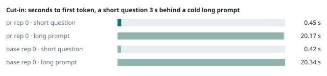
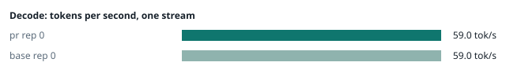
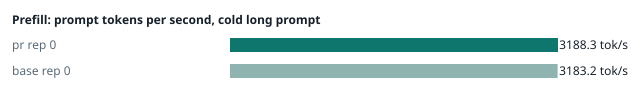
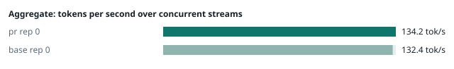
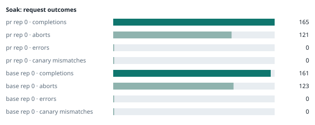

### Evidence: pr vs base

| target | role | image / artifact | model | settings that differ from the control |
|---|---|---|---|---|
| `pr` | candidate | `tensorfold-dsv41:pr-de28880a` (54b3ce1ffed2) | `DeepSeek-V4.1-Flash-1017` | - |
| `base` | control | `tensorfold-dsv41:base-97fdffb9` (5a94966d9621) | `DeepSeek-V4.1-Flash-1017` | baseline |

Conditions: fabric ring; order: A then B, one repetition (no reverse order: pass --opt reps=2 for a counterbalanced run); repetitions: 1; kit 1c26155.
Restore: live restored (verified: API answers, running artifact is live's).

#### smoke

| target | rep | arithmetic | greedy repeat equal | stream matches | JSON mode | first token (stream) | errors |
|---|---|---|---|---|---|---|---|
| `pr` | 0 | ✓ | ✓ | ✓ | ✓ | 0.098 s | - |
| `base` | 0 | ✓ | ✓ | ✓ | ✓ | 0.089 s | - |

machine state after the suite

- `pr` rep 0: `{"head": {"gpus": ["0, NVIDIA GB10, 2184 MHz, 55, [N/A], [N/A], 84 %"], "load": "load average: 6.87, 2.89, 1.20", "container": "92 pids 3.018GiB / 121.7GiB", "mem_available_mb": "26430"}}`
- `base` rep 0: `{"head": {"gpus": ["0, NVIDIA GB10, 2177 MHz, 59, [N/A], [N/A], 16 %"], "load": "load average: 7.12, 5.87, 4.60", "container": "92 pids 3.004GiB / 121.7GiB", "mem_available_mb": "27053"}}`

#### boundary

**6 of 19** greedy reply hashes identical, `pr` against `base`, over 1 repetition(s).

| rep | prompt | tokens (pr / base) | `pr` | `base` | same |
|---|---|---|---|---|---|
| 0 | len5 | 5 / 5 | `38127fef0fbb` | `38127fef0fbb` | ✓ |
| 0 | len2047 | 2047 / 2047 | `8488ccfbcf35` | `8488ccfbcf35` | ✓ |
| 0 | len2048 | 2048 / 2048 | `c5ac2fb76516` | `c5ac2fb76516` | ✓ |
| 0 | len2049 | 2049 / 2049 | `e3b0c44298fc` | `6766401c9caa` | **✗** |
| 0 | len4095 | 4095 / 4095 | `ed9e5086f520` | `ed9e5086f520` | ✓ |
| 0 | len4096 | 4096 / 4096 | `a87bd18cc9ce` | `52584e31f990` | **✗** |
| 0 | len4097 | 4097 / 4097 | `1f4e19e30220` | `1a71db317ee7` | **✗** |
| 0 | len6143 | 6143 / 6143 | `3b8fc1ca6a7b` | `2f9626e9baf5` | **✗** |
| 0 | len6144 | 6144 / 6144 | `2ef3dc011922` | `11933f2d4bd7` | **✗** |
| 0 | len6145 | 6145 / 6145 | `f9e1ef40f7de` | `7aa2f63b2547` | **✗** |
| 0 | len8193 | 8193 / 8193 | `2d1b0132f716` | `2ef3dc011922` | **✗** |
| 0 | len12289 | 12289 / 12289 | `2ef3dc011922` | `4fcfbd64881f` | **✗** |
| 0 | pfx_base | 5124 / 5124 | `bd6f047c4da0` | `52afe4842e5d` | **✗** |
| 0 | pfx_div3072 | 3376 / 3376 | `64d23fe171dc` | `64d23fe171dc` | ✓ |
| 0 | pfx_div2044 | 2348 / 2348 | `136234f08500` | `16db99ba02f2` | **✗** |
| 0 | pfx_div4092 | 4396 / 4396 | `63798c5ba36c` | `63798c5ba36c` | ✓ |
| 0 | pfx_div4093 | 4397 / 4397 | `67e4644b5144` | `6b1cfc31884d` | **✗** |
| 0 | pfx_base_again | 5124 / 5124 | `bd6f047c4da0` | `52afe4842e5d` | **✗** |
| 0 | pfx_extend | 6660 / 6660 | `3472b46bdbb4` | `357a869fef18` | **✗** |

machine state after the suite

- `pr` rep 0: `{"head": {"gpus": ["0, NVIDIA GB10, 2177 MHz, 62, [N/A], [N/A], 0 %"], "load": "load average: 6.64, 3.27, 1.39", "container": "92 pids 3.161GiB / 121.7GiB", "mem_available_mb": "26808"}}`
- `base` rep 0: `{"head": {"gpus": ["0, NVIDIA GB10, 2177 MHz, 65, [N/A], [N/A], 0 %"], "load": "load average: 5.68, 5.65, 4.58", "container": "92 pids 3.147GiB / 121.7GiB", "mem_available_mb": "26765"}}`

#### cutin

`pr` rep 0: short question first token **0.45 s** (rounds 0.34–0.469), long prompt first token 20.17 s (rounds 19.957–20.271); 3 rounds; admitted during the long prefill in 3 of 3 rounds
`base` rep 0: short question first token **0.42 s** (rounds 0.349–0.444), long prompt first token 20.34 s (rounds 20.05–20.346); 3 rounds; admitted during the long prefill in 3 of 3 rounds

machine state after the suite

- `pr` rep 0: `{"head": {"gpus": ["0, NVIDIA GB10, 2184 MHz, 70, [N/A], [N/A], 95 %"], "load": "load average: 6.56, 3.90, 1.73", "container": "92 pids 3.189GiB / 121.7GiB", "mem_available_mb": "26707"}}`
- `base` rep 0: `{"head": {"gpus": ["0, NVIDIA GB10, 2177 MHz, 69, [N/A], [N/A], 96 %"], "load": "load average: 7.33, 6.14, 4.82", "container": "92 pids 3.2GiB / 121.7GiB", "mem_available_mb": "26702"}}`

#### perf

| target | rep | decode tok/s, one stream | prefill tok/s, cold long prompt | aggregate tok/s, concurrent streams | errors |
|---|---|---|---|---|---|
| `pr` | 0 | **59.0** (56.7–59.5) | **3188.3** (3063.8–3189.2; 12004 tokens) | **134.2** (126.9–137.3; 4 streams) | - |
| `base` | 0 | **59.0** (52.8–60.1) | **3183.2** (3030.5–3200.2; 12004 tokens) | **132.4** (124.9–136.5; 4 streams) | - |

`pr` against `base`: decode +0.0%, prefill +0.2%, aggregate +1.4% (medians over repetitions; the verdict counts a difference only beyond the rounds' spread, at least ±3 %).

machine state after the suite

- `pr` rep 0: `{"head": {"gpus": ["0, NVIDIA GB10, 2177 MHz, 65, [N/A], [N/A], 0 %"], "load": "load average: 5.94, 4.04, 1.86", "container": "92 pids 3.362GiB / 121.7GiB", "mem_available_mb": "26427"}}`
- `base` rep 0: `{"head": {"gpus": ["0, NVIDIA GB10, 2177 MHz, 66, [N/A], [N/A], 0 %"], "load": "load average: 6.16, 5.97, 4.81", "container": "92 pids 3.346GiB / 121.7GiB", "mem_available_mb": "26420"}}`

#### startup

`pr`: 100.6 s from the switch to the API answering (1 start(s))
`base`: 101.8 s from the switch to the API answering (1 start(s))

#### soak

`pr` rep 0: 165 completions, 121 client aborts, **0 errors**, 58 canary checks with **0 mismatches**
  machine samples, first and last: `{"head": {"gpus": ["0, NVIDIA GB10, 2177 MHz, 67, [N/A], [N/A], 0 %"], "load": "load average: 5.47, 3.97, 1.85", "container": "96 pids 3.381GiB / 121.7GiB", "me` → `{"head": {"gpus": ["0, NVIDIA GB10, 2177 MHz, 71, [N/A], [N/A], 96 %"], "load": "load average: 6.26, 6.28, 4.11", "container": "95 pids 3.815GiB / 121.7GiB", "m`
`base` rep 0: 161 completions, 123 client aborts, **0 errors**, 57 canary checks with **0 mismatches**
  machine samples, first and last: `{"head": {"gpus": ["0, NVIDIA GB10, 2177 MHz, 65, [N/A], [N/A], 0 %"], "load": "load average: 5.74, 5.89, 4.79", "container": "96 pids 3.363GiB / 121.7GiB", "me` → `{"head": {"gpus": ["0, NVIDIA GB10, 2177 MHz, 73, [N/A], [N/A], 83 %"], "load": "load average: 6.52, 6.71, 5.75", "container": "96 pids 3.82GiB / 121.7GiB", "me`

machine state after the suite

- `pr` rep 0: `{"head": {"gpus": ["0, NVIDIA GB10, 2184 MHz, 59, [N/A], [N/A], 0 %"], "load": "load average: 4.46, 5.88, 4.12", "container": "92 pids 3.798GiB / 121.7GiB", "mem_available_mb": "25377"}}`
- `base` rep 0: `{"head": {"gpus": ["0, NVIDIA GB10, 2184 MHz, 60, [N/A], [N/A], 0 %"], "load": "load average: 4.78, 6.25, 5.66", "container": "92 pids 3.784GiB / 121.7GiB", "mem_available_mb": "25407"}}`

#### concurrency

| target | rep | streams | aggregate tok/s | first token p50 / p95 | batched replies ≠ serial | errors |
|---|---|---|---|---|---|---|
| `pr` | 0 | 1 (round 0) | **57.8** | 0.246 / 0.262 s | — |  |
| `pr` | 0 | 4 (round 0) | **100.2** | 0.82 / 1.185 s | 0 of 16 |  |
| `pr` | 0 | 8 (round 0) | **116.8** | 1.445 / 2.649 s | 0 of 16 |  |
| `pr` | 0 | 16 (round 0) | **131.0** | 2.734 / 5.28 s | 0 of 16 | 0 |
| `pr` | 0 | 1 (round 1) | **57.3** | 0.247 / 0.313 s | — |  |
| `pr` | 0 | 4 (round 1) | **98.0** | 0.828 / 1.367 s | 0 of 16 |  |
| `pr` | 0 | 8 (round 1) | **121.7** | 1.418 / 2.377 s | 0 of 16 |  |
| `pr` | 0 | 16 (round 1) | **129.2** | 2.731 / 5.197 s | 0 of 16 | 0 |
| `base` | 0 | 1 (round 0) | **58.0** | 0.246 / 0.259 s | — |  |
| `base` | 0 | 4 (round 0) | **100.2** | 0.823 / 1.146 s | 0 of 16 |  |
| `base` | 0 | 8 (round 0) | **120.3** | 1.443 / 2.425 s | 0 of 16 |  |
| `base` | 0 | 16 (round 0) | **132.0** | 2.74 / 5.211 s | 0 of 16 | 0 |
| `base` | 0 | 1 (round 1) | **58.0** | 0.246 / 0.298 s | — |  |
| `base` | 0 | 4 (round 1) | **101.8** | 0.825 / 1.13 s | 0 of 16 |  |
| `base` | 0 | 8 (round 1) | **122.1** | 1.427 / 2.393 s | 0 of 16 |  |
| `base` | 0 | 16 (round 1) | **131.9** | 2.746 / 5.281 s | 0 of 16 | 0 |

`pr` rep 0: 128 requests; batched replies identical to serial in 96 of 96 comparisons
- host `spark-123`: container memory 4198.4 → 4215.8 MB after the drain (**+17.4 MB**, +135.9 MB per 1000 requests); descriptors 223 → 223
- host `spark-161`: container memory 2920.4 → 2940.9 MB after the drain (**+20.5 MB**, +160.2 MB per 1000 requests); descriptors 150 → 150
- host `spark-197`: container memory 3003.4 → 3022.8 MB after the drain (**+19.4 MB**, +151.6 MB per 1000 requests); descriptors 150 → 147
- host `dell-113`: container memory 3047.4 → 3066.9 MB after the drain (**+19.5 MB**, +152.3 MB per 1000 requests); descriptors 150 → 150

`base` rep 0: 128 requests; batched replies identical to serial in 96 of 96 comparisons
- host `spark-123`: container memory 4131.8 → 4191.2 MB after the drain (**+59.4 MB**, +464.1 MB per 1000 requests); descriptors 223 → 223
- host `spark-161`: container memory 2867.2 → 2926.6 MB after the drain (**+59.4 MB**, +464.1 MB per 1000 requests); descriptors 150 → 150
- host `spark-197`: container memory 3029.0 → 3088.4 MB after the drain (**+59.4 MB**, +464.1 MB per 1000 requests); descriptors 150 → 150
- host `dell-113`: container memory 2993.2 → 3051.5 MB after the drain (**+58.3 MB**, +455.5 MB per 1000 requests); descriptors 150 → 150

machine state after the suite

- `pr` rep 0: `{"head": {"gpus": ["0, NVIDIA GB10, 2184 MHz, 57, [N/A], [N/A], 0 %"], "load": "load average: 3.13, 4.89, 4.17", "container": "92 pids 4.118GiB / 121.7GiB", "mem_available_mb": "24884"}}`
- `base` rep 0: `{"head": {"gpus": ["0, NVIDIA GB10, 2184 MHz, 57, [N/A], [N/A], 0 %"], "load": "load average: 2.70, 4.82, 5.24", "container": "92 pids 4.094GiB / 121.7GiB", "mem_available_mb": "24923"}}`

#### the pull request's own tests

The pull request adds or changes no test file under `tests/`.

#### What this run does not show

- a clean pair exit and recovery after an injected read fault (`fault` did not run)
- an external benchmark against a control (The Grill or similar) (`bench` did not run)
- <!-- add: paths only checked by reading, faults not injected, configurations not run -->

_Generated by inference-agent-kit `report.py` from `20261102T233015/results.json`._
