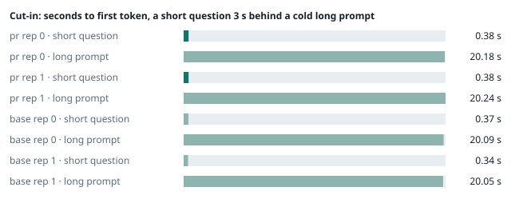
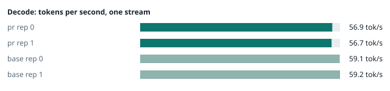
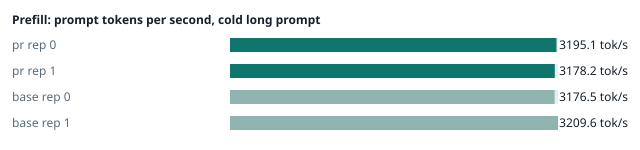
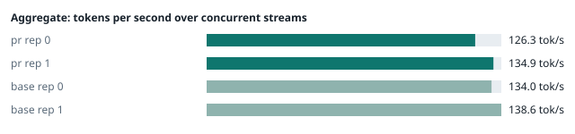
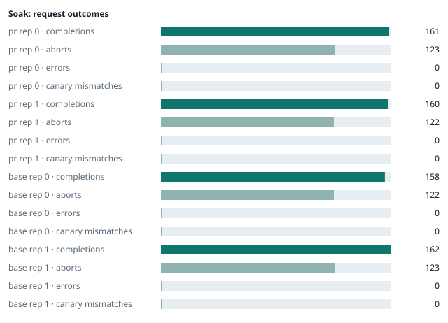

### Evidence: pr vs base

| target | role | image / artifact | model | settings that differ from the control |
|---|---|---|---|---|
| `pr` | candidate | `tensorfold-dsv41:pr-f49c79ed` (3254d526c6d0) | `DeepSeek-V4.1-Flash-1017` | - |
| `base` | control | `tensorfold-dsv41:base-97fdffb9` (5a94966d9621) | `DeepSeek-V4.1-Flash-1017` | baseline |

Conditions: fabric ring; order: counterbalanced over 2 repetitions: A B, then B A; repetitions: 2; kit 1c26155.
Restore: live restored (verified: API answers, running artifact is live's).

#### smoke

| target | rep | arithmetic | greedy repeat equal | stream matches | JSON mode | first token (stream) | errors |
|---|---|---|---|---|---|---|---|
| `pr` | 0 | ✓ | ✓ | ✓ | ✓ | 0.108 s | - |
| `pr` | 1 | ✓ | ✓ | ✓ | ✓ | 0.091 s | - |
| `base` | 0 | ✓ | ✓ | ✓ | ✓ | 0.093 s | - |
| `base` | 1 | ✓ | ✓ | ✓ | ✓ | 0.089 s | - |

machine state after the suite

- `pr` rep 0: `{"head": {"gpus": ["0, NVIDIA GB10, 2184 MHz, 57, [N/A], [N/A], 70 %"], "load": "load average: 6.66, 2.72, 2.29", "container": "92 pids 3.036GiB / 121.7GiB", "mem_available_mb": "27053"}}`
- `pr` rep 1: `{"head": {"gpus": ["0, NVIDIA GB10, 2184 MHz, 57, [N/A], [N/A], 0 %"], "load": "load average: 8.02, 6.36, 6.03", "container": "92 pids 3.006GiB / 121.7GiB", "mem_available_mb": "27240"}}`
- `base` rep 0: `{"head": {"gpus": ["0, NVIDIA GB10, 2184 MHz, 57, [N/A], [N/A], 0 %"], "load": "load average: 7.28, 5.67, 4.65", "container": "92 pids 3.005GiB / 121.7GiB", "mem_available_mb": "26439"}}`
- `base` rep 1: `{"head": {"gpus": ["0, NVIDIA GB10, 2177 MHz, 57, [N/A], [N/A], 92 %"], "load": "load average: 2.72, 4.89, 5.31", "container": "92 pids 4.186GiB / 121.7GiB", "mem_available_mb": "24741"}}`

#### boundary

**38 of 38** greedy reply hashes identical, `pr` against `base`, over 2 repetition(s).

| rep | prompt | tokens (pr / base) | `pr` | `base` | same |
|---|---|---|---|---|---|
| 0 | len5 | 5 / 5 | `38127fef0fbb` | `38127fef0fbb` | ✓ |
| 0 | len2047 | 2047 / 2047 | `8488ccfbcf35` | `8488ccfbcf35` | ✓ |
| 0 | len2048 | 2048 / 2048 | `c5ac2fb76516` | `c5ac2fb76516` | ✓ |
| 0 | len2049 | 2049 / 2049 | `6766401c9caa` | `6766401c9caa` | ✓ |
| 0 | len4095 | 4095 / 4095 | `ed9e5086f520` | `ed9e5086f520` | ✓ |
| 0 | len4096 | 4096 / 4096 | `52584e31f990` | `52584e31f990` | ✓ |
| 0 | len4097 | 4097 / 4097 | `1a71db317ee7` | `1a71db317ee7` | ✓ |
| 0 | len6143 | 6143 / 6143 | `2f9626e9baf5` | `2f9626e9baf5` | ✓ |
| 0 | len6144 | 6144 / 6144 | `11933f2d4bd7` | `11933f2d4bd7` | ✓ |
| 0 | len6145 | 6145 / 6145 | `7aa2f63b2547` | `7aa2f63b2547` | ✓ |
| 0 | len8193 | 8193 / 8193 | `2ef3dc011922` | `2ef3dc011922` | ✓ |
| 0 | len12289 | 12289 / 12289 | `4fcfbd64881f` | `4fcfbd64881f` | ✓ |
| 0 | pfx_base | 5124 / 5124 | `52afe4842e5d` | `52afe4842e5d` | ✓ |
| 0 | pfx_div3072 | 3376 / 3376 | `64d23fe171dc` | `64d23fe171dc` | ✓ |
| 0 | pfx_div2044 | 2348 / 2348 | `16db99ba02f2` | `16db99ba02f2` | ✓ |
| 0 | pfx_div4092 | 4396 / 4396 | `63798c5ba36c` | `63798c5ba36c` | ✓ |
| 0 | pfx_div4093 | 4397 / 4397 | `6b1cfc31884d` | `6b1cfc31884d` | ✓ |
| 0 | pfx_base_again | 5124 / 5124 | `52afe4842e5d` | `52afe4842e5d` | ✓ |
| 0 | pfx_extend | 6660 / 6660 | `357a869fef18` | `357a869fef18` | ✓ |
| 1 | len5 | 5 / 5 | `38127fef0fbb` | `38127fef0fbb` | ✓ |
| 1 | len2047 | 2047 / 2047 | `8488ccfbcf35` | `8488ccfbcf35` | ✓ |
| 1 | len2048 | 2048 / 2048 | `c5ac2fb76516` | `c5ac2fb76516` | ✓ |
| 1 | len2049 | 2049 / 2049 | `6766401c9caa` | `6766401c9caa` | ✓ |
| 1 | len4095 | 4095 / 4095 | `ed9e5086f520` | `ed9e5086f520` | ✓ |
| 1 | len4096 | 4096 / 4096 | `52584e31f990` | `52584e31f990` | ✓ |
| 1 | len4097 | 4097 / 4097 | `1a71db317ee7` | `1a71db317ee7` | ✓ |
| 1 | len6143 | 6143 / 6143 | `2f9626e9baf5` | `2f9626e9baf5` | ✓ |
| 1 | len6144 | 6144 / 6144 | `11933f2d4bd7` | `11933f2d4bd7` | ✓ |
| 1 | len6145 | 6145 / 6145 | `7aa2f63b2547` | `7aa2f63b2547` | ✓ |
| 1 | len8193 | 8193 / 8193 | `2ef3dc011922` | `2ef3dc011922` | ✓ |
| 1 | len12289 | 12289 / 12289 | `4fcfbd64881f` | `4fcfbd64881f` | ✓ |
| 1 | pfx_base | 5124 / 5124 | `52afe4842e5d` | `52afe4842e5d` | ✓ |
| 1 | pfx_div3072 | 3376 / 3376 | `64d23fe171dc` | `64d23fe171dc` | ✓ |
| 1 | pfx_div2044 | 2348 / 2348 | `16db99ba02f2` | `16db99ba02f2` | ✓ |
| 1 | pfx_div4092 | 4396 / 4396 | `63798c5ba36c` | `63798c5ba36c` | ✓ |
| 1 | pfx_div4093 | 4397 / 4397 | `6b1cfc31884d` | `6b1cfc31884d` | ✓ |
| 1 | pfx_base_again | 5124 / 5124 | `52afe4842e5d` | `52afe4842e5d` | ✓ |
| 1 | pfx_extend | 6660 / 6660 | `357a869fef18` | `357a869fef18` | ✓ |

machine state after the suite

- `pr` rep 0: `{"head": {"gpus": ["0, NVIDIA GB10, 2171 MHz, 63, [N/A], [N/A], 96 %"], "load": "load average: 5.96, 2.99, 2.40", "container": "92 pids 3.193GiB / 121.7GiB", "mem_available_mb": "26825"}}`
- `pr` rep 1: `{"head": {"gpus": ["0, NVIDIA GB10, 2177 MHz, 64, [N/A], [N/A], 83 %"], "load": "load average: 7.64, 6.46, 6.07", "container": "92 pids 3.15GiB / 121.7GiB", "mem_available_mb": "26841"}}`
- `base` rep 0: `{"head": {"gpus": ["0, NVIDIA GB10, 2171 MHz, 66, [N/A], [N/A], 96 %"], "load": "load average: 7.05, 5.81, 4.74", "container": "92 pids 3.149GiB / 121.7GiB", "mem_available_mb": "26841"}}`
- `base` rep 1: `{"head": {"gpus": ["0, NVIDIA GB10, 2171 MHz, 65, [N/A], [N/A], 91 %"], "load": "load average: 4.33, 5.02, 5.33", "container": "92 pids 4.186GiB / 121.7GiB", "mem_available_mb": "24759"}}`

#### cutin

`pr` rep 0: short question first token **0.38 s** (rounds 0.359–0.494), long prompt first token 20.18 s (rounds 20.036–20.198); 3 rounds; admitted during the long prefill in 3 of 3 rounds
`pr` rep 1: short question first token **0.38 s** (rounds 0.367–0.477), long prompt first token 20.24 s (rounds 19.982–20.572); 3 rounds; admitted during the long prefill in 3 of 3 rounds
`base` rep 0: short question first token **0.37 s** (rounds 0.346–0.387), long prompt first token 20.09 s (rounds 20.038–20.155); 3 rounds; admitted during the long prefill in 3 of 3 rounds
`base` rep 1: short question first token **0.34 s** (rounds 0.33–0.363), long prompt first token 20.05 s (rounds 19.999–20.144); 3 rounds; admitted during the long prefill in 3 of 3 rounds

machine state after the suite

- `pr` rep 0: `{"head": {"gpus": ["0, NVIDIA GB10, 2184 MHz, 72, [N/A], [N/A], 96 %"], "load": "load average: 6.40, 3.67, 2.67", "container": "92 pids 3.232GiB / 121.7GiB", "mem_available_mb": "26804"}}`
- `pr` rep 1: `{"head": {"gpus": ["0, NVIDIA GB10, 2177 MHz, 68, [N/A], [N/A], 0 %"], "load": "load average: 7.25, 6.54, 6.12", "container": "92 pids 3.178GiB / 121.7GiB", "mem_available_mb": "26784"}}`
- `base` rep 0: `{"head": {"gpus": ["0, NVIDIA GB10, 2177 MHz, 67, [N/A], [N/A], 96 %"], "load": "load average: 7.35, 6.18, 4.94", "container": "92 pids 3.189GiB / 121.7GiB", "mem_available_mb": "26708"}}`
- `base` rep 1: `{"head": {"gpus": ["0, NVIDIA GB10, 2177 MHz, 69, [N/A], [N/A], 96 %"], "load": "load average: 6.34, 5.48, 5.48", "container": "92 pids 4.188GiB / 121.7GiB", "mem_available_mb": "24712"}}`

#### perf

| target | rep | decode tok/s, one stream | prefill tok/s, cold long prompt | aggregate tok/s, concurrent streams | errors |
|---|---|---|---|---|---|
| `pr` | 0 | **56.9** (54.7–58.2) | **3195.1** (3053.7–3200.2; 12004 tokens) | **126.3** (122.4–133.8; 4 streams) | - |
| `pr` | 1 | **56.7** (54.6–59.0) | **3178.2** (2960.3–3204.5; 12004 tokens) | **134.9** (126.8–136.0; 4 streams) | - |
| `base` | 0 | **59.1** (57.0–60.3) | **3176.5** (3159.8–3178.2; 12004 tokens) | **134.0** (127.7–134.5; 4 streams) | - |
| `base` | 1 | **59.2** (56.6–60.8) | **3209.6** (3205.3–3220.0; 12004 tokens) | **138.6** (124.9–145.4; 4 streams) | - |

`pr` against `base`: decode -4.0%, prefill -0.2%, aggregate -4.2% (medians over repetitions; the verdict counts a difference only beyond the rounds' spread, at least ±3 %).

machine state after the suite

- `pr` rep 0: `{"head": {"gpus": ["0, NVIDIA GB10, 2177 MHz, 68, [N/A], [N/A], 95 %"], "load": "load average: 5.90, 3.88, 2.78", "container": "92 pids 3.416GiB / 121.7GiB", "mem_available_mb": "26402"}}`
- `pr` rep 1: `{"head": {"gpus": ["0, NVIDIA GB10, 2177 MHz, 66, [N/A], [N/A], 94 %"], "load": "load average: 6.31, 6.39, 6.09", "container": "92 pids 3.362GiB / 121.7GiB", "mem_available_mb": "26406"}}`
- `base` rep 0: `{"head": {"gpus": ["0, NVIDIA GB10, 2171 MHz, 67, [N/A], [N/A], 94 %"], "load": "load average: 6.68, 6.14, 4.98", "container": "92 pids 3.362GiB / 121.7GiB", "mem_available_mb": "26397"}}`
- `base` rep 1: `{"head": {"gpus": ["0, NVIDIA GB10, 2171 MHz, 67, [N/A], [N/A], 96 %"], "load": "load average: 5.73, 5.41, 5.45", "container": "92 pids 4.188GiB / 121.7GiB", "mem_available_mb": "24718"}}`

#### startup

`pr`: 100.6 s, 100.2 s from the switch to the API answering (2 start(s))
`base`: 100.5 s from the switch to the API answering (1 start(s))

#### soak

`pr` rep 0: 161 completions, 123 client aborts, **0 errors**, 57 canary checks with **0 mismatches**
  machine samples, first and last: `{"head": {"gpus": ["0, NVIDIA GB10, 2177 MHz, 66, [N/A], [N/A], 87 %"], "load": "load average: 5.91, 3.92, 2.80", "container": "97 pids 3.447GiB / 121.7GiB", "m` → `{"head": {"gpus": ["0, NVIDIA GB10, 2177 MHz, 72, [N/A], [N/A], 96 %"], "load": "load average: 5.98, 5.71, 4.28", "container": "96 pids 3.929GiB / 121.7GiB", "m`
`pr` rep 1: 160 completions, 122 client aborts, **0 errors**, 57 canary checks with **0 mismatches**
  machine samples, first and last: `{"head": {"gpus": ["0, NVIDIA GB10, 2177 MHz, 65, [N/A], [N/A], 88 %"], "load": "load average: 6.31, 6.39, 6.09", "container": "95 pids 3.378GiB / 121.7GiB", "m` → `{"head": {"gpus": ["0, NVIDIA GB10, 2171 MHz, 71, [N/A], [N/A], 96 %"], "load": "load average: 6.60, 6.47, 6.27", "container": "96 pids 3.865GiB / 121.7GiB", "m`
`base` rep 0: 158 completions, 122 client aborts, **0 errors**, 56 canary checks with **0 mismatches**
  machine samples, first and last: `{"head": {"gpus": ["0, NVIDIA GB10, 2177 MHz, 66, [N/A], [N/A], 0 %"], "load": "load average: 6.23, 6.06, 4.96", "container": "96 pids 3.378GiB / 121.7GiB", "me` → `{"head": {"gpus": ["0, NVIDIA GB10, 2177 MHz, 66, [N/A], [N/A], 96 %"], "load": "load average: 6.90, 6.61, 5.75", "container": "96 pids 3.929GiB / 121.7GiB", "m`
`base` rep 1: 162 completions, 123 client aborts, **0 errors**, 57 canary checks with **0 mismatches**
  machine samples, first and last: `{"head": {"gpus": ["0, NVIDIA GB10, 2177 MHz, 66, [N/A], [N/A], 29 %"], "load": "load average: 6.32, 5.54, 5.49", "container": "97 pids 4.22GiB / 121.7GiB", "me` → `{"head": {"gpus": ["0, NVIDIA GB10, 2184 MHz, 72, [N/A], [N/A], 96 %"], "load": "load average: 6.76, 6.72, 6.16", "container": "97 pids 4.549GiB / 121.7GiB", "m`

machine state after the suite

- `pr` rep 0: `{"head": {"gpus": ["0, NVIDIA GB10, 2184 MHz, 60, [N/A], [N/A], 0 %"], "load": "load average: 4.44, 5.41, 4.27", "container": "92 pids 3.904GiB / 121.7GiB", "mem_available_mb": "25223"}}`
- `pr` rep 1: `{"head": {"gpus": ["0, NVIDIA GB10, 2184 MHz, 59, [N/A], [N/A], 0 %"], "load": "load average: 4.81, 6.09, 6.16", "container": "92 pids 3.849GiB / 121.7GiB", "mem_available_mb": "25264"}}`
- `base` rep 0: `{"head": {"gpus": ["0, NVIDIA GB10, 2184 MHz, 55, [N/A], [N/A], 0 %"], "load": "load average: 5.33, 6.30, 5.71", "container": "92 pids 3.861GiB / 121.7GiB", "mem_available_mb": "25236"}}`
- `base` rep 1: `{"head": {"gpus": ["0, NVIDIA GB10, 2184 MHz, 59, [N/A], [N/A], 0 %"], "load": "load average: 4.60, 6.20, 6.02", "container": "92 pids 4.467GiB / 121.7GiB", "mem_available_mb": "24292"}}`

#### concurrency

| target | rep | streams | aggregate tok/s | first token p50 / p95 | batched replies ≠ serial | errors |
|---|---|---|---|---|---|---|
| `pr` | 0 | 1 (round 0) | **56.7** | 0.247 / 0.256 s | — |  |
| `pr` | 0 | 4 (round 0) | **99.3** | 0.832 / 1.146 s | 0 of 16 |  |
| `pr` | 0 | 8 (round 0) | **120.8** | 1.444 / 2.402 s | 0 of 16 |  |
| `pr` | 0 | 16 (round 0) | **130.5** | 2.759 / 5.297 s | 0 of 16 | 0 |
| `pr` | 0 | 1 (round 1) | **56.7** | 0.248 / 0.265 s | — |  |
| `pr` | 0 | 4 (round 1) | **99.9** | 0.827 / 1.133 s | 0 of 16 |  |
| `pr` | 0 | 8 (round 1) | **120.5** | 1.435 / 2.408 s | 0 of 16 |  |
| `pr` | 0 | 16 (round 1) | **131.4** | 2.732 / 5.152 s | 0 of 16 | 0 |
| `pr` | 1 | 1 (round 0) | **52.6** | 0.249 / 0.26 s | — |  |
| `pr` | 1 | 4 (round 0) | **93.4** | 0.83 / 1.137 s | 0 of 16 |  |
| `pr` | 1 | 8 (round 0) | **109.5** | 1.445 / 2.677 s | 0 of 16 |  |
| `pr` | 1 | 16 (round 0) | **122.0** | 2.712 / 5.189 s | 0 of 16 | 0 |
| `pr` | 1 | 1 (round 1) | **52.7** | 0.246 / 0.265 s | — |  |
| `pr` | 1 | 4 (round 1) | **93.4** | 0.815 / 1.144 s | 0 of 16 |  |
| `pr` | 1 | 8 (round 1) | **109.3** | 1.428 / 2.383 s | 0 of 16 |  |
| `pr` | 1 | 16 (round 1) | **122.8** | 2.724 / 5.194 s | 0 of 16 | 0 |
| `base` | 0 | 1 (round 0) | **58.2** | 0.247 / 0.257 s | — |  |
| `base` | 0 | 4 (round 0) | **101.1** | 0.827 / 1.138 s | 0 of 16 |  |
| `base` | 0 | 8 (round 0) | **120.4** | 1.44 / 2.547 s | 0 of 16 |  |
| `base` | 0 | 16 (round 0) | **131.5** | 2.759 / 5.248 s | 0 of 16 | 0 |
| `base` | 0 | 1 (round 1) | **57.8** | 0.249 / 0.285 s | — |  |
| `base` | 0 | 4 (round 1) | **100.0** | 0.833 / 1.145 s | 0 of 16 |  |
| `base` | 0 | 8 (round 1) | **120.1** | 1.453 / 2.431 s | 0 of 16 |  |
| `base` | 0 | 16 (round 1) | **132.9** | 2.719 / 5.194 s | 0 of 16 | 0 |
| `base` | 1 | 1 (round 0) | **50.0** | 0.245 / 0.298 s | — |  |
| `base` | 1 | 4 (round 0) | **75.9** | 0.829 / 1.237 s | 0 of 16 |  |
| `base` | 1 | 8 (round 0) | **91.0** | 1.521 / 2.557 s | 0 of 16 |  |
| `base` | 1 | 16 (round 0) | **91.0** | 2.911 / 9.09 s | 0 of 16 | 0 |
| `base` | 1 | 1 (round 1) | **36.6** | 0.28 / 0.299 s | — |  |
| `base` | 1 | 4 (round 1) | **95.6** | 0.813 / 1.125 s | 0 of 16 |  |
| `base` | 1 | 8 (round 1) | **94.4** | 1.443 / 2.386 s | 0 of 16 |  |
| `base` | 1 | 16 (round 1) | **96.1** | 2.875 / 9.582 s | 0 of 16 | 0 |

`pr` rep 0: 128 requests; batched replies identical to serial in 96 of 96 comparisons
- host `spark-123`: container memory 4306.9 → 4313.1 MB after the drain (**+6.2 MB**, +48.4 MB per 1000 requests); descriptors 223 → 223
- host `spark-161`: container memory 3010.6 → 3018.8 MB after the drain (**+8.2 MB**, +64.1 MB per 1000 requests); descriptors 150 → 150
- host `spark-197`: container memory 3170.3 → 3177.5 MB after the drain (**+7.2 MB**, +56.2 MB per 1000 requests); descriptors 150 → 150
- host `dell-113`: container memory 3138.6 → 3145.7 MB after the drain (**+7.1 MB**, +55.5 MB per 1000 requests); descriptors 150 → 150

`pr` rep 1: 128 requests; batched replies identical to serial in 96 of 96 comparisons
- host `spark-123`: container memory 4186.1 → 4210.7 MB after the drain (**+24.6 MB**, +192.2 MB per 1000 requests); descriptors 223 → 223
- host `spark-161`: container memory 2917.4 → 2942.0 MB after the drain (**+24.6 MB**, +192.2 MB per 1000 requests); descriptors 150 → 150
- host `spark-197`: container memory 3061.8 → 3087.4 MB after the drain (**+25.6 MB**, +200.0 MB per 1000 requests); descriptors 150 → 150
- host `dell-113`: container memory 3037.2 → 3061.8 MB after the drain (**+24.6 MB**, +192.2 MB per 1000 requests); descriptors 147 → 147

`base` rep 0: 128 requests; batched replies identical to serial in 96 of 96 comparisons
- host `spark-123`: container memory 4265.0 → 4287.5 MB after the drain (**+22.5 MB**, +175.8 MB per 1000 requests); descriptors 223 → 220
- host `spark-161`: container memory 2995.2 → 3018.8 MB after the drain (**+23.6 MB**, +184.4 MB per 1000 requests); descriptors 150 → 150
- host `spark-197`: container memory 3078.1 → 3102.7 MB after the drain (**+24.6 MB**, +192.2 MB per 1000 requests); descriptors 150 → 150
- host `dell-113`: container memory 3119.1 → 3142.7 MB after the drain (**+23.6 MB**, +184.4 MB per 1000 requests); descriptors 150 → 150

`base` rep 1: 128 requests; batched replies identical to serial in 96 of 96 comparisons
- host `spark-123`: container memory 4826.1 → 5358.6 MB after the drain (**+532.5 MB**, +4160.2 MB per 1000 requests); descriptors 224 → 223
- host `spark-161`: container memory 3569.7 → 4092.9 MB after the drain (**+523.2 MB**, +4087.5 MB per 1000 requests); descriptors 150 → 147
- host `spark-197`: container memory 3653.6 → 4176.9 MB after the drain (**+523.3 MB**, +4088.3 MB per 1000 requests); descriptors 150 → 150
- host `dell-113`: container memory 3695.6 → 4217.9 MB after the drain (**+522.3 MB**, +4080.5 MB per 1000 requests); descriptors 150 → 150

machine state after the suite

- `pr` rep 0: `{"head": {"gpus": ["0, NVIDIA GB10, 2184 MHz, 58, [N/A], [N/A], 0 %"], "load": "load average: 2.55, 4.40, 4.17", "container": "92 pids 4.212GiB / 121.7GiB", "mem_available_mb": "24793"}}`
- `pr` rep 1: `{"head": {"gpus": ["0, NVIDIA GB10, 2184 MHz, 58, [N/A], [N/A], 0 %"], "load": "load average: 2.54, 4.69, 5.60", "container": "92 pids 4.111GiB / 121.7GiB", "mem_available_mb": "24889"}}`
- `base` rep 0: `{"head": {"gpus": ["0, NVIDIA GB10, 2184 MHz, 56, [N/A], [N/A], 0 %"], "load": "load average: 2.72, 4.89, 5.31", "container": "92 pids 4.187GiB / 121.7GiB", "mem_available_mb": "24725"}}`
- `base` rep 1: `{"head": {"gpus": ["0, NVIDIA GB10, 2184 MHz, 59, [N/A], [N/A], 0 %"], "load": "load average: 3.83, 5.12, 5.63", "container": "92 pids 5.233GiB / 121.7GiB", "mem_available_mb": "23085"}}`

#### the pull request's own tests

The pull request adds or changes no test file under `tests/`.

#### What this run does not show

- a clean pair exit and recovery after an injected read fault (`fault` did not run)
- an external benchmark against a control (The Grill or similar) (`bench` did not run)
- <!-- add: paths only checked by reading, faults not injected, configurations not run -->

_Generated by inference-agent-kit `report.py` from `20261103T003117/results.json`._
