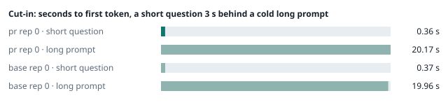
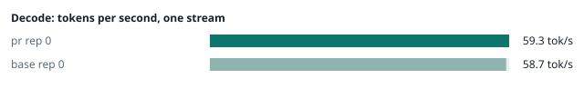
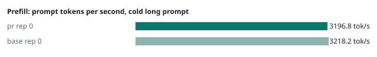
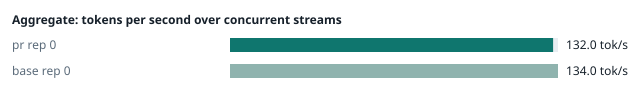
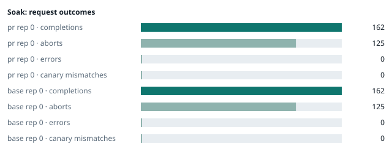

### Evidence: pr vs base

| target | role | image / artifact | model | settings that differ from the control |
|---|---|---|---|---|
| `pr` | candidate | `tensorfold-dsv41:pr-67d4e697` (dd28c151acfe) | `DeepSeek-V4.1-Flash-1017` | - |
| `base` | control | `tensorfold-dsv41:base-97fdffb9` (5a94966d9621) | `DeepSeek-V4.1-Flash-1017` | baseline |

Conditions: fabric ring; order: A then B, one repetition (no reverse order: pass --opt reps=2 for a counterbalanced run); repetitions: 1; kit 1c26155.
Restore: live restored (verified: API answers, running artifact is live's).

#### smoke

| target | rep | arithmetic | greedy repeat equal | stream matches | JSON mode | first token (stream) | errors |
|---|---|---|---|---|---|---|---|
| `pr` | 0 | ✓ | ✓ | ✓ | ✓ | 0.094 s | - |
| `base` | 0 | ✓ | ✓ | ✓ | ✓ | 0.09 s | - |

machine state after the suite

- `pr` rep 0: `{"head": {"gpus": ["0, NVIDIA GB10, 2184 MHz, 56, [N/A], [N/A], 0 %"], "load": "load average: 6.72, 2.78, 2.71", "container": "92 pids 3.097GiB / 121.7GiB", "mem_available_mb": "27248"}}`
- `base` rep 0: `{"head": {"gpus": ["0, NVIDIA GB10, 2177 MHz, 61, [N/A], [N/A], 79 %"], "load": "load average: 6.95, 5.27, 4.58", "container": "92 pids 3.034GiB / 121.7GiB", "mem_available_mb": "28094"}}`

#### boundary

**19 of 19** greedy reply hashes identical, `pr` against `base`, over 1 repetition(s).

| rep | prompt | tokens (pr / base) | `pr` | `base` | same |
|---|---|---|---|---|---|
| 0 | len5 | 5 / 5 | `38127fef0fbb` | `38127fef0fbb` | ✓ |
| 0 | len2047 | 2047 / 2047 | `8488ccfbcf35` | `8488ccfbcf35` | ✓ |
| 0 | len2048 | 2048 / 2048 | `c5ac2fb76516` | `c5ac2fb76516` | ✓ |
| 0 | len2049 | 2049 / 2049 | `6766401c9caa` | `6766401c9caa` | ✓ |
| 0 | len4095 | 4095 / 4095 | `ed9e5086f520` | `ed9e5086f520` | ✓ |
| 0 | len4096 | 4096 / 4096 | `52584e31f990` | `52584e31f990` | ✓ |
| 0 | len4097 | 4097 / 4097 | `1a71db317ee7` | `1a71db317ee7` | ✓ |
| 0 | len6143 | 6143 / 6143 | `2f9626e9baf5` | `2f9626e9baf5` | ✓ |
| 0 | len6144 | 6144 / 6144 | `11933f2d4bd7` | `11933f2d4bd7` | ✓ |
| 0 | len6145 | 6145 / 6145 | `7aa2f63b2547` | `7aa2f63b2547` | ✓ |
| 0 | len8193 | 8193 / 8193 | `2ef3dc011922` | `2ef3dc011922` | ✓ |
| 0 | len12289 | 12289 / 12289 | `4fcfbd64881f` | `4fcfbd64881f` | ✓ |
| 0 | pfx_base | 5124 / 5124 | `52afe4842e5d` | `52afe4842e5d` | ✓ |
| 0 | pfx_div3072 | 3376 / 3376 | `64d23fe171dc` | `64d23fe171dc` | ✓ |
| 0 | pfx_div2044 | 2348 / 2348 | `16db99ba02f2` | `16db99ba02f2` | ✓ |
| 0 | pfx_div4092 | 4396 / 4396 | `63798c5ba36c` | `63798c5ba36c` | ✓ |
| 0 | pfx_div4093 | 4397 / 4397 | `6b1cfc31884d` | `6b1cfc31884d` | ✓ |
| 0 | pfx_base_again | 5124 / 5124 | `52afe4842e5d` | `52afe4842e5d` | ✓ |
| 0 | pfx_extend | 6660 / 6660 | `357a869fef18` | `357a869fef18` | ✓ |

machine state after the suite

- `pr` rep 0: `{"head": {"gpus": ["0, NVIDIA GB10, 2171 MHz, 66, [N/A], [N/A], 96 %"], "load": "load average: 5.89, 3.05, 2.80", "container": "92 pids 3.402GiB / 121.7GiB", "mem_available_mb": "27555"}}`
- `base` rep 0: `{"head": {"gpus": ["0, NVIDIA GB10, 2171 MHz, 70, [N/A], [N/A], 96 %"], "load": "load average: 7.05, 5.46, 4.66", "container": "92 pids 3.177GiB / 121.7GiB", "mem_available_mb": "27746"}}`

#### cutin

`pr` rep 0: short question first token **0.36 s** (rounds 0.358–0.494), long prompt first token 20.17 s (rounds 20.023–20.317); 3 rounds; admitted during the long prefill in 3 of 3 rounds
`base` rep 0: short question first token **0.37 s** (rounds 0.331–0.42), long prompt first token 19.96 s (rounds 19.946–20.001); 3 rounds; admitted during the long prefill in 3 of 3 rounds

machine state after the suite

- `pr` rep 0: `{"head": {"gpus": ["0, NVIDIA GB10, 2177 MHz, 68, [N/A], [N/A], 5 %"], "load": "load average: 6.62, 3.85, 3.10", "container": "92 pids 3.502GiB / 121.7GiB", "mem_available_mb": "27565"}}`
- `base` rep 0: `{"head": {"gpus": ["0, NVIDIA GB10, 2177 MHz, 70, [N/A], [N/A], 0 %"], "load": "load average: 6.58, 5.69, 4.80", "container": "92 pids 3.217GiB / 121.7GiB", "mem_available_mb": "27653"}}`

#### perf

| target | rep | decode tok/s, one stream | prefill tok/s, cold long prompt | aggregate tok/s, concurrent streams | errors |
|---|---|---|---|---|---|
| `pr` | 0 | **59.3** (56.8–59.4) | **3196.8** (2915.0–3207.1; 12004 tokens) | **132.0** (125.2–136.9; 4 streams) | - |
| `base` | 0 | **58.7** (56.0–60.0) | **3218.2** (3216.5–3249.6; 12004 tokens) | **134.0** (128.7–139.5; 4 streams) | - |

`pr` against `base`: decode +1.0%, prefill -0.7%, aggregate -1.5% (medians over repetitions; the verdict counts a difference only beyond the rounds' spread, at least ±3 %).

machine state after the suite

- `pr` rep 0: `{"head": {"gpus": ["0, NVIDIA GB10, 2177 MHz, 68, [N/A], [N/A], 96 %"], "load": "load average: 5.83, 3.96, 3.16", "container": "92 pids 3.815GiB / 121.7GiB", "mem_available_mb": "26997"}}`
- `base` rep 0: `{"head": {"gpus": ["0, NVIDIA GB10, 2171 MHz, 68, [N/A], [N/A], 95 %"], "load": "load average: 5.73, 5.58, 4.80", "container": "92 pids 3.4GiB / 121.7GiB", "mem_available_mb": "27391"}}`

#### startup

`pr`: 100.1 s from the switch to the API answering (1 start(s))
`base`: 100.2 s from the switch to the API answering (1 start(s))

#### soak

`pr` rep 0: 162 completions, 125 client aborts, **0 errors**, 57 canary checks with **0 mismatches**
  machine samples, first and last: `{"head": {"gpus": ["0, NVIDIA GB10, 2177 MHz, 66, [N/A], [N/A], 0 %"], "load": "load average: 5.61, 3.94, 3.16", "container": "96 pids 3.872GiB / 121.7GiB", "me` → `{"head": {"gpus": ["0, NVIDIA GB10, 2177 MHz, 71, [N/A], [N/A], 96 %"], "load": "load average: 5.60, 5.54, 4.42", "container": "95 pids 6.803GiB / 121.7GiB", "m`
`base` rep 0: 162 completions, 125 client aborts, **0 errors**, 57 canary checks with **0 mismatches**
  machine samples, first and last: `{"head": {"gpus": ["0, NVIDIA GB10, 2177 MHz, 66, [N/A], [N/A], 96 %"], "load": "load average: 5.27, 5.48, 4.77", "container": "97 pids 3.431GiB / 121.7GiB", "m` → `{"head": {"gpus": ["0, NVIDIA GB10, 2184 MHz, 73, [N/A], [N/A], 96 %"], "load": "load average: 6.25, 6.03, 5.39", "container": "95 pids 3.865GiB / 121.7GiB", "m`

machine state after the suite

- `pr` rep 0: `{"head": {"gpus": ["0, NVIDIA GB10, 2184 MHz, 60, [N/A], [N/A], 0 %"], "load": "load average: 4.18, 5.26, 4.40", "container": "92 pids 6.952GiB / 121.7GiB", "mem_available_mb": "23143"}}`
- `base` rep 0: `{"head": {"gpus": ["0, NVIDIA GB10, 2184 MHz, 61, [N/A], [N/A], 0 %"], "load": "load average: 4.12, 5.57, 5.28", "container": "92 pids 3.85GiB / 121.7GiB", "mem_available_mb": "26303"}}`

#### concurrency

| target | rep | streams | aggregate tok/s | first token p50 / p95 | batched replies ≠ serial | errors |
|---|---|---|---|---|---|---|
| `pr` | 0 | 1 (round 0) | **57.4** | 0.249 / 0.268 s | — |  |
| `pr` | 0 | 4 (round 0) | **100.8** | 0.826 / 1.153 s | 0 of 16 |  |
| `pr` | 0 | 8 (round 0) | **116.8** | 1.45 / 2.734 s | 0 of 16 |  |
| `pr` | 0 | 16 (round 0) | **133.9** | 2.729 / 5.168 s | 0 of 16 | 0 |
| `pr` | 0 | 1 (round 1) | **57.7** | 0.25 / 0.264 s | — |  |
| `pr` | 0 | 4 (round 1) | **98.0** | 0.824 / 1.383 s | 0 of 16 |  |
| `pr` | 0 | 8 (round 1) | **120.8** | 1.429 / 2.411 s | 0 of 16 |  |
| `pr` | 0 | 16 (round 1) | **132.3** | 2.722 / 5.168 s | 0 of 16 | 0 |
| `base` | 0 | 1 (round 0) | **58.4** | 0.245 / 0.258 s | — |  |
| `base` | 0 | 4 (round 0) | **101.1** | 0.819 / 1.194 s | 0 of 16 |  |
| `base` | 0 | 8 (round 0) | **122.5** | 1.419 / 2.37 s | 0 of 16 |  |
| `base` | 0 | 16 (round 0) | **132.4** | 2.724 / 5.18 s | 0 of 16 | 0 |
| `base` | 0 | 1 (round 1) | **58.0** | 0.247 / 0.258 s | — |  |
| `base` | 0 | 4 (round 1) | **101.8** | 0.836 / 1.139 s | 0 of 16 |  |
| `base` | 0 | 8 (round 1) | **122.3** | 1.424 / 2.374 s | 0 of 16 |  |
| `base` | 0 | 16 (round 1) | **134.1** | 2.776 / 5.23 s | 0 of 16 | 0 |

`pr` rep 0: 128 requests; batched replies identical to serial in 96 of 96 comparisons
- host `spark-123`: container memory 7880.7 → 8951.8 MB after the drain (**+1071.1 MB**, +8368.0 MB per 1000 requests); descriptors 223 → 223
- host `spark-161`: container memory 2896.9 → 2942.0 MB after the drain (**+45.1 MB**, +352.3 MB per 1000 requests); descriptors 150 → 150
- host `spark-197`: container memory 3053.6 → 3098.6 MB after the drain (**+45.0 MB**, +351.6 MB per 1000 requests); descriptors 150 → 150
- host `dell-113`: container memory 3024.9 → 3070.0 MB after the drain (**+45.1 MB**, +352.3 MB per 1000 requests); descriptors 150 → 150

`base` rep 0: 128 requests; batched replies identical to serial in 96 of 96 comparisons
- host `spark-123`: container memory 4209.7 → 4224.0 MB after the drain (**+14.3 MB**, +111.7 MB per 1000 requests); descriptors 223 → 223
- host `spark-161`: container memory 2913.3 → 2926.6 MB after the drain (**+13.3 MB**, +103.9 MB per 1000 requests); descriptors 150 → 150
- host `spark-197`: container memory 2999.3 → 3012.6 MB after the drain (**+13.3 MB**, +103.9 MB per 1000 requests); descriptors 150 → 150
- host `dell-113`: container memory 3037.2 → 3050.5 MB after the drain (**+13.3 MB**, +103.9 MB per 1000 requests); descriptors 150 → 150

machine state after the suite

- `pr` rep 0: `{"head": {"gpus": ["0, NVIDIA GB10, 2184 MHz, 57, [N/A], [N/A], 0 %"], "load": "load average: 2.06, 4.08, 4.16", "container": "92 pids 8.742GiB / 121.7GiB", "mem_available_mb": "21194"}}`
- `base` rep 0: `{"head": {"gpus": ["0, NVIDIA GB10, 2184 MHz, 58, [N/A], [N/A], 0 %"], "load": "load average: 2.31, 4.32, 4.86", "container": "92 pids 4.124GiB / 121.7GiB", "mem_available_mb": "25870"}}`

#### the pull request's own tests

The pull request adds or changes no test file under `tests/`.

#### What this run does not show

- a clean pair exit and recovery after an injected read fault (`fault` did not run)
- an external benchmark against a control (The Grill or similar) (`bench` did not run)
- <!-- add: paths only checked by reading, faults not injected, configurations not run -->

_Generated by inference-agent-kit `report.py` from `20261103T020546/results.json`._
