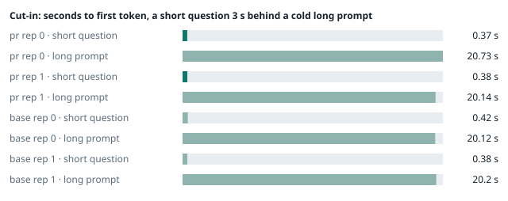
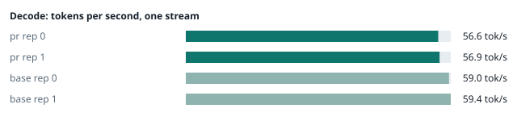
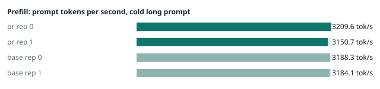
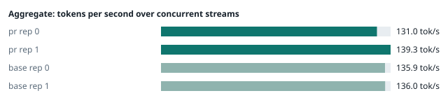
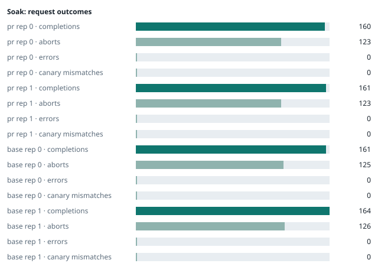

### Evidence: pr vs base

| target | role | image / artifact | model | settings that differ from the control |
|---|---|---|---|---|
| `pr` | candidate | `tensorfold-dsv41:pr-a9a25f1b` (3254d526c6d0) | `DeepSeek-V4.1-Flash-1017` | - |
| `base` | control | `tensorfold-dsv41:base-97fdffb9` (5a94966d9621) | `DeepSeek-V4.1-Flash-1017` | baseline |

Conditions: fabric ring; order: counterbalanced over 2 repetitions: A B, then B A; repetitions: 2; kit d9102c0.
Restore: live restored (verified: API answers, running artifact is live's).

#### smoke

| target | rep | arithmetic | greedy repeat equal | stream matches | JSON mode | first token (stream) | errors |
|---|---|---|---|---|---|---|---|
| `pr` | 0 | ✓ | ✓ | ✓ | ✓ | 0.1 s | - |
| `pr` | 1 | ✓ | ✓ | ✓ | ✓ | 0.096 s | - |
| `base` | 0 | ✓ | ✓ | ✓ | ✓ | 0.091 s | - |
| `base` | 1 | ✓ | ✓ | ✓ | ✓ | 0.094 s | - |

machine state after the suite

- `pr` rep 0: `{"head": {"gpus": ["0, NVIDIA GB10, 2177 MHz, 54, [N/A], [N/A], 85 %"], "load": "load average: 7.33, 3.42, 2.61", "container": "92 pids 3.006GiB / 121.7GiB", "mem_available_mb": "27480"}}`
- `pr` rep 1: `{"head": {"gpus": ["0, NVIDIA GB10, 2177 MHz, 61, [N/A], [N/A], 92 %"], "load": "load average: 7.85, 6.08, 5.66", "container": "92 pids 3.036GiB / 121.7GiB", "mem_available_mb": "28120"}}`
- `base` rep 0: `{"head": {"gpus": ["0, NVIDIA GB10, 2184 MHz, 57, [N/A], [N/A], 87 %"], "load": "load average: 6.59, 5.24, 4.57", "container": "92 pids 3.036GiB / 121.7GiB", "mem_available_mb": "27362"}}`
- `base` rep 1: `{"head": {"gpus": ["0, NVIDIA GB10, 2177 MHz, 60, [N/A], [N/A], 96 %"], "load": "load average: 2.24, 4.33, 4.90", "container": "92 pids 4.173GiB / 121.7GiB", "mem_available_mb": "25885"}}`

#### boundary

**38 of 38** greedy reply hashes identical, `pr` against `base`, over 2 repetition(s).

| rep | prompt | tokens (pr / base) | `pr` | `base` | same |
|---|---|---|---|---|---|
| 0 | len5 | 5 / 5 | `38127fef0fbb` | `38127fef0fbb` | ✓ |
| 0 | len2047 | 2047 / 2047 | `8488ccfbcf35` | `8488ccfbcf35` | ✓ |
| 0 | len2048 | 2048 / 2048 | `c5ac2fb76516` | `c5ac2fb76516` | ✓ |
| 0 | len2049 | 2049 / 2049 | `6766401c9caa` | `6766401c9caa` | ✓ |
| 0 | len4095 | 4095 / 4095 | `ed9e5086f520` | `ed9e5086f520` | ✓ |
| 0 | len4096 | 4096 / 4096 | `52584e31f990` | `52584e31f990` | ✓ |
| 0 | len4097 | 4097 / 4097 | `1a71db317ee7` | `1a71db317ee7` | ✓ |
| 0 | len6143 | 6143 / 6143 | `2f9626e9baf5` | `2f9626e9baf5` | ✓ |
| 0 | len6144 | 6144 / 6144 | `11933f2d4bd7` | `11933f2d4bd7` | ✓ |
| 0 | len6145 | 6145 / 6145 | `7aa2f63b2547` | `7aa2f63b2547` | ✓ |
| 0 | len8193 | 8193 / 8193 | `2ef3dc011922` | `2ef3dc011922` | ✓ |
| 0 | len12289 | 12289 / 12289 | `4fcfbd64881f` | `4fcfbd64881f` | ✓ |
| 0 | pfx_base | 5124 / 5124 | `52afe4842e5d` | `52afe4842e5d` | ✓ |
| 0 | pfx_div3072 | 3376 / 3376 | `64d23fe171dc` | `64d23fe171dc` | ✓ |
| 0 | pfx_div2044 | 2348 / 2348 | `16db99ba02f2` | `16db99ba02f2` | ✓ |
| 0 | pfx_div4092 | 4396 / 4396 | `63798c5ba36c` | `63798c5ba36c` | ✓ |
| 0 | pfx_div4093 | 4397 / 4397 | `6b1cfc31884d` | `6b1cfc31884d` | ✓ |
| 0 | pfx_base_again | 5124 / 5124 | `52afe4842e5d` | `52afe4842e5d` | ✓ |
| 0 | pfx_extend | 6660 / 6660 | `357a869fef18` | `357a869fef18` | ✓ |
| 1 | len5 | 5 / 5 | `38127fef0fbb` | `38127fef0fbb` | ✓ |
| 1 | len2047 | 2047 / 2047 | `8488ccfbcf35` | `8488ccfbcf35` | ✓ |
| 1 | len2048 | 2048 / 2048 | `c5ac2fb76516` | `c5ac2fb76516` | ✓ |
| 1 | len2049 | 2049 / 2049 | `6766401c9caa` | `6766401c9caa` | ✓ |
| 1 | len4095 | 4095 / 4095 | `ed9e5086f520` | `ed9e5086f520` | ✓ |
| 1 | len4096 | 4096 / 4096 | `52584e31f990` | `52584e31f990` | ✓ |
| 1 | len4097 | 4097 / 4097 | `1a71db317ee7` | `1a71db317ee7` | ✓ |
| 1 | len6143 | 6143 / 6143 | `2f9626e9baf5` | `2f9626e9baf5` | ✓ |
| 1 | len6144 | 6144 / 6144 | `11933f2d4bd7` | `11933f2d4bd7` | ✓ |
| 1 | len6145 | 6145 / 6145 | `7aa2f63b2547` | `7aa2f63b2547` | ✓ |
| 1 | len8193 | 8193 / 8193 | `2ef3dc011922` | `2ef3dc011922` | ✓ |
| 1 | len12289 | 12289 / 12289 | `4fcfbd64881f` | `4fcfbd64881f` | ✓ |
| 1 | pfx_base | 5124 / 5124 | `52afe4842e5d` | `52afe4842e5d` | ✓ |
| 1 | pfx_div3072 | 3376 / 3376 | `64d23fe171dc` | `64d23fe171dc` | ✓ |
| 1 | pfx_div2044 | 2348 / 2348 | `16db99ba02f2` | `16db99ba02f2` | ✓ |
| 1 | pfx_div4092 | 4396 / 4396 | `63798c5ba36c` | `63798c5ba36c` | ✓ |
| 1 | pfx_div4093 | 4397 / 4397 | `6b1cfc31884d` | `6b1cfc31884d` | ✓ |
| 1 | pfx_base_again | 5124 / 5124 | `52afe4842e5d` | `52afe4842e5d` | ✓ |
| 1 | pfx_extend | 6660 / 6660 | `357a869fef18` | `357a869fef18` | ✓ |

machine state after the suite

- `pr` rep 0: `{"head": {"gpus": ["0, NVIDIA GB10, 2171 MHz, 62, [N/A], [N/A], 0 %"], "load": "load average: 6.79, 3.79, 2.77", "container": "92 pids 3.163GiB / 121.7GiB", "mem_available_mb": "27953"}}`
- `pr` rep 1: `{"head": {"gpus": ["0, NVIDIA GB10, 2171 MHz, 64, [N/A], [N/A], 93 %"], "load": "load average: 6.79, 6.01, 5.66", "container": "92 pids 3.179GiB / 121.7GiB", "mem_available_mb": "27830"}}`
- `base` rep 0: `{"head": {"gpus": ["0, NVIDIA GB10, 2177 MHz, 66, [N/A], [N/A], 96 %"], "load": "load average: 6.20, 5.31, 4.62", "container": "92 pids 3.193GiB / 121.7GiB", "mem_available_mb": "27834"}}`
- `base` rep 1: `{"head": {"gpus": ["0, NVIDIA GB10, 2171 MHz, 65, [N/A], [N/A], 0 %"], "load": "load average: 3.52, 4.39, 4.89", "container": "92 pids 4.173GiB / 121.7GiB", "mem_available_mb": "25900"}}`

#### cutin

`pr` rep 0: short question first token **0.37 s** (rounds 0.362–0.506), long prompt first token 20.73 s (rounds 19.983–20.808); 3 rounds; admitted during the long prefill in 3 of 3 rounds
`pr` rep 1: short question first token **0.38 s** (rounds 0.37–0.423), long prompt first token 20.14 s (rounds 20.056–20.286); 3 rounds; admitted during the long prefill in 3 of 3 rounds
`base` rep 0: short question first token **0.42 s** (rounds 0.358–0.421), long prompt first token 20.12 s (rounds 20.082–20.166); 3 rounds; admitted during the long prefill in 3 of 3 rounds
`base` rep 1: short question first token **0.38 s** (rounds 0.369–0.403), long prompt first token 20.2 s (rounds 20.099–20.256); 3 rounds; admitted during the long prefill in 3 of 3 rounds

machine state after the suite

- `pr` rep 0: `{"head": {"gpus": ["0, NVIDIA GB10, 2177 MHz, 71, [N/A], [N/A], 96 %"], "load": "load average: 6.69, 4.38, 3.05", "container": "92 pids 3.202GiB / 121.7GiB", "mem_available_mb": "27785"}}`
- `pr` rep 1: `{"head": {"gpus": ["0, NVIDIA GB10, 2184 MHz, 71, [N/A], [N/A], 96 %"], "load": "load average: 7.70, 6.42, 5.82", "container": "92 pids 3.195GiB / 121.7GiB", "mem_available_mb": "27793"}}`
- `base` rep 0: `{"head": {"gpus": ["0, NVIDIA GB10, 2177 MHz, 68, [N/A], [N/A], 96 %"], "load": "load average: 6.57, 5.61, 4.77", "container": "92 pids 3.232GiB / 121.7GiB", "mem_available_mb": "27775"}}`
- `base` rep 1: `{"head": {"gpus": ["0, NVIDIA GB10, 2177 MHz, 74, [N/A], [N/A], 96 %"], "load": "load average: 5.32, 4.80, 5.01", "container": "92 pids 4.175GiB / 121.7GiB", "mem_available_mb": "25902"}}`

#### perf

| target | rep | decode tok/s, one stream | prefill tok/s, cold long prompt | aggregate tok/s, concurrent streams | errors |
|---|---|---|---|---|---|
| `pr` | 0 | **56.6** (54.7–57.8) | **3209.6** (2983.8–3227.7; 12004 tokens) | **131.0** (112.6–133.6; 4 streams) | - |
| `pr` | 1 | **56.9** (54.7–60.2) | **3150.7** (3107.4–3176.5; 12004 tokens) | **139.3** (125.1–140.7; 4 streams) | - |
| `base` | 0 | **59.0** (56.4–60.5) | **3188.3** (3169.0–3196.0; 12004 tokens) | **135.9** (127.7–136.6; 4 streams) | - |
| `base` | 1 | **59.4** (56.8–61.8) | **3184.1** (3092.2–3194.3; 12004 tokens) | **136.0** (129.6–155.9; 4 streams) | - |

`pr` against `base`: decode -4.1%, prefill -0.2%, aggregate -0.6% (medians over repetitions; the verdict counts a difference only beyond the rounds' spread, at least ±3 %).

machine state after the suite

- `pr` rep 0: `{"head": {"gpus": ["0, NVIDIA GB10, 2177 MHz, 66, [N/A], [N/A], 94 %"], "load": "load average: 5.81, 4.45, 3.13", "container": "92 pids 3.373GiB / 121.7GiB", "mem_available_mb": "27519"}}`
- `pr` rep 1: `{"head": {"gpus": ["0, NVIDIA GB10, 2171 MHz, 68, [N/A], [N/A], 94 %"], "load": "load average: 6.62, 6.31, 5.81", "container": "92 pids 3.352GiB / 121.7GiB", "mem_available_mb": "27497"}}`
- `base` rep 0: `{"head": {"gpus": ["0, NVIDIA GB10, 2171 MHz, 66, [N/A], [N/A], 40 %"], "load": "load average: 5.73, 5.51, 4.77", "container": "92 pids 3.405GiB / 121.7GiB", "mem_available_mb": "27508"}}`
- `base` rep 1: `{"head": {"gpus": ["0, NVIDIA GB10, 2171 MHz, 68, [N/A], [N/A], 96 %"], "load": "load average: 5.03, 4.79, 4.99", "container": "92 pids 4.176GiB / 121.7GiB", "mem_available_mb": "25927"}}`

#### startup

`pr`: 102.7 s, 100.7 s from the switch to the API answering (2 start(s))
`base`: 103.2 s from the switch to the API answering (1 start(s))

#### soak

`pr` rep 0: 160 completions, 123 client aborts, **0 errors**, 57 canary checks with **0 mismatches**
  machine samples, first and last: `{"head": {"gpus": ["0, NVIDIA GB10, 2177 MHz, 63, [N/A], [N/A], 96 %"], "load": "load average: 5.81, 4.45, 3.13", "container": "97 pids 3.404GiB / 121.7GiB", "m` → `{"head": {"gpus": ["0, NVIDIA GB10, 2184 MHz, 72, [N/A], [N/A], 96 %"], "load": "load average: 5.68, 5.75, 4.47", "container": "96 pids 3.884GiB / 121.7GiB", "m`
`pr` rep 1: 161 completions, 123 client aborts, **0 errors**, 57 canary checks with **0 mismatches**
  machine samples, first and last: `{"head": {"gpus": ["0, NVIDIA GB10, 2177 MHz, 66, [N/A], [N/A], 94 %"], "load": "load average: 6.25, 6.23, 5.79", "container": "97 pids 3.384GiB / 121.7GiB", "m` → `{"head": {"gpus": ["0, NVIDIA GB10, 2177 MHz, 71, [N/A], [N/A], 89 %"], "load": "load average: 5.91, 6.38, 6.11", "container": "96 pids 3.88GiB / 121.7GiB", "me`
`base` rep 0: 161 completions, 125 client aborts, **0 errors**, 57 canary checks with **0 mismatches**
  machine samples, first and last: `{"head": {"gpus": ["0, NVIDIA GB10, 2177 MHz, 67, [N/A], [N/A], 0 %"], "load": "load average: 5.27, 5.41, 4.74", "container": "97 pids 3.436GiB / 121.7GiB", "me` → `{"head": {"gpus": ["0, NVIDIA GB10, 2177 MHz, 69, [N/A], [N/A], 96 %"], "load": "load average: 6.40, 6.23, 5.48", "container": "95 pids 3.881GiB / 121.7GiB", "m`
`base` rep 1: 164 completions, 126 client aborts, **0 errors**, 58 canary checks with **0 mismatches**
  machine samples, first and last: `{"head": {"gpus": ["0, NVIDIA GB10, 2177 MHz, 66, [N/A], [N/A], 0 %"], "load": "load average: 4.78, 4.74, 4.98", "container": "97 pids 4.203GiB / 121.7GiB", "me` → `{"head": {"gpus": ["0, NVIDIA GB10, 2177 MHz, 70, [N/A], [N/A], 96 %"], "load": "load average: 6.75, 6.37, 5.72", "container": "95 pids 4.242GiB / 121.7GiB", "m`

machine state after the suite

- `pr` rep 0: `{"head": {"gpus": ["0, NVIDIA GB10, 2184 MHz, 59, [N/A], [N/A], 0 %"], "load": "load average: 3.76, 5.29, 4.41", "container": "92 pids 3.848GiB / 121.7GiB", "mem_available_mb": "26402"}}`
- `pr` rep 1: `{"head": {"gpus": ["0, NVIDIA GB10, 2184 MHz, 59, [N/A], [N/A], 0 %"], "load": "load average: 4.72, 6.04, 6.01", "container": "92 pids 3.842GiB / 121.7GiB", "mem_available_mb": "26342"}}`
- `base` rep 0: `{"head": {"gpus": ["0, NVIDIA GB10, 2184 MHz, 59, [N/A], [N/A], 0 %"], "load": "load average: 4.07, 5.66, 5.34", "container": "92 pids 3.865GiB / 121.7GiB", "mem_available_mb": "26396"}}`
- `base` rep 1: `{"head": {"gpus": ["0, NVIDIA GB10, 2184 MHz, 58, [N/A], [N/A], 0 %"], "load": "load average: 4.67, 5.93, 5.61", "container": "92 pids 4.224GiB / 121.7GiB", "mem_available_mb": "25728"}}`

#### concurrency

| target | rep | streams | aggregate tok/s | first token p50 / p95 | batched replies ≠ serial | errors |
|---|---|---|---|---|---|---|
| `pr` | 0 | 1 (round 0) | **55.5** | 0.247 / 0.381 s | — |  |
| `pr` | 0 | 4 (round 0) | **98.9** | 0.821 / 1.125 s | 0 of 16 |  |
| `pr` | 0 | 8 (round 0) | **116.1** | 1.447 / 2.763 s | 0 of 16 |  |
| `pr` | 0 | 16 (round 0) | **130.7** | 2.7 / 5.189 s | 0 of 16 | 0 |
| `pr` | 0 | 1 (round 1) | **55.6** | 0.248 / 0.353 s | — |  |
| `pr` | 0 | 4 (round 1) | **97.4** | 0.819 / 1.196 s | 0 of 16 |  |
| `pr` | 0 | 8 (round 1) | **119.7** | 1.492 / 2.447 s | 0 of 16 |  |
| `pr` | 0 | 16 (round 1) | **126.0** | 2.711 / 5.309 s | 0 of 16 | 0 |
| `pr` | 1 | 1 (round 0) | **53.1** | 0.245 / 0.267 s | — |  |
| `pr` | 1 | 4 (round 0) | **93.6** | 0.814 / 1.134 s | 0 of 16 |  |
| `pr` | 1 | 8 (round 0) | **111.3** | 1.434 / 2.381 s | 0 of 16 |  |
| `pr` | 1 | 16 (round 0) | **120.6** | 2.696 / 5.206 s | 0 of 16 | 0 |
| `pr` | 1 | 1 (round 1) | **53.4** | 0.242 / 0.317 s | — |  |
| `pr` | 1 | 4 (round 1) | **92.6** | 0.819 / 1.225 s | 0 of 16 |  |
| `pr` | 1 | 8 (round 1) | **112.2** | 1.419 / 2.377 s | 0 of 16 |  |
| `pr` | 1 | 16 (round 1) | **123.5** | 2.696 / 5.198 s | 0 of 16 | 0 |
| `base` | 0 | 1 (round 0) | **58.0** | 0.247 / 0.262 s | — |  |
| `base` | 0 | 4 (round 0) | **101.4** | 0.819 / 1.142 s | 0 of 16 |  |
| `base` | 0 | 8 (round 0) | **120.8** | 1.423 / 2.398 s | 0 of 16 |  |
| `base` | 0 | 16 (round 0) | **133.1** | 2.722 / 5.163 s | 0 of 16 | 0 |
| `base` | 0 | 1 (round 1) | **58.2** | 0.246 / 0.252 s | — |  |
| `base` | 0 | 4 (round 1) | **101.0** | 0.825 / 1.142 s | 0 of 16 |  |
| `base` | 0 | 8 (round 1) | **121.1** | 1.443 / 2.413 s | 0 of 16 |  |
| `base` | 0 | 16 (round 1) | **131.6** | 2.764 / 5.225 s | 0 of 16 | 0 |
| `base` | 1 | 1 (round 0) | **54.3** | 0.246 / 0.311 s | — |  |
| `base` | 1 | 4 (round 0) | **96.4** | 0.813 / 1.14 s | 0 of 16 |  |
| `base` | 1 | 8 (round 0) | **111.1** | 1.423 / 2.395 s | 0 of 16 |  |
| `base` | 1 | 16 (round 0) | **124.9** | 2.691 / 5.141 s | 0 of 16 | 0 |
| `base` | 1 | 1 (round 1) | **54.3** | 0.246 / 0.255 s | — |  |
| `base` | 1 | 4 (round 1) | **95.5** | 0.821 / 1.129 s | 0 of 16 |  |
| `base` | 1 | 8 (round 1) | **110.3** | 1.437 / 2.549 s | 0 of 16 |  |
| `base` | 1 | 16 (round 1) | **125.1** | 2.7 / 5.134 s | 0 of 16 | 0 |

`pr` rep 0: 128 requests; batched replies identical to serial in 96 of 96 comparisons
- host `spark-123`: container memory 4148.2 → 4267.0 MB after the drain (**+118.8 MB**, +928.1 MB per 1000 requests); descriptors 223 → 220
- host `spark-161`: container memory 2880.5 → 3003.4 MB after the drain (**+122.9 MB**, +960.2 MB per 1000 requests); descriptors 150 → 150
- host `spark-197`: container memory 3014.7 → 3135.5 MB after the drain (**+120.8 MB**, +943.8 MB per 1000 requests); descriptors 147 → 150
- host `dell-113`: container memory 3005.4 → 3127.3 MB after the drain (**+121.9 MB**, +952.3 MB per 1000 requests); descriptors 150 → 150

`pr` rep 1: 128 requests; batched replies identical to serial in 96 of 96 comparisons
- host `spark-123`: container memory 4217.9 → 4238.3 MB after the drain (**+20.4 MB**, +159.4 MB per 1000 requests); descriptors 220 → 223
- host `spark-161`: container memory 2916.4 → 2938.9 MB after the drain (**+22.5 MB**, +175.8 MB per 1000 requests); descriptors 150 → 150
- host `spark-197`: container memory 3044.4 → 3066.9 MB after the drain (**+22.5 MB**, +175.8 MB per 1000 requests); descriptors 150 → 150
- host `dell-113`: container memory 3038.2 → 3060.7 MB after the drain (**+22.5 MB**, +175.8 MB per 1000 requests); descriptors 150 → 150

`base` rep 0: 128 requests; batched replies identical to serial in 96 of 96 comparisons
- host `spark-123`: container memory 4227.1 → 4273.2 MB after the drain (**+46.1 MB**, +360.2 MB per 1000 requests); descriptors 223 → 223
- host `spark-161`: container memory 2928.6 → 2976.8 MB after the drain (**+48.2 MB**, +376.6 MB per 1000 requests); descriptors 150 → 150
- host `spark-197`: container memory 3042.3 → 3090.4 MB after the drain (**+48.1 MB**, +375.8 MB per 1000 requests); descriptors 150 → 150
- host `dell-113`: container memory 3058.7 → 3105.8 MB after the drain (**+47.1 MB**, +368.0 MB per 1000 requests); descriptors 150 → 150

`base` rep 1: 128 requests; batched replies identical to serial in 96 of 96 comparisons
- host `spark-123`: container memory 4327.4 → 4328.4 MB after the drain (**+1.0 MB**, +7.8 MB per 1000 requests); descriptors 223 → 223
- host `spark-161`: container memory 3030.0 → 3031.0 MB after the drain (**+1.0 MB**, +7.8 MB per 1000 requests); descriptors 147 → 150
- host `spark-197`: container memory 3143.7 → 3144.7 MB after the drain (**+1.0 MB**, +7.8 MB per 1000 requests); descriptors 150 → 150
- host `dell-113`: container memory 3160.1 → 3161.1 MB after the drain (**+1.0 MB**, +7.8 MB per 1000 requests); descriptors 150 → 150

machine state after the suite

- `pr` rep 0: `{"head": {"gpus": ["0, NVIDIA GB10, 2184 MHz, 56, [N/A], [N/A], 0 %"], "load": "load average: 2.09, 4.06, 4.15", "container": "92 pids 4.167GiB / 121.7GiB", "mem_available_mb": "25837"}}`
- `pr` rep 1: `{"head": {"gpus": ["0, NVIDIA GB10, 2184 MHz, 57, [N/A], [N/A], 0 %"], "load": "load average: 2.36, 4.67, 5.50", "container": "92 pids 4.139GiB / 121.7GiB", "mem_available_mb": "25925"}}`
- `base` rep 0: `{"head": {"gpus": ["0, NVIDIA GB10, 2184 MHz, 57, [N/A], [N/A], 0 %"], "load": "load average: 2.24, 4.33, 4.90", "container": "92 pids 4.174GiB / 121.7GiB", "mem_available_mb": "25897"}}`
- `base` rep 1: `{"head": {"gpus": ["0, NVIDIA GB10, 2184 MHz, 57, [N/A], [N/A], 0 %"], "load": "load average: 3.22, 4.91, 5.29", "container": "92 pids 4.227GiB / 121.7GiB", "mem_available_mb": "25757"}}`

#### the pull request's own tests

The pull request adds or changes no test file under `tests/`.

#### What this run does not show

- one process under mixed load for hours: throughput probes every few minutes, a canary reply, host memory and descriptors over the run (`endurance` did not run)
- a clean pair exit and recovery after an injected read fault (`fault` did not run)
- an external benchmark against a control (The Grill or similar) (`bench` did not run)
- <!-- add: paths only checked by reading, faults not injected, configurations not run -->

_Generated by inference-agent-kit `report.py` from `20261103T033538/results.json`._
