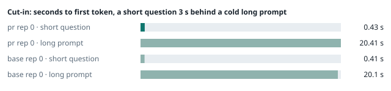
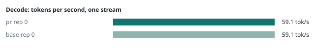
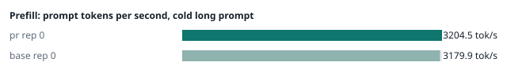
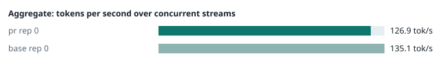
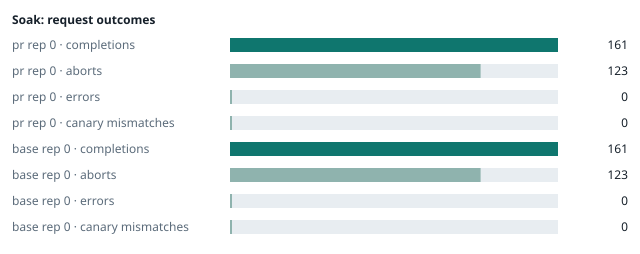

### Evidence: pr vs base

| target | role | image / artifact | model | settings that differ from the control |
|---|---|---|---|---|
| `pr` | candidate | `tensorfold-dsv41:pr-8e6449c3` (c316e266832f) | `DeepSeek-V4.1-Flash-1017` | - |
| `base` | control | `tensorfold-dsv41:base-57c739cb` (5a94966d9621) | `DeepSeek-V4.1-Flash-1017` | baseline |

Conditions: fabric ring; order: A then B, one repetition (no reverse order: pass --opt reps=2 for a counterbalanced run); repetitions: 1; kit d9102c0.
Restore: live restored (verified: API answers, running artifact is live's).

#### smoke

| target | rep | arithmetic | greedy repeat equal | stream matches | JSON mode | first token (stream) | errors |
|---|---|---|---|---|---|---|---|
| `pr` | 0 | ✓ | ✓ | ✓ | ✓ | 0.094 s | - |
| `base` | 0 | ✓ | ✓ | ✓ | ✓ | 0.088 s | - |

machine state after the suite

- `pr` rep 0: `{"head": {"gpus": ["0, NVIDIA GB10, 2184 MHz, 56, [N/A], [N/A], 95 %"], "load": "load average: 6.13, 2.66, 2.62", "container": "92 pids 2.93GiB / 121.7GiB", "mem_available_mb": "28219"}}`
- `base` rep 0: `{"head": {"gpus": ["0, NVIDIA GB10, 2177 MHz, 60, [N/A], [N/A], 64 %"], "load": "load average: 6.90, 5.37, 4.66", "container": "92 pids 3.034GiB / 121.7GiB", "mem_available_mb": "27561"}}`

#### boundary

**19 of 19** greedy reply hashes identical, `pr` against `base`, over 1 repetition(s).

| rep | prompt | tokens (pr / base) | `pr` | `base` | same |
|---|---|---|---|---|---|
| 0 | len5 | 5 / 5 | `38127fef0fbb` | `38127fef0fbb` | ✓ |
| 0 | len2047 | 2047 / 2047 | `8488ccfbcf35` | `8488ccfbcf35` | ✓ |
| 0 | len2048 | 2048 / 2048 | `c5ac2fb76516` | `c5ac2fb76516` | ✓ |
| 0 | len2049 | 2049 / 2049 | `6766401c9caa` | `6766401c9caa` | ✓ |
| 0 | len4095 | 4095 / 4095 | `ed9e5086f520` | `ed9e5086f520` | ✓ |
| 0 | len4096 | 4096 / 4096 | `52584e31f990` | `52584e31f990` | ✓ |
| 0 | len4097 | 4097 / 4097 | `1a71db317ee7` | `1a71db317ee7` | ✓ |
| 0 | len6143 | 6143 / 6143 | `2f9626e9baf5` | `2f9626e9baf5` | ✓ |
| 0 | len6144 | 6144 / 6144 | `11933f2d4bd7` | `11933f2d4bd7` | ✓ |
| 0 | len6145 | 6145 / 6145 | `7aa2f63b2547` | `7aa2f63b2547` | ✓ |
| 0 | len8193 | 8193 / 8193 | `2ef3dc011922` | `2ef3dc011922` | ✓ |
| 0 | len12289 | 12289 / 12289 | `4fcfbd64881f` | `4fcfbd64881f` | ✓ |
| 0 | pfx_base | 5124 / 5124 | `52afe4842e5d` | `52afe4842e5d` | ✓ |
| 0 | pfx_div3072 | 3376 / 3376 | `64d23fe171dc` | `64d23fe171dc` | ✓ |
| 0 | pfx_div2044 | 2348 / 2348 | `16db99ba02f2` | `16db99ba02f2` | ✓ |
| 0 | pfx_div4092 | 4396 / 4396 | `63798c5ba36c` | `63798c5ba36c` | ✓ |
| 0 | pfx_div4093 | 4397 / 4397 | `6b1cfc31884d` | `6b1cfc31884d` | ✓ |
| 0 | pfx_base_again | 5124 / 5124 | `52afe4842e5d` | `52afe4842e5d` | ✓ |
| 0 | pfx_extend | 6660 / 6660 | `357a869fef18` | `357a869fef18` | ✓ |

machine state after the suite

- `pr` rep 0: `{"head": {"gpus": ["0, NVIDIA GB10, 2171 MHz, 63, [N/A], [N/A], 96 %"], "load": "load average: 6.24, 3.08, 2.76", "container": "92 pids 3.073GiB / 121.7GiB", "mem_available_mb": "27874"}}`
- `base` rep 0: `{"head": {"gpus": ["0, NVIDIA GB10, 2177 MHz, 65, [N/A], [N/A], 85 %"], "load": "load average: 6.39, 5.41, 4.71", "container": "92 pids 3.177GiB / 121.7GiB", "mem_available_mb": "27887"}}`

#### cutin

`pr` rep 0: short question first token **0.43 s** (rounds 0.381–0.498), long prompt first token 20.41 s (rounds 20.22–20.45); 3 rounds; admitted during the long prefill in 3 of 3 rounds
`base` rep 0: short question first token **0.41 s** (rounds 0.375–0.477), long prompt first token 20.1 s (rounds 20.08–20.138); 3 rounds; admitted during the long prefill in 3 of 3 rounds

machine state after the suite

- `pr` rep 0: `{"head": {"gpus": ["0, NVIDIA GB10, 2184 MHz, 68, [N/A], [N/A], 96 %"], "load": "load average: 6.37, 3.70, 3.00", "container": "92 pids 3.126GiB / 121.7GiB", "mem_available_mb": "27807"}}`
- `base` rep 0: `{"head": {"gpus": ["0, NVIDIA GB10, 2177 MHz, 68, [N/A], [N/A], 96 %"], "load": "load average: 6.92, 5.74, 4.87", "container": "92 pids 3.23GiB / 121.7GiB", "mem_available_mb": "27895"}}`

#### perf

| target | rep | decode tok/s, one stream | prefill tok/s, cold long prompt | aggregate tok/s, concurrent streams | errors |
|---|---|---|---|---|---|
| `pr` | 0 | **59.1** (57.1–60.8) | **3204.5** (3194.3–3213.1; 12004 tokens) | **126.9** (126.3–136.1; 4 streams) | - |
| `base` | 0 | **59.1** (56.2–59.6) | **3179.9** (3168.1–3181.6; 12004 tokens) | **135.1** (123.8–136.0; 4 streams) | - |

`pr` against `base`: decode +0.0%, prefill +0.8%, aggregate -6.1% (medians over repetitions; the verdict counts a difference only beyond the rounds' spread, at least ±3 %).

machine state after the suite

- `pr` rep 0: `{"head": {"gpus": ["0, NVIDIA GB10, 2177 MHz, 64, [N/A], [N/A], 95 %"], "load": "load average: 5.66, 3.85, 3.08", "container": "92 pids 3.298GiB / 121.7GiB", "mem_available_mb": "27481"}}`
- `base` rep 0: `{"head": {"gpus": ["0, NVIDIA GB10, 2177 MHz, 65, [N/A], [N/A], 95 %"], "load": "load average: 5.95, 5.62, 4.86", "container": "92 pids 3.389GiB / 121.7GiB", "mem_available_mb": "27504"}}`

#### startup

`pr`: 103.4 s from the switch to the API answering (1 start(s))
`base`: 100.7 s from the switch to the API answering (1 start(s))

#### soak

`pr` rep 0: 161 completions, 123 client aborts, **0 errors**, 57 canary checks with **0 mismatches**
  machine samples, first and last: `{"head": {"gpus": ["0, NVIDIA GB10, 2177 MHz, 63, [N/A], [N/A], 44 %"], "load": "load average: 5.66, 3.85, 3.08", "container": "96 pids 3.328GiB / 121.7GiB", "m` → `{"head": {"gpus": ["0, NVIDIA GB10, 2177 MHz, 72, [N/A], [N/A], 96 %"], "load": "load average: 6.68, 6.03, 4.58", "container": "96 pids 3.831GiB / 121.7GiB", "m`
`base` rep 0: 161 completions, 123 client aborts, **0 errors**, 57 canary checks with **0 mismatches**
  machine samples, first and last: `{"head": {"gpus": ["0, NVIDIA GB10, 2177 MHz, 64, [N/A], [N/A], 96 %"], "load": "load average: 5.55, 5.55, 4.84", "container": "97 pids 3.419GiB / 121.7GiB", "m` → `{"head": {"gpus": ["0, NVIDIA GB10, 2177 MHz, 73, [N/A], [N/A], 96 %"], "load": "load average: 6.29, 6.21, 5.49", "container": "96 pids 3.985GiB / 121.7GiB", "m`

machine state after the suite

- `pr` rep 0: `{"head": {"gpus": ["0, NVIDIA GB10, 2184 MHz, 58, [N/A], [N/A], 0 %"], "load": "load average: 4.70, 5.68, 4.56", "container": "92 pids 3.799GiB / 121.7GiB", "mem_available_mb": "26334"}}`
- `base` rep 0: `{"head": {"gpus": ["0, NVIDIA GB10, 2184 MHz, 58, [N/A], [N/A], 0 %"], "load": "load average: 4.58, 5.83, 5.41", "container": "92 pids 3.951GiB / 121.7GiB", "mem_available_mb": "26301"}}`

#### concurrency

| target | rep | streams | aggregate tok/s | first token p50 / p95 | batched replies ≠ serial | errors |
|---|---|---|---|---|---|---|
| `pr` | 0 | 1 (round 0) | **57.2** | 0.248 / 0.332 s | — |  |
| `pr` | 0 | 4 (round 0) | **100.0** | 0.826 / 1.21 s | 0 of 16 |  |
| `pr` | 0 | 8 (round 0) | **115.5** | 1.456 / 2.828 s | 0 of 16 |  |
| `pr` | 0 | 16 (round 0) | **131.7** | 2.746 / 5.206 s | 0 of 16 | 0 |
| `pr` | 0 | 1 (round 1) | **57.7** | 0.246 / 0.37 s | — |  |
| `pr` | 0 | 4 (round 1) | **100.5** | 0.826 / 1.187 s | 0 of 16 |  |
| `pr` | 0 | 8 (round 1) | **116.1** | 1.433 / 2.397 s | 0 of 16 |  |
| `pr` | 0 | 16 (round 1) | **134.7** | 2.719 / 5.17 s | 0 of 16 | 0 |
| `base` | 0 | 1 (round 0) | **57.3** | 0.248 / 0.261 s | — |  |
| `base` | 0 | 4 (round 0) | **100.3** | 0.824 / 1.136 s | 0 of 16 |  |
| `base` | 0 | 8 (round 0) | **121.2** | 1.405 / 2.387 s | 0 of 16 |  |
| `base` | 0 | 16 (round 0) | **132.7** | 2.969 / 5.446 s | 0 of 16 | 0 |
| `base` | 0 | 1 (round 1) | **57.3** | 0.246 / 0.283 s | — |  |
| `base` | 0 | 4 (round 1) | **100.4** | 0.821 / 1.134 s | 0 of 16 |  |
| `base` | 0 | 8 (round 1) | **118.6** | 1.445 / 2.619 s | 0 of 16 |  |
| `base` | 0 | 16 (round 1) | **134.4** | 2.728 / 5.158 s | 0 of 16 | 0 |

`pr` rep 0: 128 requests; batched replies identical to serial in 96 of 96 comparisons
- host `spark-123`: container memory 4146.2 → 4190.2 MB after the drain (**+44.0 MB**, +343.8 MB per 1000 requests); descriptors 223 → 220
- host `spark-161`: container memory 2969.6 → 3014.7 MB after the drain (**+45.1 MB**, +352.3 MB per 1000 requests); descriptors 147 → 150
- host `spark-197`: container memory 3096.6 → 3141.6 MB after the drain (**+45.0 MB**, +351.6 MB per 1000 requests); descriptors 150 → 150
- host `dell-113`: container memory 3093.5 → 3137.5 MB after the drain (**+44.0 MB**, +343.8 MB per 1000 requests); descriptors 147 → 150

`base` rep 0: 128 requests; batched replies identical to serial in 96 of 96 comparisons
- host `spark-123`: container memory 4332.5 → 4367.4 MB after the drain (**+34.9 MB**, +272.7 MB per 1000 requests); descriptors 223 → 223
- host `spark-161`: container memory 3038.2 → 3074.0 MB after the drain (**+35.8 MB**, +279.7 MB per 1000 requests); descriptors 150 → 150
- host `spark-197`: container memory 3141.6 → 3178.5 MB after the drain (**+36.9 MB**, +288.3 MB per 1000 requests); descriptors 150 → 150
- host `dell-113`: container memory 3165.2 → 3201.0 MB after the drain (**+35.8 MB**, +279.7 MB per 1000 requests); descriptors 150 → 150

machine state after the suite

- `pr` rep 0: `{"head": {"gpus": ["0, NVIDIA GB10, 2184 MHz, 56, [N/A], [N/A], 0 %"], "load": "load average: 2.29, 4.32, 4.29", "container": "92 pids 4.092GiB / 121.7GiB", "mem_available_mb": "26004"}}`
- `base` rep 0: `{"head": {"gpus": ["0, NVIDIA GB10, 2184 MHz, 56, [N/A], [N/A], 0 %"], "load": "load average: 2.09, 4.40, 4.96", "container": "92 pids 4.264GiB / 121.7GiB", "mem_available_mb": "25781"}}`

#### repro

| target | role | rep | exit | outcome | expected | as expected |
|---|---|---|---|---|---|---|
| `pr` | candidate | 0 | 0 | passes | passes | ✓ |
| `base` | control | 0 | 1 | fails | fails | ✓ |

**Reproduced on the control and gone on the candidate** (every repetition).

Command: `bash tests/repro-issue-14.sh {api} {model} {logcmd}`

output of the script (tail)

- `pr` rep 0: `control, whole: finish=tool_calls tool_calls=[["write", {"path": "notes.md", "content": "plain text"}]] content="" control, stream: finish=tool_calls tool_calls=[["write", {"path": "notes.md", "content": "plain text"}]] content="" value holds the closer, whole: finish=tool_calls tool_calls=[["write", {"path": "notes.md", "content": "end of block: </｜DSML｜ calls>"}]] content="" value holds the closer, stream: finish=tool_calls tool_calls=[["write", {"path": "notes.md", "content": "end of block: </｜DSML｜ calls>"}]] content="" RESULT: fixed `
- `base` rep 0: `=\"write\">\n<｜DSML｜ parameter name=\"path\" string=\"true\">notes.md</｜DSML｜ parameter>\n<｜DSML｜ parameter name=\"content\" string=\"true\">end of block: </｜DSML｜ calls></｜DSML｜ parameter>\n</｜DSML｜ invoke>\n</｜DSML｜ calls>"   FAIL value holds the closer, whole: expected one write call with the value intact and no DSML closer in content value holds the closer, stream: finish=stop tool_calls=[] content="</｜DSML｜ parameter>\n</｜DSML｜ invoke>\n</｜DSML｜ calls>"   FAIL value holds the closer, stream: expected one write call with the value intact and no DSML closer in content RESULT: problem shows `

machine state after the suite

- `pr` rep 0: `{"head": {"gpus": ["0, NVIDIA GB10, 2184 MHz, 58, [N/A], [N/A], 95 %"], "load": "load average: 2.47, 4.29, 4.28", "container": "92 pids 4.092GiB / 121.7GiB", "mem_available_mb": "25901"}}`
- `base` rep 0: `{"head": {"gpus": ["0, NVIDIA GB10, 2177 MHz, 61, [N/A], [N/A], 86 %"], "load": "load average: 2.24, 4.40, 4.96", "container": "92 pids 4.264GiB / 121.7GiB", "mem_available_mb": "25785"}}`

#### the pull request's own tests

The pull request adds or changes no test file under `tests/`.

#### What this run does not show

- one process under mixed load for hours: throughput probes every few minutes, a canary reply, host memory and descriptors over the run (`endurance` did not run)
- a clean pair exit and recovery after an injected read fault (`fault` did not run)
- an external benchmark against a control (The Grill or similar) (`bench` did not run)
- <!-- add: paths only checked by reading, faults not injected, configurations not run -->

_Generated by inference-agent-kit `report.py` from `20261103T050851/results.json`._
