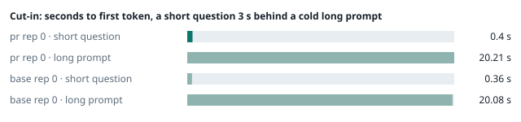
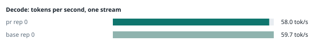
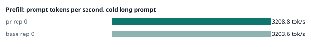
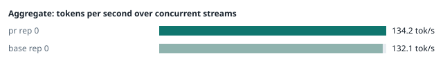
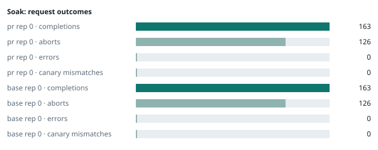

### Evidence: pr vs base

| target | role | image / artifact | model | settings that differ from the control |
|---|---|---|---|---|
| `pr` | candidate | `tensorfold-dsv41:pr-37087cdb` (c316e266832f) | `DeepSeek-V4.1-Flash-1017` | - |
| `base` | control | `tensorfold-dsv41:base-57c739cb` (5a94966d9621) | `DeepSeek-V4.1-Flash-1017` | baseline |

Conditions: fabric ring; order: A then B, one repetition (no reverse order: pass --opt reps=2 for a counterbalanced run); repetitions: 1; kit d9102c0.
Restore: live restored (verified: API answers, running artifact is live's).

#### smoke

| target | rep | arithmetic | greedy repeat equal | stream matches | JSON mode | first token (stream) | errors |
|---|---|---|---|---|---|---|---|
| `pr` | 0 | ✓ | ✓ | ✓ | ✓ | 0.09 s | - |
| `base` | 0 | ✓ | ✓ | ✓ | ✓ | 0.098 s | - |

machine state after the suite

- `pr` rep 0: `{"head": {"gpus": ["0, NVIDIA GB10, 2177 MHz, 57, [N/A], [N/A], 78 %"], "load": "load average: 7.05, 5.19, 5.11", "container": "92 pids 3.036GiB / 121.7GiB", "mem_available_mb": "27494"}}`
- `base` rep 0: `{"head": {"gpus": ["0, NVIDIA GB10, 2177 MHz, 57, [N/A], [N/A], 82 %"], "load": "load average: 7.74, 5.97, 5.64", "container": "92 pids 3.007GiB / 121.7GiB", "mem_available_mb": "27481"}}`

#### boundary

**19 of 19** greedy reply hashes identical, `pr` against `base`, over 1 repetition(s).

| rep | prompt | tokens (pr / base) | `pr` | `base` | same |
|---|---|---|---|---|---|
| 0 | len5 | 5 / 5 | `38127fef0fbb` | `38127fef0fbb` | ✓ |
| 0 | len2047 | 2047 / 2047 | `8488ccfbcf35` | `8488ccfbcf35` | ✓ |
| 0 | len2048 | 2048 / 2048 | `c5ac2fb76516` | `c5ac2fb76516` | ✓ |
| 0 | len2049 | 2049 / 2049 | `6766401c9caa` | `6766401c9caa` | ✓ |
| 0 | len4095 | 4095 / 4095 | `ed9e5086f520` | `ed9e5086f520` | ✓ |
| 0 | len4096 | 4096 / 4096 | `52584e31f990` | `52584e31f990` | ✓ |
| 0 | len4097 | 4097 / 4097 | `1a71db317ee7` | `1a71db317ee7` | ✓ |
| 0 | len6143 | 6143 / 6143 | `2f9626e9baf5` | `2f9626e9baf5` | ✓ |
| 0 | len6144 | 6144 / 6144 | `11933f2d4bd7` | `11933f2d4bd7` | ✓ |
| 0 | len6145 | 6145 / 6145 | `7aa2f63b2547` | `7aa2f63b2547` | ✓ |
| 0 | len8193 | 8193 / 8193 | `2ef3dc011922` | `2ef3dc011922` | ✓ |
| 0 | len12289 | 12289 / 12289 | `4fcfbd64881f` | `4fcfbd64881f` | ✓ |
| 0 | pfx_base | 5124 / 5124 | `52afe4842e5d` | `52afe4842e5d` | ✓ |
| 0 | pfx_div3072 | 3376 / 3376 | `64d23fe171dc` | `64d23fe171dc` | ✓ |
| 0 | pfx_div2044 | 2348 / 2348 | `16db99ba02f2` | `16db99ba02f2` | ✓ |
| 0 | pfx_div4092 | 4396 / 4396 | `63798c5ba36c` | `63798c5ba36c` | ✓ |
| 0 | pfx_div4093 | 4397 / 4397 | `6b1cfc31884d` | `6b1cfc31884d` | ✓ |
| 0 | pfx_base_again | 5124 / 5124 | `52afe4842e5d` | `52afe4842e5d` | ✓ |
| 0 | pfx_extend | 6660 / 6660 | `357a869fef18` | `357a869fef18` | ✓ |

machine state after the suite

- `pr` rep 0: `{"head": {"gpus": ["0, NVIDIA GB10, 2171 MHz, 66, [N/A], [N/A], 96 %"], "load": "load average: 6.54, 5.26, 5.14", "container": "92 pids 3.179GiB / 121.7GiB", "mem_available_mb": "27797"}}`
- `base` rep 0: `{"head": {"gpus": ["0, NVIDIA GB10, 2171 MHz, 65, [N/A], [N/A], 96 %"], "load": "load average: 7.31, 6.06, 5.69", "container": "92 pids 3.151GiB / 121.7GiB", "mem_available_mb": "27869"}}`

#### cutin

`pr` rep 0: short question first token **0.4 s** (rounds 0.386–0.482), long prompt first token 20.21 s (rounds 20.041–20.27); 3 rounds; admitted during the long prefill in 3 of 3 rounds
`base` rep 0: short question first token **0.36 s** (rounds 0.338–0.392), long prompt first token 20.08 s (rounds 19.878–20.129); 3 rounds; admitted during the long prefill in 3 of 3 rounds

machine state after the suite

- `pr` rep 0: `{"head": {"gpus": ["0, NVIDIA GB10, 2184 MHz, 69, [N/A], [N/A], 78 %"], "load": "load average: 6.46, 5.54, 5.24", "container": "92 pids 3.232GiB / 121.7GiB", "mem_available_mb": "27743"}}`
- `base` rep 0: `{"head": {"gpus": ["0, NVIDIA GB10, 2184 MHz, 68, [N/A], [N/A], 96 %"], "load": "load average: 7.48, 6.33, 5.80", "container": "92 pids 3.191GiB / 121.7GiB", "mem_available_mb": "27756"}}`

#### perf

| target | rep | decode tok/s, one stream | prefill tok/s, cold long prompt | aggregate tok/s, concurrent streams | errors |
|---|---|---|---|---|---|
| `pr` | 0 | **58.0** (56.7–58.2) | **3208.8** (3162.3–3214.8; 12004 tokens) | **134.2** (119.6–135.8; 4 streams) | - |
| `base` | 0 | **59.7** (57.2–60.3) | **3203.6** (3194.3–3213.1; 12004 tokens) | **132.1** (125.9–138.1; 4 streams) | - |

`pr` against `base`: decode -2.8%, prefill +0.2%, aggregate +1.6% (medians over repetitions; the verdict counts a difference only beyond the rounds' spread, at least ±3 %).

machine state after the suite

- `pr` rep 0: `{"head": {"gpus": ["0, NVIDIA GB10, 2177 MHz, 67, [N/A], [N/A], 96 %"], "load": "load average: 5.82, 5.48, 5.23", "container": "92 pids 3.391GiB / 121.7GiB", "mem_available_mb": "27461"}}`
- `base` rep 0: `{"head": {"gpus": ["0, NVIDIA GB10, 2177 MHz, 67, [N/A], [N/A], 96 %"], "load": "load average: 6.27, 6.14, 5.76", "container": "92 pids 3.351GiB / 121.7GiB", "mem_available_mb": "27503"}}`

#### startup

`pr`: 100.3 s from the switch to the API answering (1 start(s))
`base`: 100.0 s from the switch to the API answering (1 start(s))

#### soak

`pr` rep 0: 163 completions, 126 client aborts, **0 errors**, 57 canary checks with **0 mismatches**
  machine samples, first and last: `{"head": {"gpus": ["0, NVIDIA GB10, 2177 MHz, 65, [N/A], [N/A], 0 %"], "load": "load average: 5.35, 5.39, 5.21", "container": "97 pids 3.411GiB / 121.7GiB", "me` → `{"head": {"gpus": ["0, NVIDIA GB10, 2171 MHz, 72, [N/A], [N/A], 96 %"], "load": "load average: 5.99, 6.10, 5.70", "container": "95 pids 3.882GiB / 121.7GiB", "m`
`base` rep 0: 163 completions, 126 client aborts, **0 errors**, 57 canary checks with **0 mismatches**
  machine samples, first and last: `{"head": {"gpus": ["0, NVIDIA GB10, 2177 MHz, 65, [N/A], [N/A], 0 %"], "load": "load average: 6.41, 6.17, 5.77", "container": "95 pids 3.368GiB / 121.7GiB", "me` → `{"head": {"gpus": ["0, NVIDIA GB10, 2171 MHz, 71, [N/A], [N/A], 96 %"], "load": "load average: 6.37, 6.53, 6.17", "container": "95 pids 3.835GiB / 121.7GiB", "m`

machine state after the suite

- `pr` rep 0: `{"head": {"gpus": ["0, NVIDIA GB10, 2184 MHz, 58, [N/A], [N/A], 0 %"], "load": "load average: 4.60, 5.77, 5.62", "container": "92 pids 3.865GiB / 121.7GiB", "mem_available_mb": "26373"}}`
- `base` rep 0: `{"head": {"gpus": ["0, NVIDIA GB10, 2184 MHz, 58, [N/A], [N/A], 0 %"], "load": "load average: 4.62, 6.11, 6.06", "container": "92 pids 3.823GiB / 121.7GiB", "mem_available_mb": "26343"}}`

#### concurrency

| target | rep | streams | aggregate tok/s | first token p50 / p95 | batched replies ≠ serial | errors |
|---|---|---|---|---|---|---|
| `pr` | 0 | 1 (round 0) | **58.0** | 0.248 / 0.26 s | — |  |
| `pr` | 0 | 4 (round 0) | **99.7** | 0.82 / 1.132 s | 0 of 16 |  |
| `pr` | 0 | 8 (round 0) | **121.7** | 1.418 / 2.4 s | 0 of 16 |  |
| `pr` | 0 | 16 (round 0) | **131.2** | 2.699 / 5.151 s | 0 of 16 | 0 |
| `pr` | 0 | 1 (round 1) | **57.7** | 0.247 / 0.381 s | — |  |
| `pr` | 0 | 4 (round 1) | **102.0** | 0.816 / 1.126 s | 0 of 16 |  |
| `pr` | 0 | 8 (round 1) | **121.7** | 1.422 / 2.378 s | 0 of 16 |  |
| `pr` | 0 | 16 (round 1) | **128.9** | 2.713 / 5.392 s | 0 of 16 | 0 |
| `base` | 0 | 1 (round 0) | **58.2** | 0.247 / 0.261 s | — |  |
| `base` | 0 | 4 (round 0) | **100.7** | 0.824 / 1.141 s | 0 of 16 |  |
| `base` | 0 | 8 (round 0) | **121.6** | 1.414 / 2.38 s | 0 of 16 |  |
| `base` | 0 | 16 (round 0) | **132.2** | 2.723 / 5.371 s | 0 of 16 | 0 |
| `base` | 0 | 1 (round 1) | **58.1** | 0.247 / 0.269 s | — |  |
| `base` | 0 | 4 (round 1) | **101.7** | 0.818 / 1.128 s | 0 of 16 |  |
| `base` | 0 | 8 (round 1) | **120.1** | 1.423 / 2.386 s | 0 of 16 |  |
| `base` | 0 | 16 (round 1) | **134.0** | 2.714 / 5.148 s | 0 of 16 | 0 |

`pr` rep 0: 128 requests; batched replies identical to serial in 96 of 96 comparisons
- host `spark-123`: container memory 4205.6 → 4263.9 MB after the drain (**+58.3 MB**, +455.5 MB per 1000 requests); descriptors 220 → 223
- host `spark-161`: container memory 2910.2 → 2969.6 MB after the drain (**+59.4 MB**, +464.1 MB per 1000 requests); descriptors 150 → 150
- host `spark-197`: container memory 3015.7 → 3075.1 MB after the drain (**+59.4 MB**, +464.1 MB per 1000 requests); descriptors 150 → 150
- host `dell-113`: container memory 3039.2 → 3098.6 MB after the drain (**+59.4 MB**, +464.1 MB per 1000 requests); descriptors 150 → 150

`base` rep 0: 128 requests; batched replies identical to serial in 96 of 96 comparisons
- host `spark-123`: container memory 4225.0 → 4232.2 MB after the drain (**+7.2 MB**, +56.2 MB per 1000 requests); descriptors 223 → 223
- host `spark-161`: container memory 2963.5 → 2970.6 MB after the drain (**+7.1 MB**, +55.5 MB per 1000 requests); descriptors 150 → 147
- host `spark-197`: container memory 3083.3 → 3090.4 MB after the drain (**+7.1 MB**, +55.5 MB per 1000 requests); descriptors 150 → 150
- host `dell-113`: container memory 3092.5 → 3100.7 MB after the drain (**+8.2 MB**, +64.1 MB per 1000 requests); descriptors 150 → 150

machine state after the suite

- `pr` rep 0: `{"head": {"gpus": ["0, NVIDIA GB10, 2184 MHz, 56, [N/A], [N/A], 0 %"], "load": "load average: 2.95, 4.76, 5.26", "container": "92 pids 4.163GiB / 121.7GiB", "mem_available_mb": "25949"}}`
- `base` rep 0: `{"head": {"gpus": ["0, NVIDIA GB10, 2184 MHz, 56, [N/A], [N/A], 0 %"], "load": "load average: 2.53, 4.69, 5.51", "container": "92 pids 4.133GiB / 121.7GiB", "mem_available_mb": "25831"}}`

#### repro

| target | role | rep | exit | outcome | expected | as expected |
|---|---|---|---|---|---|---|
| `pr` | candidate | 0 | 0 | passes | passes | ✓ |
| `base` | control | 0 | 1 | fails | fails | ✓ |

**Reproduced on the control and gone on the candidate** (every repetition).

Command: `bash tests/repro-issue-14.sh {api} {model} {logcmd}`

output of the script (tail)

- `pr` rep 0: `control, whole: finish=tool_calls tool_calls=[["write", {"path": "notes.md", "content": "plain text"}]] content="" control, stream: finish=tool_calls tool_calls=[["write", {"path": "notes.md", "content": "plain text"}]] content="" value holds the closer, whole: finish=tool_calls tool_calls=[["write", {"path": "notes.md", "content": "end of block: </｜DSML｜ calls>"}]] content="" value holds the closer, stream: finish=tool_calls tool_calls=[["write", {"path": "notes.md", "content": "end of block: </｜DSML｜ calls>"}]] content="" RESULT: fixed `
- `base` rep 0: `=\"write\">\n<｜DSML｜ parameter name=\"path\" string=\"true\">notes.md</｜DSML｜ parameter>\n<｜DSML｜ parameter name=\"content\" string=\"true\">end of block: </｜DSML｜ calls></｜DSML｜ parameter>\n</｜DSML｜ invoke>\n</｜DSML｜ calls>"   FAIL value holds the closer, whole: expected one write call with the value intact and no DSML closer in content value holds the closer, stream: finish=stop tool_calls=[] content="</｜DSML｜ parameter>\n</｜DSML｜ invoke>\n</｜DSML｜ calls>"   FAIL value holds the closer, stream: expected one write call with the value intact and no DSML closer in content RESULT: problem shows `

machine state after the suite

- `pr` rep 0: `{"head": {"gpus": ["0, NVIDIA GB10, 2177 MHz, 60, [N/A], [N/A], 94 %"], "load": "load average: 3.19, 4.78, 5.27", "container": "92 pids 4.163GiB / 121.7GiB", "mem_available_mb": "25862"}}`
- `base` rep 0: `{"head": {"gpus": ["0, NVIDIA GB10, 2177 MHz, 60, [N/A], [N/A], 96 %"], "load": "load average: 2.41, 4.63, 5.49", "container": "92 pids 4.133GiB / 121.7GiB", "mem_available_mb": "25868"}}`

#### the pull request's own tests

The pull request adds or changes no test file under `tests/`.

#### What this run does not show

- one process under mixed load for hours: throughput probes every few minutes, a canary reply, host memory and descriptors over the run (`endurance` did not run)
- a clean pair exit and recovery after an injected read fault (`fault` did not run)
- an external benchmark against a control (The Grill or similar) (`bench` did not run)
- <!-- add: paths only checked by reading, faults not injected, configurations not run -->

_Generated by inference-agent-kit `report.py` from `20261103T055023/results.json`._
