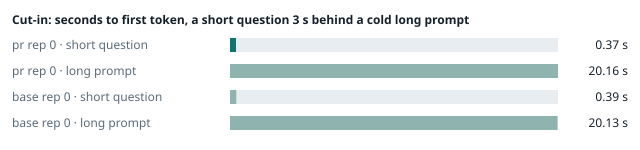
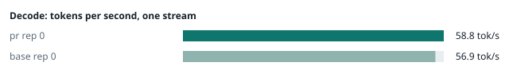
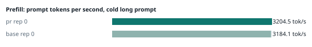
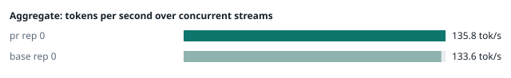
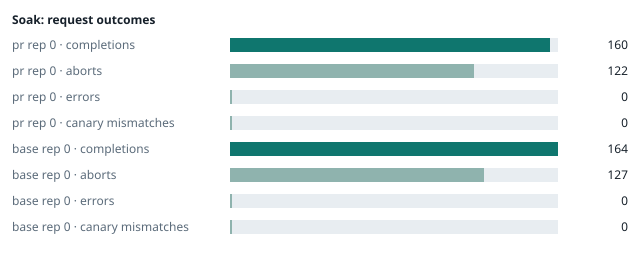

### Evidence: pr vs base

| target | role | image / artifact | model | settings that differ from the control |
|---|---|---|---|---|
| `pr` | candidate | `tensorfold-dsv41:pr-6f0de334` (c316e266832f) | `DeepSeek-V4.1-Flash-1017` | - |
| `base` | control | `tensorfold-dsv41:base-57c739cb` (5a94966d9621) | `DeepSeek-V4.1-Flash-1017` | baseline |

Conditions: fabric ring; order: A then B, one repetition (no reverse order: pass --opt reps=2 for a counterbalanced run); repetitions: 1; kit d9102c0.
Restore: live restored (verified: API answers, running artifact is live's).

#### smoke

| target | rep | arithmetic | greedy repeat equal | stream matches | JSON mode | first token (stream) | errors |
|---|---|---|---|---|---|---|---|
| `pr` | 0 | ✓ | ✓ | ✓ | ✓ | 0.09 s | - |
| `base` | 0 | ✓ | ✓ | ✓ | ✓ | 0.091 s | - |

machine state after the suite

- `pr` rep 0: `{"head": {"gpus": ["0, NVIDIA GB10, 2177 MHz, 54, [N/A], [N/A], 83 %"], "load": "load average: 6.13, 4.22, 4.86", "container": "92 pids 3.007GiB / 121.7GiB", "mem_available_mb": "28081"}}`
- `base` rep 0: `{"head": {"gpus": ["0, NVIDIA GB10, 2184 MHz, 57, [N/A], [N/A], 92 %"], "load": "load average: 7.04, 5.36, 5.21", "container": "92 pids 3.035GiB / 121.7GiB", "mem_available_mb": "27420"}}`

#### boundary

**19 of 19** greedy reply hashes identical, `pr` against `base`, over 1 repetition(s).

| rep | prompt | tokens (pr / base) | `pr` | `base` | same |
|---|---|---|---|---|---|
| 0 | len5 | 5 / 5 | `38127fef0fbb` | `38127fef0fbb` | ✓ |
| 0 | len2047 | 2047 / 2047 | `8488ccfbcf35` | `8488ccfbcf35` | ✓ |
| 0 | len2048 | 2048 / 2048 | `c5ac2fb76516` | `c5ac2fb76516` | ✓ |
| 0 | len2049 | 2049 / 2049 | `6766401c9caa` | `6766401c9caa` | ✓ |
| 0 | len4095 | 4095 / 4095 | `ed9e5086f520` | `ed9e5086f520` | ✓ |
| 0 | len4096 | 4096 / 4096 | `52584e31f990` | `52584e31f990` | ✓ |
| 0 | len4097 | 4097 / 4097 | `1a71db317ee7` | `1a71db317ee7` | ✓ |
| 0 | len6143 | 6143 / 6143 | `2f9626e9baf5` | `2f9626e9baf5` | ✓ |
| 0 | len6144 | 6144 / 6144 | `11933f2d4bd7` | `11933f2d4bd7` | ✓ |
| 0 | len6145 | 6145 / 6145 | `7aa2f63b2547` | `7aa2f63b2547` | ✓ |
| 0 | len8193 | 8193 / 8193 | `2ef3dc011922` | `2ef3dc011922` | ✓ |
| 0 | len12289 | 12289 / 12289 | `4fcfbd64881f` | `4fcfbd64881f` | ✓ |
| 0 | pfx_base | 5124 / 5124 | `52afe4842e5d` | `52afe4842e5d` | ✓ |
| 0 | pfx_div3072 | 3376 / 3376 | `64d23fe171dc` | `64d23fe171dc` | ✓ |
| 0 | pfx_div2044 | 2348 / 2348 | `16db99ba02f2` | `16db99ba02f2` | ✓ |
| 0 | pfx_div4092 | 4396 / 4396 | `63798c5ba36c` | `63798c5ba36c` | ✓ |
| 0 | pfx_div4093 | 4397 / 4397 | `6b1cfc31884d` | `6b1cfc31884d` | ✓ |
| 0 | pfx_base_again | 5124 / 5124 | `52afe4842e5d` | `52afe4842e5d` | ✓ |
| 0 | pfx_extend | 6660 / 6660 | `357a869fef18` | `357a869fef18` | ✓ |

machine state after the suite

- `pr` rep 0: `{"head": {"gpus": ["0, NVIDIA GB10, 2171 MHz, 62, [N/A], [N/A], 0 %"], "load": "load average: 6.26, 4.47, 4.92", "container": "92 pids 3.15GiB / 121.7GiB", "mem_available_mb": "27783"}}`
- `base` rep 0: `{"head": {"gpus": ["0, NVIDIA GB10, 2171 MHz, 65, [N/A], [N/A], 96 %"], "load": "load average: 6.58, 5.43, 5.24", "container": "92 pids 3.178GiB / 121.7GiB", "mem_available_mb": "27757"}}`

#### cutin

`pr` rep 0: short question first token **0.37 s** (rounds 0.355–0.414), long prompt first token 20.16 s (rounds 20.106–20.264); 3 rounds; admitted during the long prefill in 3 of 3 rounds
`base` rep 0: short question first token **0.39 s** (rounds 0.342–0.388), long prompt first token 20.13 s (rounds 19.984–20.161); 3 rounds; admitted during the long prefill in 3 of 3 rounds

machine state after the suite

- `pr` rep 0: `{"head": {"gpus": ["0, NVIDIA GB10, 2184 MHz, 70, [N/A], [N/A], 80 %"], "load": "load average: 6.27, 4.84, 5.02", "container": "92 pids 3.191GiB / 121.7GiB", "mem_available_mb": "27770"}}`
- `base` rep 0: `{"head": {"gpus": ["0, NVIDIA GB10, 2177 MHz, 74, [N/A], [N/A], 96 %"], "load": "load average: 6.56, 5.64, 5.33", "container": "92 pids 3.219GiB / 121.7GiB", "mem_available_mb": "27776"}}`

#### perf

| target | rep | decode tok/s, one stream | prefill tok/s, cold long prompt | aggregate tok/s, concurrent streams | errors |
|---|---|---|---|---|---|
| `pr` | 0 | **58.8** (56.9–59.9) | **3204.5** (3089.0–3211.3; 12004 tokens) | **135.8** (125.4–138.8; 4 streams) | - |
| `base` | 0 | **56.9** (56.4–60.4) | **3184.1** (3180.7–3201.9; 12004 tokens) | **133.6** (124.4–137.9; 4 streams) | - |

`pr` against `base`: decode +3.3%, prefill +0.6%, aggregate +1.6% (medians over repetitions; the verdict counts a difference only beyond the rounds' spread, at least ±3 %).

machine state after the suite

- `pr` rep 0: `{"head": {"gpus": ["0, NVIDIA GB10, 2177 MHz, 64, [N/A], [N/A], 0 %"], "load": "load average: 5.69, 4.86, 5.02", "container": "92 pids 3.348GiB / 121.7GiB", "mem_available_mb": "27509"}}`
- `base` rep 0: `{"head": {"gpus": ["0, NVIDIA GB10, 2171 MHz, 67, [N/A], [N/A], 96 %"], "load": "load average: 5.40, 5.48, 5.29", "container": "92 pids 3.403GiB / 121.7GiB", "mem_available_mb": "27460"}}`

#### startup

`pr`: 100.1 s from the switch to the API answering (1 start(s))
`base`: 100.8 s from the switch to the API answering (1 start(s))

#### soak

`pr` rep 0: 160 completions, 122 client aborts, **0 errors**, 57 canary checks with **0 mismatches**
  machine samples, first and last: `{"head": {"gpus": ["0, NVIDIA GB10, 2177 MHz, 63, [N/A], [N/A], 0 %"], "load": "load average: 5.23, 4.78, 4.99", "container": "97 pids 3.377GiB / 121.7GiB", "me` → `{"head": {"gpus": ["0, NVIDIA GB10, 2177 MHz, 69, [N/A], [N/A], 85 %"], "load": "load average: 5.65, 5.71, 5.42", "container": "95 pids 3.931GiB / 121.7GiB", "m`
`base` rep 0: 164 completions, 127 client aborts, **0 errors**, 58 canary checks with **0 mismatches**
  machine samples, first and last: `{"head": {"gpus": ["0, NVIDIA GB10, 2177 MHz, 63, [N/A], [N/A], 4 %"], "load": "load average: 5.40, 5.48, 5.29", "container": "96 pids 3.421GiB / 121.7GiB", "me` → `{"head": {"gpus": ["0, NVIDIA GB10, 2177 MHz, 68, [N/A], [N/A], 85 %"], "load": "load average: 6.13, 6.05, 5.70", "container": "96 pids 3.923GiB / 121.7GiB", "m`

machine state after the suite

- `pr` rep 0: `{"head": {"gpus": ["0, NVIDIA GB10, 2184 MHz, 58, [N/A], [N/A], 0 %"], "load": "load average: 3.75, 5.25, 5.29", "container": "92 pids 3.874GiB / 121.7GiB", "mem_available_mb": "26264"}}`
- `base` rep 0: `{"head": {"gpus": ["0, NVIDIA GB10, 2184 MHz, 58, [N/A], [N/A], 0 %"], "load": "load average: 4.51, 5.73, 5.61", "container": "92 pids 3.89GiB / 121.7GiB", "mem_available_mb": "26323"}}`

#### concurrency

| target | rep | streams | aggregate tok/s | first token p50 / p95 | batched replies ≠ serial | errors |
|---|---|---|---|---|---|---|
| `pr` | 0 | 1 (round 0) | **57.6** | 0.247 / 0.364 s | — |  |
| `pr` | 0 | 4 (round 0) | **100.2** | 0.842 / 1.149 s | 0 of 16 |  |
| `pr` | 0 | 8 (round 0) | **120.4** | 1.448 / 2.388 s | 0 of 16 |  |
| `pr` | 0 | 16 (round 0) | **134.1** | 2.741 / 5.201 s | 0 of 16 | 0 |
| `pr` | 0 | 1 (round 1) | **58.1** | 0.247 / 0.262 s | — |  |
| `pr` | 0 | 4 (round 1) | **101.1** | 0.836 / 1.193 s | 0 of 16 |  |
| `pr` | 0 | 8 (round 1) | **120.3** | 1.439 / 2.396 s | 0 of 16 |  |
| `pr` | 0 | 16 (round 1) | **134.3** | 2.707 / 5.16 s | 0 of 16 | 0 |
| `base` | 0 | 1 (round 0) | **57.6** | 0.248 / 0.351 s | — |  |
| `base` | 0 | 4 (round 0) | **101.2** | 0.821 / 1.146 s | 0 of 16 |  |
| `base` | 0 | 8 (round 0) | **119.5** | 1.433 / 2.401 s | 0 of 16 |  |
| `base` | 0 | 16 (round 0) | **132.8** | 2.698 / 5.195 s | 0 of 16 | 0 |
| `base` | 0 | 1 (round 1) | **57.7** | 0.247 / 0.262 s | — |  |
| `base` | 0 | 4 (round 1) | **101.4** | 0.815 / 1.126 s | 0 of 16 |  |
| `base` | 0 | 8 (round 1) | **119.6** | 1.43 / 2.598 s | 0 of 16 |  |
| `base` | 0 | 16 (round 1) | **133.7** | 2.703 / 5.133 s | 0 of 16 | 0 |

`pr` rep 0: 128 requests; batched replies identical to serial in 96 of 96 comparisons
- host `spark-123`: container memory 4266.0 → 4284.4 MB after the drain (**+18.4 MB**, +143.7 MB per 1000 requests); descriptors 220 → 220
- host `spark-161`: container memory 3002.4 → 3022.8 MB after the drain (**+20.4 MB**, +159.4 MB per 1000 requests); descriptors 150 → 150
- host `spark-197`: container memory 3123.2 → 3142.7 MB after the drain (**+19.5 MB**, +152.3 MB per 1000 requests); descriptors 150 → 150
- host `dell-113`: container memory 3132.4 → 3151.9 MB after the drain (**+19.5 MB**, +152.3 MB per 1000 requests); descriptors 150 → 150

`base` rep 0: 128 requests; batched replies identical to serial in 96 of 96 comparisons
- host `spark-123`: container memory 4214.8 → 4261.9 MB after the drain (**+47.1 MB**, +368.0 MB per 1000 requests); descriptors 220 → 223
- host `spark-161`: container memory 2920.4 → 2968.6 MB after the drain (**+48.2 MB**, +376.6 MB per 1000 requests); descriptors 150 → 150
- host `spark-197`: container memory 3022.8 → 3072.0 MB after the drain (**+49.2 MB**, +384.4 MB per 1000 requests); descriptors 150 → 150
- host `dell-113`: container memory 3046.4 → 3095.6 MB after the drain (**+49.2 MB**, +384.4 MB per 1000 requests); descriptors 150 → 150

machine state after the suite

- `pr` rep 0: `{"head": {"gpus": ["0, NVIDIA GB10, 2184 MHz, 56, [N/A], [N/A], 0 %"], "load": "load average: 2.19, 4.12, 4.84", "container": "92 pids 4.183GiB / 121.7GiB", "mem_available_mb": "25760"}}`
- `base` rep 0: `{"head": {"gpus": ["0, NVIDIA GB10, 2184 MHz, 56, [N/A], [N/A], 0 %"], "load": "load average: 2.33, 4.33, 5.09", "container": "92 pids 4.163GiB / 121.7GiB", "mem_available_mb": "25865"}}`

#### repro

| target | role | rep | exit | outcome | expected | as expected |
|---|---|---|---|---|---|---|
| `pr` | candidate | 0 | 0 | passes | passes | ✓ |
| `base` | control | 0 | 1 | fails | fails | ✓ |

**Reproduced on the control and gone on the candidate** (every repetition).

Command: `bash tests/repro-issue-14.sh {api} {model} {logcmd}`

output of the script (tail)

- `pr` rep 0: `control, whole: finish=tool_calls tool_calls=[["write", {"path": "notes.md", "content": "plain text"}]] content="" control, stream: finish=tool_calls tool_calls=[["write", {"path": "notes.md", "content": "plain text"}]] content="" value holds the closer, whole: finish=tool_calls tool_calls=[["write", {"path": "notes.md", "content": "end of block: </｜DSML｜ calls>"}]] content="" value holds the closer, stream: finish=tool_calls tool_calls=[["write", {"path": "notes.md", "content": "end of block: </｜DSML｜ calls>"}]] content="" RESULT: fixed `
- `base` rep 0: `=\"write\">\n<｜DSML｜ parameter name=\"path\" string=\"true\">notes.md</｜DSML｜ parameter>\n<｜DSML｜ parameter name=\"content\" string=\"true\">end of block: </｜DSML｜ calls></｜DSML｜ parameter>\n</｜DSML｜ invoke>\n</｜DSML｜ calls>"   FAIL value holds the closer, whole: expected one write call with the value intact and no DSML closer in content value holds the closer, stream: finish=stop tool_calls=[] content="</｜DSML｜ parameter>\n</｜DSML｜ invoke>\n</｜DSML｜ calls>"   FAIL value holds the closer, stream: expected one write call with the value intact and no DSML closer in content RESULT: problem shows `

machine state after the suite

- `pr` rep 0: `{"head": {"gpus": ["0, NVIDIA GB10, 2184 MHz, 58, [N/A], [N/A], 94 %"], "load": "load average: 2.41, 4.14, 4.85", "container": "92 pids 4.183GiB / 121.7GiB", "mem_available_mb": "25778"}}`
- `base` rep 0: `{"head": {"gpus": ["0, NVIDIA GB10, 2184 MHz, 57, [N/A], [N/A], 95 %"], "load": "load average: 2.54, 4.34, 5.09", "container": "92 pids 4.162GiB / 121.7GiB", "mem_available_mb": "25880"}}`

#### the pull request's own tests

The pull request adds or changes no test file under `tests/`.

#### What this run does not show

- one process under mixed load for hours: throughput probes every few minutes, a canary reply, host memory and descriptors over the run (`endurance` did not run)
- a clean pair exit and recovery after an injected read fault (`fault` did not run)
- an external benchmark against a control (The Grill or similar) (`bench` did not run)
- <!-- add: paths only checked by reading, faults not injected, configurations not run -->

_Generated by inference-agent-kit `report.py` from `20261103T063435/results.json`._
