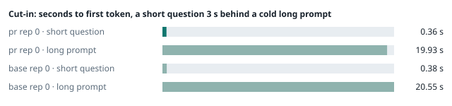
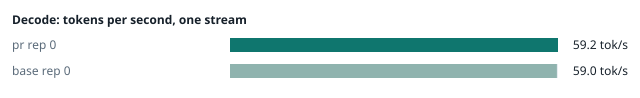
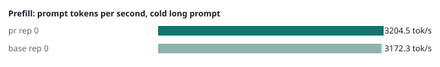
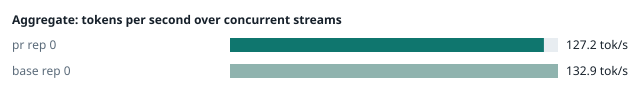
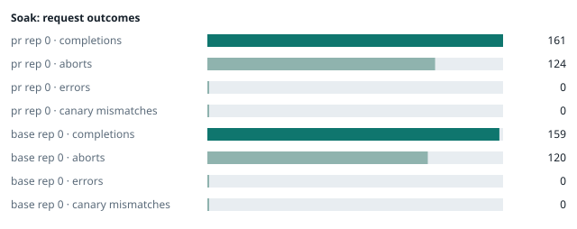

### Evidence: pr vs base

| target | role | image / artifact | model | settings that differ from the control |
|---|---|---|---|---|
| `pr` | candidate | `tensorfold-dsv41:pr-21756361` (c316e266832f) | `DeepSeek-V4.1-Flash-1017` | - |
| `base` | control | `tensorfold-dsv41:base-57c739cb` (5a94966d9621) | `DeepSeek-V4.1-Flash-1017` | baseline |

Conditions: fabric ring; order: A then B, one repetition (no reverse order: pass --opt reps=2 for a counterbalanced run); repetitions: 1; kit d9102c0.
Restore: live restored (verified: API answers, running artifact is live's).

#### smoke

| target | rep | arithmetic | greedy repeat equal | stream matches | JSON mode | first token (stream) | errors |
|---|---|---|---|---|---|---|---|
| `pr` | 0 | ✓ | ✓ | ✓ | ✓ | 0.09 s | - |
| `base` | 0 | ✓ | ✓ | ✓ | ✓ | 0.091 s | - |

machine state after the suite

- `pr` rep 0: `{"head": {"gpus": ["0, NVIDIA GB10, 2184 MHz, 51, [N/A], [N/A], 0 %"], "load": "load average: 6.45, 4.45, 4.79", "container": "92 pids 2.931GiB / 121.7GiB", "mem_available_mb": "27451"}}`
- `base` rep 0: `{"head": {"gpus": ["0, NVIDIA GB10, 2184 MHz, 59, [N/A], [N/A], 76 %"], "load": "load average: 7.28, 5.47, 5.23", "container": "92 pids 3.022GiB / 121.7GiB", "mem_available_mb": "27265"}}`

#### boundary

**19 of 19** greedy reply hashes identical, `pr` against `base`, over 1 repetition(s).

| rep | prompt | tokens (pr / base) | `pr` | `base` | same |
|---|---|---|---|---|---|
| 0 | len5 | 5 / 5 | `38127fef0fbb` | `38127fef0fbb` | ✓ |
| 0 | len2047 | 2047 / 2047 | `8488ccfbcf35` | `8488ccfbcf35` | ✓ |
| 0 | len2048 | 2048 / 2048 | `c5ac2fb76516` | `c5ac2fb76516` | ✓ |
| 0 | len2049 | 2049 / 2049 | `6766401c9caa` | `6766401c9caa` | ✓ |
| 0 | len4095 | 4095 / 4095 | `ed9e5086f520` | `ed9e5086f520` | ✓ |
| 0 | len4096 | 4096 / 4096 | `52584e31f990` | `52584e31f990` | ✓ |
| 0 | len4097 | 4097 / 4097 | `1a71db317ee7` | `1a71db317ee7` | ✓ |
| 0 | len6143 | 6143 / 6143 | `2f9626e9baf5` | `2f9626e9baf5` | ✓ |
| 0 | len6144 | 6144 / 6144 | `11933f2d4bd7` | `11933f2d4bd7` | ✓ |
| 0 | len6145 | 6145 / 6145 | `7aa2f63b2547` | `7aa2f63b2547` | ✓ |
| 0 | len8193 | 8193 / 8193 | `2ef3dc011922` | `2ef3dc011922` | ✓ |
| 0 | len12289 | 12289 / 12289 | `4fcfbd64881f` | `4fcfbd64881f` | ✓ |
| 0 | pfx_base | 5124 / 5124 | `52afe4842e5d` | `52afe4842e5d` | ✓ |
| 0 | pfx_div3072 | 3376 / 3376 | `64d23fe171dc` | `64d23fe171dc` | ✓ |
| 0 | pfx_div2044 | 2348 / 2348 | `16db99ba02f2` | `16db99ba02f2` | ✓ |
| 0 | pfx_div4092 | 4396 / 4396 | `63798c5ba36c` | `63798c5ba36c` | ✓ |
| 0 | pfx_div4093 | 4397 / 4397 | `6b1cfc31884d` | `6b1cfc31884d` | ✓ |
| 0 | pfx_base_again | 5124 / 5124 | `52afe4842e5d` | `52afe4842e5d` | ✓ |
| 0 | pfx_extend | 6660 / 6660 | `357a869fef18` | `357a869fef18` | ✓ |

machine state after the suite

- `pr` rep 0: `{"head": {"gpus": ["0, NVIDIA GB10, 2177 MHz, 60, [N/A], [N/A], 0 %"], "load": "load average: 6.23, 4.61, 4.83", "container": "92 pids 3.074GiB / 121.7GiB", "mem_available_mb": "27131"}}`
- `base` rep 0: `{"head": {"gpus": ["0, NVIDIA GB10, 2171 MHz, 67, [N/A], [N/A], 96 %"], "load": "load average: 6.66, 5.51, 5.26", "container": "92 pids 3.165GiB / 121.7GiB", "mem_available_mb": "27777"}}`

#### cutin

`pr` rep 0: short question first token **0.36 s** (rounds 0.332–0.506), long prompt first token 19.93 s (rounds 19.907–20.042); 3 rounds; admitted during the long prefill in 3 of 3 rounds
`base` rep 0: short question first token **0.38 s** (rounds 0.362–0.417), long prompt first token 20.55 s (rounds 20.077–20.615); 3 rounds; admitted during the long prefill in 3 of 3 rounds

machine state after the suite

- `pr` rep 0: `{"head": {"gpus": ["0, NVIDIA GB10, 2177 MHz, 67, [N/A], [N/A], 96 %"], "load": "load average: 6.18, 4.96, 4.94", "container": "92 pids 3.115GiB / 121.7GiB", "mem_available_mb": "27736"}}`
- `base` rep 0: `{"head": {"gpus": ["0, NVIDIA GB10, 2184 MHz, 72, [N/A], [N/A], 83 %"], "load": "load average: 7.17, 5.93, 5.42", "container": "92 pids 3.217GiB / 121.7GiB", "mem_available_mb": "27751"}}`

#### perf

| target | rep | decode tok/s, one stream | prefill tok/s, cold long prompt | aggregate tok/s, concurrent streams | errors |
|---|---|---|---|---|---|
| `pr` | 0 | **59.2** (56.9–60.0) | **3204.5** (3201.9–3213.1; 12004 tokens) | **127.2** (125.9–134.8; 4 streams) | - |
| `base` | 0 | **59.0** (56.0–60.1) | **3172.3** (3077.9–3193.4; 12004 tokens) | **132.9** (127.2–137.2; 4 streams) | - |

`pr` against `base`: decode +0.3%, prefill +1.0%, aggregate -4.3% (medians over repetitions; the verdict counts a difference only beyond the rounds' spread, at least ±3 %).

machine state after the suite

- `pr` rep 0: `{"head": {"gpus": ["0, NVIDIA GB10, 2177 MHz, 63, [N/A], [N/A], 96 %"], "load": "load average: 5.58, 4.95, 4.94", "container": "92 pids 3.298GiB / 121.7GiB", "mem_available_mb": "27444"}}`
- `base` rep 0: `{"head": {"gpus": ["0, NVIDIA GB10, 2177 MHz, 69, [N/A], [N/A], 96 %"], "load": "load average: 6.32, 5.86, 5.42", "container": "92 pids 3.376GiB / 121.7GiB", "mem_available_mb": "27428"}}`

#### startup

`pr`: 100.6 s from the switch to the API answering (1 start(s))
`base`: 100.2 s from the switch to the API answering (1 start(s))

#### soak

`pr` rep 0: 161 completions, 124 client aborts, **0 errors**, 57 canary checks with **0 mismatches**
  machine samples, first and last: `{"head": {"gpus": ["0, NVIDIA GB10, 2184 MHz, 62, [N/A], [N/A], 96 %"], "load": "load average: 5.13, 4.87, 4.91", "container": "97 pids 3.329GiB / 121.7GiB", "m` → `{"head": {"gpus": ["0, NVIDIA GB10, 2177 MHz, 63, [N/A], [N/A], 96 %"], "load": "load average: 6.07, 5.75, 5.36", "container": "95 pids 3.789GiB / 121.7GiB", "m`
`base` rep 0: 159 completions, 120 client aborts, **0 errors**, 56 canary checks with **0 mismatches**
  machine samples, first and last: `{"head": {"gpus": ["0, NVIDIA GB10, 2177 MHz, 67, [N/A], [N/A], 0 %"], "load": "load average: 6.06, 5.81, 5.41", "container": "97 pids 3.407GiB / 121.7GiB", "me` → `{"head": {"gpus": ["0, NVIDIA GB10, 2177 MHz, 70, [N/A], [N/A], 96 %"], "load": "load average: 6.40, 6.41, 5.93", "container": "96 pids 3.918GiB / 121.7GiB", "m`

machine state after the suite

- `pr` rep 0: `{"head": {"gpus": ["0, NVIDIA GB10, 2184 MHz, 53, [N/A], [N/A], 0 %"], "load": "load average: 3.99, 5.31, 5.24", "container": "92 pids 3.772GiB / 121.7GiB", "mem_available_mb": "26249"}}`
- `base` rep 0: `{"head": {"gpus": ["0, NVIDIA GB10, 2184 MHz, 58, [N/A], [N/A], 0 %"], "load": "load average: 4.44, 5.95, 5.81", "container": "92 pids 3.889GiB / 121.7GiB", "mem_available_mb": "26277"}}`

#### concurrency

| target | rep | streams | aggregate tok/s | first token p50 / p95 | batched replies ≠ serial | errors |
|---|---|---|---|---|---|---|
| `pr` | 0 | 1 (round 0) | **58.1** | 0.248 / 0.258 s | — |  |
| `pr` | 0 | 4 (round 0) | **100.6** | 0.83 / 1.139 s | 0 of 16 |  |
| `pr` | 0 | 8 (round 0) | **122.2** | 1.429 / 2.39 s | 0 of 16 |  |
| `pr` | 0 | 16 (round 0) | **130.8** | 2.738 / 5.213 s | 0 of 16 | 0 |
| `pr` | 0 | 1 (round 1) | **58.2** | 0.248 / 0.256 s | — |  |
| `pr` | 0 | 4 (round 1) | **101.0** | 0.825 / 1.15 s | 0 of 16 |  |
| `pr` | 0 | 8 (round 1) | **121.7** | 1.421 / 2.385 s | 0 of 16 |  |
| `pr` | 0 | 16 (round 1) | **134.0** | 2.707 / 5.179 s | 0 of 16 | 0 |
| `base` | 0 | 1 (round 0) | **57.3** | 0.25 / 0.381 s | — |  |
| `base` | 0 | 4 (round 0) | **100.7** | 0.823 / 1.155 s | 0 of 16 |  |
| `base` | 0 | 8 (round 0) | **118.3** | 1.44 / 2.704 s | 0 of 16 |  |
| `base` | 0 | 16 (round 0) | **131.5** | 2.708 / 5.165 s | 0 of 16 | 0 |
| `base` | 0 | 1 (round 1) | **57.4** | 0.249 / 0.381 s | — |  |
| `base` | 0 | 4 (round 1) | **98.6** | 0.839 / 1.156 s | 0 of 16 |  |
| `base` | 0 | 8 (round 1) | **121.3** | 1.432 / 2.393 s | 0 of 16 |  |
| `base` | 0 | 16 (round 1) | **131.2** | 2.761 / 5.292 s | 0 of 16 | 0 |

`pr` rep 0: 128 requests; batched replies identical to serial in 96 of 96 comparisons
- host `spark-123`: container memory 4121.6 → 4154.4 MB after the drain (**+32.8 MB**, +256.2 MB per 1000 requests); descriptors 223 → 223
- host `spark-161`: container memory 2932.7 → 2966.5 MB after the drain (**+33.8 MB**, +264.1 MB per 1000 requests); descriptors 150 → 150
- host `spark-197`: container memory 3038.2 → 3071.0 MB after the drain (**+32.8 MB**, +256.3 MB per 1000 requests); descriptors 150 → 150
- host `dell-113`: container memory 3059.7 → 3093.5 MB after the drain (**+33.8 MB**, +264.1 MB per 1000 requests); descriptors 150 → 150

`base` rep 0: 128 requests; batched replies identical to serial in 96 of 96 comparisons
- host `spark-123`: container memory 4295.7 → 4299.8 MB after the drain (**+4.1 MB**, +32.0 MB per 1000 requests); descriptors 223 → 223
- host `spark-161`: container memory 3016.7 → 3022.8 MB after the drain (**+6.1 MB**, +47.7 MB per 1000 requests); descriptors 150 → 150
- host `spark-197`: container memory 3118.1 → 3125.2 MB after the drain (**+7.1 MB**, +55.5 MB per 1000 requests); descriptors 150 → 150
- host `dell-113`: container memory 3145.7 → 3150.8 MB after the drain (**+5.1 MB**, +39.8 MB per 1000 requests); descriptors 150 → 150

machine state after the suite

- `pr` rep 0: `{"head": {"gpus": ["0, NVIDIA GB10, 2184 MHz, 55, [N/A], [N/A], 0 %"], "load": "load average: 2.26, 4.31, 4.88", "container": "92 pids 4.057GiB / 121.7GiB", "mem_available_mb": "25825"}}`
- `base` rep 0: `{"head": {"gpus": ["0, NVIDIA GB10, 2184 MHz, 55, [N/A], [N/A], 0 %"], "load": "load average: 2.95, 4.81, 5.40", "container": "92 pids 4.199GiB / 121.7GiB", "mem_available_mb": "25742"}}`

#### repro

| target | role | rep | exit | outcome | expected | as expected |
|---|---|---|---|---|---|---|
| `pr` | candidate | 0 | 0 | passes | passes | ✓ |
| `base` | control | 0 | 1 | fails | fails | ✓ |

**Reproduced on the control and gone on the candidate** (every repetition).

Command: `bash tests/repro-issue-14.sh {api} {model} {logcmd}`

output of the script (tail)

- `pr` rep 0: `control, whole: finish=tool_calls tool_calls=[["write", {"path": "notes.md", "content": "plain text"}]] content="" control, stream: finish=tool_calls tool_calls=[["write", {"path": "notes.md", "content": "plain text"}]] content="" value holds the closer, whole: finish=tool_calls tool_calls=[["write", {"path": "notes.md", "content": "end of block: </｜DSML｜ calls>"}]] content="" value holds the closer, stream: finish=tool_calls tool_calls=[["write", {"path": "notes.md", "content": "end of block: </｜DSML｜ calls>"}]] content="" RESULT: fixed `
- `base` rep 0: `=\"write\">\n<｜DSML｜ parameter name=\"path\" string=\"true\">notes.md</｜DSML｜ parameter>\n<｜DSML｜ parameter name=\"content\" string=\"true\">end of block: </｜DSML｜ calls></｜DSML｜ parameter>\n</｜DSML｜ invoke>\n</｜DSML｜ calls>"   FAIL value holds the closer, whole: expected one write call with the value intact and no DSML closer in content value holds the closer, stream: finish=stop tool_calls=[] content="</｜DSML｜ parameter>\n</｜DSML｜ invoke>\n</｜DSML｜ calls>"   FAIL value holds the closer, stream: expected one write call with the value intact and no DSML closer in content RESULT: problem shows `

machine state after the suite

- `pr` rep 0: `{"head": {"gpus": ["0, NVIDIA GB10, 2177 MHz, 57, [N/A], [N/A], 95 %"], "load": "load average: 2.40, 4.30, 4.88", "container": "92 pids 4.055GiB / 121.7GiB", "mem_available_mb": "25818"}}`
- `base` rep 0: `{"head": {"gpus": ["0, NVIDIA GB10, 2177 MHz, 57, [N/A], [N/A], 94 %"], "load": "load average: 3.12, 4.81, 5.40", "container": "92 pids 4.199GiB / 121.7GiB", "mem_available_mb": "25738"}}`

#### the pull request's own tests

The pull request adds or changes no test file under `tests/`.

#### What this run does not show

- one process under mixed load for hours: throughput probes every few minutes, a canary reply, host memory and descriptors over the run (`endurance` did not run)
- a clean pair exit and recovery after an injected read fault (`fault` did not run)
- an external benchmark against a control (The Grill or similar) (`bench` did not run)
- <!-- add: paths only checked by reading, faults not injected, configurations not run -->

_Generated by inference-agent-kit `report.py` from `20261103T071745/results.json`._
