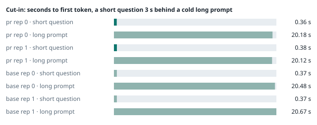
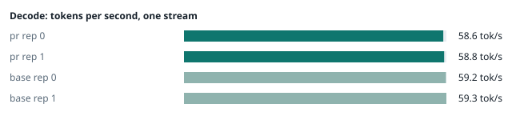
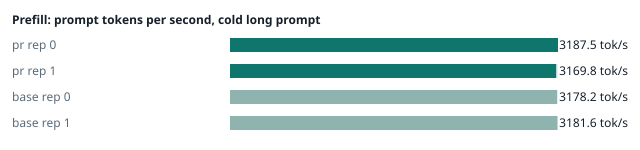
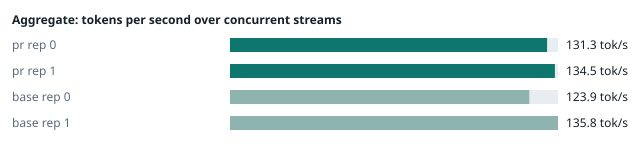
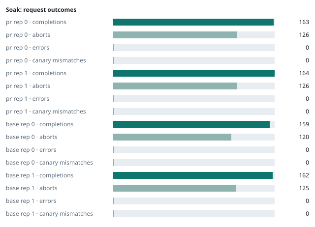

### Evidence: pr vs base

| target | role | image / artifact | model | settings that differ from the control |
|---|---|---|---|---|
| `pr` | candidate | `tensorfold-dsv41:pr-e62a5bf9` (c316e266832f) | `DeepSeek-V4.1-Flash-1017` | - |
| `base` | control | `tensorfold-dsv41:base-57c739cb` (5a94966d9621) | `DeepSeek-V4.1-Flash-1017` | baseline |

Conditions: fabric ring; order: counterbalanced over 2 repetitions: A B, then B A; repetitions: 2; kit d9102c0.
Restore: live restored (verified: API answers, running artifact is live's).

#### smoke

| target | rep | arithmetic | greedy repeat equal | stream matches | JSON mode | first token (stream) | errors |
|---|---|---|---|---|---|---|---|
| `pr` | 0 | ✓ | ✓ | ✓ | ✓ | 0.092 s | - |
| `pr` | 1 | ✓ | ✓ | ✓ | ✓ | 0.091 s | - |
| `base` | 0 | ✓ | ✓ | ✓ | ✓ | 0.09 s | - |
| `base` | 1 | ✓ | ✓ | ✓ | ✓ | 0.089 s | - |

machine state after the suite

- `pr` rep 0: `{"head": {"gpus": ["0, NVIDIA GB10, 2177 MHz, 56, [N/A], [N/A], 0 %"], "load": "load average: 6.81, 4.65, 4.96", "container": "92 pids 3.028GiB / 121.7GiB", "mem_available_mb": "28010"}}`
- `pr` rep 1: `{"head": {"gpus": ["0, NVIDIA GB10, 2177 MHz, 56, [N/A], [N/A], 0 %"], "load": "load average: 6.79, 5.93, 6.03", "container": "92 pids 3.029GiB / 121.7GiB", "mem_available_mb": "26731"}}`
- `base` rep 0: `{"head": {"gpus": ["0, NVIDIA GB10, 2184 MHz, 58, [N/A], [N/A], 22 %"], "load": "load average: 7.18, 5.46, 5.27", "container": "92 pids 2.913GiB / 121.7GiB", "mem_available_mb": "26861"}}`
- `base` rep 1: `{"head": {"gpus": ["0, NVIDIA GB10, 2184 MHz, 58, [N/A], [N/A], 0 %"], "load": "load average: 2.58, 4.61, 5.31", "container": "92 pids 4.089GiB / 121.7GiB", "mem_available_mb": "25192"}}`

#### boundary

**38 of 38** greedy reply hashes identical, `pr` against `base`, over 2 repetition(s).

| rep | prompt | tokens (pr / base) | `pr` | `base` | same |
|---|---|---|---|---|---|
| 0 | len5 | 5 / 5 | `38127fef0fbb` | `38127fef0fbb` | ✓ |
| 0 | len2047 | 2047 / 2047 | `8488ccfbcf35` | `8488ccfbcf35` | ✓ |
| 0 | len2048 | 2048 / 2048 | `c5ac2fb76516` | `c5ac2fb76516` | ✓ |
| 0 | len2049 | 2049 / 2049 | `6766401c9caa` | `6766401c9caa` | ✓ |
| 0 | len4095 | 4095 / 4095 | `ed9e5086f520` | `ed9e5086f520` | ✓ |
| 0 | len4096 | 4096 / 4096 | `52584e31f990` | `52584e31f990` | ✓ |
| 0 | len4097 | 4097 / 4097 | `1a71db317ee7` | `1a71db317ee7` | ✓ |
| 0 | len6143 | 6143 / 6143 | `2f9626e9baf5` | `2f9626e9baf5` | ✓ |
| 0 | len6144 | 6144 / 6144 | `11933f2d4bd7` | `11933f2d4bd7` | ✓ |
| 0 | len6145 | 6145 / 6145 | `7aa2f63b2547` | `7aa2f63b2547` | ✓ |
| 0 | len8193 | 8193 / 8193 | `2ef3dc011922` | `2ef3dc011922` | ✓ |
| 0 | len12289 | 12289 / 12289 | `4fcfbd64881f` | `4fcfbd64881f` | ✓ |
| 0 | pfx_base | 5124 / 5124 | `52afe4842e5d` | `52afe4842e5d` | ✓ |
| 0 | pfx_div3072 | 3376 / 3376 | `64d23fe171dc` | `64d23fe171dc` | ✓ |
| 0 | pfx_div2044 | 2348 / 2348 | `16db99ba02f2` | `16db99ba02f2` | ✓ |
| 0 | pfx_div4092 | 4396 / 4396 | `63798c5ba36c` | `63798c5ba36c` | ✓ |
| 0 | pfx_div4093 | 4397 / 4397 | `6b1cfc31884d` | `6b1cfc31884d` | ✓ |
| 0 | pfx_base_again | 5124 / 5124 | `52afe4842e5d` | `52afe4842e5d` | ✓ |
| 0 | pfx_extend | 6660 / 6660 | `357a869fef18` | `357a869fef18` | ✓ |
| 1 | len5 | 5 / 5 | `38127fef0fbb` | `38127fef0fbb` | ✓ |
| 1 | len2047 | 2047 / 2047 | `8488ccfbcf35` | `8488ccfbcf35` | ✓ |
| 1 | len2048 | 2048 / 2048 | `c5ac2fb76516` | `c5ac2fb76516` | ✓ |
| 1 | len2049 | 2049 / 2049 | `6766401c9caa` | `6766401c9caa` | ✓ |
| 1 | len4095 | 4095 / 4095 | `ed9e5086f520` | `ed9e5086f520` | ✓ |
| 1 | len4096 | 4096 / 4096 | `52584e31f990` | `52584e31f990` | ✓ |
| 1 | len4097 | 4097 / 4097 | `1a71db317ee7` | `1a71db317ee7` | ✓ |
| 1 | len6143 | 6143 / 6143 | `2f9626e9baf5` | `2f9626e9baf5` | ✓ |
| 1 | len6144 | 6144 / 6144 | `11933f2d4bd7` | `11933f2d4bd7` | ✓ |
| 1 | len6145 | 6145 / 6145 | `7aa2f63b2547` | `7aa2f63b2547` | ✓ |
| 1 | len8193 | 8193 / 8193 | `2ef3dc011922` | `2ef3dc011922` | ✓ |
| 1 | len12289 | 12289 / 12289 | `4fcfbd64881f` | `4fcfbd64881f` | ✓ |
| 1 | pfx_base | 5124 / 5124 | `52afe4842e5d` | `52afe4842e5d` | ✓ |
| 1 | pfx_div3072 | 3376 / 3376 | `64d23fe171dc` | `64d23fe171dc` | ✓ |
| 1 | pfx_div2044 | 2348 / 2348 | `16db99ba02f2` | `16db99ba02f2` | ✓ |
| 1 | pfx_div4092 | 4396 / 4396 | `63798c5ba36c` | `63798c5ba36c` | ✓ |
| 1 | pfx_div4093 | 4397 / 4397 | `6b1cfc31884d` | `6b1cfc31884d` | ✓ |
| 1 | pfx_base_again | 5124 / 5124 | `52afe4842e5d` | `52afe4842e5d` | ✓ |
| 1 | pfx_extend | 6660 / 6660 | `357a869fef18` | `357a869fef18` | ✓ |

machine state after the suite

- `pr` rep 0: `{"head": {"gpus": ["0, NVIDIA GB10, 2171 MHz, 64, [N/A], [N/A], 0 %"], "load": "load average: 6.20, 4.76, 4.99", "container": "92 pids 3.171GiB / 121.7GiB", "mem_available_mb": "27681"}}`
- `pr` rep 1: `{"head": {"gpus": ["0, NVIDIA GB10, 2171 MHz, 65, [N/A], [N/A], 96 %"], "load": "load average: 6.48, 5.93, 6.02", "container": "92 pids 3.171GiB / 121.7GiB", "mem_available_mb": "27318"}}`
- `base` rep 0: `{"head": {"gpus": ["0, NVIDIA GB10, 2171 MHz, 68, [N/A], [N/A], 96 %"], "load": "load average: 6.85, 5.57, 5.31", "container": "92 pids 3.069GiB / 121.7GiB", "mem_available_mb": "27239"}}`
- `base` rep 1: `{"head": {"gpus": ["0, NVIDIA GB10, 2171 MHz, 68, [N/A], [N/A], 96 %"], "load": "load average: 4.12, 4.74, 5.33", "container": "92 pids 4.09GiB / 121.7GiB", "mem_available_mb": "25124"}}`

#### cutin

`pr` rep 0: short question first token **0.36 s** (rounds 0.357–0.481), long prompt first token 20.18 s (rounds 20.025–20.333); 3 rounds; admitted during the long prefill in 3 of 3 rounds
`pr` rep 1: short question first token **0.38 s** (rounds 0.376–0.411), long prompt first token 20.12 s (rounds 20.079–20.219); 3 rounds; admitted during the long prefill in 3 of 3 rounds
`base` rep 0: short question first token **0.37 s** (rounds 0.35–0.835), long prompt first token 20.48 s (rounds 20.357–20.662); 3 rounds; admitted during the long prefill in 3 of 3 rounds
`base` rep 1: short question first token **0.37 s** (rounds 0.361–0.993), long prompt first token 20.67 s (rounds 20.005–20.795); 3 rounds; admitted during the long prefill in 3 of 3 rounds

machine state after the suite

- `pr` rep 0: `{"head": {"gpus": ["0, NVIDIA GB10, 2184 MHz, 70, [N/A], [N/A], 80 %"], "load": "load average: 6.19, 5.08, 5.09", "container": "92 pids 3.224GiB / 121.7GiB", "mem_available_mb": "27700"}}`
- `pr` rep 1: `{"head": {"gpus": ["0, NVIDIA GB10, 2177 MHz, 67, [N/A], [N/A], 96 %"], "load": "load average: 6.62, 6.12, 6.08", "container": "92 pids 3.199GiB / 121.7GiB", "mem_available_mb": "27127"}}`
- `base` rep 0: `{"head": {"gpus": ["0, NVIDIA GB10, 2184 MHz, 68, [N/A], [N/A], 0 %"], "load": "load average: 7.06, 5.89, 5.44", "container": "92 pids 3.108GiB / 121.7GiB", "mem_available_mb": "27167"}}`
- `base` rep 1: `{"head": {"gpus": ["0, NVIDIA GB10, 2184 MHz, 69, [N/A], [N/A], 0 %"], "load": "load average: 6.46, 5.31, 5.48", "container": "92 pids 4.091GiB / 121.7GiB", "mem_available_mb": "25138"}}`

#### perf

| target | rep | decode tok/s, one stream | prefill tok/s, cold long prompt | aggregate tok/s, concurrent streams | errors |
|---|---|---|---|---|---|
| `pr` | 0 | **58.6** (57.0–59.2) | **3187.5** (3184.9–3203.6; 12004 tokens) | **131.3** (122.4–135.4; 4 streams) | - |
| `pr` | 1 | **58.8** (56.5–61.5) | **3169.8** (3112.3–3185.8; 12004 tokens) | **134.5** (128.9–139.0; 4 streams) | - |
| `base` | 0 | **59.2** (57.0–60.5) | **3178.2** (3074.8–3184.9; 12004 tokens) | **123.9** (115.0–137.1; 4 streams) | - |
| `base` | 1 | **59.3** (52.1–62.2) | **3181.6** (3163.9–3184.1; 12004 tokens) | **135.8** (131.5–142.9; 4 streams) | - |

`pr` against `base`: decode -0.9%, prefill -0.0%, aggregate +2.3% (medians over repetitions; the verdict counts a difference only beyond the rounds' spread, at least ±3 %).

machine state after the suite

- `pr` rep 0: `{"head": {"gpus": ["0, NVIDIA GB10, 2177 MHz, 67, [N/A], [N/A], 96 %"], "load": "load average: 5.51, 5.04, 5.07", "container": "92 pids 3.395GiB / 121.7GiB", "mem_available_mb": "27282"}}`
- `pr` rep 1: `{"head": {"gpus": ["0, NVIDIA GB10, 2177 MHz, 66, [N/A], [N/A], 65 %"], "load": "load average: 6.58, 6.16, 6.10", "container": "92 pids 3.384GiB / 121.7GiB", "mem_available_mb": "26862"}}`
- `base` rep 0: `{"head": {"gpus": ["0, NVIDIA GB10, 2177 MHz, 66, [N/A], [N/A], 96 %"], "load": "load average: 6.41, 5.85, 5.45", "container": "92 pids 3.269GiB / 121.7GiB", "mem_available_mb": "26957"}}`
- `base` rep 1: `{"head": {"gpus": ["0, NVIDIA GB10, 2177 MHz, 66, [N/A], [N/A], 96 %"], "load": "load average: 5.95, 5.34, 5.49", "container": "92 pids 4.092GiB / 121.7GiB", "mem_available_mb": "25209"}}`

#### startup

`pr`: 100.4 s, 101.6 s from the switch to the API answering (2 start(s))
`base`: 100.3 s from the switch to the API answering (1 start(s))

#### soak

`pr` rep 0: 163 completions, 126 client aborts, **0 errors**, 57 canary checks with **0 mismatches**
  machine samples, first and last: `{"head": {"gpus": ["0, NVIDIA GB10, 2177 MHz, 65, [N/A], [N/A], 0 %"], "load": "load average: 5.07, 4.96, 5.05", "container": "97 pids 3.425GiB / 121.7GiB", "me` → `{"head": {"gpus": ["0, NVIDIA GB10, 2177 MHz, 69, [N/A], [N/A], 96 %"], "load": "load average: 5.67, 5.79, 5.47", "container": "95 pids 3.907GiB / 121.7GiB", "m`
`pr` rep 1: 164 completions, 126 client aborts, **0 errors**, 57 canary checks with **0 mismatches**
  machine samples, first and last: `{"head": {"gpus": ["0, NVIDIA GB10, 2177 MHz, 66, [N/A], [N/A], 0 %"], "load": "load average: 6.05, 6.05, 6.06", "container": "96 pids 3.401GiB / 121.7GiB", "me` → `{"head": {"gpus": ["0, NVIDIA GB10, 2171 MHz, 69, [N/A], [N/A], 96 %"], "load": "load average: 6.91, 6.72, 6.43", "container": "96 pids 3.933GiB / 121.7GiB", "m`
`base` rep 0: 159 completions, 120 client aborts, **0 errors**, 56 canary checks with **0 mismatches**
  machine samples, first and last: `{"head": {"gpus": ["0, NVIDIA GB10, 2177 MHz, 65, [N/A], [N/A], 63 %"], "load": "load average: 6.41, 5.85, 5.45", "container": "96 pids 3.287GiB / 121.7GiB", "m` → `{"head": {"gpus": ["0, NVIDIA GB10, 2177 MHz, 73, [N/A], [N/A], 96 %"], "load": "load average: 6.36, 6.31, 5.90", "container": "96 pids 3.829GiB / 121.7GiB", "m`
`base` rep 1: 162 completions, 125 client aborts, **0 errors**, 57 canary checks with **0 mismatches**
  machine samples, first and last: `{"head": {"gpus": ["0, NVIDIA GB10, 2177 MHz, 65, [N/A], [N/A], 60 %"], "load": "load average: 5.95, 5.34, 5.49", "container": "97 pids 4.121GiB / 121.7GiB", "m` → `{"head": {"gpus": ["0, NVIDIA GB10, 2177 MHz, 70, [N/A], [N/A], 96 %"], "load": "load average: 7.28, 7.20, 6.44", "container": "96 pids 4.132GiB / 121.7GiB", "m`

machine state after the suite

- `pr` rep 0: `{"head": {"gpus": ["0, NVIDIA GB10, 2184 MHz, 58, [N/A], [N/A], 0 %"], "load": "load average: 3.98, 5.38, 5.36", "container": "92 pids 3.895GiB / 121.7GiB", "mem_available_mb": "25711"}}`
- `pr` rep 1: `{"head": {"gpus": ["0, NVIDIA GB10, 2184 MHz, 58, [N/A], [N/A], 0 %"], "load": "load average: 5.20, 6.36, 6.33", "container": "92 pids 3.895GiB / 121.7GiB", "mem_available_mb": "25657"}}`
- `base` rep 0: `{"head": {"gpus": ["0, NVIDIA GB10, 2184 MHz, 59, [N/A], [N/A], 0 %"], "load": "load average: 4.44, 5.89, 5.78", "container": "92 pids 3.78GiB / 121.7GiB", "mem_available_mb": "25714"}}`
- `base` rep 1: `{"head": {"gpus": ["0, NVIDIA GB10, 2184 MHz, 59, [N/A], [N/A], 0 %"], "load": "load average: 4.79, 6.64, 6.31", "container": "92 pids 4.116GiB / 121.7GiB", "mem_available_mb": "25111"}}`

#### concurrency

| target | rep | streams | aggregate tok/s | first token p50 / p95 | batched replies ≠ serial | errors |
|---|---|---|---|---|---|---|
| `pr` | 0 | 1 (round 0) | **58.0** | 0.246 / 0.373 s | — |  |
| `pr` | 0 | 4 (round 0) | **101.3** | 0.823 / 1.15 s | 0 of 16 |  |
| `pr` | 0 | 8 (round 0) | **118.9** | 1.431 / 2.396 s | 0 of 16 |  |
| `pr` | 0 | 16 (round 0) | **134.9** | 2.719 / 5.168 s | 0 of 16 | 0 |
| `pr` | 0 | 1 (round 1) | **58.1** | 0.247 / 0.251 s | — |  |
| `pr` | 0 | 4 (round 1) | **101.2** | 0.822 / 1.145 s | 0 of 16 |  |
| `pr` | 0 | 8 (round 1) | **120.5** | 1.424 / 2.39 s | 0 of 16 |  |
| `pr` | 0 | 16 (round 1) | **132.8** | 2.746 / 5.209 s | 0 of 16 | 0 |
| `pr` | 1 | 1 (round 0) | **54.4** | 0.246 / 0.253 s | — |  |
| `pr` | 1 | 4 (round 0) | **95.4** | 0.826 / 1.156 s | 0 of 16 |  |
| `pr` | 1 | 8 (round 0) | **111.7** | 1.433 / 2.408 s | 0 of 16 |  |
| `pr` | 1 | 16 (round 0) | **121.5** | 2.692 / 5.161 s | 0 of 16 | 0 |
| `pr` | 1 | 1 (round 1) | **54.3** | 0.248 / 0.267 s | — |  |
| `pr` | 1 | 4 (round 1) | **94.3** | 0.827 / 1.176 s | 0 of 16 |  |
| `pr` | 1 | 8 (round 1) | **112.0** | 1.439 / 2.371 s | 0 of 16 |  |
| `pr` | 1 | 16 (round 1) | **121.7** | 2.698 / 5.163 s | 0 of 16 | 0 |
| `base` | 0 | 1 (round 0) | **58.4** | 0.248 / 0.256 s | — |  |
| `base` | 0 | 4 (round 0) | **98.6** | 0.821 / 1.157 s | 0 of 16 |  |
| `base` | 0 | 8 (round 0) | **119.2** | 1.433 / 2.397 s | 0 of 16 |  |
| `base` | 0 | 16 (round 0) | **132.9** | 2.703 / 5.163 s | 0 of 16 | 0 |
| `base` | 0 | 1 (round 1) | **58.3** | 0.247 / 0.261 s | — |  |
| `base` | 0 | 4 (round 1) | **98.7** | 0.817 / 1.14 s | 0 of 16 |  |
| `base` | 0 | 8 (round 1) | **121.5** | 1.439 / 2.397 s | 0 of 16 |  |
| `base` | 0 | 16 (round 1) | **127.1** | 2.745 / 5.179 s | 0 of 16 | 0 |
| `base` | 1 | 1 (round 0) | **54.9** | 0.249 / 0.261 s | — |  |
| `base` | 1 | 4 (round 0) | **92.8** | 0.834 / 1.438 s | 0 of 16 |  |
| `base` | 1 | 8 (round 0) | **112.1** | 1.428 / 2.38 s | 0 of 16 |  |
| `base` | 1 | 16 (round 0) | **125.3** | 2.728 / 5.17 s | 0 of 16 | 0 |
| `base` | 1 | 1 (round 1) | **54.8** | 0.246 / 0.251 s | — |  |
| `base` | 1 | 4 (round 1) | **91.6** | 0.821 / 1.366 s | 0 of 16 |  |
| `base` | 1 | 8 (round 1) | **113.5** | 1.435 / 2.39 s | 0 of 16 |  |
| `base` | 1 | 16 (round 1) | **123.1** | 2.731 / 5.198 s | 0 of 16 | 0 |

`pr` rep 0: 128 requests; batched replies identical to serial in 96 of 96 comparisons
- host `spark-123`: container memory 4248.6 → 4267.0 MB after the drain (**+18.4 MB**, +143.7 MB per 1000 requests); descriptors 223 → 223
- host `spark-161`: container memory 2963.5 → 2981.9 MB after the drain (**+18.4 MB**, +143.8 MB per 1000 requests); descriptors 147 → 150
- host `spark-197`: container memory 3065.9 → 3084.3 MB after the drain (**+18.4 MB**, +143.8 MB per 1000 requests); descriptors 150 → 150
- host `dell-113`: container memory 3074.0 → 3092.5 MB after the drain (**+18.5 MB**, +144.5 MB per 1000 requests); descriptors 147 → 150

`pr` rep 1: 128 requests; batched replies identical to serial in 96 of 96 comparisons
- host `spark-123`: container memory 4233.2 → 4270.1 MB after the drain (**+36.9 MB**, +288.3 MB per 1000 requests); descriptors 223 → 223
- host `spark-161`: container memory 2947.1 → 2983.9 MB after the drain (**+36.8 MB**, +287.5 MB per 1000 requests); descriptors 150 → 150
- host `spark-197`: container memory 3045.4 → 3082.2 MB after the drain (**+36.8 MB**, +287.5 MB per 1000 requests); descriptors 150 → 150
- host `dell-113`: container memory 3058.7 → 3094.5 MB after the drain (**+35.8 MB**, +279.7 MB per 1000 requests); descriptors 150 → 150

`base` rep 0: 128 requests; batched replies identical to serial in 96 of 96 comparisons
- host `spark-123`: container memory 4152.3 → 4188.2 MB after the drain (**+35.9 MB**, +280.5 MB per 1000 requests); descriptors 223 → 220
- host `spark-161`: container memory 2981.9 → 3019.8 MB after the drain (**+37.9 MB**, +296.1 MB per 1000 requests); descriptors 150 → 147
- host `spark-197`: container memory 3086.3 → 3124.2 MB after the drain (**+37.9 MB**, +296.1 MB per 1000 requests); descriptors 150 → 147
- host `dell-113`: container memory 3100.7 → 3136.5 MB after the drain (**+35.8 MB**, +279.7 MB per 1000 requests); descriptors 150 → 150

`base` rep 1: 128 requests; batched replies identical to serial in 96 of 96 comparisons
- host `spark-123`: container memory 4246.5 → 4244.5 MB after the drain (**-2.0 MB**, -15.6 MB per 1000 requests); descriptors 223 → 223
- host `spark-161`: container memory 3075.1 → 3076.1 MB after the drain (**+1.0 MB**, +7.8 MB per 1000 requests); descriptors 150 → 150
- host `spark-197`: container memory 3179.5 → 3179.5 MB after the drain (**+0.0 MB**, +0.0 MB per 1000 requests); descriptors 150 → 150
- host `dell-113`: container memory 3192.8 → 3192.8 MB after the drain (**+0.0 MB**, +0.0 MB per 1000 requests); descriptors 147 → 150

machine state after the suite

- `pr` rep 0: `{"head": {"gpus": ["0, NVIDIA GB10, 2184 MHz, 56, [N/A], [N/A], 0 %"], "load": "load average: 2.24, 4.13, 4.87", "container": "92 pids 4.166GiB / 121.7GiB", "mem_available_mb": "25295"}}`
- `pr` rep 1: `{"head": {"gpus": ["0, NVIDIA GB10, 2184 MHz, 56, [N/A], [N/A], 0 %"], "load": "load average: 3.21, 5.27, 5.93", "container": "92 pids 4.17GiB / 121.7GiB", "mem_available_mb": "25168"}}`
- `base` rep 0: `{"head": {"gpus": ["0, NVIDIA GB10, 2184 MHz, 57, [N/A], [N/A], 0 %"], "load": "load average: 2.77, 4.72, 5.35", "container": "92 pids 4.091GiB / 121.7GiB", "mem_available_mb": "25187"}}`
- `base` rep 1: `{"head": {"gpus": ["0, NVIDIA GB10, 2184 MHz, 57, [N/A], [N/A], 0 %"], "load": "load average: 2.84, 5.29, 5.87", "container": "92 pids 4.144GiB / 121.7GiB", "mem_available_mb": "25085"}}`

#### repro

| target | role | rep | exit | outcome | expected | as expected |
|---|---|---|---|---|---|---|
| `pr` | candidate | 0 | 0 | passes | passes | ✓ |
| `pr` | candidate | 1 | 0 | passes | passes | ✓ |
| `base` | control | 0 | 1 | fails | fails | ✓ |
| `base` | control | 1 | 1 | fails | fails | ✓ |

**Reproduced on the control and gone on the candidate** (every repetition).

Command: `bash tests/repro-issue-14.sh {api} {model} {logcmd}`

output of the script (tail)

- `pr` rep 0: `control, whole: finish=tool_calls tool_calls=[["write", {"path": "notes.md", "content": "plain text"}]] content="" control, stream: finish=tool_calls tool_calls=[["write", {"path": "notes.md", "content": "plain text"}]] content="" value holds the closer, whole: finish=tool_calls tool_calls=[["write", {"path": "notes.md", "content": "end of block: </｜DSML｜ calls>"}]] content="" value holds the closer, stream: finish=tool_calls tool_calls=[["write", {"path": "notes.md", "content": "end of block: </｜DSML｜ calls>"}]] content="" RESULT: fixed `
- `pr` rep 1: `control, whole: finish=tool_calls tool_calls=[["write", {"path": "notes.md", "content": "plain text"}]] content="" control, stream: finish=tool_calls tool_calls=[["write", {"path": "notes.md", "content": "plain text"}]] content="" value holds the closer, whole: finish=tool_calls tool_calls=[["write", {"path": "notes.md", "content": "end of block: </｜DSML｜ calls>"}]] content="" value holds the closer, stream: finish=tool_calls tool_calls=[["write", {"path": "notes.md", "content": "end of block: </｜DSML｜ calls>"}]] content="" RESULT: fixed `
- `base` rep 0: `=\"write\">\n<｜DSML｜ parameter name=\"path\" string=\"true\">notes.md</｜DSML｜ parameter>\n<｜DSML｜ parameter name=\"content\" string=\"true\">end of block: </｜DSML｜ calls></｜DSML｜ parameter>\n</｜DSML｜ invoke>\n</｜DSML｜ calls>"   FAIL value holds the closer, whole: expected one write call with the value intact and no DSML closer in content value holds the closer, stream: finish=stop tool_calls=[] content="</｜DSML｜ parameter>\n</｜DSML｜ invoke>\n</｜DSML｜ calls>"   FAIL value holds the closer, stream: expected one write call with the value intact and no DSML closer in content RESULT: problem shows `
- `base` rep 1: `=\"write\">\n<｜DSML｜ parameter name=\"path\" string=\"true\">notes.md</｜DSML｜ parameter>\n<｜DSML｜ parameter name=\"content\" string=\"true\">end of block: </｜DSML｜ calls></｜DSML｜ parameter>\n</｜DSML｜ invoke>\n</｜DSML｜ calls>"   FAIL value holds the closer, whole: expected one write call with the value intact and no DSML closer in content value holds the closer, stream: finish=stop tool_calls=[] content="</｜DSML｜ parameter>\n</｜DSML｜ invoke>\n</｜DSML｜ calls>"   FAIL value holds the closer, stream: expected one write call with the value intact and no DSML closer in content RESULT: problem shows `

machine state after the suite

- `pr` rep 0: `{"head": {"gpus": ["0, NVIDIA GB10, 2177 MHz, 61, [N/A], [N/A], 96 %"], "load": "load average: 2.38, 4.13, 4.86", "container": "92 pids 4.166GiB / 121.7GiB", "mem_available_mb": "25273"}}`
- `pr` rep 1: `{"head": {"gpus": ["0, NVIDIA GB10, 2177 MHz, 59, [N/A], [N/A], 94 %"], "load": "load average: 3.35, 5.27, 5.92", "container": "92 pids 4.169GiB / 121.7GiB", "mem_available_mb": "25192"}}`
- `base` rep 0: `{"head": {"gpus": ["0, NVIDIA GB10, 2184 MHz, 58, [N/A], [N/A], 95 %"], "load": "load average: 2.58, 4.61, 5.31", "container": "92 pids 4.09GiB / 121.7GiB", "mem_available_mb": "25196"}}`
- `base` rep 1: `{"head": {"gpus": ["0, NVIDIA GB10, 2177 MHz, 59, [N/A], [N/A], 0 %"], "load": "load average: 2.61, 5.21, 5.84", "container": "92 pids 4.144GiB / 121.7GiB", "mem_available_mb": "25088"}}`

#### the pull request's own tests

The pull request adds or changes no test file under `tests/`.

#### What this run does not show

- one process under mixed load for hours: throughput probes every few minutes, a canary reply, host memory and descriptors over the run (`endurance` did not run)
- a clean pair exit and recovery after an injected read fault (`fault` did not run)
- an external benchmark against a control (The Grill or similar) (`bench` did not run)
- <!-- add: paths only checked by reading, faults not injected, configurations not run -->

_Generated by inference-agent-kit `report.py` from `20261103T104147/results.json`._
