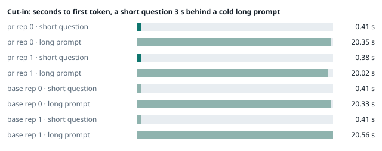
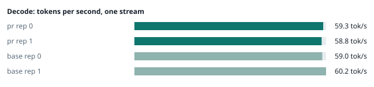
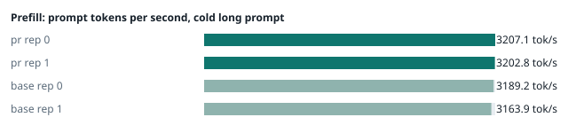
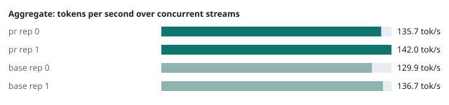
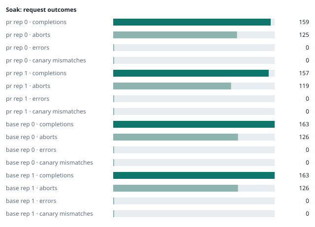

### Evidence: pr vs base

| target | role | image / artifact | model | settings that differ from the control |
|---|---|---|---|---|
| `pr` | candidate | `tensorfold-dsv41:pr-2830c904` (e9c7764e92d3) | `DeepSeek-V4.1-Flash-1017` | - |
| `base` | control | `tensorfold-dsv41:base-57c739cb` (5a94966d9621) | `DeepSeek-V4.1-Flash-1017` | baseline |

Conditions: fabric ring; order: counterbalanced over 2 repetitions: A B, then B A; repetitions: 2; kit 22398b7.
Restore: live restored (verified: API answers, running artifact is live's).

#### smoke

| target | rep | arithmetic | greedy repeat equal | stream matches | JSON mode | first token (stream) | errors |
|---|---|---|---|---|---|---|---|
| `pr` | 0 | ✓ | ✓ | ✓ | ✓ | 0.088 s | - |
| `pr` | 1 | ✓ | ✓ | ✓ | ✓ | 0.092 s | - |
| `base` | 0 | ✓ | ✓ | ✓ | ✓ | 0.09 s | - |
| `base` | 1 | ✓ | ✓ | ✓ | ✓ | 0.091 s | - |

machine state after the suite

- `pr` rep 0: `{"head": {"gpus": ["0, NVIDIA GB10, 2184 MHz, 54, [N/A], [N/A], 0 %"], "load": "load average: 7.05, 2.67, 1.18", "container": "92 pids 3.096GiB / 121.7GiB", "mem_available_mb": "28031"}}`
- `pr` rep 1: `{"head": {"gpus": ["0, NVIDIA GB10, 2184 MHz, 59, [N/A], [N/A], 15 %"], "load": "load average: 7.00, 5.49, 5.27", "container": "92 pids 3.048GiB / 121.7GiB", "mem_available_mb": "27983"}}`
- `base` rep 0: `{"head": {"gpus": ["0, NVIDIA GB10, 2184 MHz, 59, [N/A], [N/A], 0 %"], "load": "load average: 7.07, 5.55, 4.35", "container": "92 pids 3.06GiB / 121.7GiB", "mem_available_mb": "27319"}}`
- `base` rep 1: `{"head": {"gpus": ["0, NVIDIA GB10, 2177 MHz, 60, [N/A], [N/A], 87 %"], "load": "load average: 2.60, 4.29, 4.78", "container": "92 pids 4.187GiB / 121.7GiB", "mem_available_mb": "25768"}}`

#### boundary

**38 of 38** greedy reply hashes identical, `pr` against `base`, over 2 repetition(s).

| rep | prompt | tokens (pr / base) | `pr` | `base` | same |
|---|---|---|---|---|---|
| 0 | len5 | 5 / 5 | `38127fef0fbb` | `38127fef0fbb` | ✓ |
| 0 | len2047 | 2047 / 2047 | `8488ccfbcf35` | `8488ccfbcf35` | ✓ |
| 0 | len2048 | 2048 / 2048 | `c5ac2fb76516` | `c5ac2fb76516` | ✓ |
| 0 | len2049 | 2049 / 2049 | `6766401c9caa` | `6766401c9caa` | ✓ |
| 0 | len4095 | 4095 / 4095 | `ed9e5086f520` | `ed9e5086f520` | ✓ |
| 0 | len4096 | 4096 / 4096 | `52584e31f990` | `52584e31f990` | ✓ |
| 0 | len4097 | 4097 / 4097 | `1a71db317ee7` | `1a71db317ee7` | ✓ |
| 0 | len6143 | 6143 / 6143 | `2f9626e9baf5` | `2f9626e9baf5` | ✓ |
| 0 | len6144 | 6144 / 6144 | `11933f2d4bd7` | `11933f2d4bd7` | ✓ |
| 0 | len6145 | 6145 / 6145 | `7aa2f63b2547` | `7aa2f63b2547` | ✓ |
| 0 | len8193 | 8193 / 8193 | `2ef3dc011922` | `2ef3dc011922` | ✓ |
| 0 | len12289 | 12289 / 12289 | `4fcfbd64881f` | `4fcfbd64881f` | ✓ |
| 0 | pfx_base | 5124 / 5124 | `52afe4842e5d` | `52afe4842e5d` | ✓ |
| 0 | pfx_div3072 | 3376 / 3376 | `64d23fe171dc` | `64d23fe171dc` | ✓ |
| 0 | pfx_div2044 | 2348 / 2348 | `16db99ba02f2` | `16db99ba02f2` | ✓ |
| 0 | pfx_div4092 | 4396 / 4396 | `63798c5ba36c` | `63798c5ba36c` | ✓ |
| 0 | pfx_div4093 | 4397 / 4397 | `6b1cfc31884d` | `6b1cfc31884d` | ✓ |
| 0 | pfx_base_again | 5124 / 5124 | `52afe4842e5d` | `52afe4842e5d` | ✓ |
| 0 | pfx_extend | 6660 / 6660 | `357a869fef18` | `357a869fef18` | ✓ |
| 1 | len5 | 5 / 5 | `38127fef0fbb` | `38127fef0fbb` | ✓ |
| 1 | len2047 | 2047 / 2047 | `8488ccfbcf35` | `8488ccfbcf35` | ✓ |
| 1 | len2048 | 2048 / 2048 | `c5ac2fb76516` | `c5ac2fb76516` | ✓ |
| 1 | len2049 | 2049 / 2049 | `6766401c9caa` | `6766401c9caa` | ✓ |
| 1 | len4095 | 4095 / 4095 | `ed9e5086f520` | `ed9e5086f520` | ✓ |
| 1 | len4096 | 4096 / 4096 | `52584e31f990` | `52584e31f990` | ✓ |
| 1 | len4097 | 4097 / 4097 | `1a71db317ee7` | `1a71db317ee7` | ✓ |
| 1 | len6143 | 6143 / 6143 | `2f9626e9baf5` | `2f9626e9baf5` | ✓ |
| 1 | len6144 | 6144 / 6144 | `11933f2d4bd7` | `11933f2d4bd7` | ✓ |
| 1 | len6145 | 6145 / 6145 | `7aa2f63b2547` | `7aa2f63b2547` | ✓ |
| 1 | len8193 | 8193 / 8193 | `2ef3dc011922` | `2ef3dc011922` | ✓ |
| 1 | len12289 | 12289 / 12289 | `4fcfbd64881f` | `4fcfbd64881f` | ✓ |
| 1 | pfx_base | 5124 / 5124 | `52afe4842e5d` | `52afe4842e5d` | ✓ |
| 1 | pfx_div3072 | 3376 / 3376 | `64d23fe171dc` | `64d23fe171dc` | ✓ |
| 1 | pfx_div2044 | 2348 / 2348 | `16db99ba02f2` | `16db99ba02f2` | ✓ |
| 1 | pfx_div4092 | 4396 / 4396 | `63798c5ba36c` | `63798c5ba36c` | ✓ |
| 1 | pfx_div4093 | 4397 / 4397 | `6b1cfc31884d` | `6b1cfc31884d` | ✓ |
| 1 | pfx_base_again | 5124 / 5124 | `52afe4842e5d` | `52afe4842e5d` | ✓ |
| 1 | pfx_extend | 6660 / 6660 | `357a869fef18` | `357a869fef18` | ✓ |

machine state after the suite

- `pr` rep 0: `{"head": {"gpus": ["0, NVIDIA GB10, 2171 MHz, 65, [N/A], [N/A], 96 %"], "load": "load average: 6.35, 2.98, 1.34", "container": "92 pids 3.253GiB / 121.7GiB", "mem_available_mb": "27697"}}`
- `pr` rep 1: `{"head": {"gpus": ["0, NVIDIA GB10, 2177 MHz, 68, [N/A], [N/A], 96 %"], "load": "load average: 6.40, 5.50, 5.29", "container": "92 pids 3.205GiB / 121.7GiB", "mem_available_mb": "27670"}}`
- `base` rep 0: `{"head": {"gpus": ["0, NVIDIA GB10, 2171 MHz, 66, [N/A], [N/A], 0 %"], "load": "load average: 6.57, 5.60, 4.41", "container": "92 pids 3.203GiB / 121.7GiB", "mem_available_mb": "27730"}}`
- `base` rep 1: `{"head": {"gpus": ["0, NVIDIA GB10, 2171 MHz, 68, [N/A], [N/A], 96 %"], "load": "load average: 4.51, 4.57, 4.85", "container": "92 pids 4.187GiB / 121.7GiB", "mem_available_mb": "25749"}}`

#### cutin

`pr` rep 0: short question first token **0.41 s** (rounds 0.344–0.431), long prompt first token 20.35 s (rounds 20.017–20.41); 3 rounds; admitted during the long prefill in 3 of 3 rounds
`pr` rep 1: short question first token **0.38 s** (rounds 0.331–0.387), long prompt first token 20.02 s (rounds 20.003–20.026); 3 rounds; admitted during the long prefill in 3 of 3 rounds
`base` rep 0: short question first token **0.41 s** (rounds 0.399–0.482), long prompt first token 20.33 s (rounds 20.044–20.404); 3 rounds; admitted during the long prefill in 3 of 3 rounds
`base` rep 1: short question first token **0.41 s** (rounds 0.392–0.419), long prompt first token 20.56 s (rounds 20.09–20.588); 3 rounds; admitted during the long prefill in 3 of 3 rounds

machine state after the suite

- `pr` rep 0: `{"head": {"gpus": ["0, NVIDIA GB10, 2177 MHz, 67, [N/A], [N/A], 96 %"], "load": "load average: 6.75, 3.72, 1.71", "container": "92 pids 3.292GiB / 121.7GiB", "mem_available_mb": "27628"}}`
- `pr` rep 1: `{"head": {"gpus": ["0, NVIDIA GB10, 2177 MHz, 69, [N/A], [N/A], 30 %"], "load": "load average: 6.79, 5.82, 5.41", "container": "92 pids 3.219GiB / 121.7GiB", "mem_available_mb": "27615"}}`
- `base` rep 0: `{"head": {"gpus": ["0, NVIDIA GB10, 2177 MHz, 69, [N/A], [N/A], 96 %"], "load": "load average: 6.80, 5.87, 4.59", "container": "92 pids 3.244GiB / 121.7GiB", "mem_available_mb": "27669"}}`
- `base` rep 1: `{"head": {"gpus": ["0, NVIDIA GB10, 2184 MHz, 71, [N/A], [N/A], 96 %"], "load": "load average: 5.79, 4.90, 4.95", "container": "92 pids 4.188GiB / 121.7GiB", "mem_available_mb": "25755"}}`

#### perf

| target | rep | decode tok/s, one stream | prefill tok/s, cold long prompt | aggregate tok/s, concurrent streams | errors |
|---|---|---|---|---|---|
| `pr` | 0 | **59.3** (52.2–60.5) | **3207.1** (3197.7–3210.5; 12004 tokens) | **135.7** (125.9–136.0; 4 streams) | - |
| `pr` | 1 | **58.8** (56.7–61.5) | **3202.8** (3195.1–3209.6; 12004 tokens) | **142.0** (126.2–143.2; 4 streams) | - |
| `base` | 0 | **59.0** (56.6–60.6) | **3189.2** (3188.3–3201.1; 12004 tokens) | **129.9** (127.9–135.3; 4 streams) | - |
| `base` | 1 | **60.2** (56.6–61.5) | **3163.9** (3162.3–3164.8; 12004 tokens) | **136.7** (120.3–145.1; 4 streams) | - |

`pr` against `base`: decode -0.9%, prefill +0.9%, aggregate +4.2% (medians over repetitions; the verdict counts a difference only beyond the rounds' spread, at least ±3 %).

machine state after the suite

- `pr` rep 0: `{"head": {"gpus": ["0, NVIDIA GB10, 2177 MHz, 64, [N/A], [N/A], 95 %"], "load": "load average: 6.07, 3.93, 1.86", "container": "92 pids 3.48GiB / 121.7GiB", "mem_available_mb": "27310"}}`
- `pr` rep 1: `{"head": {"gpus": ["0, NVIDIA GB10, 2177 MHz, 69, [N/A], [N/A], 96 %"], "load": "load average: 5.85, 5.70, 5.39", "container": "92 pids 3.39GiB / 121.7GiB", "mem_available_mb": "27384"}}`
- `base` rep 0: `{"head": {"gpus": ["0, NVIDIA GB10, 2177 MHz, 69, [N/A], [N/A], 96 %"], "load": "load average: 5.93, 5.76, 4.60", "container": "92 pids 3.428GiB / 121.7GiB", "mem_available_mb": "27304"}}`
- `base` rep 1: `{"head": {"gpus": ["0, NVIDIA GB10, 2171 MHz, 68, [N/A], [N/A], 96 %"], "load": "load average: 5.31, 4.88, 4.94", "container": "92 pids 4.189GiB / 121.7GiB", "mem_available_mb": "25840"}}`

#### startup

`pr`: 101.0 s, 101.2 s from the switch to the API answering (2 start(s))
`base`: 100.9 s from the switch to the API answering (1 start(s))

#### soak

`pr` rep 0: 159 completions, 125 client aborts, **0 errors**, 56 canary checks with **0 mismatches**
  machine samples, first and last: `{"head": {"gpus": ["0, NVIDIA GB10, 2177 MHz, 63, [N/A], [N/A], 96 %"], "load": "load average: 6.07, 3.93, 1.86", "container": "97 pids 3.51GiB / 121.7GiB", "me` → `{"head": {"gpus": ["0, NVIDIA GB10, 2177 MHz, 72, [N/A], [N/A], 96 %"], "load": "load average: 7.09, 6.29, 4.02", "container": "95 pids 2.916GiB / 121.7GiB", "m`
`pr` rep 1: 157 completions, 119 client aborts, **0 errors**, 55 canary checks with **0 mismatches**
  machine samples, first and last: `{"head": {"gpus": ["0, NVIDIA GB10, 2177 MHz, 65, [N/A], [N/A], 0 %"], "load": "load average: 5.38, 5.60, 5.36", "container": "97 pids 3.42GiB / 121.7GiB", "mem` → `{"head": {"gpus": ["0, NVIDIA GB10, 2177 MHz, 70, [N/A], [N/A], 96 %"], "load": "load average: 6.88, 6.50, 5.91", "container": "96 pids 3.927GiB / 121.7GiB", "m`
`base` rep 0: 163 completions, 126 client aborts, **0 errors**, 58 canary checks with **0 mismatches**
  machine samples, first and last: `{"head": {"gpus": ["0, NVIDIA GB10, 2177 MHz, 67, [N/A], [N/A], 0 %"], "load": "load average: 5.54, 5.68, 4.58", "container": "97 pids 3.46GiB / 121.7GiB", "mem` → `{"head": {"gpus": ["0, NVIDIA GB10, 2177 MHz, 70, [N/A], [N/A], 96 %"], "load": "load average: 6.37, 6.11, 5.32", "container": "95 pids 3.902GiB / 121.7GiB", "m`
`base` rep 1: 163 completions, 126 client aborts, **0 errors**, 58 canary checks with **0 mismatches**
  machine samples, first and last: `{"head": {"gpus": ["0, NVIDIA GB10, 2177 MHz, 66, [N/A], [N/A], 0 %"], "load": "load average: 5.31, 4.88, 4.94", "container": "97 pids 4.219GiB / 121.7GiB", "me` → `{"head": {"gpus": ["0, NVIDIA GB10, 2177 MHz, 70, [N/A], [N/A], 73 %"], "load": "load average: 6.13, 5.90, 5.45", "container": "96 pids 4.292GiB / 121.7GiB", "m`

machine state after the suite

- `pr` rep 0: `{"head": {"gpus": ["0, NVIDIA GB10, 2184 MHz, 58, [N/A], [N/A], 0 %"], "load": "load average: 4.81, 5.88, 4.02", "container": "92 pids 2.88GiB / 121.7GiB", "mem_available_mb": "26191"}}`
- `pr` rep 1: `{"head": {"gpus": ["0, NVIDIA GB10, 2184 MHz, 58, [N/A], [N/A], 0 %"], "load": "load average: 4.59, 6.03, 5.80", "container": "92 pids 3.839GiB / 121.7GiB", "mem_available_mb": "26220"}}`
- `base` rep 0: `{"head": {"gpus": ["0, NVIDIA GB10, 2184 MHz, 59, [N/A], [N/A], 0 %"], "load": "load average: 4.28, 5.64, 5.21", "container": "92 pids 3.888GiB / 121.7GiB", "mem_available_mb": "26262"}}`
- `base` rep 1: `{"head": {"gpus": ["0, NVIDIA GB10, 2184 MHz, 58, [N/A], [N/A], 0 %"], "load": "load average: 4.30, 5.51, 5.35", "container": "92 pids 4.253GiB / 121.7GiB", "mem_available_mb": "25629"}}`

#### concurrency

| target | rep | streams | aggregate tok/s | first token p50 / p95 | batched replies ≠ serial | errors |
|---|---|---|---|---|---|---|
| `pr` | 0 | 1 (round 0) | **57.6** | 0.251 / 0.284 s | — |  |
| `pr` | 0 | 4 (round 0) | **100.8** | 0.841 / 1.212 s | 0 of 16 |  |
| `pr` | 0 | 8 (round 0) | **121.3** | 1.429 / 2.397 s | 0 of 16 |  |
| `pr` | 0 | 16 (round 0) | **128.0** | 3.102 / 5.563 s | 0 of 16 | 0 |
| `pr` | 0 | 1 (round 1) | **57.7** | 0.248 / 0.276 s | — |  |
| `pr` | 0 | 4 (round 1) | **100.8** | 0.84 / 1.145 s | 0 of 16 |  |
| `pr` | 0 | 8 (round 1) | **115.6** | 1.444 / 2.768 s | 0 of 16 |  |
| `pr` | 0 | 16 (round 1) | **135.1** | 2.728 / 5.207 s | 0 of 16 | 0 |
| `pr` | 1 | 1 (round 0) | **55.0** | 0.244 / 0.251 s | — |  |
| `pr` | 1 | 4 (round 0) | **93.1** | 0.819 / 1.305 s | 0 of 16 |  |
| `pr` | 1 | 8 (round 0) | **112.2** | 1.434 / 2.394 s | 0 of 16 |  |
| `pr` | 1 | 16 (round 0) | **122.6** | 2.692 / 5.218 s | 0 of 16 | 0 |
| `pr` | 1 | 1 (round 1) | **54.5** | 0.246 / 0.28 s | — |  |
| `pr` | 1 | 4 (round 1) | **95.4** | 0.827 / 1.131 s | 0 of 16 |  |
| `pr` | 1 | 8 (round 1) | **111.3** | 1.417 / 2.518 s | 0 of 16 |  |
| `pr` | 1 | 16 (round 1) | **124.1** | 2.678 / 5.108 s | 0 of 16 | 0 |
| `base` | 0 | 1 (round 0) | **58.5** | 0.248 / 0.262 s | — |  |
| `base` | 0 | 4 (round 0) | **99.0** | 0.847 / 1.154 s | 0 of 16 |  |
| `base` | 0 | 8 (round 0) | **121.8** | 1.444 / 2.391 s | 0 of 16 |  |
| `base` | 0 | 16 (round 0) | **133.5** | 2.728 / 5.241 s | 0 of 16 | 0 |
| `base` | 0 | 1 (round 1) | **58.4** | 0.247 / 0.261 s | — |  |
| `base` | 0 | 4 (round 1) | **99.6** | 0.829 / 1.164 s | 0 of 16 |  |
| `base` | 0 | 8 (round 1) | **121.4** | 1.423 / 2.386 s | 0 of 16 |  |
| `base` | 0 | 16 (round 1) | **128.7** | 2.707 / 5.218 s | 0 of 16 | 0 |
| `base` | 1 | 1 (round 0) | **53.9** | 0.245 / 0.384 s | — |  |
| `base` | 1 | 4 (round 0) | **93.4** | 0.831 / 1.134 s | 0 of 16 |  |
| `base` | 1 | 8 (round 0) | **110.7** | 1.449 / 2.642 s | 0 of 16 |  |
| `base` | 1 | 16 (round 0) | **124.1** | 2.712 / 5.203 s | 0 of 16 | 0 |
| `base` | 1 | 1 (round 1) | **53.8** | 0.249 / 0.34 s | — |  |
| `base` | 1 | 4 (round 1) | **95.7** | 0.827 / 1.141 s | 0 of 16 |  |
| `base` | 1 | 8 (round 1) | **109.6** | 1.438 / 2.389 s | 0 of 16 |  |
| `base` | 1 | 16 (round 1) | **123.6** | 2.695 / 5.189 s | 0 of 16 | 0 |

`pr` rep 0: 128 requests; batched replies identical to serial in 96 of 96 comparisons
- host `spark-123`: container memory 3220.5 → 3267.6 MB after the drain (**+47.1 MB**, +368.0 MB per 1000 requests); descriptors 223 → 223
- host `spark-161`: container memory 3025.9 → 3070.0 MB after the drain (**+44.1 MB**, +344.5 MB per 1000 requests); descriptors 147 → 150
- host `spark-197`: container memory 3130.4 → 3175.4 MB after the drain (**+45.0 MB**, +351.6 MB per 1000 requests); descriptors 150 → 150
- host `dell-113`: container memory 3163.1 → 3207.2 MB after the drain (**+44.1 MB**, +344.5 MB per 1000 requests); descriptors 150 → 150

`pr` rep 1: 128 requests; batched replies identical to serial in 96 of 96 comparisons
- host `spark-123`: container memory 4212.7 → 4250.6 MB after the drain (**+37.9 MB**, +296.1 MB per 1000 requests); descriptors 223 → 220
- host `spark-161`: container memory 2902.0 → 2939.9 MB after the drain (**+37.9 MB**, +296.1 MB per 1000 requests); descriptors 147 → 150
- host `spark-197`: container memory 3007.5 → 3045.4 MB after the drain (**+37.9 MB**, +296.1 MB per 1000 requests); descriptors 150 → 150
- host `dell-113`: container memory 3040.3 → 3078.1 MB after the drain (**+37.8 MB**, +295.3 MB per 1000 requests); descriptors 150 → 150

`base` rep 0: 128 requests; batched replies identical to serial in 96 of 96 comparisons
- host `spark-123`: container memory 4238.3 → 4287.5 MB after the drain (**+49.2 MB**, +384.4 MB per 1000 requests); descriptors 223 → 223
- host `spark-161`: container memory 2913.3 → 2962.4 MB after the drain (**+49.1 MB**, +383.6 MB per 1000 requests); descriptors 150 → 147
- host `spark-197`: container memory 3022.8 → 3072.0 MB after the drain (**+49.2 MB**, +384.4 MB per 1000 requests); descriptors 150 → 150
- host `dell-113`: container memory 3039.2 → 3087.4 MB after the drain (**+48.2 MB**, +376.6 MB per 1000 requests); descriptors 150 → 150

`base` rep 1: 128 requests; batched replies identical to serial in 96 of 96 comparisons
- host `spark-123`: container memory 4358.1 → 4358.1 MB after the drain (**+0.0 MB**, +0.0 MB per 1000 requests); descriptors 223 → 223
- host `spark-161`: container memory 3030.0 → 3033.1 MB after the drain (**+3.1 MB**, +24.2 MB per 1000 requests); descriptors 147 → 150
- host `spark-197`: container memory 3140.6 → 3142.7 MB after the drain (**+2.1 MB**, +16.4 MB per 1000 requests); descriptors 150 → 150
- host `dell-113`: container memory 3157.0 → 3158.0 MB after the drain (**+1.0 MB**, +7.8 MB per 1000 requests); descriptors 150 → 150

machine state after the suite

- `pr` rep 0: `{"head": {"gpus": ["0, NVIDIA GB10, 2184 MHz, 56, [N/A], [N/A], 0 %"], "load": "load average: 2.12, 4.31, 3.86", "container": "92 pids 3.191GiB / 121.7GiB", "mem_available_mb": "25702"}}`
- `pr` rep 1: `{"head": {"gpus": ["0, NVIDIA GB10, 2184 MHz, 56, [N/A], [N/A], 0 %"], "load": "load average: 2.33, 4.64, 5.32", "container": "92 pids 4.151GiB / 121.7GiB", "mem_available_mb": "25762"}}`
- `base` rep 0: `{"head": {"gpus": ["0, NVIDIA GB10, 2184 MHz, 56, [N/A], [N/A], 0 %"], "load": "load average: 2.16, 4.27, 4.78", "container": "92 pids 4.187GiB / 121.7GiB", "mem_available_mb": "25801"}}`
- `base` rep 1: `{"head": {"gpus": ["0, NVIDIA GB10, 2184 MHz, 56, [N/A], [N/A], 0 %"], "load": "load average: 2.22, 4.24, 4.89", "container": "92 pids 4.257GiB / 121.7GiB", "mem_available_mb": "25613"}}`

#### repro

| target | role | rep | exit | outcome | expected | as expected |
|---|---|---|---|---|---|---|
| `pr` | candidate | 0 | 0 | passes | passes | ✓ |
| `pr` | candidate | 1 | 0 | passes | passes | ✓ |
| `base` | control | 0 | 1 | fails | fails | ✓ |
| `base` | control | 1 | 1 | fails | fails | ✓ |

**Reproduced on the control and gone on the candidate** (every repetition).

Command: `bash tests/repro-issue-14.sh {api} {model} {logcmd}`

output of the script (tail)

- `pr` rep 0: `control, whole: finish=tool_calls tool_calls=[["write", {"path": "notes.md", "content": "plain text"}]] content="" control, stream: finish=tool_calls tool_calls=[["write", {"path": "notes.md", "content": "plain text"}]] content="" value holds the closer, whole: finish=tool_calls tool_calls=[["write", {"path": "notes.md", "content": "end of block: </｜DSML｜ calls>"}]] content="" value holds the closer, stream: finish=tool_calls tool_calls=[["write", {"path": "notes.md", "content": "end of block: </｜DSML｜ calls>"}]] content="" RESULT: fixed `
- `pr` rep 1: `control, whole: finish=tool_calls tool_calls=[["write", {"path": "notes.md", "content": "plain text"}]] content="" control, stream: finish=tool_calls tool_calls=[["write", {"path": "notes.md", "content": "plain text"}]] content="" value holds the closer, whole: finish=tool_calls tool_calls=[["write", {"path": "notes.md", "content": "end of block: </｜DSML｜ calls>"}]] content="" value holds the closer, stream: finish=tool_calls tool_calls=[["write", {"path": "notes.md", "content": "end of block: </｜DSML｜ calls>"}]] content="" RESULT: fixed `
- `base` rep 0: `=\"write\">\n<｜DSML｜ parameter name=\"path\" string=\"true\">notes.md</｜DSML｜ parameter>\n<｜DSML｜ parameter name=\"content\" string=\"true\">end of block: </｜DSML｜ calls></｜DSML｜ parameter>\n</｜DSML｜ invoke>\n</｜DSML｜ calls>"   FAIL value holds the closer, whole: expected one write call with the value intact and no DSML closer in content value holds the closer, stream: finish=stop tool_calls=[] content="</｜DSML｜ parameter>\n</｜DSML｜ invoke>\n</｜DSML｜ calls>"   FAIL value holds the closer, stream: expected one write call with the value intact and no DSML closer in content RESULT: problem shows `
- `base` rep 1: `=\"write\">\n<｜DSML｜ parameter name=\"path\" string=\"true\">notes.md</｜DSML｜ parameter>\n<｜DSML｜ parameter name=\"content\" string=\"true\">end of block: </｜DSML｜ calls></｜DSML｜ parameter>\n</｜DSML｜ invoke>\n</｜DSML｜ calls>"   FAIL value holds the closer, whole: expected one write call with the value intact and no DSML closer in content value holds the closer, stream: finish=stop tool_calls=[] content="</｜DSML｜ parameter>\n</｜DSML｜ invoke>\n</｜DSML｜ calls>"   FAIL value holds the closer, stream: expected one write call with the value intact and no DSML closer in content RESULT: problem shows `

machine state after the suite

- `pr` rep 0: `{"head": {"gpus": ["0, NVIDIA GB10, 2177 MHz, 61, [N/A], [N/A], 87 %"], "load": "load average: 2.27, 4.31, 3.86", "container": "92 pids 3.191GiB / 121.7GiB", "mem_available_mb": "25720"}}`
- `pr` rep 1: `{"head": {"gpus": ["0, NVIDIA GB10, 2177 MHz, 61, [N/A], [N/A], 96 %"], "load": "load average: 2.55, 4.64, 5.32", "container": "92 pids 4.15GiB / 121.7GiB", "mem_available_mb": "25758"}}`
- `base` rep 0: `{"head": {"gpus": ["0, NVIDIA GB10, 2177 MHz, 61, [N/A], [N/A], 96 %"], "load": "load average: 2.39, 4.28, 4.78", "container": "92 pids 4.187GiB / 121.7GiB", "mem_available_mb": "25726"}}`
- `base` rep 1: `{"head": {"gpus": ["0, NVIDIA GB10, 2177 MHz, 58, [N/A], [N/A], 0 %"], "load": "load average: 2.60, 4.29, 4.91", "container": "92 pids 4.257GiB / 121.7GiB", "mem_available_mb": "25606"}}`

#### the pull request's own tests

The pull request adds or changes no test file under `tests/`.

#### What this run does not show

- one process under mixed load for hours: throughput probes every few minutes, a canary reply, host memory and descriptors over the run (`endurance` did not run)
- a clean pair exit and recovery after an injected read fault (`fault` did not run)
- an external benchmark against a control (The Grill or similar) (`bench` did not run)
- <!-- add: paths only checked by reading, faults not injected, configurations not run -->

_Generated by inference-agent-kit `report.py` from `20261104T030405/results.json`._
