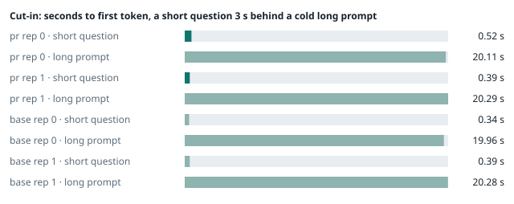
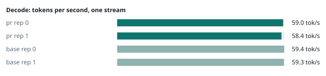
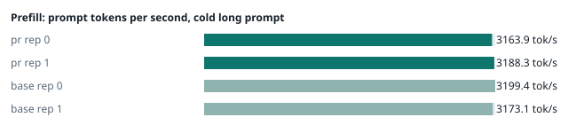
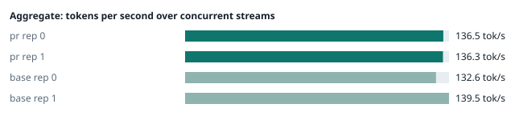
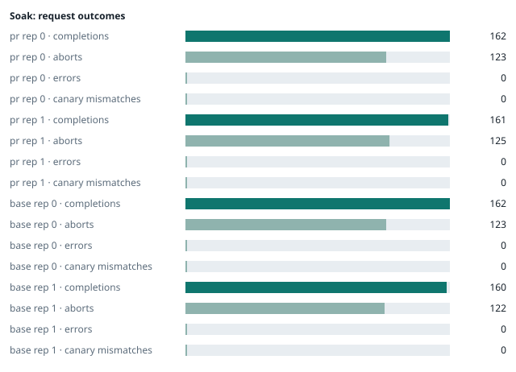

### Evidence: pr vs base

| target | role | image / artifact | model | settings that differ from the control |
|---|---|---|---|---|
| `pr` | candidate | `tensorfold-dsv41:pr-1e33106f` (c51bfb3e7446) | `DeepSeek-V4.1-Flash-1017` | - |
| `base` | control | `tensorfold-dsv41:base-57c739cb` (5a94966d9621) | `DeepSeek-V4.1-Flash-1017` | baseline |

Conditions: fabric ring; order: counterbalanced over 2 repetitions: A B, then B A; repetitions: 2; kit e3938b6.
Restore: live restored (verified: API answers, running artifact is live's).

#### smoke

| target | rep | arithmetic | greedy repeat equal | stream matches | JSON mode | first token (stream) | errors |
|---|---|---|---|---|---|---|---|
| `pr` | 0 | ✓ | ✓ | ✓ | ✓ | 0.094 s | - |
| `pr` | 1 | ✓ | ✓ | ✓ | ✓ | 0.097 s | - |
| `base` | 0 | ✓ | ✓ | ✓ | ✓ | 0.092 s | - |
| `base` | 1 | ✓ | ✓ | ✓ | ✓ | 0.091 s | - |

machine state after the suite

- `pr` rep 0: `{"head": {"gpus": ["0, NVIDIA GB10, 2190 MHz, 53, [N/A], [N/A], 92 %"], "load": "load average: 6.64, 2.58, 1.15", "container": "92 pids 3.008GiB / 121.7GiB", "mem_available_mb": "27503"}}`
- `pr` rep 1: `{"head": {"gpus": ["0, NVIDIA GB10, 2177 MHz, 56, [N/A], [N/A], 95 %"], "load": "load average: 7.72, 5.60, 5.28", "container": "92 pids 3.037GiB / 121.7GiB", "mem_available_mb": "27617"}}`
- `base` rep 0: `{"head": {"gpus": ["0, NVIDIA GB10, 2184 MHz, 59, [N/A], [N/A], 78 %"], "load": "load average: 7.30, 5.29, 4.13", "container": "92 pids 3.012GiB / 121.7GiB", "mem_available_mb": "28042"}}`
- `base` rep 1: `{"head": {"gpus": ["0, NVIDIA GB10, 2177 MHz, 60, [N/A], [N/A], 90 %"], "load": "load average: 2.35, 4.27, 4.70", "container": "92 pids 4.216GiB / 121.7GiB", "mem_available_mb": "25676"}}`

#### boundary

**38 of 38** greedy reply hashes identical, `pr` against `base`, over 2 repetition(s).

| rep | prompt | tokens (pr / base) | `pr` | `base` | same |
|---|---|---|---|---|---|
| 0 | len5 | 5 / 5 | `38127fef0fbb` | `38127fef0fbb` | ✓ |
| 0 | len2047 | 2047 / 2047 | `8488ccfbcf35` | `8488ccfbcf35` | ✓ |
| 0 | len2048 | 2048 / 2048 | `c5ac2fb76516` | `c5ac2fb76516` | ✓ |
| 0 | len2049 | 2049 / 2049 | `6766401c9caa` | `6766401c9caa` | ✓ |
| 0 | len4095 | 4095 / 4095 | `ed9e5086f520` | `ed9e5086f520` | ✓ |
| 0 | len4096 | 4096 / 4096 | `52584e31f990` | `52584e31f990` | ✓ |
| 0 | len4097 | 4097 / 4097 | `1a71db317ee7` | `1a71db317ee7` | ✓ |
| 0 | len6143 | 6143 / 6143 | `2f9626e9baf5` | `2f9626e9baf5` | ✓ |
| 0 | len6144 | 6144 / 6144 | `11933f2d4bd7` | `11933f2d4bd7` | ✓ |
| 0 | len6145 | 6145 / 6145 | `7aa2f63b2547` | `7aa2f63b2547` | ✓ |
| 0 | len8193 | 8193 / 8193 | `2ef3dc011922` | `2ef3dc011922` | ✓ |
| 0 | len12289 | 12289 / 12289 | `4fcfbd64881f` | `4fcfbd64881f` | ✓ |
| 0 | pfx_base | 5124 / 5124 | `52afe4842e5d` | `52afe4842e5d` | ✓ |
| 0 | pfx_div3072 | 3376 / 3376 | `64d23fe171dc` | `64d23fe171dc` | ✓ |
| 0 | pfx_div2044 | 2348 / 2348 | `16db99ba02f2` | `16db99ba02f2` | ✓ |
| 0 | pfx_div4092 | 4396 / 4396 | `63798c5ba36c` | `63798c5ba36c` | ✓ |
| 0 | pfx_div4093 | 4397 / 4397 | `6b1cfc31884d` | `6b1cfc31884d` | ✓ |
| 0 | pfx_base_again | 5124 / 5124 | `52afe4842e5d` | `52afe4842e5d` | ✓ |
| 0 | pfx_extend | 6660 / 6660 | `357a869fef18` | `357a869fef18` | ✓ |
| 1 | len5 | 5 / 5 | `38127fef0fbb` | `38127fef0fbb` | ✓ |
| 1 | len2047 | 2047 / 2047 | `8488ccfbcf35` | `8488ccfbcf35` | ✓ |
| 1 | len2048 | 2048 / 2048 | `c5ac2fb76516` | `c5ac2fb76516` | ✓ |
| 1 | len2049 | 2049 / 2049 | `6766401c9caa` | `6766401c9caa` | ✓ |
| 1 | len4095 | 4095 / 4095 | `ed9e5086f520` | `ed9e5086f520` | ✓ |
| 1 | len4096 | 4096 / 4096 | `52584e31f990` | `52584e31f990` | ✓ |
| 1 | len4097 | 4097 / 4097 | `1a71db317ee7` | `1a71db317ee7` | ✓ |
| 1 | len6143 | 6143 / 6143 | `2f9626e9baf5` | `2f9626e9baf5` | ✓ |
| 1 | len6144 | 6144 / 6144 | `11933f2d4bd7` | `11933f2d4bd7` | ✓ |
| 1 | len6145 | 6145 / 6145 | `7aa2f63b2547` | `7aa2f63b2547` | ✓ |
| 1 | len8193 | 8193 / 8193 | `2ef3dc011922` | `2ef3dc011922` | ✓ |
| 1 | len12289 | 12289 / 12289 | `4fcfbd64881f` | `4fcfbd64881f` | ✓ |
| 1 | pfx_base | 5124 / 5124 | `52afe4842e5d` | `52afe4842e5d` | ✓ |
| 1 | pfx_div3072 | 3376 / 3376 | `64d23fe171dc` | `64d23fe171dc` | ✓ |
| 1 | pfx_div2044 | 2348 / 2348 | `16db99ba02f2` | `16db99ba02f2` | ✓ |
| 1 | pfx_div4092 | 4396 / 4396 | `63798c5ba36c` | `63798c5ba36c` | ✓ |
| 1 | pfx_div4093 | 4397 / 4397 | `6b1cfc31884d` | `6b1cfc31884d` | ✓ |
| 1 | pfx_base_again | 5124 / 5124 | `52afe4842e5d` | `52afe4842e5d` | ✓ |
| 1 | pfx_extend | 6660 / 6660 | `357a869fef18` | `357a869fef18` | ✓ |

machine state after the suite

- `pr` rep 0: `{"head": {"gpus": ["0, NVIDIA GB10, 2171 MHz, 60, [N/A], [N/A], 85 %"], "load": "load average: 6.09, 2.94, 1.33", "container": "92 pids 3.152GiB / 121.7GiB", "mem_available_mb": "27764"}}`
- `pr` rep 1: `{"head": {"gpus": ["0, NVIDIA GB10, 2171 MHz, 65, [N/A], [N/A], 96 %"], "load": "load average: 7.69, 5.82, 5.37", "container": "92 pids 3.18GiB / 121.7GiB", "mem_available_mb": "27698"}}`
- `base` rep 0: `{"head": {"gpus": ["0, NVIDIA GB10, 2177 MHz, 64, [N/A], [N/A], 0 %"], "load": "load average: 6.50, 5.33, 4.19", "container": "92 pids 3.168GiB / 121.7GiB", "mem_available_mb": "27739"}}`
- `base` rep 1: `{"head": {"gpus": ["0, NVIDIA GB10, 2177 MHz, 65, [N/A], [N/A], 0 %"], "load": "load average: 4.23, 4.53, 4.77", "container": "92 pids 4.216GiB / 121.7GiB", "mem_available_mb": "25656"}}`

#### cutin

`pr` rep 0: short question first token **0.52 s** (rounds 0.424–0.525), long prompt first token 20.11 s (rounds 20.091–20.157); 3 rounds; admitted during the long prefill in 3 of 3 rounds
`pr` rep 1: short question first token **0.39 s** (rounds 0.373–0.411), long prompt first token 20.29 s (rounds 20.056–20.301); 3 rounds; admitted during the long prefill in 3 of 3 rounds
`base` rep 0: short question first token **0.34 s** (rounds 0.327–0.366), long prompt first token 19.96 s (rounds 19.912–20.084); 3 rounds; admitted during the long prefill in 3 of 3 rounds
`base` rep 1: short question first token **0.39 s** (rounds 0.383–0.4), long prompt first token 20.28 s (rounds 20.051–20.32); 3 rounds; admitted during the long prefill in 3 of 3 rounds

machine state after the suite

- `pr` rep 0: `{"head": {"gpus": ["0, NVIDIA GB10, 2177 MHz, 68, [N/A], [N/A], 96 %"], "load": "load average: 6.21, 3.64, 1.69", "container": "92 pids 3.192GiB / 121.7GiB", "mem_available_mb": "27629"}}`
- `pr` rep 1: `{"head": {"gpus": ["0, NVIDIA GB10, 2184 MHz, 71, [N/A], [N/A], 96 %"], "load": "load average: 7.59, 6.20, 5.53", "container": "92 pids 3.208GiB / 121.7GiB", "mem_available_mb": "27637"}}`
- `base` rep 0: `{"head": {"gpus": ["0, NVIDIA GB10, 2184 MHz, 70, [N/A], [N/A], 96 %"], "load": "load average: 6.78, 5.63, 4.37", "container": "92 pids 3.208GiB / 121.7GiB", "mem_available_mb": "27663"}}`
- `base` rep 1: `{"head": {"gpus": ["0, NVIDIA GB10, 2184 MHz, 71, [N/A], [N/A], 96 %"], "load": "load average: 5.99, 4.96, 4.91", "container": "92 pids 4.218GiB / 121.7GiB", "mem_available_mb": "25681"}}`

#### perf

| target | rep | decode tok/s, one stream | prefill tok/s, cold long prompt | aggregate tok/s, concurrent streams | errors |
|---|---|---|---|---|---|
| `pr` | 0 | **59.0** (56.3–60.2) | **3163.9** (3151.5–3204.5; 12004 tokens) | **136.5** (123.9–139.5; 4 streams) | - |
| `pr` | 1 | **58.4** (56.2–61.4) | **3188.3** (3180.7–3192.6; 12004 tokens) | **136.3** (128.3–137.5; 4 streams) | - |
| `base` | 0 | **59.4** (57.0–60.2) | **3199.4** (3198.5–3212.2; 12004 tokens) | **132.6** (128.5–133.3; 4 streams) | - |
| `base` | 1 | **59.3** (54.5–61.0) | **3173.1** (3163.1–3184.9; 12004 tokens) | **139.5** (129.7–154.6; 4 streams) | - |

`pr` against `base`: decode -1.1%, prefill -0.3%, aggregate +0.3% (medians over repetitions; the verdict counts a difference only beyond the rounds' spread, at least ±3 %).

machine state after the suite

- `pr` rep 0: `{"head": {"gpus": ["0, NVIDIA GB10, 2171 MHz, 62, [N/A], [N/A], 95 %"], "load": "load average: 5.58, 3.78, 1.81", "container": "92 pids 3.39GiB / 121.7GiB", "mem_available_mb": "27470"}}`
- `pr` rep 1: `{"head": {"gpus": ["0, NVIDIA GB10, 2177 MHz, 67, [N/A], [N/A], 96 %"], "load": "load average: 6.76, 6.14, 5.54", "container": "92 pids 3.368GiB / 121.7GiB", "mem_available_mb": "27369"}}`
- `base` rep 0: `{"head": {"gpus": ["0, NVIDIA GB10, 2177 MHz, 64, [N/A], [N/A], 96 %"], "load": "load average: 5.78, 5.50, 4.38", "container": "92 pids 3.392GiB / 121.7GiB", "mem_available_mb": "27332"}}`
- `base` rep 1: `{"head": {"gpus": ["0, NVIDIA GB10, 2177 MHz, 64, [N/A], [N/A], 96 %"], "load": "load average: 5.44, 4.95, 4.91", "container": "92 pids 4.219GiB / 121.7GiB", "mem_available_mb": "25625"}}`

#### startup

`pr`: 99.8 s, 100.5 s from the switch to the API answering (2 start(s))
`base`: 101.9 s from the switch to the API answering (1 start(s))

#### soak

`pr` rep 0: 162 completions, 123 client aborts, **0 errors**, 57 canary checks with **0 mismatches**
  machine samples, first and last: `{"head": {"gpus": ["0, NVIDIA GB10, 2177 MHz, 61, [N/A], [N/A], 96 %"], "load": "load average: 5.14, 3.72, 1.80", "container": "97 pids 3.421GiB / 121.7GiB", "m` → `{"head": {"gpus": ["0, NVIDIA GB10, 2177 MHz, 65, [N/A], [N/A], 34 %"], "load": "load average: 6.04, 5.68, 3.74", "container": "95 pids 3.862GiB / 121.7GiB", "m`
`pr` rep 1: 161 completions, 125 client aborts, **0 errors**, 57 canary checks with **0 mismatches**
  machine samples, first and last: `{"head": {"gpus": ["0, NVIDIA GB10, 2177 MHz, 63, [N/A], [N/A], 0 %"], "load": "load average: 6.22, 6.04, 5.51", "container": "96 pids 3.385GiB / 121.7GiB", "me` → `{"head": {"gpus": ["0, NVIDIA GB10, 2177 MHz, 66, [N/A], [N/A], 69 %"], "load": "load average: 5.91, 6.03, 5.77", "container": "95 pids 3.858GiB / 121.7GiB", "m`
`base` rep 0: 162 completions, 123 client aborts, **0 errors**, 57 canary checks with **0 mismatches**
  machine samples, first and last: `{"head": {"gpus": ["0, NVIDIA GB10, 2177 MHz, 65, [N/A], [N/A], 96 %"], "load": "load average: 5.78, 5.50, 4.38", "container": "96 pids 3.411GiB / 121.7GiB", "m` → `{"head": {"gpus": ["0, NVIDIA GB10, 2177 MHz, 69, [N/A], [N/A], 96 %"], "load": "load average: 6.41, 6.15, 5.20", "container": "95 pids 3.934GiB / 121.7GiB", "m`
`base` rep 1: 160 completions, 122 client aborts, **0 errors**, 57 canary checks with **0 mismatches**
  machine samples, first and last: `{"head": {"gpus": ["0, NVIDIA GB10, 2177 MHz, 63, [N/A], [N/A], 51 %"], "load": "load average: 5.44, 4.95, 4.91", "container": "97 pids 4.249GiB / 121.7GiB", "m` → `{"head": {"gpus": ["0, NVIDIA GB10, 2177 MHz, 69, [N/A], [N/A], 96 %"], "load": "load average: 5.98, 5.84, 5.42", "container": "96 pids 4.279GiB / 121.7GiB", "m`

machine state after the suite

- `pr` rep 0: `{"head": {"gpus": ["0, NVIDIA GB10, 2184 MHz, 56, [N/A], [N/A], 0 %"], "load": "load average: 3.93, 5.24, 3.73", "container": "92 pids 3.85GiB / 121.7GiB", "mem_available_mb": "26279"}}`
- `pr` rep 1: `{"head": {"gpus": ["0, NVIDIA GB10, 2184 MHz, 57, [N/A], [N/A], 0 %"], "load": "load average: 4.03, 5.56, 5.63", "container": "92 pids 3.842GiB / 121.7GiB", "mem_available_mb": "26235"}}`
- `base` rep 0: `{"head": {"gpus": ["0, NVIDIA GB10, 2184 MHz, 57, [N/A], [N/A], 0 %"], "load": "load average: 4.62, 5.78, 5.14", "container": "92 pids 3.917GiB / 121.7GiB", "mem_available_mb": "26123"}}`
- `base` rep 1: `{"head": {"gpus": ["0, NVIDIA GB10, 2184 MHz, 57, [N/A], [N/A], 0 %"], "load": "load average: 3.86, 5.36, 5.29", "container": "92 pids 4.244GiB / 121.7GiB", "mem_available_mb": "25547"}}`

#### concurrency

| target | rep | streams | aggregate tok/s | first token p50 / p95 | batched replies ≠ serial | errors |
|---|---|---|---|---|---|---|
| `pr` | 0 | 1 (round 0) | **58.2** | 0.251 / 0.281 s | — |  |
| `pr` | 0 | 4 (round 0) | **100.2** | 0.828 / 1.251 s | 0 of 16 |  |
| `pr` | 0 | 8 (round 0) | **121.3** | 1.438 / 2.415 s | 0 of 16 |  |
| `pr` | 0 | 16 (round 0) | **131.0** | 2.742 / 5.208 s | 0 of 16 | 0 |
| `pr` | 0 | 1 (round 1) | **58.3** | 0.247 / 0.259 s | — |  |
| `pr` | 0 | 4 (round 1) | **100.9** | 0.821 / 1.139 s | 0 of 16 |  |
| `pr` | 0 | 8 (round 1) | **122.3** | 1.413 / 2.393 s | 0 of 16 |  |
| `pr` | 0 | 16 (round 1) | **132.4** | 2.714 / 5.159 s | 0 of 16 | 0 |
| `pr` | 1 | 1 (round 0) | **54.6** | 0.247 / 0.252 s | — |  |
| `pr` | 1 | 4 (round 0) | **93.6** | 0.825 / 1.154 s | 0 of 16 |  |
| `pr` | 1 | 8 (round 0) | **112.7** | 1.416 / 2.401 s | 0 of 16 |  |
| `pr` | 1 | 16 (round 0) | **123.1** | 2.731 / 5.226 s | 0 of 16 | 0 |
| `pr` | 1 | 1 (round 1) | **54.4** | 0.247 / 0.321 s | — |  |
| `pr` | 1 | 4 (round 1) | **93.1** | 0.818 / 1.147 s | 0 of 16 |  |
| `pr` | 1 | 8 (round 1) | **112.4** | 1.445 / 2.402 s | 0 of 16 |  |
| `pr` | 1 | 16 (round 1) | **125.0** | 2.704 / 5.229 s | 0 of 16 | 0 |
| `base` | 0 | 1 (round 0) | **57.7** | 0.249 / 0.361 s | — |  |
| `base` | 0 | 4 (round 0) | **99.8** | 0.821 / 1.143 s | 0 of 16 |  |
| `base` | 0 | 8 (round 0) | **121.8** | 1.444 / 2.421 s | 0 of 16 |  |
| `base` | 0 | 16 (round 0) | **132.1** | 2.733 / 5.246 s | 0 of 16 | 0 |
| `base` | 0 | 1 (round 1) | **57.8** | 0.246 / 0.364 s | — |  |
| `base` | 0 | 4 (round 1) | **100.1** | 0.824 / 1.294 s | 0 of 16 |  |
| `base` | 0 | 8 (round 1) | **122.1** | 1.44 / 2.428 s | 0 of 16 |  |
| `base` | 0 | 16 (round 1) | **133.2** | 2.72 / 5.148 s | 0 of 16 | 0 |
| `base` | 1 | 1 (round 0) | **54.5** | 0.247 / 0.262 s | — |  |
| `base` | 1 | 4 (round 0) | **93.4** | 0.832 / 1.136 s | 0 of 16 |  |
| `base` | 1 | 8 (round 0) | **111.5** | 1.433 / 2.383 s | 0 of 16 |  |
| `base` | 1 | 16 (round 0) | **123.3** | 2.709 / 5.157 s | 0 of 16 | 0 |
| `base` | 1 | 1 (round 1) | **54.5** | 0.247 / 0.259 s | — |  |
| `base` | 1 | 4 (round 1) | **93.5** | 0.836 / 1.142 s | 0 of 16 |  |
| `base` | 1 | 8 (round 1) | **112.3** | 1.44 / 2.4 s | 0 of 16 |  |
| `base` | 1 | 16 (round 1) | **123.0** | 2.722 / 5.176 s | 0 of 16 | 0 |

`pr` rep 0: 128 requests; batched replies identical to serial in 96 of 96 comparisons
- host `spark-123`: container memory 4198.4 → 4242.4 MB after the drain (**+44.0 MB**, +343.8 MB per 1000 requests); descriptors 223 → 223
- host `spark-161`: container memory 2933.8 → 2976.8 MB after the drain (**+43.0 MB**, +335.9 MB per 1000 requests); descriptors 150 → 150
- host `spark-197`: container memory 3036.2 → 3079.2 MB after the drain (**+43.0 MB**, +335.9 MB per 1000 requests); descriptors 150 → 150
- host `dell-113`: container memory 3072.0 → 3114.0 MB after the drain (**+42.0 MB**, +328.1 MB per 1000 requests); descriptors 150 → 150

`pr` rep 1: 128 requests; batched replies identical to serial in 96 of 96 comparisons
- host `spark-123`: container memory 4231.2 → 4267.0 MB after the drain (**+35.8 MB**, +279.7 MB per 1000 requests); descriptors 220 → 223
- host `spark-161`: container memory 2932.7 → 2969.6 MB after the drain (**+36.9 MB**, +288.3 MB per 1000 requests); descriptors 150 → 150
- host `spark-197`: container memory 3036.2 → 3074.0 MB after the drain (**+37.8 MB**, +295.3 MB per 1000 requests); descriptors 150 → 147
- host `dell-113`: container memory 3053.6 → 3090.4 MB after the drain (**+36.8 MB**, +287.5 MB per 1000 requests); descriptors 150 → 147

`base` rep 0: 128 requests; batched replies identical to serial in 96 of 96 comparisons
- host `spark-123`: container memory 4282.4 → 4317.2 MB after the drain (**+34.8 MB**, +271.9 MB per 1000 requests); descriptors 223 → 223
- host `spark-161`: container memory 3006.5 → 3042.3 MB after the drain (**+35.8 MB**, +279.7 MB per 1000 requests); descriptors 150 → 150
- host `spark-197`: container memory 3117.1 → 3153.9 MB after the drain (**+36.8 MB**, +287.5 MB per 1000 requests); descriptors 150 → 150
- host `dell-113`: container memory 3132.4 → 3169.3 MB after the drain (**+36.9 MB**, +288.3 MB per 1000 requests); descriptors 150 → 150

`base` rep 1: 128 requests; batched replies identical to serial in 96 of 96 comparisons
- host `spark-123`: container memory 4348.9 → 4347.9 MB after the drain (**-1.0 MB**, -7.8 MB per 1000 requests); descriptors 223 → 220
- host `spark-161`: container memory 3072.0 → 3072.0 MB after the drain (**+0.0 MB**, +0.0 MB per 1000 requests); descriptors 150 → 150
- host `spark-197`: container memory 3183.6 → 3183.6 MB after the drain (**+0.0 MB**, +0.0 MB per 1000 requests); descriptors 150 → 150
- host `dell-113`: container memory 3200.0 → 3198.0 MB after the drain (**-2.0 MB**, -15.6 MB per 1000 requests); descriptors 150 → 150

machine state after the suite

- `pr` rep 0: `{"head": {"gpus": ["0, NVIDIA GB10, 2184 MHz, 55, [N/A], [N/A], 0 %"], "load": "load average: 2.07, 4.02, 3.63", "container": "92 pids 4.143GiB / 121.7GiB", "mem_available_mb": "25762"}}`
- `pr` rep 1: `{"head": {"gpus": ["0, NVIDIA GB10, 2184 MHz, 55, [N/A], [N/A], 0 %"], "load": "load average: 2.54, 4.52, 5.23", "container": "92 pids 4.167GiB / 121.7GiB", "mem_available_mb": "25735"}}`
- `base` rep 0: `{"head": {"gpus": ["0, NVIDIA GB10, 2184 MHz, 55, [N/A], [N/A], 0 %"], "load": "load average: 2.13, 4.34, 4.73", "container": "92 pids 4.216GiB / 121.7GiB", "mem_available_mb": "25623"}}`
- `base` rep 1: `{"head": {"gpus": ["0, NVIDIA GB10, 2184 MHz, 56, [N/A], [N/A], 0 %"], "load": "load average: 2.06, 4.11, 4.83", "container": "92 pids 4.245GiB / 121.7GiB", "mem_available_mb": "25617"}}`

#### repro

| target | role | rep | exit | outcome | expected | as expected |
|---|---|---|---|---|---|---|
| `pr` | candidate | 0 | 0 | passes | passes | ✓ |
| `pr` | candidate | 1 | 0 | passes | passes | ✓ |
| `base` | control | 0 | 1 | fails | fails | ✓ |
| `base` | control | 1 | 1 | fails | fails | ✓ |

**Reproduced on the control and gone on the candidate** (every repetition).

Command: `bash tests/repro-issue-14.sh {api} {model} {logcmd}`

output of the script (tail)

- `pr` rep 0: `｜DSML｜ calls>"}]] content="" two calls, the first value holds the closer and <tool_call> markup, whole: finish=tool_calls tool_calls=[["write", {"path": "notes.md", "content": "</｜DSML｜ calls><tool_call><function=write></function></tool_call>"}], ["write", {"path": "two.md", "content": "two"}]] content="" two calls, the first value holds the closer and <tool_call> markup, stream: finish=tool_calls tool_calls=[["write", {"path": "notes.md", "content": "</｜DSML｜ calls><tool_call><function=write></function></tool_call>"}], ["write", {"path": "two.md", "content": "two"}]] content="" RESULT: fixed `
- `pr` rep 1: `｜DSML｜ calls>"}]] content="" two calls, the first value holds the closer and <tool_call> markup, whole: finish=tool_calls tool_calls=[["write", {"path": "notes.md", "content": "</｜DSML｜ calls><tool_call><function=write></function></tool_call>"}], ["write", {"path": "two.md", "content": "two"}]] content="" two calls, the first value holds the closer and <tool_call> markup, stream: finish=tool_calls tool_calls=[["write", {"path": "notes.md", "content": "</｜DSML｜ calls><tool_call><function=write></function></tool_call>"}], ["write", {"path": "two.md", "content": "two"}]] content="" RESULT: fixed `
- `base` rep 0: `o DSML closer in content two calls, the first value holds the closer and <tool_call> markup, stream: finish=tool_calls tool_calls=[["write", {}]] content="</｜DSML｜ parameter>\n</｜DSML｜ invoke>\n<｜DSML｜ invoke name=\"write\">\n<｜DSML｜ parameter name=\"path\" string=\"true\">two.md</｜DSML｜ parameter>\n<｜DSML｜ parameter name=\"content\" string=\"true\">two</｜DSML｜ parameter>\n</｜DSML｜ invoke>\n</｜DSML｜ calls>"   FAIL two calls, the first value holds the closer and <tool_call> markup, stream: expected the two write calls with their values intact and no DSML closer in content RESULT: problem shows `
- `base` rep 1: `o DSML closer in content two calls, the first value holds the closer and <tool_call> markup, stream: finish=tool_calls tool_calls=[["write", {}]] content="</｜DSML｜ parameter>\n</｜DSML｜ invoke>\n<｜DSML｜ invoke name=\"write\">\n<｜DSML｜ parameter name=\"path\" string=\"true\">two.md</｜DSML｜ parameter>\n<｜DSML｜ parameter name=\"content\" string=\"true\">two</｜DSML｜ parameter>\n</｜DSML｜ invoke>\n</｜DSML｜ calls>"   FAIL two calls, the first value holds the closer and <tool_call> markup, stream: expected the two write calls with their values intact and no DSML closer in content RESULT: problem shows `

machine state after the suite

- `pr` rep 0: `{"head": {"gpus": ["0, NVIDIA GB10, 2177 MHz, 58, [N/A], [N/A], 0 %"], "load": "load average: 2.23, 4.02, 3.64", "container": "92 pids 4.143GiB / 121.7GiB", "mem_available_mb": "25748"}}`
- `pr` rep 1: `{"head": {"gpus": ["0, NVIDIA GB10, 2177 MHz, 61, [N/A], [N/A], 94 %"], "load": "load average: 2.91, 4.53, 5.22", "container": "92 pids 4.167GiB / 121.7GiB", "mem_available_mb": "25709"}}`
- `base` rep 0: `{"head": {"gpus": ["0, NVIDIA GB10, 2177 MHz, 58, [N/A], [N/A], 95 %"], "load": "load average: 2.20, 4.28, 4.71", "container": "92 pids 4.216GiB / 121.7GiB", "mem_available_mb": "25694"}}`
- `base` rep 1: `{"head": {"gpus": ["0, NVIDIA GB10, 2177 MHz, 61, [N/A], [N/A], 94 %"], "load": "load average: 2.50, 4.14, 4.83", "container": "92 pids 4.245GiB / 121.7GiB", "mem_available_mb": "25529"}}`

#### the pull request's own tests

The pull request adds or changes no test file under `tests/`.

#### What this run does not show

- one process under mixed load for hours: throughput probes every few minutes, a canary reply, host memory and descriptors over the run (`endurance` did not run)
- a clean pair exit and recovery after an injected read fault (`fault` did not run)
- an external benchmark against a control (The Grill or similar) (`bench` did not run)
- <!-- add: paths only checked by reading, faults not injected, configurations not run -->

_Generated by inference-agent-kit `report.py` from `20261104T055741/results.json`._
