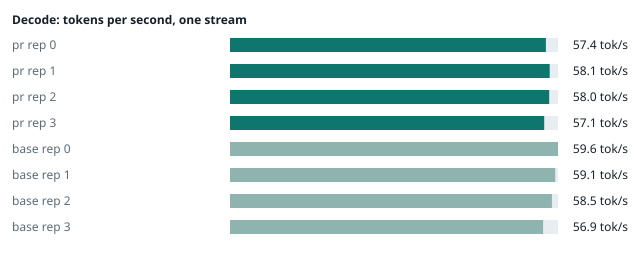
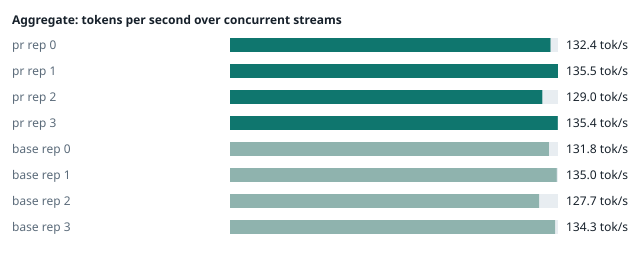

### Evidence: pr vs base

| target | role | image / artifact | model | settings that differ from the control |
|---|---|---|---|---|
| `pr` | candidate | `tensorfold-dsv41:pr-7d91c8d6` (c51bfb3e7446) | `DeepSeek-V4.1-Flash-1017` | - |
| `base` | control | `tensorfold-dsv41:base-57c739cb` (5a94966d9621) | `DeepSeek-V4.1-Flash-1017` | baseline |

Conditions: fabric ring; order: counterbalanced over 4 repetitions: A B, then B A; repetitions: 4; kit e3938b6.
Restore: live restored (verified: API answers, running artifact is live's).

#### perf

| target | rep | decode tok/s, one stream | prefill tok/s, cold long prompt | aggregate tok/s, concurrent streams | errors |
|---|---|---|---|---|---|
| `pr` | 0 | **57.4** (57.3–59.6) | **3126.9** (3100.2–3151.5; 12004 tokens) | **132.4** (116.2–138.4; 4 streams) | - |
| `pr` | 1 | **58.1** (56.8–61.5) | **3139.1** (3101.8–3147.4; 12004 tokens) | **135.5** (132.9–142.5; 4 streams) | - |
| `pr` | 2 | **58.0** (56.2–63.1) | **3117.1** (3098.6–3158.9; 12004 tokens) | **129.0** (127.9–130.6; 4 streams) | - |
| `pr` | 3 | **57.1** (57.0–60.9) | **3130.9** (3034.4–3136.7; 12004 tokens) | **135.4** (130.2–140.2; 4 streams) | - |
| `base` | 0 | **59.6** (57.1–59.6) | **3170.6** (3132.6–3171.5; 12004 tokens) | **131.8** (128.0–133.4; 4 streams) | - |
| `base` | 1 | **59.1** (56.6–61.7) | **3125.2** (3022.2–3154.8; 12004 tokens) | **135.0** (124.6–144.5; 4 streams) | - |
| `base` | 2 | **58.5** (55.6–63.4) | **3118.7** (2922.1–3143.2; 12004 tokens) | **127.7** (120.5–129.8; 4 streams) | - |
| `base` | 3 | **56.9** (56.5–60.8) | **3127.7** (2906.5–3128.5; 12004 tokens) | **134.3** (134.0–139.6; 4 streams) | - |

`pr` against `base`: decode -1.9%, prefill +0.1%, aggregate +0.6% (medians over repetitions; the verdict counts a difference only beyond the rounds' spread, at least ±3 %).

machine state after the suite

- `pr` rep 0: `{"head": {"gpus": ["0, NVIDIA GB10, 2177 MHz, 61, [N/A], [N/A], 0 %"], "load": "load average: 6.16, 4.21, 4.58", "container": "92 pids 3.164GiB / 121.7GiB", "mem_available_mb": "27089"}}`
- `pr` rep 1: `{"head": {"gpus": ["0, NVIDIA GB10, 2171 MHz, 63, [N/A], [N/A], 96 %"], "load": "load average: 7.09, 6.25, 5.39", "container": "92 pids 3.152GiB / 121.7GiB", "mem_available_mb": "27860"}}`
- `pr` rep 2: `{"head": {"gpus": ["0, NVIDIA GB10, 2171 MHz, 65, [N/A], [N/A], 96 %"], "load": "load average: 6.02, 6.08, 5.37", "container": "92 pids 3.206GiB / 121.7GiB", "mem_available_mb": "27705"}}`
- `pr` rep 3: `{"head": {"gpus": ["0, NVIDIA GB10, 2177 MHz, 61, [N/A], [N/A], 96 %"], "load": "load average: 7.23, 7.01, 6.00", "container": "92 pids 3.111GiB / 121.7GiB", "mem_available_mb": "27884"}}`
- `base` rep 0: `{"head": {"gpus": ["0, NVIDIA GB10, 2177 MHz, 60, [N/A], [N/A], 0 %"], "load": "load average: 6.75, 5.49, 5.02", "container": "92 pids 3.129GiB / 121.7GiB", "mem_available_mb": "27905"}}`
- `base` rep 1: `{"head": {"gpus": ["0, NVIDIA GB10, 2177 MHz, 63, [N/A], [N/A], 96 %"], "load": "load average: 5.78, 5.39, 5.01", "container": "92 pids 3.199GiB / 121.7GiB", "mem_available_mb": "27799"}}`
- `base` rep 2: `{"head": {"gpus": ["0, NVIDIA GB10, 2171 MHz, 61, [N/A], [N/A], 34 %"], "load": "load average: 7.03, 6.68, 5.71", "container": "92 pids 3.127GiB / 121.7GiB", "mem_available_mb": "27787"}}`
- `base` rep 3: `{"head": {"gpus": ["0, NVIDIA GB10, 2177 MHz, 63, [N/A], [N/A], 0 %"], "load": "load average: 6.08, 6.45, 5.68", "container": "92 pids 3.182GiB / 121.7GiB", "mem_available_mb": "27802"}}`

#### startup

`pr`: 101.0 s, 100.5 s, 100.5 s from the switch to the API answering (3 start(s))
`base`: 100.7 s, 100.5 s from the switch to the API answering (2 start(s))

#### repro

| target | role | rep | exit | outcome | expected | as expected |
|---|---|---|---|---|---|---|
| `pr` | candidate | 0 | 0 | passes | passes | ✓ |
| `pr` | candidate | 1 | 0 | passes | passes | ✓ |
| `pr` | candidate | 2 | 0 | passes | passes | ✓ |
| `pr` | candidate | 3 | 0 | passes | passes | ✓ |
| `base` | control | 0 | 1 | fails | fails | ✓ |
| `base` | control | 1 | 1 | fails | fails | ✓ |
| `base` | control | 2 | 1 | fails | fails | ✓ |
| `base` | control | 3 | 1 | fails | fails | ✓ |

**Reproduced on the control and gone on the candidate** (every repetition).

Command: `bash tests/repro-issue-14.sh {api} {model} {logcmd}`

output of the script (tail)

- `pr` rep 0: `｜DSML｜ calls>"}]] content="" two calls, the first value holds the closer and <tool_call> markup, whole: finish=tool_calls tool_calls=[["write", {"path": "notes.md", "content": "</｜DSML｜ calls><tool_call><function=write></function></tool_call>"}], ["write", {"path": "two.md", "content": "two"}]] content="" two calls, the first value holds the closer and <tool_call> markup, stream: finish=tool_calls tool_calls=[["write", {"path": "notes.md", "content": "</｜DSML｜ calls><tool_call><function=write></function></tool_call>"}], ["write", {"path": "two.md", "content": "two"}]] content="" RESULT: fixed `
- `pr` rep 1: `｜DSML｜ calls>"}]] content="" two calls, the first value holds the closer and <tool_call> markup, whole: finish=tool_calls tool_calls=[["write", {"path": "notes.md", "content": "</｜DSML｜ calls><tool_call><function=write></function></tool_call>"}], ["write", {"path": "two.md", "content": "two"}]] content="" two calls, the first value holds the closer and <tool_call> markup, stream: finish=tool_calls tool_calls=[["write", {"path": "notes.md", "content": "</｜DSML｜ calls><tool_call><function=write></function></tool_call>"}], ["write", {"path": "two.md", "content": "two"}]] content="" RESULT: fixed `
- `pr` rep 2: `｜DSML｜ calls>"}]] content="" two calls, the first value holds the closer and <tool_call> markup, whole: finish=tool_calls tool_calls=[["write", {"path": "notes.md", "content": "</｜DSML｜ calls><tool_call><function=write></function></tool_call>"}], ["write", {"path": "two.md", "content": "two"}]] content="" two calls, the first value holds the closer and <tool_call> markup, stream: finish=tool_calls tool_calls=[["write", {"path": "notes.md", "content": "</｜DSML｜ calls><tool_call><function=write></function></tool_call>"}], ["write", {"path": "two.md", "content": "two"}]] content="" RESULT: fixed `
- `pr` rep 3: `｜DSML｜ calls>"}]] content="" two calls, the first value holds the closer and <tool_call> markup, whole: finish=tool_calls tool_calls=[["write", {"path": "notes.md", "content": "</｜DSML｜ calls><tool_call><function=write></function></tool_call>"}], ["write", {"path": "two.md", "content": "two"}]] content="" two calls, the first value holds the closer and <tool_call> markup, stream: finish=tool_calls tool_calls=[["write", {"path": "notes.md", "content": "</｜DSML｜ calls><tool_call><function=write></function></tool_call>"}], ["write", {"path": "two.md", "content": "two"}]] content="" RESULT: fixed `
- `base` rep 0: `o DSML closer in content two calls, the first value holds the closer and <tool_call> markup, stream: finish=tool_calls tool_calls=[["write", {}]] content="</｜DSML｜ parameter>\n</｜DSML｜ invoke>\n<｜DSML｜ invoke name=\"write\">\n<｜DSML｜ parameter name=\"path\" string=\"true\">two.md</｜DSML｜ parameter>\n<｜DSML｜ parameter name=\"content\" string=\"true\">two</｜DSML｜ parameter>\n</｜DSML｜ invoke>\n</｜DSML｜ calls>"   FAIL two calls, the first value holds the closer and <tool_call> markup, stream: expected the two write calls with their values intact and no DSML closer in content RESULT: problem shows `
- `base` rep 1: `o DSML closer in content two calls, the first value holds the closer and <tool_call> markup, stream: finish=tool_calls tool_calls=[["write", {}]] content="</｜DSML｜ parameter>\n</｜DSML｜ invoke>\n<｜DSML｜ invoke name=\"write\">\n<｜DSML｜ parameter name=\"path\" string=\"true\">two.md</｜DSML｜ parameter>\n<｜DSML｜ parameter name=\"content\" string=\"true\">two</｜DSML｜ parameter>\n</｜DSML｜ invoke>\n</｜DSML｜ calls>"   FAIL two calls, the first value holds the closer and <tool_call> markup, stream: expected the two write calls with their values intact and no DSML closer in content RESULT: problem shows `
- `base` rep 2: `o DSML closer in content two calls, the first value holds the closer and <tool_call> markup, stream: finish=tool_calls tool_calls=[["write", {}]] content="</｜DSML｜ parameter>\n</｜DSML｜ invoke>\n<｜DSML｜ invoke name=\"write\">\n<｜DSML｜ parameter name=\"path\" string=\"true\">two.md</｜DSML｜ parameter>\n<｜DSML｜ parameter name=\"content\" string=\"true\">two</｜DSML｜ parameter>\n</｜DSML｜ invoke>\n</｜DSML｜ calls>"   FAIL two calls, the first value holds the closer and <tool_call> markup, stream: expected the two write calls with their values intact and no DSML closer in content RESULT: problem shows `
- `base` rep 3: `o DSML closer in content two calls, the first value holds the closer and <tool_call> markup, stream: finish=tool_calls tool_calls=[["write", {}]] content="</｜DSML｜ parameter>\n</｜DSML｜ invoke>\n<｜DSML｜ invoke name=\"write\">\n<｜DSML｜ parameter name=\"path\" string=\"true\">two.md</｜DSML｜ parameter>\n<｜DSML｜ parameter name=\"content\" string=\"true\">two</｜DSML｜ parameter>\n</｜DSML｜ invoke>\n</｜DSML｜ calls>"   FAIL two calls, the first value holds the closer and <tool_call> markup, stream: expected the two write calls with their values intact and no DSML closer in content RESULT: problem shows `

machine state after the suite

- `pr` rep 0: `{"head": {"gpus": ["0, NVIDIA GB10, 2171 MHz, 60, [N/A], [N/A], 94 %"], "load": "load average: 5.51, 4.13, 4.56", "container": "92 pids 3.218GiB / 121.7GiB", "mem_available_mb": "27057"}}`
- `pr` rep 1: `{"head": {"gpus": ["0, NVIDIA GB10, 2177 MHz, 63, [N/A], [N/A], 95 %"], "load": "load average: 6.54, 6.16, 5.37", "container": "92 pids 3.205GiB / 121.7GiB", "mem_available_mb": "27709"}}`
- `pr` rep 2: `{"head": {"gpus": ["0, NVIDIA GB10, 2177 MHz, 63, [N/A], [N/A], 0 %"], "load": "load average: 5.78, 6.02, 5.36", "container": "92 pids 3.205GiB / 121.7GiB", "mem_available_mb": "27677"}}`
- `pr` rep 3: `{"head": {"gpus": ["0, NVIDIA GB10, 2177 MHz, 61, [N/A], [N/A], 0 %"], "load": "load average: 7.05, 6.97, 6.00", "container": "92 pids 3.165GiB / 121.7GiB", "mem_available_mb": "27778"}}`
- `base` rep 0: `{"head": {"gpus": ["0, NVIDIA GB10, 2177 MHz, 60, [N/A], [N/A], 95 %"], "load": "load average: 6.26, 5.42, 5.00", "container": "92 pids 3.183GiB / 121.7GiB", "mem_available_mb": "27773"}}`
- `base` rep 1: `{"head": {"gpus": ["0, NVIDIA GB10, 2171 MHz, 65, [N/A], [N/A], 94 %"], "load": "load average: 5.50, 5.34, 5.00", "container": "92 pids 3.198GiB / 121.7GiB", "mem_available_mb": "27729"}}`
- `base` rep 2: `{"head": {"gpus": ["0, NVIDIA GB10, 2171 MHz, 61, [N/A], [N/A], 95 %"], "load": "load average: 6.79, 6.64, 5.70", "container": "92 pids 3.181GiB / 121.7GiB", "mem_available_mb": "27725"}}`
- `base` rep 3: `{"head": {"gpus": ["0, NVIDIA GB10, 2171 MHz, 65, [N/A], [N/A], 94 %"], "load": "load average: 5.63, 6.34, 5.65", "container": "92 pids 3.182GiB / 121.7GiB", "mem_available_mb": "27756"}}`

#### the pull request's own tests

The pull request adds or changes no test file under `tests/`.

#### What this run does not show

- basic answers, greedy repeat equality, streaming and JSON mode (`smoke` did not run)
- reply equality at chunk ends and prefix-cache cases (`boundary` did not run)
- a short request's first-token time behind a cold long prompt (`cutin` did not run)
- errors, canary mismatches and resource growth over time with client aborts (`soak` did not run)
- throughput and first-token latency at 1 to 16 streams, serial-vs-batched determinism, host memory and descriptors after a drain (`concurrency` did not run)
- one process under mixed load for hours: throughput probes every few minutes, a canary reply, host memory and descriptors over the run (`endurance` did not run)
- a clean pair exit and recovery after an injected read fault (`fault` did not run)
- an external benchmark against a control (The Grill or similar) (`bench` did not run)
- <!-- add: paths only checked by reading, faults not injected, configurations not run -->

_Generated by inference-agent-kit `report.py` from `20261104T071712/results.json`._
