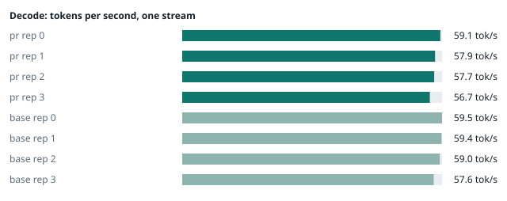
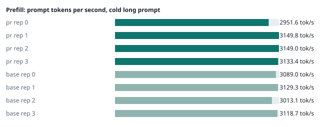
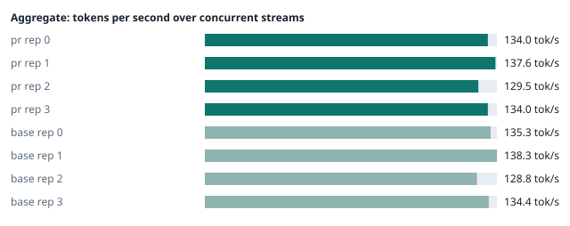

### Evidence: pr vs base

| target | role | image / artifact | model | settings that differ from the control |
|---|---|---|---|---|
| `pr` | candidate | `tensorfold-dsv41:pr-18c4b5b5` (c51bfb3e7446) | `DeepSeek-V4.1-Flash-1017` | - |
| `base` | control | `tensorfold-dsv41:base-57c739cb` (5a94966d9621) | `DeepSeek-V4.1-Flash-1017` | baseline |

Conditions: fabric ring; order: counterbalanced over 4 repetitions: A B, then B A; repetitions: 4; kit 6cc9b1d.
Restore: live restored (verified: API answers, running artifact is live's).

#### perf

| target | rep | decode tok/s, one stream | prefill tok/s, cold long prompt | aggregate tok/s, concurrent streams | errors |
|---|---|---|---|---|---|
| `pr` | 0 | **59.1** (56.4–60.0) | **2951.6** (2835.1–3013.1; 12004 tokens) | **134.0** (127.8–136.6; 4 streams) | - |
| `pr` | 1 | **57.9** (55.1–61.8) | **3149.8** (3124.4–3152.3; 12004 tokens) | **137.6** (127.3–138.6; 4 streams) | - |
| `pr` | 2 | **57.7** (56.8–63.3) | **3149.0** (3075.6–3198.5; 12004 tokens) | **129.5** (127.9–131.6; 4 streams) | - |
| `pr` | 3 | **56.7** (56.6–60.2) | **3133.4** (3130.1–3186.6; 12004 tokens) | **134.0** (129.5–141.8; 4 streams) | - |
| `base` | 0 | **59.5** (57.4–59.5) | **3089.0** (3025.2–3155.6; 12004 tokens) | **135.3** (125.9–139.0; 4 streams) | - |
| `base` | 1 | **59.4** (55.0–62.0) | **3129.3** (3124.4–3137.5; 12004 tokens) | **138.3** (128.5–143.7; 4 streams) | - |
| `base` | 2 | **59.0** (56.8–63.3) | **3013.1** (2946.5–3163.1; 12004 tokens) | **128.8** (119.5–130.0; 4 streams) | - |
| `base` | 3 | **57.6** (56.7–62.0) | **3118.7** (3101.8–3139.1; 12004 tokens) | **134.4** (127.7–141.4; 4 streams) | - |

`pr` against `base`: decode -2.4%, prefill +1.2%, aggregate -0.6% (medians over repetitions; the verdict counts a difference only beyond the rounds' spread, at least ±3 %).

machine state after the suite

- `pr` rep 0: `{"head": {"gpus": ["0, NVIDIA GB10, 2184 MHz, 58, [N/A], [N/A], 0 %"], "load": "load average: 7.34, 3.94, 2.55", "container": "92 pids 3.107GiB / 121.7GiB", "mem_available_mb": "27776"}}`
- `pr` rep 1: `{"head": {"gpus": ["0, NVIDIA GB10, 2177 MHz, 62, [N/A], [N/A], 96 %"], "load": "load average: 6.79, 6.13, 4.00", "container": "92 pids 3.134GiB / 121.7GiB", "mem_available_mb": "27730"}}`
- `pr` rep 2: `{"head": {"gpus": ["0, NVIDIA GB10, 2171 MHz, 62, [N/A], [N/A], 96 %"], "load": "load average: 5.87, 5.95, 4.04", "container": "92 pids 3.187GiB / 121.7GiB", "mem_available_mb": "27644"}}`
- `pr` rep 3: `{"head": {"gpus": ["0, NVIDIA GB10, 2171 MHz, 63, [N/A], [N/A], 96 %"], "load": "load average: 7.18, 6.94, 5.08", "container": "92 pids 3.119GiB / 121.7GiB", "mem_available_mb": "27701"}}`
- `base` rep 0: `{"head": {"gpus": ["0, NVIDIA GB10, 2177 MHz, 59, [N/A], [N/A], 95 %"], "load": "load average: 7.14, 5.44, 3.33", "container": "92 pids 3.114GiB / 121.7GiB", "mem_available_mb": "27704"}}`
- `base` rep 1: `{"head": {"gpus": ["0, NVIDIA GB10, 2177 MHz, 61, [N/A], [N/A], 0 %"], "load": "load average: 6.44, 5.49, 3.45", "container": "92 pids 3.169GiB / 121.7GiB", "mem_available_mb": "27618"}}`
- `base` rep 2: `{"head": {"gpus": ["0, NVIDIA GB10, 2171 MHz, 62, [N/A], [N/A], 78 %"], "load": "load average: 6.70, 6.47, 4.53", "container": "92 pids 3.134GiB / 121.7GiB", "mem_available_mb": "27751"}}`
- `base` rep 3: `{"head": {"gpus": ["0, NVIDIA GB10, 2177 MHz, 64, [N/A], [N/A], 96 %"], "load": "load average: 5.96, 6.28, 4.56", "container": "92 pids 3.188GiB / 121.7GiB", "mem_available_mb": "27617"}}`

#### startup

`pr`: 100.5 s, 100.1 s, 101.5 s from the switch to the API answering (3 start(s))
`base`: 101.3 s, 101.8 s from the switch to the API answering (2 start(s))

#### repro

| target | role | rep | exit | outcome | expected | as expected |
|---|---|---|---|---|---|---|
| `pr` | candidate | 0 | 0 | passes | passes | ✓ |
| `pr` | candidate | 1 | 0 | passes | passes | ✓ |
| `pr` | candidate | 2 | 0 | passes | passes | ✓ |
| `pr` | candidate | 3 | 0 | passes | passes | ✓ |
| `base` | control | 0 | 1 | fails | fails | ✓ |
| `base` | control | 1 | 1 | fails | fails | ✓ |
| `base` | control | 2 | 1 | fails | fails | ✓ |
| `base` | control | 3 | 1 | fails | fails | ✓ |

**Reproduced on the control and gone on the candidate** (every repetition).

Command: `bash tests/repro-issue-14.sh {api} {model} {logcmd}`

output of the script (tail)

- `pr` rep 0: `｜DSML｜ calls>"}]] content="" two calls, the first value holds the closer and <tool_call> markup, whole: finish=tool_calls tool_calls=[["write", {"path": "notes.md", "content": "</｜DSML｜ calls><tool_call><function=write></function></tool_call>"}], ["write", {"path": "two.md", "content": "two"}]] content="" two calls, the first value holds the closer and <tool_call> markup, stream: finish=tool_calls tool_calls=[["write", {"path": "notes.md", "content": "</｜DSML｜ calls><tool_call><function=write></function></tool_call>"}], ["write", {"path": "two.md", "content": "two"}]] content="" RESULT: fixed `
- `pr` rep 1: `｜DSML｜ calls>"}]] content="" two calls, the first value holds the closer and <tool_call> markup, whole: finish=tool_calls tool_calls=[["write", {"path": "notes.md", "content": "</｜DSML｜ calls><tool_call><function=write></function></tool_call>"}], ["write", {"path": "two.md", "content": "two"}]] content="" two calls, the first value holds the closer and <tool_call> markup, stream: finish=tool_calls tool_calls=[["write", {"path": "notes.md", "content": "</｜DSML｜ calls><tool_call><function=write></function></tool_call>"}], ["write", {"path": "two.md", "content": "two"}]] content="" RESULT: fixed `
- `pr` rep 2: `｜DSML｜ calls>"}]] content="" two calls, the first value holds the closer and <tool_call> markup, whole: finish=tool_calls tool_calls=[["write", {"path": "notes.md", "content": "</｜DSML｜ calls><tool_call><function=write></function></tool_call>"}], ["write", {"path": "two.md", "content": "two"}]] content="" two calls, the first value holds the closer and <tool_call> markup, stream: finish=tool_calls tool_calls=[["write", {"path": "notes.md", "content": "</｜DSML｜ calls><tool_call><function=write></function></tool_call>"}], ["write", {"path": "two.md", "content": "two"}]] content="" RESULT: fixed `
- `pr` rep 3: `｜DSML｜ calls>"}]] content="" two calls, the first value holds the closer and <tool_call> markup, whole: finish=tool_calls tool_calls=[["write", {"path": "notes.md", "content": "</｜DSML｜ calls><tool_call><function=write></function></tool_call>"}], ["write", {"path": "two.md", "content": "two"}]] content="" two calls, the first value holds the closer and <tool_call> markup, stream: finish=tool_calls tool_calls=[["write", {"path": "notes.md", "content": "</｜DSML｜ calls><tool_call><function=write></function></tool_call>"}], ["write", {"path": "two.md", "content": "two"}]] content="" RESULT: fixed `
- `base` rep 0: `o DSML closer in content two calls, the first value holds the closer and <tool_call> markup, stream: finish=tool_calls tool_calls=[["write", {}]] content="</｜DSML｜ parameter>\n</｜DSML｜ invoke>\n<｜DSML｜ invoke name=\"write\">\n<｜DSML｜ parameter name=\"path\" string=\"true\">two.md</｜DSML｜ parameter>\n<｜DSML｜ parameter name=\"content\" string=\"true\">two</｜DSML｜ parameter>\n</｜DSML｜ invoke>\n</｜DSML｜ calls>"   FAIL two calls, the first value holds the closer and <tool_call> markup, stream: expected the two write calls with their values intact and no DSML closer in content RESULT: problem shows `
- `base` rep 1: `o DSML closer in content two calls, the first value holds the closer and <tool_call> markup, stream: finish=tool_calls tool_calls=[["write", {}]] content="</｜DSML｜ parameter>\n</｜DSML｜ invoke>\n<｜DSML｜ invoke name=\"write\">\n<｜DSML｜ parameter name=\"path\" string=\"true\">two.md</｜DSML｜ parameter>\n<｜DSML｜ parameter name=\"content\" string=\"true\">two</｜DSML｜ parameter>\n</｜DSML｜ invoke>\n</｜DSML｜ calls>"   FAIL two calls, the first value holds the closer and <tool_call> markup, stream: expected the two write calls with their values intact and no DSML closer in content RESULT: problem shows `
- `base` rep 2: `o DSML closer in content two calls, the first value holds the closer and <tool_call> markup, stream: finish=tool_calls tool_calls=[["write", {}]] content="</｜DSML｜ parameter>\n</｜DSML｜ invoke>\n<｜DSML｜ invoke name=\"write\">\n<｜DSML｜ parameter name=\"path\" string=\"true\">two.md</｜DSML｜ parameter>\n<｜DSML｜ parameter name=\"content\" string=\"true\">two</｜DSML｜ parameter>\n</｜DSML｜ invoke>\n</｜DSML｜ calls>"   FAIL two calls, the first value holds the closer and <tool_call> markup, stream: expected the two write calls with their values intact and no DSML closer in content RESULT: problem shows `
- `base` rep 3: `o DSML closer in content two calls, the first value holds the closer and <tool_call> markup, stream: finish=tool_calls tool_calls=[["write", {}]] content="</｜DSML｜ parameter>\n</｜DSML｜ invoke>\n<｜DSML｜ invoke name=\"write\">\n<｜DSML｜ parameter name=\"path\" string=\"true\">two.md</｜DSML｜ parameter>\n<｜DSML｜ parameter name=\"content\" string=\"true\">two</｜DSML｜ parameter>\n</｜DSML｜ invoke>\n</｜DSML｜ calls>"   FAIL two calls, the first value holds the closer and <tool_call> markup, stream: expected the two write calls with their values intact and no DSML closer in content RESULT: problem shows `

machine state after the suite

- `pr` rep 0: `{"head": {"gpus": ["0, NVIDIA GB10, 2184 MHz, 58, [N/A], [N/A], 94 %"], "load": "load average: 6.77, 3.93, 2.56", "container": "92 pids 3.16GiB / 121.7GiB", "mem_available_mb": "27701"}}`
- `pr` rep 1: `{"head": {"gpus": ["0, NVIDIA GB10, 2177 MHz, 62, [N/A], [N/A], 95 %"], "load": "load average: 6.12, 6.01, 3.99", "container": "92 pids 3.187GiB / 121.7GiB", "mem_available_mb": "27744"}}`
- `pr` rep 2: `{"head": {"gpus": ["0, NVIDIA GB10, 2177 MHz, 64, [N/A], [N/A], 95 %"], "load": "load average: 5.44, 5.85, 4.03", "container": "92 pids 3.188GiB / 121.7GiB", "mem_available_mb": "27686"}}`
- `pr` rep 3: `{"head": {"gpus": ["0, NVIDIA GB10, 2177 MHz, 62, [N/A], [N/A], 94 %"], "load": "load average: 7.01, 6.91, 5.08", "container": "92 pids 3.173GiB / 121.7GiB", "mem_available_mb": "27682"}}`
- `base` rep 0: `{"head": {"gpus": ["0, NVIDIA GB10, 2177 MHz, 58, [N/A], [N/A], 94 %"], "load": "load average: 6.81, 5.42, 3.35", "container": "92 pids 3.168GiB / 121.7GiB", "mem_available_mb": "27636"}}`
- `base` rep 1: `{"head": {"gpus": ["0, NVIDIA GB10, 2177 MHz, 63, [N/A], [N/A], 95 %"], "load": "load average: 6.07, 5.44, 3.46", "container": "92 pids 3.169GiB / 121.7GiB", "mem_available_mb": "27684"}}`
- `base` rep 2: `{"head": {"gpus": ["0, NVIDIA GB10, 2177 MHz, 60, [N/A], [N/A], 94 %"], "load": "load average: 6.23, 6.37, 4.52", "container": "92 pids 3.188GiB / 121.7GiB", "mem_available_mb": "27685"}}`
- `base` rep 3: `{"head": {"gpus": ["0, NVIDIA GB10, 2177 MHz, 62, [N/A], [N/A], 0 %"], "load": "load average: 5.58, 6.19, 4.55", "container": "92 pids 3.188GiB / 121.7GiB", "mem_available_mb": "27690"}}`

#### the pull request's own tests

The pull request adds or changes no test file under `tests/`.

#### What this run does not show

- basic answers, greedy repeat equality, streaming and JSON mode (`smoke` did not run)
- reply equality at chunk ends and prefix-cache cases (`boundary` did not run)
- a short request's first-token time behind a cold long prompt (`cutin` did not run)
- errors, canary mismatches and resource growth over time with client aborts (`soak` did not run)
- throughput and first-token latency at 1 to 16 streams, serial-vs-batched determinism, host memory and descriptors after a drain (`concurrency` did not run)
- one process under mixed load for hours: throughput probes every few minutes, a canary reply, host memory and descriptors over the run (`endurance` did not run)
- a clean pair exit and recovery after an injected read fault (`fault` did not run)
- an external benchmark against a control (The Grill or similar) (`bench` did not run)
- <!-- add: paths only checked by reading, faults not injected, configurations not run -->

_Generated by inference-agent-kit `report.py` from `20261104T080605/results.json`._
