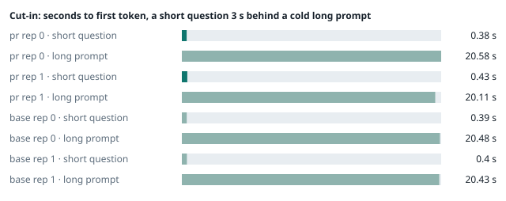
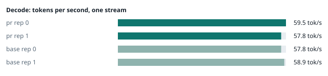
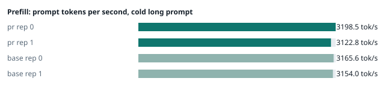
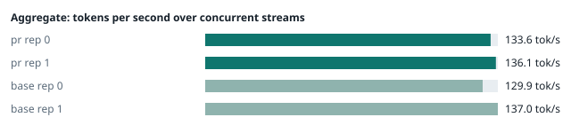
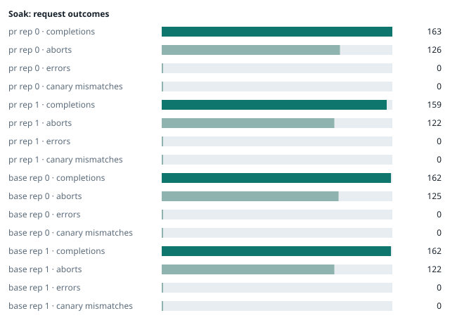

### Evidence: pr vs base

| target | role | image / artifact | model | settings that differ from the control |
|---|---|---|---|---|
| `pr` | candidate | `tensorfold-dsv41:pr-312c2e08` (1751c2212f10) | `DeepSeek-V4.1-Flash-1017` | - |
| `base` | control | `tensorfold-dsv41:base-8ffa67d5` (b3ebb6f612e4) | `DeepSeek-V4.1-Flash-1017` | baseline |

Conditions: fabric ring; order: counterbalanced over 2 repetitions: A B, then B A; repetitions: 2; kit 2825d9f.
Restore: live restored (verified: API answers, running artifact is live's).

#### smoke

| target | rep | arithmetic | greedy repeat equal | stream matches | JSON mode | first token (stream) | errors |
|---|---|---|---|---|---|---|---|
| `pr` | 0 | ✓ | ✓ | ✓ | ✓ | 0.09 s | - |
| `pr` | 1 | ✓ | ✓ | ✓ | ✓ | 0.091 s | - |
| `base` | 0 | ✓ | ✓ | ✓ | ✓ | 0.092 s | - |
| `base` | 1 | ✓ | ✓ | ✓ | ✓ | 0.088 s | - |

machine state after the suite

- `pr` rep 0: `{"head": {"gpus": ["0, NVIDIA GB10, 2184 MHz, 56, [N/A], [N/A], 75 %"], "load": "load average: 7.38, 3.04, 1.92", "container": "92 pids 3.029GiB / 121.7GiB", "mem_available_mb": "27794"}}`
- `pr` rep 1: `{"head": {"gpus": ["0, NVIDIA GB10, 2184 MHz, 57, [N/A], [N/A], 76 %"], "load": "load average: 7.42, 5.55, 5.43", "container": "92 pids 3.03GiB / 121.7GiB", "mem_available_mb": "27860"}}`
- `base` rep 0: `{"head": {"gpus": ["0, NVIDIA GB10, 2184 MHz, 56, [N/A], [N/A], 0 %"], "load": "load average: 8.22, 6.08, 4.82", "container": "92 pids 2.997GiB / 121.7GiB", "mem_available_mb": "26891"}}`
- `base` rep 1: `{"head": {"gpus": ["0, NVIDIA GB10, 2184 MHz, 60, [N/A], [N/A], 93 %"], "load": "load average: 2.44, 4.61, 5.21", "container": "92 pids 4.099GiB / 121.7GiB", "mem_available_mb": "25543"}}`

#### boundary

**38 of 38** greedy reply hashes identical, `pr` against `base`, over 2 repetition(s).

| rep | prompt | tokens (pr / base) | `pr` | `base` | same |
|---|---|---|---|---|---|
| 0 | len5 | 5 / 5 | `38127fef0fbb` | `38127fef0fbb` | ✓ |
| 0 | len2047 | 2047 / 2047 | `8488ccfbcf35` | `8488ccfbcf35` | ✓ |
| 0 | len2048 | 2048 / 2048 | `c5ac2fb76516` | `c5ac2fb76516` | ✓ |
| 0 | len2049 | 2049 / 2049 | `6766401c9caa` | `6766401c9caa` | ✓ |
| 0 | len4095 | 4095 / 4095 | `ed9e5086f520` | `ed9e5086f520` | ✓ |
| 0 | len4096 | 4096 / 4096 | `52584e31f990` | `52584e31f990` | ✓ |
| 0 | len4097 | 4097 / 4097 | `1a71db317ee7` | `1a71db317ee7` | ✓ |
| 0 | len6143 | 6143 / 6143 | `2f9626e9baf5` | `2f9626e9baf5` | ✓ |
| 0 | len6144 | 6144 / 6144 | `11933f2d4bd7` | `11933f2d4bd7` | ✓ |
| 0 | len6145 | 6145 / 6145 | `7aa2f63b2547` | `7aa2f63b2547` | ✓ |
| 0 | len8193 | 8193 / 8193 | `2ef3dc011922` | `2ef3dc011922` | ✓ |
| 0 | len12289 | 12289 / 12289 | `4fcfbd64881f` | `4fcfbd64881f` | ✓ |
| 0 | pfx_base | 5124 / 5124 | `52afe4842e5d` | `52afe4842e5d` | ✓ |
| 0 | pfx_div3072 | 3376 / 3376 | `64d23fe171dc` | `64d23fe171dc` | ✓ |
| 0 | pfx_div2044 | 2348 / 2348 | `16db99ba02f2` | `16db99ba02f2` | ✓ |
| 0 | pfx_div4092 | 4396 / 4396 | `63798c5ba36c` | `63798c5ba36c` | ✓ |
| 0 | pfx_div4093 | 4397 / 4397 | `6b1cfc31884d` | `6b1cfc31884d` | ✓ |
| 0 | pfx_base_again | 5124 / 5124 | `52afe4842e5d` | `52afe4842e5d` | ✓ |
| 0 | pfx_extend | 6660 / 6660 | `357a869fef18` | `357a869fef18` | ✓ |
| 1 | len5 | 5 / 5 | `38127fef0fbb` | `38127fef0fbb` | ✓ |
| 1 | len2047 | 2047 / 2047 | `8488ccfbcf35` | `8488ccfbcf35` | ✓ |
| 1 | len2048 | 2048 / 2048 | `c5ac2fb76516` | `c5ac2fb76516` | ✓ |
| 1 | len2049 | 2049 / 2049 | `6766401c9caa` | `6766401c9caa` | ✓ |
| 1 | len4095 | 4095 / 4095 | `ed9e5086f520` | `ed9e5086f520` | ✓ |
| 1 | len4096 | 4096 / 4096 | `52584e31f990` | `52584e31f990` | ✓ |
| 1 | len4097 | 4097 / 4097 | `1a71db317ee7` | `1a71db317ee7` | ✓ |
| 1 | len6143 | 6143 / 6143 | `2f9626e9baf5` | `2f9626e9baf5` | ✓ |
| 1 | len6144 | 6144 / 6144 | `11933f2d4bd7` | `11933f2d4bd7` | ✓ |
| 1 | len6145 | 6145 / 6145 | `7aa2f63b2547` | `7aa2f63b2547` | ✓ |
| 1 | len8193 | 8193 / 8193 | `2ef3dc011922` | `2ef3dc011922` | ✓ |
| 1 | len12289 | 12289 / 12289 | `4fcfbd64881f` | `4fcfbd64881f` | ✓ |
| 1 | pfx_base | 5124 / 5124 | `52afe4842e5d` | `52afe4842e5d` | ✓ |
| 1 | pfx_div3072 | 3376 / 3376 | `64d23fe171dc` | `64d23fe171dc` | ✓ |
| 1 | pfx_div2044 | 2348 / 2348 | `16db99ba02f2` | `16db99ba02f2` | ✓ |
| 1 | pfx_div4092 | 4396 / 4396 | `63798c5ba36c` | `63798c5ba36c` | ✓ |
| 1 | pfx_div4093 | 4397 / 4397 | `6b1cfc31884d` | `6b1cfc31884d` | ✓ |
| 1 | pfx_base_again | 5124 / 5124 | `52afe4842e5d` | `52afe4842e5d` | ✓ |
| 1 | pfx_extend | 6660 / 6660 | `357a869fef18` | `357a869fef18` | ✓ |

machine state after the suite

- `pr` rep 0: `{"head": {"gpus": ["0, NVIDIA GB10, 2177 MHz, 62, [N/A], [N/A], 0 %"], "load": "load average: 6.97, 3.48, 2.12", "container": "92 pids 3.186GiB / 121.7GiB", "mem_available_mb": "27447"}}`
- `pr` rep 1: `{"head": {"gpus": ["0, NVIDIA GB10, 2171 MHz, 66, [N/A], [N/A], 96 %"], "load": "load average: 6.90, 5.63, 5.46", "container": "92 pids 3.187GiB / 121.7GiB", "mem_available_mb": "27392"}}`
- `base` rep 0: `{"head": {"gpus": ["0, NVIDIA GB10, 2171 MHz, 66, [N/A], [N/A], 96 %"], "load": "load average: 7.28, 6.09, 4.87", "container": "92 pids 3.141GiB / 121.7GiB", "mem_available_mb": "27393"}}`
- `base` rep 1: `{"head": {"gpus": ["0, NVIDIA GB10, 2171 MHz, 67, [N/A], [N/A], 96 %"], "load": "load average: 3.82, 4.67, 5.20", "container": "92 pids 4.099GiB / 121.7GiB", "mem_available_mb": "25507"}}`

#### cutin

`pr` rep 0: short question first token **0.38 s** (rounds 0.37–0.499), long prompt first token 20.58 s (rounds 20.162–20.754); 3 rounds; admitted during the long prefill in 3 of 3 rounds
`pr` rep 1: short question first token **0.43 s** (rounds 0.357–0.697), long prompt first token 20.11 s (rounds 20.075–20.333); 3 rounds; admitted during the long prefill in 3 of 3 rounds
`base` rep 0: short question first token **0.39 s** (rounds 0.351–0.413), long prompt first token 20.48 s (rounds 20.009–20.558); 3 rounds; admitted during the long prefill in 3 of 3 rounds
`base` rep 1: short question first token **0.4 s** (rounds 0.393–0.399), long prompt first token 20.43 s (rounds 20.054–20.849); 3 rounds; admitted during the long prefill in 3 of 3 rounds

machine state after the suite

- `pr` rep 0: `{"head": {"gpus": ["0, NVIDIA GB10, 2177 MHz, 69, [N/A], [N/A], 78 %"], "load": "load average: 7.37, 4.30, 2.50", "container": "92 pids 3.226GiB / 121.7GiB", "mem_available_mb": "27387"}}`
- `pr` rep 1: `{"head": {"gpus": ["0, NVIDIA GB10, 2177 MHz, 68, [N/A], [N/A], 96 %"], "load": "load average: 6.75, 5.81, 5.54", "container": "92 pids 3.215GiB / 121.7GiB", "mem_available_mb": "27372"}}`
- `base` rep 0: `{"head": {"gpus": ["0, NVIDIA GB10, 2177 MHz, 69, [N/A], [N/A], 0 %"], "load": "load average: 7.33, 6.30, 5.03", "container": "92 pids 3.181GiB / 121.7GiB", "mem_available_mb": "27380"}}`
- `base` rep 1: `{"head": {"gpus": ["0, NVIDIA GB10, 2184 MHz, 73, [N/A], [N/A], 96 %"], "load": "load average: 6.10, 5.21, 5.36", "container": "92 pids 4.1GiB / 121.7GiB", "mem_available_mb": "25519"}}`

#### perf

| target | rep | decode tok/s, one stream | prefill tok/s, cold long prompt | aggregate tok/s, concurrent streams | errors |
|---|---|---|---|---|---|
| `pr` | 0 | **59.5** (56.6–60.6) | **3198.5** (3182.4–3200.2; 12004 tokens) | **133.6** (127.8–139.0; 4 streams) | - |
| `pr` | 1 | **57.8** (55.9–61.1) | **3122.8** (3066.9–3179.9; 12004 tokens) | **136.1** (126.8–137.1; 4 streams) | - |
| `base` | 0 | **57.8** (56.4–60.3) | **3165.6** (3158.9–3173.1; 12004 tokens) | **129.9** (122.4–131.2; 4 streams) | - |
| `base` | 1 | **58.9** (56.2–61.6) | **3154.0** (3150.7–3161.4; 12004 tokens) | **137.0** (129.1–138.3; 4 streams) | - |

`pr` against `base`: decode +0.5%, prefill +0.0%, aggregate +1.0% (medians over repetitions; the verdict counts a difference only beyond the rounds' spread, at least ±3 %).

machine state after the suite

- `pr` rep 0: `{"head": {"gpus": ["0, NVIDIA GB10, 2177 MHz, 67, [N/A], [N/A], 96 %"], "load": "load average: 6.50, 4.43, 2.61", "container": "92 pids 3.398GiB / 121.7GiB", "mem_available_mb": "27149"}}`
- `pr` rep 1: `{"head": {"gpus": ["0, NVIDIA GB10, 2177 MHz, 65, [N/A], [N/A], 96 %"], "load": "load average: 6.23, 5.79, 5.54", "container": "92 pids 3.372GiB / 121.7GiB", "mem_available_mb": "27079"}}`
- `base` rep 0: `{"head": {"gpus": ["0, NVIDIA GB10, 2177 MHz, 68, [N/A], [N/A], 96 %"], "load": "load average: 6.76, 6.28, 5.07", "container": "92 pids 3.364GiB / 121.7GiB", "mem_available_mb": "27015"}}`
- `base` rep 1: `{"head": {"gpus": ["0, NVIDIA GB10, 2177 MHz, 66, [N/A], [N/A], 0 %"], "load": "load average: 5.10, 5.08, 5.31", "container": "92 pids 4.101GiB / 121.7GiB", "mem_available_mb": "25435"}}`

#### startup

`pr`: 99.9 s, 100.8 s from the switch to the API answering (2 start(s))
`base`: 100.7 s from the switch to the API answering (1 start(s))

#### soak

`pr` rep 0: 163 completions, 126 client aborts, **0 errors**, 57 canary checks with **0 mismatches**
  machine samples, first and last: `{"head": {"gpus": ["0, NVIDIA GB10, 2177 MHz, 65, [N/A], [N/A], 96 %"], "load": "load average: 5.97, 4.35, 2.59", "container": "97 pids 3.427GiB / 121.7GiB", "m` → `{"head": {"gpus": ["0, NVIDIA GB10, 2177 MHz, 71, [N/A], [N/A], 96 %"], "load": "load average: 6.51, 6.18, 4.37", "container": "95 pids 3.899GiB / 121.7GiB", "m`
`pr` rep 1: 159 completions, 122 client aborts, **0 errors**, 57 canary checks with **0 mismatches**
  machine samples, first and last: `{"head": {"gpus": ["0, NVIDIA GB10, 2177 MHz, 65, [N/A], [N/A], 0 %"], "load": "load average: 6.23, 5.79, 5.54", "container": "97 pids 3.403GiB / 121.7GiB", "me` → `{"head": {"gpus": ["0, NVIDIA GB10, 2177 MHz, 71, [N/A], [N/A], 96 %"], "load": "load average: 6.22, 6.10, 5.83", "container": "95 pids 3.879GiB / 121.7GiB", "m`
`base` rep 0: 162 completions, 125 client aborts, **0 errors**, 57 canary checks with **0 mismatches**
  machine samples, first and last: `{"head": {"gpus": ["0, NVIDIA GB10, 2177 MHz, 66, [N/A], [N/A], 0 %"], "load": "load average: 6.76, 6.28, 5.07", "container": "97 pids 3.391GiB / 121.7GiB", "me` → `{"head": {"gpus": ["0, NVIDIA GB10, 2177 MHz, 69, [N/A], [N/A], 96 %"], "load": "load average: 6.59, 6.59, 5.82", "container": "95 pids 3.8GiB / 121.7GiB", "mem`
`base` rep 1: 162 completions, 122 client aborts, **0 errors**, 57 canary checks with **0 mismatches**
  machine samples, first and last: `{"head": {"gpus": ["0, NVIDIA GB10, 2177 MHz, 65, [N/A], [N/A], 20 %"], "load": "load average: 5.10, 5.08, 5.31", "container": "97 pids 4.13GiB / 121.7GiB", "me` → `{"head": {"gpus": ["0, NVIDIA GB10, 2177 MHz, 67, [N/A], [N/A], 53 %"], "load": "load average: 6.12, 5.97, 5.67", "container": "95 pids 4.223GiB / 121.7GiB", "m`

machine state after the suite

- `pr` rep 0: `{"head": {"gpus": ["0, NVIDIA GB10, 2184 MHz, 58, [N/A], [N/A], 0 %"], "load": "load average: 4.40, 5.75, 4.35", "container": "92 pids 3.897GiB / 121.7GiB", "mem_available_mb": "25861"}}`
- `pr` rep 1: `{"head": {"gpus": ["0, NVIDIA GB10, 2184 MHz, 57, [N/A], [N/A], 0 %"], "load": "load average: 4.15, 5.61, 5.68", "container": "92 pids 3.834GiB / 121.7GiB", "mem_available_mb": "26003"}}`
- `base` rep 0: `{"head": {"gpus": ["0, NVIDIA GB10, 2184 MHz, 58, [N/A], [N/A], 0 %"], "load": "load average: 4.28, 6.01, 5.67", "container": "92 pids 3.787GiB / 121.7GiB", "mem_available_mb": "26015"}}`
- `base` rep 1: `{"head": {"gpus": ["0, NVIDIA GB10, 2184 MHz, 58, [N/A], [N/A], 0 %"], "load": "load average: 4.22, 5.53, 5.54", "container": "92 pids 4.19GiB / 121.7GiB", "mem_available_mb": "25384"}}`

#### concurrency

| target | rep | streams | aggregate tok/s | first token p50 / p95 | batched replies ≠ serial | errors |
|---|---|---|---|---|---|---|
| `pr` | 0 | 1 (round 0) | **58.4** | 0.248 / 0.261 s | — |  |
| `pr` | 0 | 4 (round 0) | **98.1** | 0.82 / 1.417 s | 0 of 16 |  |
| `pr` | 0 | 8 (round 0) | **120.8** | 1.435 / 2.397 s | 0 of 16 |  |
| `pr` | 0 | 16 (round 0) | **134.8** | 2.726 / 5.237 s | 0 of 16 | 0 |
| `pr` | 0 | 1 (round 1) | **58.5** | 0.247 / 0.253 s | — |  |
| `pr` | 0 | 4 (round 1) | **99.1** | 0.821 / 1.28 s | 0 of 16 |  |
| `pr` | 0 | 8 (round 1) | **122.1** | 1.441 / 2.398 s | 0 of 16 |  |
| `pr` | 0 | 16 (round 1) | **128.9** | 2.736 / 5.211 s | 0 of 16 | 0 |
| `pr` | 1 | 1 (round 0) | **53.6** | 0.256 / 0.388 s | — |  |
| `pr` | 1 | 4 (round 0) | **94.1** | 0.836 / 1.21 s | 0 of 16 |  |
| `pr` | 1 | 8 (round 0) | **108.6** | 1.451 / 2.416 s | 0 of 16 |  |
| `pr` | 1 | 16 (round 0) | **121.7** | 2.766 / 5.32 s | 0 of 16 | 0 |
| `pr` | 1 | 1 (round 1) | **53.3** | 0.249 / 0.317 s | — |  |
| `pr` | 1 | 4 (round 1) | **92.6** | 0.829 / 1.249 s | 0 of 16 |  |
| `pr` | 1 | 8 (round 1) | **110.0** | 1.462 / 2.585 s | 0 of 16 |  |
| `pr` | 1 | 16 (round 1) | **121.2** | 2.747 / 5.31 s | 0 of 16 | 0 |
| `base` | 0 | 1 (round 0) | **57.8** | 0.249 / 0.334 s | — |  |
| `base` | 0 | 4 (round 0) | **99.4** | 0.844 / 1.188 s | 0 of 16 |  |
| `base` | 0 | 8 (round 0) | **120.5** | 1.451 / 2.421 s | 0 of 16 |  |
| `base` | 0 | 16 (round 0) | **132.9** | 2.762 / 5.242 s | 0 of 16 | 0 |
| `base` | 0 | 1 (round 1) | **58.2** | 0.248 / 0.268 s | — |  |
| `base` | 0 | 4 (round 1) | **99.6** | 0.835 / 1.156 s | 0 of 16 |  |
| `base` | 0 | 8 (round 1) | **121.5** | 1.433 / 2.391 s | 0 of 16 |  |
| `base` | 0 | 16 (round 1) | **132.4** | 2.717 / 5.215 s | 0 of 16 | 0 |
| `base` | 1 | 1 (round 0) | **53.7** | 0.248 / 0.357 s | — |  |
| `base` | 1 | 4 (round 0) | **93.3** | 0.824 / 1.14 s | 0 of 16 |  |
| `base` | 1 | 8 (round 0) | **110.6** | 1.455 / 2.422 s | 0 of 16 |  |
| `base` | 1 | 16 (round 0) | **123.0** | 2.732 / 5.241 s | 0 of 16 | 0 |
| `base` | 1 | 1 (round 1) | **54.7** | 0.248 / 0.258 s | — |  |
| `base` | 1 | 4 (round 1) | **93.8** | 0.814 / 1.248 s | 0 of 16 |  |
| `base` | 1 | 8 (round 1) | **111.9** | 1.452 / 2.407 s | 0 of 16 |  |
| `base` | 1 | 16 (round 1) | **121.8** | 2.709 / 5.161 s | 0 of 16 | 0 |

`pr` rep 0: 128 requests; batched replies identical to serial in 96 of 96 comparisons
- host `spark-123`: container memory 4302.8 → 4306.9 MB after the drain (**+4.1 MB**, +32.0 MB per 1000 requests); descriptors 223 → 223
- host `spark-161`: container memory 3010.6 → 3016.7 MB after the drain (**+6.1 MB**, +47.7 MB per 1000 requests); descriptors 150 → 150
- host `spark-197`: container memory 3136.5 → 3141.6 MB after the drain (**+5.1 MB**, +39.8 MB per 1000 requests); descriptors 150 → 150
- host `dell-113`: container memory 3142.7 → 3148.8 MB after the drain (**+6.1 MB**, +47.7 MB per 1000 requests); descriptors 150 → 147

`pr` rep 1: 128 requests; batched replies identical to serial in 96 of 96 comparisons
- host `spark-123`: container memory 4198.4 → 4233.2 MB after the drain (**+34.8 MB**, +271.9 MB per 1000 requests); descriptors 223 → 220
- host `spark-161`: container memory 2905.1 → 2939.9 MB after the drain (**+34.8 MB**, +271.9 MB per 1000 requests); descriptors 150 → 150
- host `spark-197`: container memory 3033.1 → 3068.9 MB after the drain (**+35.8 MB**, +279.7 MB per 1000 requests); descriptors 150 → 150
- host `dell-113`: container memory 3036.2 → 3072.0 MB after the drain (**+35.8 MB**, +279.7 MB per 1000 requests); descriptors 147 → 150

`base` rep 0: 128 requests; batched replies identical to serial in 96 of 96 comparisons
- host `spark-123`: container memory 4188.2 → 4197.4 MB after the drain (**+9.2 MB**, +71.9 MB per 1000 requests); descriptors 223 → 223
- host `spark-161`: container memory 2927.6 → 2939.9 MB after the drain (**+12.3 MB**, +96.1 MB per 1000 requests); descriptors 150 → 150
- host `spark-197`: container memory 3035.1 → 3047.4 MB after the drain (**+12.3 MB**, +96.1 MB per 1000 requests); descriptors 150 → 150
- host `dell-113`: container memory 3020.8 → 3034.1 MB after the drain (**+13.3 MB**, +103.9 MB per 1000 requests); descriptors 150 → 150

`base` rep 1: 128 requests; batched replies identical to serial in 96 of 96 comparisons
- host `spark-123`: container memory 4291.6 → 4292.6 MB after the drain (**+1.0 MB**, +7.8 MB per 1000 requests); descriptors 223 → 223
- host `spark-161`: container memory 3034.1 → 3034.1 MB after the drain (**+0.0 MB**, +0.0 MB per 1000 requests); descriptors 150 → 150
- host `spark-197`: container memory 3141.6 → 3141.6 MB after the drain (**+0.0 MB**, +0.0 MB per 1000 requests); descriptors 150 → 150
- host `dell-113`: container memory 3127.3 → 3127.3 MB after the drain (**+0.0 MB**, +0.0 MB per 1000 requests); descriptors 150 → 150

machine state after the suite

- `pr` rep 0: `{"head": {"gpus": ["0, NVIDIA GB10, 2184 MHz, 57, [N/A], [N/A], 0 %"], "load": "load average: 2.73, 4.64, 4.27", "container": "92 pids 4.205GiB / 121.7GiB", "mem_available_mb": "25418"}}`
- `pr` rep 1: `{"head": {"gpus": ["0, NVIDIA GB10, 2184 MHz, 55, [N/A], [N/A], 0 %"], "load": "load average: 2.23, 4.37, 5.19", "container": "92 pids 4.134GiB / 121.7GiB", "mem_available_mb": "25479"}}`
- `base` rep 0: `{"head": {"gpus": ["0, NVIDIA GB10, 2184 MHz, 56, [N/A], [N/A], 0 %"], "load": "load average: 2.44, 4.61, 5.21", "container": "92 pids 4.1GiB / 121.7GiB", "mem_available_mb": "25560"}}`
- `base` rep 1: `{"head": {"gpus": ["0, NVIDIA GB10, 2184 MHz, 57, [N/A], [N/A], 0 %"], "load": "load average: 2.07, 4.27, 5.06", "container": "92 pids 4.192GiB / 121.7GiB", "mem_available_mb": "25362"}}`

#### the pull request's own tests

**confirmed** — 2 test file(s) added or changed by the PR (`tests/test_start_smoke.py`, `tests/test_start_urls.py`): on the PR **passes** (exit 0), on the base with the PR's tests copied in **fails** (exit 1).

- PR: `.......................................................... [100%] 58 passed, 14 subtests passed in 25.66s`
- base + PR tests: `Restart  ./start.sh restart     Stop     ./stop.sh 68 failed, 4 passed in 29.88s`

#### What this run does not show

- one process under mixed load for hours: throughput probes every few minutes, a canary reply, host memory and descriptors over the run (`endurance` did not run)
- a clean pair exit and recovery after an injected read fault (`fault` did not run)
- an external benchmark against a control (The Grill or similar) (`bench` did not run)
- <!-- add: paths only checked by reading, faults not injected, configurations not run -->

_Generated by inference-agent-kit `report.py` from `20261105T023145/results.json`._
