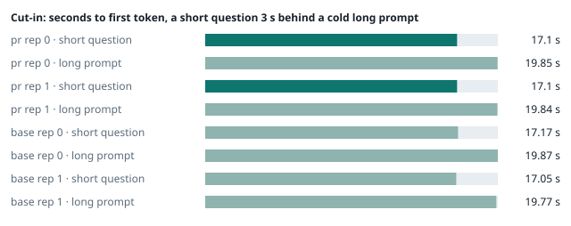
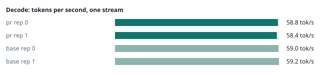
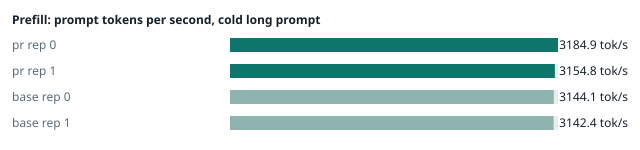
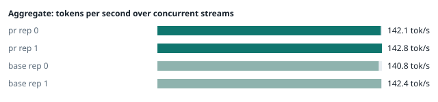
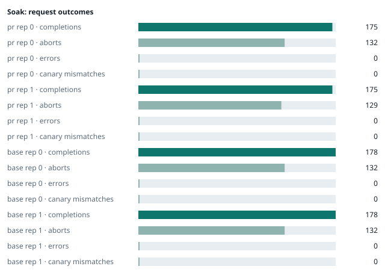

### Evidence: pr vs base

| target | role | image / artifact | model | settings that differ from the control |
|---|---|---|---|---|
| `pr` | candidate | `tensorfold-dsv41:pr-312c2e08` (1751c2212f10) | `DeepSeek-V4.1-Flash-1017` | - |
| `base` | control | `tensorfold-dsv41:base-8ffa67d5` (b3ebb6f612e4) | `DeepSeek-V4.1-Flash-1017` | baseline |

Conditions: fabric ring; order: counterbalanced over 2 repetitions: A B, then B A; repetitions: 2; kit 2825d9f; defaults.
Restore: live restored (verified: API answers, running artifact is live's).

#### smoke

| target | rep | arithmetic | greedy repeat equal | stream matches | JSON mode | first token (stream) | errors |
|---|---|---|---|---|---|---|---|
| `pr` | 0 | ✓ | ✓ | ✓ | ✓ | 0.091 s | - |
| `pr` | 1 | ✓ | ✓ | ✓ | ✓ | 0.095 s | - |
| `base` | 0 | ✓ | ✓ | ✓ | ✓ | 0.089 s | - |
| `base` | 1 | ✓ | ✓ | ✓ | ✓ | 0.088 s | - |

machine state after the suite

- `pr` rep 0: `{"head": {"gpus": ["0, NVIDIA GB10, 2184 MHz, 56, [N/A], [N/A], 0 %"], "load": "load average: 8.66, 6.48, 5.85", "container": "92 pids 2.998GiB / 121.7GiB", "mem_available_mb": "27685"}}`
- `pr` rep 1: `{"head": {"gpus": ["0, NVIDIA GB10, 2177 MHz, 57, [N/A], [N/A], 0 %"], "load": "load average: 8.19, 6.05, 5.87", "container": "92 pids 3.032GiB / 121.7GiB", "mem_available_mb": "27770"}}`
- `base` rep 0: `{"head": {"gpus": ["0, NVIDIA GB10, 2184 MHz, 58, [N/A], [N/A], 91 %"], "load": "load average: 7.23, 5.81, 5.92", "container": "92 pids 3.029GiB / 121.7GiB", "mem_available_mb": "27148"}}`
- `base` rep 1: `{"head": {"gpus": ["0, NVIDIA GB10, 2184 MHz, 57, [N/A], [N/A], 96 %"], "load": "load average: 2.29, 4.53, 5.45", "container": "92 pids 4.278GiB / 121.7GiB", "mem_available_mb": "25213"}}`

#### boundary

**38 of 38** greedy reply hashes identical, `pr` against `base`, over 2 repetition(s).

| rep | prompt | tokens (pr / base) | `pr` | `base` | same |
|---|---|---|---|---|---|
| 0 | len5 | 5 / 5 | `38127fef0fbb` | `38127fef0fbb` | ✓ |
| 0 | len2047 | 2047 / 2047 | `8488ccfbcf35` | `8488ccfbcf35` | ✓ |
| 0 | len2048 | 2048 / 2048 | `c5ac2fb76516` | `c5ac2fb76516` | ✓ |
| 0 | len2049 | 2049 / 2049 | `6766401c9caa` | `6766401c9caa` | ✓ |
| 0 | len4095 | 4095 / 4095 | `ed9e5086f520` | `ed9e5086f520` | ✓ |
| 0 | len4096 | 4096 / 4096 | `52584e31f990` | `52584e31f990` | ✓ |
| 0 | len4097 | 4097 / 4097 | `1a71db317ee7` | `1a71db317ee7` | ✓ |
| 0 | len6143 | 6143 / 6143 | `2f9626e9baf5` | `2f9626e9baf5` | ✓ |
| 0 | len6144 | 6144 / 6144 | `11933f2d4bd7` | `11933f2d4bd7` | ✓ |
| 0 | len6145 | 6145 / 6145 | `7aa2f63b2547` | `7aa2f63b2547` | ✓ |
| 0 | len8193 | 8193 / 8193 | `2ef3dc011922` | `2ef3dc011922` | ✓ |
| 0 | len12289 | 12289 / 12289 | `4fcfbd64881f` | `4fcfbd64881f` | ✓ |
| 0 | pfx_base | 5124 / 5124 | `52afe4842e5d` | `52afe4842e5d` | ✓ |
| 0 | pfx_div3072 | 3376 / 3376 | `64d23fe171dc` | `64d23fe171dc` | ✓ |
| 0 | pfx_div2044 | 2348 / 2348 | `16db99ba02f2` | `16db99ba02f2` | ✓ |
| 0 | pfx_div4092 | 4396 / 4396 | `63798c5ba36c` | `63798c5ba36c` | ✓ |
| 0 | pfx_div4093 | 4397 / 4397 | `6b1cfc31884d` | `6b1cfc31884d` | ✓ |
| 0 | pfx_base_again | 5124 / 5124 | `52afe4842e5d` | `52afe4842e5d` | ✓ |
| 0 | pfx_extend | 6660 / 6660 | `357a869fef18` | `357a869fef18` | ✓ |
| 1 | len5 | 5 / 5 | `38127fef0fbb` | `38127fef0fbb` | ✓ |
| 1 | len2047 | 2047 / 2047 | `8488ccfbcf35` | `8488ccfbcf35` | ✓ |
| 1 | len2048 | 2048 / 2048 | `c5ac2fb76516` | `c5ac2fb76516` | ✓ |
| 1 | len2049 | 2049 / 2049 | `6766401c9caa` | `6766401c9caa` | ✓ |
| 1 | len4095 | 4095 / 4095 | `ed9e5086f520` | `ed9e5086f520` | ✓ |
| 1 | len4096 | 4096 / 4096 | `52584e31f990` | `52584e31f990` | ✓ |
| 1 | len4097 | 4097 / 4097 | `1a71db317ee7` | `1a71db317ee7` | ✓ |
| 1 | len6143 | 6143 / 6143 | `2f9626e9baf5` | `2f9626e9baf5` | ✓ |
| 1 | len6144 | 6144 / 6144 | `11933f2d4bd7` | `11933f2d4bd7` | ✓ |
| 1 | len6145 | 6145 / 6145 | `7aa2f63b2547` | `7aa2f63b2547` | ✓ |
| 1 | len8193 | 8193 / 8193 | `2ef3dc011922` | `2ef3dc011922` | ✓ |
| 1 | len12289 | 12289 / 12289 | `4fcfbd64881f` | `4fcfbd64881f` | ✓ |
| 1 | pfx_base | 5124 / 5124 | `52afe4842e5d` | `52afe4842e5d` | ✓ |
| 1 | pfx_div3072 | 3376 / 3376 | `64d23fe171dc` | `64d23fe171dc` | ✓ |
| 1 | pfx_div2044 | 2348 / 2348 | `16db99ba02f2` | `16db99ba02f2` | ✓ |
| 1 | pfx_div4092 | 4396 / 4396 | `63798c5ba36c` | `63798c5ba36c` | ✓ |
| 1 | pfx_div4093 | 4397 / 4397 | `6b1cfc31884d` | `6b1cfc31884d` | ✓ |
| 1 | pfx_base_again | 5124 / 5124 | `52afe4842e5d` | `52afe4842e5d` | ✓ |
| 1 | pfx_extend | 6660 / 6660 | `357a869fef18` | `357a869fef18` | ✓ |

machine state after the suite

- `pr` rep 0: `{"head": {"gpus": ["0, NVIDIA GB10, 2171 MHz, 65, [N/A], [N/A], 96 %"], "load": "load average: 7.49, 6.47, 5.88", "container": "92 pids 3.155GiB / 121.7GiB", "mem_available_mb": "27350"}}`
- `pr` rep 1: `{"head": {"gpus": ["0, NVIDIA GB10, 2171 MHz, 64, [N/A], [N/A], 96 %"], "load": "load average: 7.32, 6.11, 5.90", "container": "92 pids 3.174GiB / 121.7GiB", "mem_available_mb": "27350"}}`
- `base` rep 0: `{"head": {"gpus": ["0, NVIDIA GB10, 2177 MHz, 64, [N/A], [N/A], 0 %"], "load": "load average: 6.45, 5.79, 5.90", "container": "92 pids 3.173GiB / 121.7GiB", "mem_available_mb": "27373"}}`
- `base` rep 1: `{"head": {"gpus": ["0, NVIDIA GB10, 2171 MHz, 68, [N/A], [N/A], 96 %"], "load": "load average: 3.74, 4.61, 5.44", "container": "92 pids 4.278GiB / 121.7GiB", "mem_available_mb": "25194"}}`

#### cutin

`pr` rep 0: short question first token **17.1 s** (rounds 16.989–17.15), long prompt first token 19.85 s (rounds 19.694–19.872); 3 rounds; admitted during the long prefill in 3 of 3 rounds
`pr` rep 1: short question first token **17.1 s** (rounds 17.09–17.204), long prompt first token 19.84 s (rounds 19.77–19.948); 3 rounds; admitted during the long prefill in 3 of 3 rounds
`base` rep 0: short question first token **17.17 s** (rounds 16.906–17.19), long prompt first token 19.87 s (rounds 19.654–19.917); 3 rounds; admitted during the long prefill in 3 of 3 rounds
`base` rep 1: short question first token **17.05 s** (rounds 17.0–17.213), long prompt first token 19.77 s (rounds 19.737–19.929); 3 rounds; admitted during the long prefill in 3 of 3 rounds

machine state after the suite

- `pr` rep 0: `{"head": {"gpus": ["0, NVIDIA GB10, 2177 MHz, 71, [N/A], [N/A], 96 %"], "load": "load average: 8.00, 6.81, 6.03", "container": "92 pids 3.195GiB / 121.7GiB", "mem_available_mb": "27321"}}`
- `pr` rep 1: `{"head": {"gpus": ["0, NVIDIA GB10, 2184 MHz, 72, [N/A], [N/A], 87 %"], "load": "load average: 7.79, 6.47, 6.04", "container": "92 pids 3.202GiB / 121.7GiB", "mem_available_mb": "27324"}}`
- `base` rep 0: `{"head": {"gpus": ["0, NVIDIA GB10, 2177 MHz, 69, [N/A], [N/A], 96 %"], "load": "load average: 7.13, 6.10, 6.01", "container": "92 pids 3.225GiB / 121.7GiB", "mem_available_mb": "27245"}}`
- `base` rep 1: `{"head": {"gpus": ["0, NVIDIA GB10, 2177 MHz, 69, [N/A], [N/A], 0 %"], "load": "load average: 5.67, 5.04, 5.54", "container": "92 pids 4.279GiB / 121.7GiB", "mem_available_mb": "25244"}}`

#### perf

| target | rep | decode tok/s, one stream | prefill tok/s, cold long prompt | aggregate tok/s, concurrent streams | errors |
|---|---|---|---|---|---|
| `pr` | 0 | **58.8** (54.9–60.1) | **3184.9** (3182.4–3203.6; 12004 tokens) | **142.1** (132.6–142.6; 4 streams) | - |
| `pr` | 1 | **58.4** (56.8–61.5) | **3154.8** (3032.1–3162.3; 12004 tokens) | **142.8** (131.0–144.3; 4 streams) | - |
| `base` | 0 | **59.0** (56.4–59.8) | **3144.1** (3101.0–3161.4; 12004 tokens) | **140.8** (130.4–141.9; 4 streams) | - |
| `base` | 1 | **59.2** (56.0–61.1) | **3142.4** (3138.3–3154.8; 12004 tokens) | **142.4** (132.1–144.7; 4 streams) | - |

`pr` against `base`: decode -0.8%, prefill +0.8%, aggregate +0.6% (medians over repetitions; the verdict counts a difference only beyond the rounds' spread, at least ±3 %).

machine state after the suite

- `pr` rep 0: `{"head": {"gpus": ["0, NVIDIA GB10, 2171 MHz, 66, [N/A], [N/A], 96 %"], "load": "load average: 7.14, 6.75, 6.05", "container": "92 pids 3.39GiB / 121.7GiB", "mem_available_mb": "26969"}}`
- `pr` rep 1: `{"head": {"gpus": ["0, NVIDIA GB10, 2177 MHz, 66, [N/A], [N/A], 96 %"], "load": "load average: 6.82, 6.38, 6.02", "container": "92 pids 3.372GiB / 121.7GiB", "mem_available_mb": "26976"}}`
- `base` rep 0: `{"head": {"gpus": ["0, NVIDIA GB10, 2177 MHz, 66, [N/A], [N/A], 40 %"], "load": "load average: 6.26, 6.00, 5.97", "container": "92 pids 3.408GiB / 121.7GiB", "mem_available_mb": "27019"}}`
- `base` rep 1: `{"head": {"gpus": ["0, NVIDIA GB10, 2177 MHz, 68, [N/A], [N/A], 96 %"], "load": "load average: 5.69, 5.12, 5.54", "container": "92 pids 4.279GiB / 121.7GiB", "mem_available_mb": "25192"}}`

#### startup

`pr`: 100.4 s, 100.6 s from the switch to the API answering (2 start(s))
`base`: 101.1 s from the switch to the API answering (1 start(s))

#### soak

`pr` rep 0: 175 completions, 132 client aborts, **0 errors**, 60 canary checks with **0 mismatches**
  machine samples, first and last: `{"head": {"gpus": ["0, NVIDIA GB10, 2177 MHz, 64, [N/A], [N/A], 96 %"], "load": "load average: 7.14, 6.75, 6.05", "container": "95 pids 3.424GiB / 121.7GiB", "m` → `{"head": {"gpus": ["0, NVIDIA GB10, 2177 MHz, 71, [N/A], [N/A], 96 %"], "load": "load average: 6.77, 6.82, 6.38", "container": "95 pids 3.916GiB / 121.7GiB", "m`
`pr` rep 1: 175 completions, 129 client aborts, **0 errors**, 58 canary checks with **0 mismatches**
  machine samples, first and last: `{"head": {"gpus": ["0, NVIDIA GB10, 2177 MHz, 65, [N/A], [N/A], 38 %"], "load": "load average: 6.82, 6.38, 6.02", "container": "95 pids 3.405GiB / 121.7GiB", "m` → `{"head": {"gpus": ["0, NVIDIA GB10, 2177 MHz, 73, [N/A], [N/A], 96 %"], "load": "load average: 6.20, 6.48, 6.26", "container": "95 pids 3.881GiB / 121.7GiB", "m`
`base` rep 0: 178 completions, 132 client aborts, **0 errors**, 64 canary checks with **0 mismatches**
  machine samples, first and last: `{"head": {"gpus": ["0, NVIDIA GB10, 2177 MHz, 66, [N/A], [N/A], 0 %"], "load": "load average: 5.84, 5.92, 5.95", "container": "96 pids 3.435GiB / 121.7GiB", "me` → `{"head": {"gpus": ["0, NVIDIA GB10, 2171 MHz, 69, [N/A], [N/A], 96 %"], "load": "load average: 6.51, 6.30, 6.12", "container": "97 pids 3.997GiB / 121.7GiB", "m`
`base` rep 1: 178 completions, 132 client aborts, **0 errors**, 63 canary checks with **0 mismatches**
  machine samples, first and last: `{"head": {"gpus": ["0, NVIDIA GB10, 2177 MHz, 66, [N/A], [N/A], 0 %"], "load": "load average: 5.63, 5.12, 5.54", "container": "95 pids 4.296GiB / 121.7GiB", "me` → `{"head": {"gpus": ["0, NVIDIA GB10, 2184 MHz, 71, [N/A], [N/A], 96 %"], "load": "load average: 6.58, 6.38, 6.06", "container": "96 pids 4.354GiB / 121.7GiB", "m`

machine state after the suite

- `pr` rep 0: `{"head": {"gpus": ["0, NVIDIA GB10, 2184 MHz, 58, [N/A], [N/A], 0 %"], "load": "load average: 4.43, 6.25, 6.21", "container": "92 pids 3.943GiB / 121.7GiB", "mem_available_mb": "25761"}}`
- `pr` rep 1: `{"head": {"gpus": ["0, NVIDIA GB10, 2184 MHz, 60, [N/A], [N/A], 0 %"], "load": "load average: 4.62, 6.08, 6.14", "container": "92 pids 3.949GiB / 121.7GiB", "mem_available_mb": "25689"}}`
- `base` rep 0: `{"head": {"gpus": ["0, NVIDIA GB10, 2184 MHz, 59, [N/A], [N/A], 0 %"], "load": "load average: 4.59, 5.92, 6.01", "container": "92 pids 3.962GiB / 121.7GiB", "mem_available_mb": "25663"}}`
- `base` rep 1: `{"head": {"gpus": ["0, NVIDIA GB10, 2184 MHz, 59, [N/A], [N/A], 0 %"], "load": "load average: 4.72, 5.99, 5.95", "container": "92 pids 4.33GiB / 121.7GiB", "mem_available_mb": "25079"}}`

#### concurrency

| target | rep | streams | aggregate tok/s | first token p50 / p95 | batched replies ≠ serial | errors |
|---|---|---|---|---|---|---|
| `pr` | 0 | 1 (round 0) | **57.2** | 0.249 / 0.366 s | — |  |
| `pr` | 0 | 4 (round 0) | **102.9** | 0.729 / 0.976 s | 0 of 16 |  |
| `pr` | 0 | 8 (round 0) | **126.7** | 1.228 / 1.972 s | 0 of 16 |  |
| `pr` | 0 | 16 (round 0) | **140.6** | 2.209 / 3.919 s | 0 of 16 | 0 |
| `pr` | 0 | 1 (round 1) | **57.7** | 0.249 / 0.337 s | — |  |
| `pr` | 0 | 4 (round 1) | **101.7** | 0.726 / 1.259 s | 0 of 16 |  |
| `pr` | 0 | 8 (round 1) | **122.4** | 1.236 / 2.323 s | 0 of 16 |  |
| `pr` | 0 | 16 (round 1) | **141.7** | 2.247 / 3.942 s | 0 of 16 | 0 |
| `pr` | 1 | 1 (round 0) | **52.6** | 0.26 / 0.353 s | — |  |
| `pr` | 1 | 4 (round 0) | **97.8** | 0.747 / 1.027 s | 0 of 16 |  |
| `pr` | 1 | 8 (round 0) | **119.7** | 1.257 / 2.006 s | 0 of 16 |  |
| `pr` | 1 | 16 (round 0) | **131.1** | 2.24 / 4.196 s | 0 of 16 | 0 |
| `pr` | 1 | 1 (round 1) | **53.7** | 0.251 / 0.266 s | — |  |
| `pr` | 1 | 4 (round 1) | **98.0** | 0.737 / 1.001 s | 0 of 16 |  |
| `pr` | 1 | 8 (round 1) | **120.7** | 1.242 / 1.997 s | 0 of 16 |  |
| `pr` | 1 | 16 (round 1) | **132.8** | 2.226 / 3.936 s | 0 of 16 | 0 |
| `base` | 0 | 1 (round 0) | **57.7** | 0.248 / 0.267 s | — |  |
| `base` | 0 | 4 (round 0) | **104.3** | 0.734 / 1.01 s | 0 of 16 |  |
| `base` | 0 | 8 (round 0) | **127.4** | 1.226 / 1.967 s | 0 of 16 |  |
| `base` | 0 | 16 (round 0) | **140.0** | 2.202 / 3.905 s | 0 of 16 | 0 |
| `base` | 0 | 1 (round 1) | **57.8** | 0.253 / 0.264 s | — |  |
| `base` | 0 | 4 (round 1) | **103.0** | 0.724 / 1.031 s | 0 of 16 |  |
| `base` | 0 | 8 (round 1) | **126.9** | 1.218 / 1.961 s | 0 of 16 |  |
| `base` | 0 | 16 (round 1) | **140.1** | 2.217 / 3.936 s | 0 of 16 | 0 |
| `base` | 1 | 1 (round 0) | **54.1** | 0.25 / 0.265 s | — |  |
| `base` | 1 | 4 (round 0) | **97.6** | 0.726 / 1.004 s | 0 of 16 |  |
| `base` | 1 | 8 (round 0) | **119.5** | 1.227 / 1.988 s | 0 of 16 |  |
| `base` | 1 | 16 (round 0) | **135.3** | 2.225 / 3.896 s | 0 of 16 | 0 |
| `base` | 1 | 1 (round 1) | **53.9** | 0.247 / 0.259 s | — |  |
| `base` | 1 | 4 (round 1) | **98.2** | 0.737 / 0.986 s | 0 of 16 |  |
| `base` | 1 | 8 (round 1) | **120.0** | 1.214 / 2.043 s | 0 of 16 |  |
| `base` | 1 | 16 (round 1) | **135.9** | 2.203 / 3.896 s | 0 of 16 | 0 |

`pr` rep 0: 128 requests; batched replies identical to serial in 96 of 96 comparisons
- host `spark-123`: container memory 4302.8 → 4344.8 MB after the drain (**+42.0 MB**, +328.1 MB per 1000 requests); descriptors 223 → 223
- host `spark-161`: container memory 3044.4 → 3085.3 MB after the drain (**+40.9 MB**, +319.5 MB per 1000 requests); descriptors 150 → 150
- host `spark-197`: container memory 3170.3 → 3211.3 MB after the drain (**+41.0 MB**, +320.3 MB per 1000 requests); descriptors 147 → 150
- host `dell-113`: container memory 3176.4 → 3217.4 MB after the drain (**+41.0 MB**, +320.3 MB per 1000 requests); descriptors 147 → 150

`pr` rep 1: 128 requests; batched replies identical to serial in 96 of 96 comparisons
- host `spark-123`: container memory 4287.5 → 4305.9 MB after the drain (**+18.4 MB**, +143.7 MB per 1000 requests); descriptors 223 → 223
- host `spark-161`: container memory 2990.1 → 3010.6 MB after the drain (**+20.5 MB**, +160.2 MB per 1000 requests); descriptors 150 → 150
- host `spark-197`: container memory 3116.0 → 3136.5 MB after the drain (**+20.5 MB**, +160.2 MB per 1000 requests); descriptors 150 → 150
- host `dell-113`: container memory 3123.2 → 3141.6 MB after the drain (**+18.4 MB**, +143.8 MB per 1000 requests); descriptors 150 → 150

`base` rep 0: 128 requests; batched replies identical to serial in 96 of 96 comparisons
- host `spark-123`: container memory 4311.0 → 4380.7 MB after the drain (**+69.7 MB**, +544.5 MB per 1000 requests); descriptors 223 → 223
- host `spark-161`: container memory 3018.8 → 3089.4 MB after the drain (**+70.6 MB**, +551.6 MB per 1000 requests); descriptors 150 → 150
- host `spark-197`: container memory 3123.2 → 3193.9 MB after the drain (**+70.7 MB**, +552.3 MB per 1000 requests); descriptors 150 → 150
- host `dell-113`: container memory 3113.0 → 3183.6 MB after the drain (**+70.6 MB**, +551.6 MB per 1000 requests); descriptors 150 → 150

`base` rep 1: 128 requests; batched replies identical to serial in 96 of 96 comparisons
- host `spark-123`: container memory 4461.6 → 4489.2 MB after the drain (**+27.6 MB**, +215.6 MB per 1000 requests); descriptors 223 → 223
- host `spark-161`: container memory 3171.3 → 3199.0 MB after the drain (**+27.7 MB**, +216.4 MB per 1000 requests); descriptors 150 → 150
- host `spark-197`: container memory 3275.8 → 3303.4 MB after the drain (**+27.6 MB**, +215.6 MB per 1000 requests); descriptors 150 → 150
- host `dell-113`: container memory 3264.5 → 3293.2 MB after the drain (**+28.7 MB**, +224.2 MB per 1000 requests); descriptors 150 → 147

machine state after the suite

- `pr` rep 0: `{"head": {"gpus": ["0, NVIDIA GB10, 2184 MHz, 56, [N/A], [N/A], 0 %"], "load": "load average: 2.56, 4.75, 5.63", "container": "92 pids 4.242GiB / 121.7GiB", "mem_available_mb": "25239"}}`
- `pr` rep 1: `{"head": {"gpus": ["0, NVIDIA GB10, 2184 MHz, 56, [N/A], [N/A], 0 %"], "load": "load average: 2.20, 4.57, 5.54", "container": "92 pids 4.205GiB / 121.7GiB", "mem_available_mb": "25323"}}`
- `base` rep 0: `{"head": {"gpus": ["0, NVIDIA GB10, 2184 MHz, 56, [N/A], [N/A], 0 %"], "load": "load average: 2.29, 4.53, 5.45", "container": "92 pids 4.278GiB / 121.7GiB", "mem_available_mb": "25166"}}`
- `base` rep 1: `{"head": {"gpus": ["0, NVIDIA GB10, 2184 MHz, 56, [N/A], [N/A], 0 %"], "load": "load average: 2.48, 4.69, 5.47", "container": "92 pids 4.384GiB / 121.7GiB", "mem_available_mb": "25045"}}`

#### the pull request's own tests

**confirmed** — 2 test file(s) added or changed by the PR (`tests/test_start_smoke.py`, `tests/test_start_urls.py`): on the PR **passes** (exit 0), on the base with the PR's tests copied in **fails** (exit 1).

- PR: `.......................................................... [100%] 58 passed, 14 subtests passed in 25.66s`
- base + PR tests: `Restart  ./start.sh restart     Stop     ./stop.sh 68 failed, 4 passed in 29.88s`

#### What this run does not show

- one process under mixed load for hours: throughput probes every few minutes, a canary reply, host memory and descriptors over the run (`endurance` did not run)
- a clean pair exit and recovery after an injected read fault (`fault` did not run)
- an external benchmark against a control (The Grill or similar) (`bench` did not run)
- <!-- add: paths only checked by reading, faults not injected, configurations not run -->

_Generated by inference-agent-kit `report.py` from `20261105T034610/results.json`._
