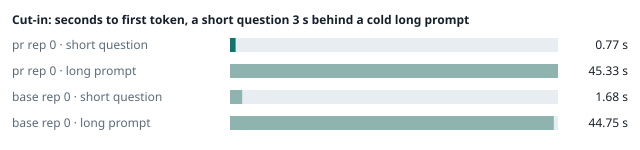
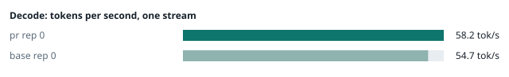
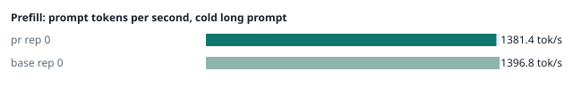
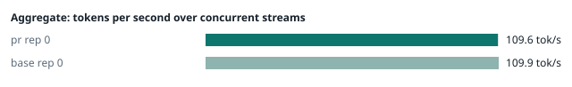
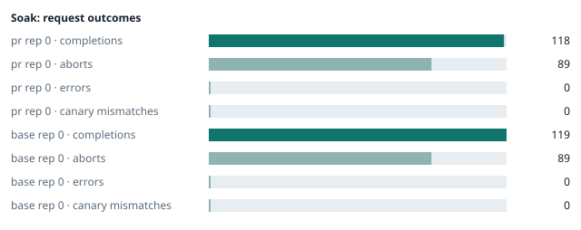

### Evidence: pr vs base

| target | role | image / artifact | model | settings that differ from the control |
|---|---|---|---|---|
| `pr` | candidate | `tensorfold-dsv41:pr-d6b62cf3` (c19b9fa52529) | `DeepSeek-V4.1-Flash-1017` | - |
| `base` | control | `tensorfold-dsv41:base-d24e79ee` (5a94966d9621) | `DeepSeek-V4.1-Flash-1017` | baseline |

Conditions: fabric ring; order: A then B, one repetition (no reverse order: pass --opt reps=2 for a counterbalanced run); repetitions: 1; kit 2825d9f.
Restore: live restored (verified: API answers, running artifact is live's).

#### smoke

| target | rep | arithmetic | greedy repeat equal | stream matches | JSON mode | first token (stream) | errors |
|---|---|---|---|---|---|---|---|
| `pr` | 0 | ✓ | ✓ | ✓ | ✓ | 0.098 s | - |
| `base` | 0 | ✓ | ✓ | ✓ | ✓ | 0.1 s | - |

machine state after the suite

- `pr` rep 0: `{"head": {"gpus": ["0, NVIDIA GB10, 2411 MHz, 51, [N/A], [N/A], 0 %"], "load": "load average: 6.39, 2.47, 1.06", "container": "90 pids 3.055GiB / 121.7GiB", "mem_available_mb": "29060"}}`
- `base` rep 0: `{"head": {"gpus": ["0, NVIDIA GB10, 2418 MHz, 55, [N/A], [N/A], 0 %"], "load": "load average: 6.95, 5.30, 4.37", "container": "90 pids 3.042GiB / 121.7GiB", "mem_available_mb": "28293"}}`

#### boundary

**19 of 19** greedy reply hashes identical, `pr` against `base`, over 1 repetition(s).

| rep | prompt | tokens (pr / base) | `pr` | `base` | same |
|---|---|---|---|---|---|
| 0 | len5 | 5 / 5 | `38127fef0fbb` | `38127fef0fbb` | ✓ |
| 0 | len2047 | 2047 / 2047 | `8488ccfbcf35` | `8488ccfbcf35` | ✓ |
| 0 | len2048 | 2048 / 2048 | `c5ac2fb76516` | `c5ac2fb76516` | ✓ |
| 0 | len2049 | 2049 / 2049 | `6766401c9caa` | `6766401c9caa` | ✓ |
| 0 | len4095 | 4095 / 4095 | `ed9e5086f520` | `ed9e5086f520` | ✓ |
| 0 | len4096 | 4096 / 4096 | `52584e31f990` | `52584e31f990` | ✓ |
| 0 | len4097 | 4097 / 4097 | `1a71db317ee7` | `1a71db317ee7` | ✓ |
| 0 | len6143 | 6143 / 6143 | `2f9626e9baf5` | `2f9626e9baf5` | ✓ |
| 0 | len6144 | 6144 / 6144 | `11933f2d4bd7` | `11933f2d4bd7` | ✓ |
| 0 | len6145 | 6145 / 6145 | `7aa2f63b2547` | `7aa2f63b2547` | ✓ |
| 0 | len8193 | 8193 / 8193 | `2ef3dc011922` | `2ef3dc011922` | ✓ |
| 0 | len12289 | 12289 / 12289 | `4fcfbd64881f` | `4fcfbd64881f` | ✓ |
| 0 | pfx_base | 5124 / 5124 | `52afe4842e5d` | `52afe4842e5d` | ✓ |
| 0 | pfx_div3072 | 3376 / 3376 | `64d23fe171dc` | `64d23fe171dc` | ✓ |
| 0 | pfx_div2044 | 2348 / 2348 | `16db99ba02f2` | `16db99ba02f2` | ✓ |
| 0 | pfx_div4092 | 4396 / 4396 | `63798c5ba36c` | `63798c5ba36c` | ✓ |
| 0 | pfx_div4093 | 4397 / 4397 | `6b1cfc31884d` | `6b1cfc31884d` | ✓ |
| 0 | pfx_base_again | 5124 / 5124 | `52afe4842e5d` | `52afe4842e5d` | ✓ |
| 0 | pfx_extend | 6660 / 6660 | `357a869fef18` | `357a869fef18` | ✓ |

machine state after the suite

- `pr` rep 0: `{"head": {"gpus": ["0, NVIDIA GB10, 2444 MHz, 61, [N/A], [N/A], 0 %"], "load": "load average: 5.94, 3.20, 1.42", "container": "90 pids 3.212GiB / 121.7GiB", "mem_available_mb": "28460"}}`
- `base` rep 0: `{"head": {"gpus": ["0, NVIDIA GB10, 2392 MHz, 63, [N/A], [N/A], 20 %"], "load": "load average: 6.38, 5.48, 4.50", "container": "90 pids 3.199GiB / 121.7GiB", "mem_available_mb": "27927"}}`

#### cutin

`pr` rep 0: short question first token **0.77 s** (rounds 0.595–1.962), long prompt first token 45.33 s (rounds 45.277–47.235); 3 rounds; admitted during the long prefill in 3 of 3 rounds
`base` rep 0: short question first token **1.68 s** (rounds 1.654–1.736), long prompt first token 44.75 s (rounds 44.746–51.796); 3 rounds; admitted during the long prefill in 3 of 3 rounds

machine state after the suite

- `pr` rep 0: `{"head": {"gpus": ["0, NVIDIA GB10, 2424 MHz, 66, [N/A], [N/A], 0 %"], "load": "load average: 7.08, 4.61, 2.20", "container": "90 pids 3.251GiB / 121.7GiB", "mem_available_mb": "28629"}}`
- `base` rep 0: `{"head": {"gpus": ["0, NVIDIA GB10, 2476 MHz, 66, [N/A], [N/A], 81 %"], "load": "load average: 7.59, 6.22, 4.92", "container": "92 pids 3.289GiB / 121.7GiB", "mem_available_mb": "28530"}}`

#### perf

| target | rep | decode tok/s, one stream | prefill tok/s, cold long prompt | aggregate tok/s, concurrent streams | errors |
|---|---|---|---|---|---|
| `pr` | 0 | **58.2** (55.0–58.4) | **1381.4** (1359.9–1395.7; 12004 tokens) | **109.6** (106.2–111.9; 4 streams) | - |
| `base` | 0 | **54.7** (27.4–58.0) | **1396.8** (1389.7–1399.7; 12004 tokens) | **109.9** (105.5–112.5; 4 streams) | - |

`pr` against `base`: decode +6.4%, prefill -1.1%, aggregate -0.3% (medians over repetitions; the verdict counts a difference only beyond the rounds' spread, at least ±3 %).

machine state after the suite

- `pr` rep 0: `{"head": {"gpus": ["0, NVIDIA GB10, 2392 MHz, 67, [N/A], [N/A], 0 %"], "load": "load average: 5.53, 4.62, 2.35", "container": "90 pids 3.46GiB / 121.7GiB", "mem_available_mb": "27411"}}`
- `base` rep 0: `{"head": {"gpus": ["0, NVIDIA GB10, 2398 MHz, 65, [N/A], [N/A], 0 %"], "load": "load average: 6.27, 6.10, 4.96", "container": "90 pids 3.475GiB / 121.7GiB", "mem_available_mb": "28237"}}`

#### startup

`pr`: 98.0 s from the switch to the API answering (1 start(s))
`base`: 99.2 s from the switch to the API answering (1 start(s))

#### soak

`pr` rep 0: 118 completions, 89 client aborts, **0 errors**, 39 canary checks with **0 mismatches**
  machine samples, first and last: `{"head": {"gpus": ["0, NVIDIA GB10, 2450 MHz, 66, [N/A], [N/A], 74 %"], "load": "load average: 5.53, 4.62, 2.35", "container": "94 pids 3.489GiB / 121.7GiB", "m` → `{"head": {"gpus": ["0, NVIDIA GB10, 2476 MHz, 68, [N/A], [N/A], 96 %"], "load": "load average: 6.11, 5.95, 4.12", "container": "93 pids 3.85GiB / 121.7GiB", "me`
`base` rep 0: 119 completions, 89 client aborts, **0 errors**, 39 canary checks with **0 mismatches**
  machine samples, first and last: `{"head": {"gpus": ["0, NVIDIA GB10, 2470 MHz, 64, [N/A], [N/A], 95 %"], "load": "load average: 6.01, 6.05, 4.95", "container": "94 pids 3.504GiB / 121.7GiB", "m` → `{"head": {"gpus": ["0, NVIDIA GB10, 2489 MHz, 69, [N/A], [N/A], 96 %"], "load": "load average: 6.00, 6.12, 5.51", "container": "93 pids 3.841GiB / 121.7GiB", "m`

machine state after the suite

- `pr` rep 0: `{"head": {"gpus": ["0, NVIDIA GB10, 2411 MHz, 58, [N/A], [N/A], 0 %"], "load": "load average: 3.98, 5.46, 4.07", "container": "90 pids 3.835GiB / 121.7GiB", "mem_available_mb": "26535"}}`
- `base` rep 0: `{"head": {"gpus": ["0, NVIDIA GB10, 2411 MHz, 58, [N/A], [N/A], 0 %"], "load": "load average: 4.29, 5.71, 5.41", "container": "90 pids 3.822GiB / 121.7GiB", "mem_available_mb": "27340"}}`

#### concurrency

| target | rep | streams | aggregate tok/s | first token p50 / p95 | batched replies ≠ serial | errors |
|---|---|---|---|---|---|---|
| `pr` | 0 | 1 (round 0) | **52.4** | 0.389 / 0.411 s | — |  |
| `pr` | 0 | 4 (round 0) | **80.7** | 1.219 / 1.727 s | 0 of 16 |  |
| `pr` | 0 | 8 (round 0) | **89.5** | 2.104 / 3.574 s | 0 of 16 |  |
| `pr` | 0 | 16 (round 0) | **92.2** | 4.025 / 7.921 s | 0 of 16 | 0 |
| `pr` | 0 | 1 (round 1) | **52.6** | 0.392 / 0.426 s | — |  |
| `pr` | 0 | 4 (round 1) | **80.7** | 1.229 / 1.725 s | 0 of 16 |  |
| `pr` | 0 | 8 (round 1) | **88.8** | 2.116 / 3.62 s | 0 of 16 |  |
| `pr` | 0 | 16 (round 1) | **92.5** | 4.063 / 7.978 s | 0 of 16 | 0 |
| `base` | 0 | 1 (round 0) | **52.0** | 0.389 / 0.414 s | — |  |
| `base` | 0 | 4 (round 0) | **80.2** | 1.254 / 1.736 s | 0 of 16 |  |
| `base` | 0 | 8 (round 0) | **88.6** | 2.158 / 3.59 s | 0 of 16 |  |
| `base` | 0 | 16 (round 0) | **91.1** | 4.001 / 7.826 s | 0 of 16 | 0 |
| `base` | 0 | 1 (round 1) | **52.3** | 0.38 / 0.409 s | — |  |
| `base` | 0 | 4 (round 1) | **82.0** | 1.21 / 1.707 s | 0 of 16 |  |
| `base` | 0 | 8 (round 1) | **89.2** | 2.103 / 3.558 s | 0 of 16 |  |
| `base` | 0 | 16 (round 1) | **92.6** | 4.05 / 7.921 s | 0 of 16 | 0 |

`pr` rep 0: 128 requests; batched replies identical to serial in 96 of 96 comparisons
- host `spark-161`: container memory 2877.4 → 2960.4 MB after the drain (**+83.0 MB**, +648.4 MB per 1000 requests); descriptors 147 → 150
- host `spark-197`: container memory 4193.3 → 4275.2 MB after the drain (**+81.9 MB**, +639.8 MB per 1000 requests); descriptors 221 → 221
- host `gx10-126`: container memory 2906.1 → 2989.1 MB after the drain (**+83.0 MB**, +648.4 MB per 1000 requests); descriptors 150 → 150
- host `dell-113`: container memory 2878.5 → 2961.4 MB after the drain (**+82.9 MB**, +647.7 MB per 1000 requests); descriptors 150 → 150

`base` rep 0: 128 requests; batched replies identical to serial in 96 of 96 comparisons
- host `spark-161`: container memory 2861.1 → 2971.6 MB after the drain (**+110.5 MB**, +863.3 MB per 1000 requests); descriptors 147 → 150
- host `spark-197`: container memory 4168.7 → 4278.3 MB after the drain (**+109.6 MB**, +856.3 MB per 1000 requests); descriptors 221 → 221
- host `gx10-126`: container memory 2872.3 → 2982.9 MB after the drain (**+110.6 MB**, +864.1 MB per 1000 requests); descriptors 150 → 150
- host `dell-113`: container memory 2937.9 → 3049.5 MB after the drain (**+111.6 MB**, +871.9 MB per 1000 requests); descriptors 150 → 150

machine state after the suite

- `pr` rep 0: `{"head": {"gpus": ["0, NVIDIA GB10, 2411 MHz, 56, [N/A], [N/A], 0 %"], "load": "load average: 2.18, 4.14, 3.93", "container": "90 pids 4.175GiB / 121.7GiB", "mem_available_mb": "25971"}}`
- `base` rep 0: `{"head": {"gpus": ["0, NVIDIA GB10, 2411 MHz, 56, [N/A], [N/A], 0 %"], "load": "load average: 2.12, 4.21, 4.89", "container": "90 pids 4.178GiB / 121.7GiB", "mem_available_mb": "26789"}}`

#### the pull request's own tests

**confirmed** — 1 test file(s) added or changed by the PR (`tests/test_scripts.py`): on the PR **passes** (exit 0), on the base with the PR's tests copied in **fails** (exit 1).

- PR: `............................................... [ 59%] ..................s.............                                 [100%] 78 passed, 1 skipped, 33 subtests passed in 27.11s`
- base + PR tests: `-  'model-00048-of-00048.safetensors', -  'model.safetensors.index.json'] 13 failed, 67 passed, 1 skipped, 31 subtests passed in 27.15s`

#### What this run does not show

- one process under mixed load for hours: throughput probes every few minutes, a canary reply, host memory and descriptors over the run (`endurance` did not run)
- a clean pair exit and recovery after an injected read fault (`fault` did not run)
- an external benchmark against a control (The Grill or similar) (`bench` did not run)
- <!-- add: paths only checked by reading, faults not injected, configurations not run -->

_Generated by inference-agent-kit `report.py` from `20261118T052821/results.json`._
