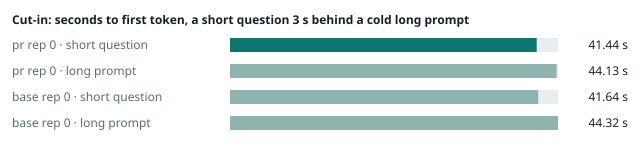
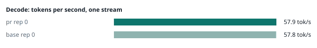
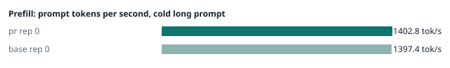
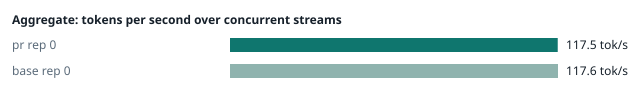
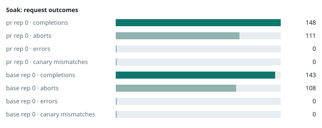

### Evidence: pr vs base

| target | role | image / artifact | model | settings that differ from the control |
|---|---|---|---|---|
| `pr` | candidate | `tensorfold-dsv41:pr-d6b62cf3` (c19b9fa52529) | `DeepSeek-V4.1-Flash-1017` | - |
| `base` | control | `tensorfold-dsv41:base-d24e79ee` (5a94966d9621) | `DeepSeek-V4.1-Flash-1017` | baseline |

Conditions: fabric ring; order: A then B, one repetition (no reverse order: pass --opt reps=2 for a counterbalanced run); repetitions: 1; kit 2825d9f; defaults.
Restore: live restored (verified: API answers, running artifact is live's).

#### smoke

| target | rep | arithmetic | greedy repeat equal | stream matches | JSON mode | first token (stream) | errors |
|---|---|---|---|---|---|---|---|
| `pr` | 0 | ✓ | ✓ | ✓ | ✓ | 0.099 s | - |
| `base` | 0 | ✓ | ✓ | ✓ | ✓ | 0.102 s | - |

machine state after the suite

- `pr` rep 0: `{"head": {"gpus": ["0, NVIDIA GB10, 2444 MHz, 54, [N/A], [N/A], 0 %"], "load": "load average: 8.19, 6.41, 5.63", "container": "90 pids 3.047GiB / 121.7GiB", "mem_available_mb": "28124"}}`
- `base` rep 0: `{"head": {"gpus": ["0, NVIDIA GB10, 2463 MHz, 58, [N/A], [N/A], 0 %"], "load": "load average: 7.39, 5.63, 5.58", "container": "90 pids 3.04GiB / 121.7GiB", "mem_available_mb": "28032"}}`

#### boundary

**19 of 19** greedy reply hashes identical, `pr` against `base`, over 1 repetition(s).

| rep | prompt | tokens (pr / base) | `pr` | `base` | same |
|---|---|---|---|---|---|
| 0 | len5 | 5 / 5 | `38127fef0fbb` | `38127fef0fbb` | ✓ |
| 0 | len2047 | 2047 / 2047 | `8488ccfbcf35` | `8488ccfbcf35` | ✓ |
| 0 | len2048 | 2048 / 2048 | `c5ac2fb76516` | `c5ac2fb76516` | ✓ |
| 0 | len2049 | 2049 / 2049 | `6766401c9caa` | `6766401c9caa` | ✓ |
| 0 | len4095 | 4095 / 4095 | `ed9e5086f520` | `ed9e5086f520` | ✓ |
| 0 | len4096 | 4096 / 4096 | `52584e31f990` | `52584e31f990` | ✓ |
| 0 | len4097 | 4097 / 4097 | `1a71db317ee7` | `1a71db317ee7` | ✓ |
| 0 | len6143 | 6143 / 6143 | `2f9626e9baf5` | `2f9626e9baf5` | ✓ |
| 0 | len6144 | 6144 / 6144 | `11933f2d4bd7` | `11933f2d4bd7` | ✓ |
| 0 | len6145 | 6145 / 6145 | `7aa2f63b2547` | `7aa2f63b2547` | ✓ |
| 0 | len8193 | 8193 / 8193 | `2ef3dc011922` | `2ef3dc011922` | ✓ |
| 0 | len12289 | 12289 / 12289 | `4fcfbd64881f` | `4fcfbd64881f` | ✓ |
| 0 | pfx_base | 5124 / 5124 | `52afe4842e5d` | `52afe4842e5d` | ✓ |
| 0 | pfx_div3072 | 3376 / 3376 | `64d23fe171dc` | `64d23fe171dc` | ✓ |
| 0 | pfx_div2044 | 2348 / 2348 | `16db99ba02f2` | `16db99ba02f2` | ✓ |
| 0 | pfx_div4092 | 4396 / 4396 | `63798c5ba36c` | `63798c5ba36c` | ✓ |
| 0 | pfx_div4093 | 4397 / 4397 | `6b1cfc31884d` | `6b1cfc31884d` | ✓ |
| 0 | pfx_base_again | 5124 / 5124 | `52afe4842e5d` | `52afe4842e5d` | ✓ |
| 0 | pfx_extend | 6660 / 6660 | `357a869fef18` | `357a869fef18` | ✓ |

machine state after the suite

- `pr` rep 0: `{"head": {"gpus": ["0, NVIDIA GB10, 2411 MHz, 63, [N/A], [N/A], 0 %"], "load": "load average: 7.64, 6.59, 5.75", "container": "90 pids 3.204GiB / 121.7GiB", "mem_available_mb": "27934"}}`
- `base` rep 0: `{"head": {"gpus": ["0, NVIDIA GB10, 2392 MHz, 65, [N/A], [N/A], 0 %"], "load": "load average: 6.67, 5.80, 5.64", "container": "90 pids 3.196GiB / 121.7GiB", "mem_available_mb": "27822"}}`

#### cutin

`pr` rep 0: short question first token **41.44 s** (rounds 41.356–41.511), long prompt first token 44.13 s (rounds 44.075–44.205); 3 rounds; admitted during the long prefill in 3 of 3 rounds
`base` rep 0: short question first token **41.64 s** (rounds 41.474–41.675), long prompt first token 44.32 s (rounds 44.19–44.359); 3 rounds; admitted during the long prefill in 3 of 3 rounds

machine state after the suite

- `pr` rep 0: `{"head": {"gpus": ["0, NVIDIA GB10, 2405 MHz, 67, [N/A], [N/A], 16 %"], "load": "load average: 7.07, 6.75, 5.92", "container": "90 pids 3.256GiB / 121.7GiB", "mem_available_mb": "27833"}}`
- `base` rep 0: `{"head": {"gpus": ["0, NVIDIA GB10, 2392 MHz, 67, [N/A], [N/A], 20 %"], "load": "load average: 6.96, 6.23, 5.82", "container": "90 pids 3.249GiB / 121.7GiB", "mem_available_mb": "27696"}}`

#### perf

| target | rep | decode tok/s, one stream | prefill tok/s, cold long prompt | aggregate tok/s, concurrent streams | errors |
|---|---|---|---|---|---|
| `pr` | 0 | **57.9** (54.8–58.0) | **1402.8** (1400.4–1408.8; 12004 tokens) | **117.5** (110.2–118.6; 4 streams) | - |
| `base` | 0 | **57.8** (55.2–58.9) | **1397.4** (1396.5–1400.0; 12004 tokens) | **117.6** (110.3–119.1; 4 streams) | - |

`pr` against `base`: decode +0.2%, prefill +0.4%, aggregate -0.1% (medians over repetitions; the verdict counts a difference only beyond the rounds' spread, at least ±3 %).

machine state after the suite

- `pr` rep 0: `{"head": {"gpus": ["0, NVIDIA GB10, 2411 MHz, 66, [N/A], [N/A], 0 %"], "load": "load average: 5.84, 6.44, 5.86", "container": "90 pids 3.452GiB / 121.7GiB", "mem_available_mb": "27497"}}`
- `base` rep 0: `{"head": {"gpus": ["0, NVIDIA GB10, 2437 MHz, 66, [N/A], [N/A], 6 %"], "load": "load average: 6.00, 6.08, 5.80", "container": "90 pids 3.432GiB / 121.7GiB", "mem_available_mb": "27408"}}`

#### startup

`pr`: 98.0 s from the switch to the API answering (1 start(s))
`base`: 97.7 s from the switch to the API answering (1 start(s))

#### soak

`pr` rep 0: 148 completions, 111 client aborts, **0 errors**, 49 canary checks with **0 mismatches**
  machine samples, first and last: `{"head": {"gpus": ["0, NVIDIA GB10, 2470 MHz, 65, [N/A], [N/A], 79 %"], "load": "load average: 5.37, 6.33, 5.83", "container": "94 pids 3.481GiB / 121.7GiB", "m` → `{"head": {"gpus": ["0, NVIDIA GB10, 2489 MHz, 69, [N/A], [N/A], 96 %"], "load": "load average: 5.77, 5.91, 5.85", "container": "93 pids 3.771GiB / 121.7GiB", "m`
`base` rep 0: 143 completions, 108 client aborts, **0 errors**, 48 canary checks with **0 mismatches**
  machine samples, first and last: `{"head": {"gpus": ["0, NVIDIA GB10, 2483 MHz, 65, [N/A], [N/A], 96 %"], "load": "load average: 5.84, 6.05, 5.79", "container": "94 pids 3.459GiB / 121.7GiB", "m` → `{"head": {"gpus": ["0, NVIDIA GB10, 2476 MHz, 66, [N/A], [N/A], 96 %"], "load": "load average: 5.80, 5.85, 5.80", "container": "93 pids 3.784GiB / 121.7GiB", "m`

machine state after the suite

- `pr` rep 0: `{"head": {"gpus": ["0, NVIDIA GB10, 2411 MHz, 58, [N/A], [N/A], 0 %"], "load": "load average: 4.03, 5.49, 5.72", "container": "90 pids 3.801GiB / 121.7GiB", "mem_available_mb": "27378"}}`
- `base` rep 0: `{"head": {"gpus": ["0, NVIDIA GB10, 2411 MHz, 58, [N/A], [N/A], 0 %"], "load": "load average: 4.17, 5.47, 5.68", "container": "90 pids 3.743GiB / 121.7GiB", "mem_available_mb": "26569"}}`

#### concurrency

| target | rep | streams | aggregate tok/s | first token p50 / p95 | batched replies ≠ serial | errors |
|---|---|---|---|---|---|---|
| `pr` | 0 | 1 (round 0) | **51.7** | 0.401 / 0.464 s | — |  |
| `pr` | 0 | 4 (round 0) | **82.3** | 1.165 / 1.601 s | 0 of 16 |  |
| `pr` | 0 | 8 (round 0) | **91.5** | 1.993 / 3.144 s | 0 of 16 |  |
| `pr` | 0 | 16 (round 0) | **94.4** | 3.549 / 6.26 s | 0 of 16 | 0 |
| `pr` | 0 | 1 (round 1) | **38.8** | 0.398 / 6.947 s | — |  |
| `pr` | 0 | 4 (round 1) | **82.1** | 1.164 / 1.597 s | 0 of 16 |  |
| `pr` | 0 | 8 (round 1) | **91.7** | 1.943 / 3.127 s | 0 of 16 |  |
| `pr` | 0 | 16 (round 1) | **95.0** | 3.473 / 6.131 s | 0 of 16 | 0 |
| `base` | 0 | 1 (round 0) | **52.3** | 0.385 / 0.415 s | — |  |
| `base` | 0 | 4 (round 0) | **83.3** | 1.12 / 1.557 s | 0 of 16 |  |
| `base` | 0 | 8 (round 0) | **92.4** | 1.88 / 3.055 s | 0 of 16 |  |
| `base` | 0 | 16 (round 0) | **95.7** | 3.391 / 6.07 s | 0 of 16 | 0 |
| `base` | 0 | 1 (round 1) | **51.9** | 0.386 / 0.409 s | — |  |
| `base` | 0 | 4 (round 1) | **82.9** | 1.131 / 1.547 s | 0 of 16 |  |
| `base` | 0 | 8 (round 1) | **92.3** | 1.877 / 3.062 s | 0 of 16 |  |
| `base` | 0 | 16 (round 1) | **96.4** | 3.416 / 6.092 s | 0 of 16 | 0 |

`pr` rep 0: 128 requests; batched replies identical to serial in 96 of 96 comparisons
- host `spark-161`: container memory 2844.7 → 2940.9 MB after the drain (**+96.2 MB**, +751.6 MB per 1000 requests); descriptors 147 → 150
- host `spark-197`: container memory 4156.4 → 4250.6 MB after the drain (**+94.2 MB**, +735.9 MB per 1000 requests); descriptors 221 → 221
- host `gx10-126`: container memory 2855.9 → 2952.2 MB after the drain (**+96.3 MB**, +752.3 MB per 1000 requests); descriptors 150 → 150
- host `dell-113`: container memory 2901.0 → 2997.2 MB after the drain (**+96.2 MB**, +751.6 MB per 1000 requests); descriptors 150 → 150

`base` rep 0: 128 requests; batched replies identical to serial in 96 of 96 comparisons
- host `spark-161`: container memory 2820.1 → 2907.1 MB after the drain (**+87.0 MB**, +679.7 MB per 1000 requests); descriptors 150 → 150
- host `spark-197`: container memory 4121.6 → 4207.6 MB after the drain (**+86.0 MB**, +671.9 MB per 1000 requests); descriptors 221 → 221
- host `gx10-126`: container memory 2849.8 → 2936.8 MB after the drain (**+87.0 MB**, +679.7 MB per 1000 requests); descriptors 147 → 150
- host `dell-113`: container memory 2821.1 → 2909.2 MB after the drain (**+88.1 MB**, +688.3 MB per 1000 requests); descriptors 150 → 150

machine state after the suite

- `pr` rep 0: `{"head": {"gpus": ["0, NVIDIA GB10, 2411 MHz, 56, [N/A], [N/A], 0 %"], "load": "load average: 2.52, 4.36, 5.21", "container": "90 pids 4.151GiB / 121.7GiB", "mem_available_mb": "25881"}}`
- `base` rep 0: `{"head": {"gpus": ["0, NVIDIA GB10, 2411 MHz, 56, [N/A], [N/A], 0 %"], "load": "load average: 2.23, 4.28, 5.15", "container": "90 pids 4.109GiB / 121.7GiB", "mem_available_mb": "26875"}}`

#### the pull request's own tests

**confirmed** — 1 test file(s) added or changed by the PR (`tests/test_scripts.py`): on the PR **passes** (exit 0), on the base with the PR's tests copied in **fails** (exit 1).

- PR: `............................................... [ 59%] ..................s.............                                 [100%] 78 passed, 1 skipped, 33 subtests passed in 27.11s`
- base + PR tests: `-  'model-00048-of-00048.safetensors', -  'model.safetensors.index.json'] 13 failed, 67 passed, 1 skipped, 31 subtests passed in 27.15s`

#### What this run does not show

- one process under mixed load for hours: throughput probes every few minutes, a canary reply, host memory and descriptors over the run (`endurance` did not run)
- a clean pair exit and recovery after an injected read fault (`fault` did not run)
- an external benchmark against a control (The Grill or similar) (`bench` did not run)
- <!-- add: paths only checked by reading, faults not injected, configurations not run -->

_Generated by inference-agent-kit `report.py` from `20261118T061343/results.json`._
