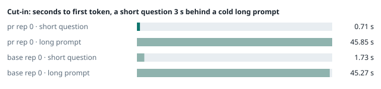
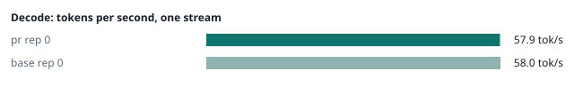
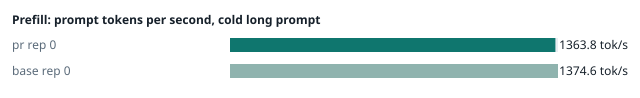
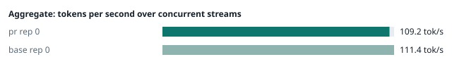
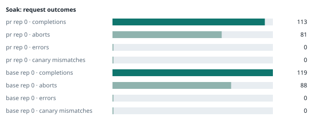

### Evidence: pr vs base

| target | role | image / artifact | model | settings that differ from the control |
|---|---|---|---|---|
| `pr` | candidate | `tensorfold-dsv41:pr-ef7b40f7` (a05e115cd668) | `DeepSeek-V4.1-Flash-1017` | - |
| `base` | control | `tensorfold-dsv41:base-8ffa67d5` (b3ebb6f612e4) | `DeepSeek-V4.1-Flash-1017` | baseline |

Conditions: fabric ring; order: A then B, one repetition (no reverse order: pass --opt reps=2 for a counterbalanced run); repetitions: 1; kit 2825d9f.
Restore: live restored (verified: API answers, running artifact is live's).

#### smoke

| target | rep | arithmetic | greedy repeat equal | stream matches | JSON mode | first token (stream) | errors |
|---|---|---|---|---|---|---|---|
| `pr` | 0 | ✓ | ✓ | ✓ | ✓ | 0.097 s | - |
| `base` | 0 | ✓ | ✓ | ✓ | ✓ | 0.1 s | - |

machine state after the suite

- `pr` rep 0: `{"head": {"gpus": ["0, NVIDIA GB10, 2411 MHz, 54, [N/A], [N/A], 0 %"], "load": "load average: 7.10, 2.79, 2.49", "container": "90 pids 3.097GiB / 121.7GiB", "mem_available_mb": "29031"}}`
- `base` rep 0: `{"head": {"gpus": ["0, NVIDIA GB10, 2418 MHz, 60, [N/A], [N/A], 0 %"], "load": "load average: 7.30, 5.54, 4.84", "container": "90 pids 3.02GiB / 121.7GiB", "mem_available_mb": "28740"}}`

#### boundary

**19 of 19** greedy reply hashes identical, `pr` against `base`, over 1 repetition(s).

| rep | prompt | tokens (pr / base) | `pr` | `base` | same |
|---|---|---|---|---|---|
| 0 | len5 | 5 / 5 | `38127fef0fbb` | `38127fef0fbb` | ✓ |
| 0 | len2047 | 2047 / 2047 | `8488ccfbcf35` | `8488ccfbcf35` | ✓ |
| 0 | len2048 | 2048 / 2048 | `c5ac2fb76516` | `c5ac2fb76516` | ✓ |
| 0 | len2049 | 2049 / 2049 | `6766401c9caa` | `6766401c9caa` | ✓ |
| 0 | len4095 | 4095 / 4095 | `ed9e5086f520` | `ed9e5086f520` | ✓ |
| 0 | len4096 | 4096 / 4096 | `52584e31f990` | `52584e31f990` | ✓ |
| 0 | len4097 | 4097 / 4097 | `1a71db317ee7` | `1a71db317ee7` | ✓ |
| 0 | len6143 | 6143 / 6143 | `2f9626e9baf5` | `2f9626e9baf5` | ✓ |
| 0 | len6144 | 6144 / 6144 | `11933f2d4bd7` | `11933f2d4bd7` | ✓ |
| 0 | len6145 | 6145 / 6145 | `7aa2f63b2547` | `7aa2f63b2547` | ✓ |
| 0 | len8193 | 8193 / 8193 | `2ef3dc011922` | `2ef3dc011922` | ✓ |
| 0 | len12289 | 12289 / 12289 | `4fcfbd64881f` | `4fcfbd64881f` | ✓ |
| 0 | pfx_base | 5124 / 5124 | `52afe4842e5d` | `52afe4842e5d` | ✓ |
| 0 | pfx_div3072 | 3376 / 3376 | `64d23fe171dc` | `64d23fe171dc` | ✓ |
| 0 | pfx_div2044 | 2348 / 2348 | `16db99ba02f2` | `16db99ba02f2` | ✓ |
| 0 | pfx_div4092 | 4396 / 4396 | `63798c5ba36c` | `63798c5ba36c` | ✓ |
| 0 | pfx_div4093 | 4397 / 4397 | `6b1cfc31884d` | `6b1cfc31884d` | ✓ |
| 0 | pfx_base_again | 5124 / 5124 | `52afe4842e5d` | `52afe4842e5d` | ✓ |
| 0 | pfx_extend | 6660 / 6660 | `357a869fef18` | `357a869fef18` | ✓ |

machine state after the suite

- `pr` rep 0: `{"head": {"gpus": ["0, NVIDIA GB10, 2424 MHz, 63, [N/A], [N/A], 0 %"], "load": "load average: 6.05, 3.49, 2.76", "container": "90 pids 3.253GiB / 121.7GiB", "mem_available_mb": "29079"}}`
- `base` rep 0: `{"head": {"gpus": ["0, NVIDIA GB10, 2463 MHz, 66, [N/A], [N/A], 0 %"], "load": "load average: 6.26, 5.66, 4.94", "container": "90 pids 3.177GiB / 121.7GiB", "mem_available_mb": "28397"}}`

#### cutin

`pr` rep 0: short question first token **0.71 s** (rounds 0.633–0.935), long prompt first token 45.85 s (rounds 45.591–46.865); 3 rounds; admitted during the long prefill in 3 of 3 rounds
`base` rep 0: short question first token **1.73 s** (rounds 0.894–1.76), long prompt first token 45.27 s (rounds 45.201–45.775); 3 rounds; admitted during the long prefill in 3 of 3 rounds

machine state after the suite

- `pr` rep 0: `{"head": {"gpus": ["0, NVIDIA GB10, 2418 MHz, 66, [N/A], [N/A], 0 %"], "load": "load average: 6.83, 4.77, 3.35", "container": "90 pids 3.293GiB / 121.7GiB", "mem_available_mb": "28318"}}`
- `base` rep 0: `{"head": {"gpus": ["0, NVIDIA GB10, 2405 MHz, 67, [N/A], [N/A], 0 %"], "load": "load average: 6.91, 6.21, 5.25", "container": "90 pids 3.216GiB / 121.7GiB", "mem_available_mb": "28319"}}`

#### perf

| target | rep | decode tok/s, one stream | prefill tok/s, cold long prompt | aggregate tok/s, concurrent streams | errors |
|---|---|---|---|---|---|
| `pr` | 0 | **57.9** (54.7–58.2) | **1363.8** (1353.3–1369.4; 12004 tokens) | **109.2** (106.0–112.1; 4 streams) | - |
| `base` | 0 | **58.0** (55.5–58.8) | **1374.6** (1369.2–1385.2; 12004 tokens) | **111.4** (107.9–111.5; 4 streams) | - |

`pr` against `base`: decode -0.2%, prefill -0.8%, aggregate -2.0% (medians over repetitions; the verdict counts a difference only beyond the rounds' spread, at least ±3 %).

machine state after the suite

- `pr` rep 0: `{"head": {"gpus": ["0, NVIDIA GB10, 2424 MHz, 68, [N/A], [N/A], 0 %"], "load": "load average: 5.99, 4.89, 3.47", "container": "90 pids 3.475GiB / 121.7GiB", "mem_available_mb": "28081"}}`
- `base` rep 0: `{"head": {"gpus": ["0, NVIDIA GB10, 2411 MHz, 67, [N/A], [N/A], 0 %"], "load": "load average: 5.88, 6.04, 5.25", "container": "90 pids 3.424GiB / 121.7GiB", "mem_available_mb": "27979"}}`

#### startup

`pr`: 98.5 s from the switch to the API answering (1 start(s))
`base`: 98.6 s from the switch to the API answering (1 start(s))

#### soak

`pr` rep 0: 113 completions, 81 client aborts, **0 errors**, 37 canary checks with **0 mismatches**
  machine samples, first and last: `{"head": {"gpus": ["0, NVIDIA GB10, 2476 MHz, 67, [N/A], [N/A], 96 %"], "load": "load average: 5.91, 4.89, 3.48", "container": "95 pids 3.504GiB / 121.7GiB", "m` → `{"head": {"gpus": ["0, NVIDIA GB10, 2483 MHz, 70, [N/A], [N/A], 96 %"], "load": "load average: 6.19, 5.99, 4.71", "container": "95 pids 3.945GiB / 121.7GiB", "m`
`base` rep 0: 119 completions, 88 client aborts, **0 errors**, 39 canary checks with **0 mismatches**
  machine samples, first and last: `{"head": {"gpus": ["0, NVIDIA GB10, 2470 MHz, 66, [N/A], [N/A], 89 %"], "load": "load average: 5.88, 6.04, 5.25", "container": "94 pids 3.453GiB / 121.7GiB", "m` → `{"head": {"gpus": ["0, NVIDIA GB10, 2489 MHz, 67, [N/A], [N/A], 96 %"], "load": "load average: 6.87, 6.42, 5.80", "container": "94 pids 3.786GiB / 121.7GiB", "m`

machine state after the suite

- `pr` rep 0: `{"head": {"gpus": ["0, NVIDIA GB10, 2411 MHz, 57, [N/A], [N/A], 0 %"], "load": "load average: 4.15, 5.56, 4.65", "container": "90 pids 3.902GiB / 121.7GiB", "mem_available_mb": "27654"}}`
- `base` rep 0: `{"head": {"gpus": ["0, NVIDIA GB10, 2411 MHz, 57, [N/A], [N/A], 0 %"], "load": "load average: 4.38, 5.90, 5.67", "container": "90 pids 3.76GiB / 121.7GiB", "mem_available_mb": "27874"}}`

#### concurrency

| target | rep | streams | aggregate tok/s | first token p50 / p95 | batched replies ≠ serial | errors |
|---|---|---|---|---|---|---|
| `pr` | 0 | 1 (round 0) | **50.9** | 0.417 / 0.529 s | — |  |
| `pr` | 0 | 4 (round 0) | **79.3** | 1.301 / 1.798 s | 0 of 16 |  |
| `pr` | 0 | 8 (round 0) | **88.0** | 2.183 / 3.717 s | 0 of 16 |  |
| `pr` | 0 | 16 (round 0) | **91.4** | 4.165 / 8.158 s | 0 of 16 | 0 |
| `pr` | 0 | 1 (round 1) | **51.8** | 0.402 / 0.449 s | — |  |
| `pr` | 0 | 4 (round 1) | **80.4** | 1.27 / 1.77 s | 0 of 16 |  |
| `pr` | 0 | 8 (round 1) | **87.8** | 2.168 / 3.648 s | 0 of 16 |  |
| `pr` | 0 | 16 (round 1) | **91.0** | 4.204 / 8.156 s | 0 of 16 | 0 |
| `base` | 0 | 1 (round 0) | **52.4** | 0.382 / 0.41 s | — |  |
| `base` | 0 | 4 (round 0) | **81.4** | 1.224 / 1.764 s | 0 of 16 |  |
| `base` | 0 | 8 (round 0) | **87.9** | 2.137 / 3.717 s | 0 of 16 |  |
| `base` | 0 | 16 (round 0) | **91.5** | 4.087 / 7.995 s | 0 of 16 | 0 |
| `base` | 0 | 1 (round 1) | **52.6** | 0.384 / 0.408 s | — |  |
| `base` | 0 | 4 (round 1) | **81.2** | 1.226 / 1.706 s | 0 of 16 |  |
| `base` | 0 | 8 (round 1) | **88.1** | 2.128 / 3.607 s | 0 of 16 |  |
| `base` | 0 | 16 (round 1) | **92.2** | 4.173 / 7.99 s | 0 of 16 | 0 |

`pr` rep 0: 128 requests; batched replies identical to serial in 96 of 96 comparisons
- host `spark-161`: container memory 2957.3 → 3025.9 MB after the drain (**+68.6 MB**, +535.9 MB per 1000 requests); descriptors 150 → 150
- host `spark-197`: container memory 4316.2 → 4386.8 MB after the drain (**+70.6 MB**, +551.6 MB per 1000 requests); descriptors 221 → 221
- host `gx10-126`: container memory 2979.8 → 3048.4 MB after the drain (**+68.6 MB**, +535.9 MB per 1000 requests); descriptors 150 → 150
- host `dell-113`: container memory 2983.9 → 3053.6 MB after the drain (**+69.7 MB**, +544.5 MB per 1000 requests); descriptors 150 → 150

`base` rep 0: 128 requests; batched replies identical to serial in 96 of 96 comparisons
- host `spark-161`: container memory 3045.4 → 3140.6 MB after the drain (**+95.2 MB**, +743.7 MB per 1000 requests); descriptors 147 → 150
- host `spark-197`: container memory 4331.5 → 4425.7 MB after the drain (**+94.2 MB**, +735.9 MB per 1000 requests); descriptors 221 → 221
- host `gx10-126`: container memory 3058.7 → 3153.9 MB after the drain (**+95.2 MB**, +743.8 MB per 1000 requests); descriptors 150 → 150
- host `dell-113`: container memory 3096.6 → 3192.8 MB after the drain (**+96.2 MB**, +751.6 MB per 1000 requests); descriptors 150 → 150

machine state after the suite

- `pr` rep 0: `{"head": {"gpus": ["0, NVIDIA GB10, 2411 MHz, 57, [N/A], [N/A], 0 %"], "load": "load average: 2.35, 4.27, 4.40", "container": "90 pids 4.284GiB / 121.7GiB", "mem_available_mb": "26455"}}`
- `base` rep 0: `{"head": {"gpus": ["0, NVIDIA GB10, 2411 MHz, 59, [N/A], [N/A], 0 %"], "load": "load average: 2.19, 4.45, 5.18", "container": "90 pids 4.322GiB / 121.7GiB", "mem_available_mb": "27005"}}`

#### the pull request's own tests

**confirmed** — 1 test file(s) added or changed by the PR (`tests/test_claims.py`): on the PR **passes** (exit 0), on the base with the PR's tests copied in **fails** (exit 1).

- PR: `......................                                                   [100%] 22 passed in 2.74s`
- base + PR tests: `DELETE stored with body: every reply on the kept connection is what the bodyless request gets CLAIM: holds 11 failed, 11 passed in 2.95s`

#### What this run does not show

- one process under mixed load for hours: throughput probes every few minutes, a canary reply, host memory and descriptors over the run (`endurance` did not run)
- a clean pair exit and recovery after an injected read fault (`fault` did not run)
- an external benchmark against a control (The Grill or similar) (`bench` did not run)
- <!-- add: paths only checked by reading, faults not injected, configurations not run -->

_Generated by inference-agent-kit `report.py` from `20261118T071740/results.json`._
