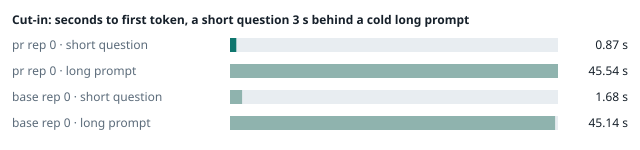
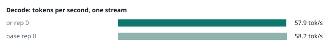
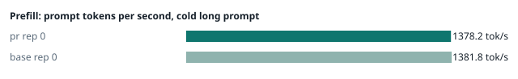
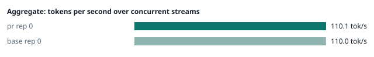
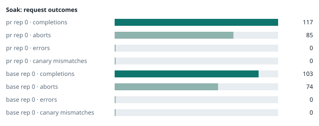

### Evidence: pr vs base

| target | role | image / artifact | model | settings that differ from the control |
|---|---|---|---|---|
| `pr` | candidate | `tensorfold-dsv41:pr-c726b868` (5aead4ac81fe) | `DeepSeek-V4.1-Flash-1017` | - |
| `base` | control | `tensorfold-dsv41:base-8ffa67d5` (b3ebb6f612e4) | `DeepSeek-V4.1-Flash-1017` | baseline |

Conditions: fabric ring; order: A then B, one repetition (no reverse order: pass --opt reps=2 for a counterbalanced run); repetitions: 1; kit 2825d9f.
Restore: live restored (verified: API answers, running artifact is live's).

#### smoke

| target | rep | arithmetic | greedy repeat equal | stream matches | JSON mode | first token (stream) | errors |
|---|---|---|---|---|---|---|---|
| `pr` | 0 | ✓ | ✓ | ✓ | ✓ | 0.103 s | - |
| `base` | 0 | ✓ | ✓ | ✓ | ✓ | 0.098 s | - |

machine state after the suite

- `pr` rep 0: `{"head": {"gpus": ["0, NVIDIA GB10, 2411 MHz, 55, [N/A], [N/A], 1 %"], "load": "load average: 6.29, 2.64, 2.37", "container": "90 pids 3.008GiB / 121.7GiB", "mem_available_mb": "29527"}}`
- `base` rep 0: `{"head": {"gpus": ["0, NVIDIA GB10, 2450 MHz, 61, [N/A], [N/A], 0 %"], "load": "load average: 7.26, 5.50, 4.78", "container": "90 pids 3.009GiB / 121.7GiB", "mem_available_mb": "28540"}}`

#### boundary

**19 of 19** greedy reply hashes identical, `pr` against `base`, over 1 repetition(s).

| rep | prompt | tokens (pr / base) | `pr` | `base` | same |
|---|---|---|---|---|---|
| 0 | len5 | 5 / 5 | `38127fef0fbb` | `38127fef0fbb` | ✓ |
| 0 | len2047 | 2047 / 2047 | `8488ccfbcf35` | `8488ccfbcf35` | ✓ |
| 0 | len2048 | 2048 / 2048 | `c5ac2fb76516` | `c5ac2fb76516` | ✓ |
| 0 | len2049 | 2049 / 2049 | `6766401c9caa` | `6766401c9caa` | ✓ |
| 0 | len4095 | 4095 / 4095 | `ed9e5086f520` | `ed9e5086f520` | ✓ |
| 0 | len4096 | 4096 / 4096 | `52584e31f990` | `52584e31f990` | ✓ |
| 0 | len4097 | 4097 / 4097 | `1a71db317ee7` | `1a71db317ee7` | ✓ |
| 0 | len6143 | 6143 / 6143 | `2f9626e9baf5` | `2f9626e9baf5` | ✓ |
| 0 | len6144 | 6144 / 6144 | `11933f2d4bd7` | `11933f2d4bd7` | ✓ |
| 0 | len6145 | 6145 / 6145 | `7aa2f63b2547` | `7aa2f63b2547` | ✓ |
| 0 | len8193 | 8193 / 8193 | `2ef3dc011922` | `2ef3dc011922` | ✓ |
| 0 | len12289 | 12289 / 12289 | `4fcfbd64881f` | `4fcfbd64881f` | ✓ |
| 0 | pfx_base | 5124 / 5124 | `52afe4842e5d` | `52afe4842e5d` | ✓ |
| 0 | pfx_div3072 | 3376 / 3376 | `64d23fe171dc` | `64d23fe171dc` | ✓ |
| 0 | pfx_div2044 | 2348 / 2348 | `16db99ba02f2` | `16db99ba02f2` | ✓ |
| 0 | pfx_div4092 | 4396 / 4396 | `63798c5ba36c` | `63798c5ba36c` | ✓ |
| 0 | pfx_div4093 | 4397 / 4397 | `6b1cfc31884d` | `6b1cfc31884d` | ✓ |
| 0 | pfx_base_again | 5124 / 5124 | `52afe4842e5d` | `52afe4842e5d` | ✓ |
| 0 | pfx_extend | 6660 / 6660 | `357a869fef18` | `357a869fef18` | ✓ |

machine state after the suite

- `pr` rep 0: `{"head": {"gpus": ["0, NVIDIA GB10, 2398 MHz, 64, [N/A], [N/A], 0 %"], "load": "load average: 6.23, 3.46, 2.68", "container": "90 pids 3.165GiB / 121.7GiB", "mem_available_mb": "29187"}}`
- `base` rep 0: `{"head": {"gpus": ["0, NVIDIA GB10, 2450 MHz, 68, [N/A], [N/A], 46 %"], "load": "load average: 6.53, 5.64, 4.89", "container": "90 pids 3.166GiB / 121.7GiB", "mem_available_mb": "28288"}}`

#### cutin

`pr` rep 0: short question first token **0.87 s** (rounds 0.592–1.901), long prompt first token 45.54 s (rounds 45.469–46.578); 3 rounds; admitted during the long prefill in 3 of 3 rounds
`base` rep 0: short question first token **1.68 s** (rounds 0.702–1.719), long prompt first token 45.14 s (rounds 45.102–45.573); 3 rounds; admitted during the long prefill in 3 of 3 rounds

machine state after the suite

- `pr` rep 0: `{"head": {"gpus": ["0, NVIDIA GB10, 2392 MHz, 67, [N/A], [N/A], 0 %"], "load": "load average: 6.96, 4.87, 3.33", "container": "90 pids 3.204GiB / 121.7GiB", "mem_available_mb": "28231"}}`
- `base` rep 0: `{"head": {"gpus": ["0, NVIDIA GB10, 2405 MHz, 68, [N/A], [N/A], 0 %"], "load": "load average: 6.92, 6.08, 5.16", "container": "90 pids 3.205GiB / 121.7GiB", "mem_available_mb": "28070"}}`

#### perf

| target | rep | decode tok/s, one stream | prefill tok/s, cold long prompt | aggregate tok/s, concurrent streams | errors |
|---|---|---|---|---|---|
| `pr` | 0 | **57.9** (55.3–58.5) | **1378.2** (1359.6–1381.2; 12004 tokens) | **110.1** (106.4–114.9; 4 streams) | - |
| `base` | 0 | **58.2** (55.4–59.1) | **1381.8** (1375.8–1383.1; 12004 tokens) | **110.0** (108.0–113.2; 4 streams) | - |

`pr` against `base`: decode -0.5%, prefill -0.3%, aggregate +0.1% (medians over repetitions; the verdict counts a difference only beyond the rounds' spread, at least ±3 %).

machine state after the suite

- `pr` rep 0: `{"head": {"gpus": ["0, NVIDIA GB10, 2392 MHz, 66, [N/A], [N/A], 0 %"], "load": "load average: 6.13, 4.98, 3.46", "container": "90 pids 3.4GiB / 121.7GiB", "mem_available_mb": "27951"}}`
- `base` rep 0: `{"head": {"gpus": ["0, NVIDIA GB10, 2392 MHz, 67, [N/A], [N/A], 0 %"], "load": "load average: 6.15, 6.00, 5.18", "container": "90 pids 3.388GiB / 121.7GiB", "mem_available_mb": "27858"}}`

#### startup

`pr`: 99.3 s from the switch to the API answering (1 start(s))
`base`: 98.1 s from the switch to the API answering (1 start(s))

#### soak

`pr` rep 0: 117 completions, 85 client aborts, **0 errors**, 37 canary checks with **0 mismatches**
  machine samples, first and last: `{"head": {"gpus": ["0, NVIDIA GB10, 2483 MHz, 66, [N/A], [N/A], 96 %"], "load": "load average: 5.64, 4.90, 3.44", "container": "94 pids 3.433GiB / 121.7GiB", "m` → `{"head": {"gpus": ["0, NVIDIA GB10, 2489 MHz, 68, [N/A], [N/A], 96 %"], "load": "load average: 6.09, 5.94, 4.66", "container": "94 pids 3.749GiB / 121.7GiB", "m`
`base` rep 0: 103 completions, 74 client aborts, **0 errors**, 32 canary checks with **0 mismatches**
  machine samples, first and last: `{"head": {"gpus": ["0, NVIDIA GB10, 2418 MHz, 66, [N/A], [N/A], 96 %"], "load": "load average: 5.66, 5.90, 5.16", "container": "94 pids 3.417GiB / 121.7GiB", "m` → `{"head": {"gpus": ["0, NVIDIA GB10, 2476 MHz, 67, [N/A], [N/A], 96 %"], "load": "load average: 6.88, 6.40, 5.74", "container": "95 pids 4.064GiB / 121.7GiB", "m`

machine state after the suite

- `pr` rep 0: `{"head": {"gpus": ["0, NVIDIA GB10, 2411 MHz, 58, [N/A], [N/A], 0 %"], "load": "load average: 3.85, 5.43, 4.57", "container": "90 pids 3.712GiB / 121.7GiB", "mem_available_mb": "26992"}}`
- `base` rep 0: `{"head": {"gpus": ["0, NVIDIA GB10, 2411 MHz, 60, [N/A], [N/A], 0 %"], "load": "load average: 5.30, 6.13, 5.70", "container": "90 pids 4.096GiB / 121.7GiB", "mem_available_mb": "27225"}}`

#### concurrency

| target | rep | streams | aggregate tok/s | first token p50 / p95 | batched replies ≠ serial | errors |
|---|---|---|---|---|---|---|
| `pr` | 0 | 1 (round 0) | **52.4** | 0.385 / 0.413 s | — |  |
| `pr` | 0 | 4 (round 0) | **81.0** | 1.238 / 1.704 s | 0 of 16 |  |
| `pr` | 0 | 8 (round 0) | **89.1** | 2.124 / 3.589 s | 0 of 16 |  |
| `pr` | 0 | 16 (round 0) | **91.7** | 4.012 / 8.039 s | 0 of 16 | 0 |
| `pr` | 0 | 1 (round 1) | **52.3** | 0.386 / 0.406 s | — |  |
| `pr` | 0 | 4 (round 1) | **81.3** | 1.229 / 1.714 s | 0 of 16 |  |
| `pr` | 0 | 8 (round 1) | **89.5** | 2.143 / 3.593 s | 0 of 16 |  |
| `pr` | 0 | 16 (round 1) | **92.3** | 4.047 / 7.847 s | 0 of 16 | 0 |
| `base` | 0 | 1 (round 0) | **52.5** | 0.391 / 0.43 s | — |  |
| `base` | 0 | 4 (round 0) | **81.2** | 1.231 / 1.699 s | 0 of 16 |  |
| `base` | 0 | 8 (round 0) | **87.9** | 2.142 / 3.785 s | 0 of 16 |  |
| `base` | 0 | 16 (round 0) | **92.1** | 4.046 / 7.968 s | 0 of 16 | 0 |
| `base` | 0 | 1 (round 1) | **52.4** | 0.39 / 0.417 s | — |  |
| `base` | 0 | 4 (round 1) | **80.7** | 1.244 / 1.701 s | 0 of 16 |  |
| `base` | 0 | 8 (round 1) | **88.3** | 2.152 / 3.615 s | 0 of 16 |  |
| `base` | 0 | 16 (round 1) | **92.2** | 4.044 / 7.938 s | 0 of 16 | 0 |

`pr` rep 0: 128 requests; batched replies identical to serial in 96 of 96 comparisons
- host `spark-161`: container memory 2842.6 → 2895.9 MB after the drain (**+53.3 MB**, +416.4 MB per 1000 requests); descriptors 150 → 150
- host `spark-197`: container memory 4108.3 → 4162.6 MB after the drain (**+54.3 MB**, +424.2 MB per 1000 requests); descriptors 221 → 221
- host `gx10-126`: container memory 2846.7 → 2901.0 MB after the drain (**+54.3 MB**, +424.2 MB per 1000 requests); descriptors 150 → 150
- host `dell-113`: container memory 2886.7 → 2940.9 MB after the drain (**+54.2 MB**, +423.4 MB per 1000 requests); descriptors 147 → 150

`base` rep 0: 128 requests; batched replies identical to serial in 96 of 96 comparisons
- host `spark-161`: container memory 3203.1 → 3299.3 MB after the drain (**+96.2 MB**, +751.6 MB per 1000 requests); descriptors 150 → 147
- host `spark-197`: container memory 4474.9 → 4572.2 MB after the drain (**+97.3 MB**, +760.2 MB per 1000 requests); descriptors 221 → 221
- host `gx10-126`: container memory 3233.8 → 3330.0 MB after the drain (**+96.2 MB**, +751.6 MB per 1000 requests); descriptors 150 → 150
- host `dell-113`: container memory 3231.7 → 3329.0 MB after the drain (**+97.3 MB**, +760.2 MB per 1000 requests); descriptors 150 → 150

machine state after the suite

- `pr` rep 0: `{"head": {"gpus": ["0, NVIDIA GB10, 2411 MHz, 58, [N/A], [N/A], 0 %"], "load": "load average: 2.22, 4.18, 4.33", "container": "90 pids 4.065GiB / 121.7GiB", "mem_available_mb": "26425"}}`
- `base` rep 0: `{"head": {"gpus": ["0, NVIDIA GB10, 2411 MHz, 58, [N/A], [N/A], 0 %"], "load": "load average: 2.66, 4.55, 5.15", "container": "90 pids 4.465GiB / 121.7GiB", "mem_available_mb": "26753"}}`

#### the pull request's own tests

**confirmed** — 2 test file(s) added or changed by the PR (`tests/test_start_smoke.py`, `tests/test_start_urls.py`): on the PR **passes** (exit 0), on the base with the PR's tests copied in **fails** (exit 1).

- PR: `.......................................................... [ 98%] .                                                                        [100%] 59 passed, 14 subtests passed in 32.72s`
- base + PR tests: `Restart  ./start.sh restart     Stop     ./stop.sh 69 failed, 4 passed in 31.06s`

#### What this run does not show

- one process under mixed load for hours: throughput probes every few minutes, a canary reply, host memory and descriptors over the run (`endurance` did not run)
- a clean pair exit and recovery after an injected read fault (`fault` did not run)
- an external benchmark against a control (The Grill or similar) (`bench` did not run)
- <!-- add: paths only checked by reading, faults not injected, configurations not run -->

_Generated by inference-agent-kit `report.py` from `20261118T082408/results.json`._
