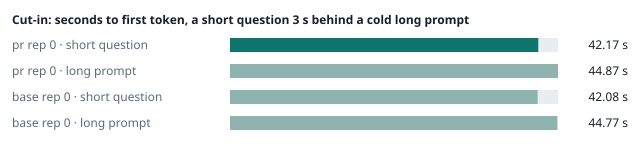
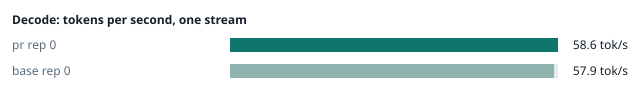
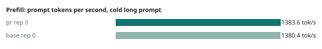
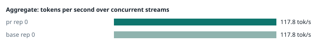
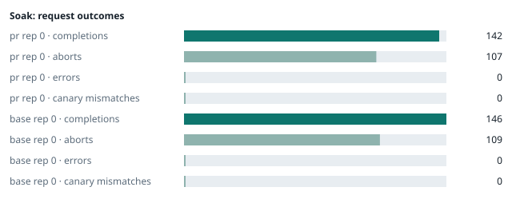

### Evidence: pr vs base

| target | role | image / artifact | model | settings that differ from the control |
|---|---|---|---|---|
| `pr` | candidate | `tensorfold-dsv41:pr-c726b868` (5aead4ac81fe) | `DeepSeek-V4.1-Flash-1017` | - |
| `base` | control | `tensorfold-dsv41:base-8ffa67d5` (b3ebb6f612e4) | `DeepSeek-V4.1-Flash-1017` | baseline |

Conditions: fabric ring; order: A then B, one repetition (no reverse order: pass --opt reps=2 for a counterbalanced run); repetitions: 1; kit 2825d9f; defaults.
Restore: live restored (verified: API answers, running artifact is live's).

#### smoke

| target | rep | arithmetic | greedy repeat equal | stream matches | JSON mode | first token (stream) | errors |
|---|---|---|---|---|---|---|---|
| `pr` | 0 | ✓ | ✓ | ✓ | ✓ | 0.099 s | - |
| `base` | 0 | ✓ | ✓ | ✓ | ✓ | 0.099 s | - |

machine state after the suite

- `pr` rep 0: `{"head": {"gpus": ["0, NVIDIA GB10, 2431 MHz, 61, [N/A], [N/A], 0 %"], "load": "load average: 8.23, 6.61, 5.86", "container": "90 pids 3.004GiB / 121.7GiB", "mem_available_mb": "28692"}}`
- `base` rep 0: `{"head": {"gpus": ["0, NVIDIA GB10, 2444 MHz, 61, [N/A], [N/A], 0 %"], "load": "load average: 7.73, 5.74, 5.68", "container": "90 pids 3.044GiB / 121.7GiB", "mem_available_mb": "28673"}}`

#### boundary

**19 of 19** greedy reply hashes identical, `pr` against `base`, over 1 repetition(s).

| rep | prompt | tokens (pr / base) | `pr` | `base` | same |
|---|---|---|---|---|---|
| 0 | len5 | 5 / 5 | `38127fef0fbb` | `38127fef0fbb` | ✓ |
| 0 | len2047 | 2047 / 2047 | `8488ccfbcf35` | `8488ccfbcf35` | ✓ |
| 0 | len2048 | 2048 / 2048 | `c5ac2fb76516` | `c5ac2fb76516` | ✓ |
| 0 | len2049 | 2049 / 2049 | `6766401c9caa` | `6766401c9caa` | ✓ |
| 0 | len4095 | 4095 / 4095 | `ed9e5086f520` | `ed9e5086f520` | ✓ |
| 0 | len4096 | 4096 / 4096 | `52584e31f990` | `52584e31f990` | ✓ |
| 0 | len4097 | 4097 / 4097 | `1a71db317ee7` | `1a71db317ee7` | ✓ |
| 0 | len6143 | 6143 / 6143 | `2f9626e9baf5` | `2f9626e9baf5` | ✓ |
| 0 | len6144 | 6144 / 6144 | `11933f2d4bd7` | `11933f2d4bd7` | ✓ |
| 0 | len6145 | 6145 / 6145 | `7aa2f63b2547` | `7aa2f63b2547` | ✓ |
| 0 | len8193 | 8193 / 8193 | `2ef3dc011922` | `2ef3dc011922` | ✓ |
| 0 | len12289 | 12289 / 12289 | `4fcfbd64881f` | `4fcfbd64881f` | ✓ |
| 0 | pfx_base | 5124 / 5124 | `52afe4842e5d` | `52afe4842e5d` | ✓ |
| 0 | pfx_div3072 | 3376 / 3376 | `64d23fe171dc` | `64d23fe171dc` | ✓ |
| 0 | pfx_div2044 | 2348 / 2348 | `16db99ba02f2` | `16db99ba02f2` | ✓ |
| 0 | pfx_div4092 | 4396 / 4396 | `63798c5ba36c` | `63798c5ba36c` | ✓ |
| 0 | pfx_div4093 | 4397 / 4397 | `6b1cfc31884d` | `6b1cfc31884d` | ✓ |
| 0 | pfx_base_again | 5124 / 5124 | `52afe4842e5d` | `52afe4842e5d` | ✓ |
| 0 | pfx_extend | 6660 / 6660 | `357a869fef18` | `357a869fef18` | ✓ |

machine state after the suite

- `pr` rep 0: `{"head": {"gpus": ["0, NVIDIA GB10, 2392 MHz, 67, [N/A], [N/A], 0 %"], "load": "load average: 6.73, 6.49, 5.88", "container": "90 pids 3.16GiB / 121.7GiB", "mem_available_mb": "29197"}}`
- `base` rep 0: `{"head": {"gpus": ["0, NVIDIA GB10, 2392 MHz, 66, [N/A], [N/A], 0 %"], "load": "load average: 6.77, 5.88, 5.74", "container": "90 pids 3.201GiB / 121.7GiB", "mem_available_mb": "28328"}}`

#### cutin

`pr` rep 0: short question first token **42.17 s** (rounds 42.115–42.212), long prompt first token 44.87 s (rounds 44.848–44.897); 3 rounds; admitted during the long prefill in 3 of 3 rounds
`base` rep 0: short question first token **42.08 s** (rounds 42.031–42.15), long prompt first token 44.77 s (rounds 44.759–44.837); 3 rounds; admitted during the long prefill in 3 of 3 rounds

machine state after the suite

- `pr` rep 0: `{"head": {"gpus": ["0, NVIDIA GB10, 2392 MHz, 68, [N/A], [N/A], 0 %"], "load": "load average: 7.03, 6.68, 6.03", "container": "90 pids 3.2GiB / 121.7GiB", "mem_available_mb": "28253"}}`
- `base` rep 0: `{"head": {"gpus": ["0, NVIDIA GB10, 2398 MHz, 69, [N/A], [N/A], 0 %"], "load": "load average: 6.80, 6.20, 5.88", "container": "90 pids 3.24GiB / 121.7GiB", "mem_available_mb": "28238"}}`

#### perf

| target | rep | decode tok/s, one stream | prefill tok/s, cold long prompt | aggregate tok/s, concurrent streams | errors |
|---|---|---|---|---|---|
| `pr` | 0 | **58.6** (56.3–59.4) | **1383.6** (1379.8–1384.1; 12004 tokens) | **117.8** (110.8–117.9; 4 streams) | - |
| `base` | 0 | **57.9** (55.8–58.9) | **1380.4** (1373.1–1381.4; 12004 tokens) | **117.8** (107.8–118.0; 4 streams) | - |

`pr` against `base`: decode +1.2%, prefill +0.2%, aggregate +0.0% (medians over repetitions; the verdict counts a difference only beyond the rounds' spread, at least ±3 %).

machine state after the suite

- `pr` rep 0: `{"head": {"gpus": ["0, NVIDIA GB10, 2418 MHz, 67, [N/A], [N/A], 0 %"], "load": "load average: 5.47, 6.30, 5.94", "container": "90 pids 3.409GiB / 121.7GiB", "mem_available_mb": "27592"}}`
- `base` rep 0: `{"head": {"gpus": ["0, NVIDIA GB10, 2392 MHz, 68, [N/A], [N/A], 11 %"], "load": "load average: 5.82, 6.03, 5.84", "container": "90 pids 3.436GiB / 121.7GiB", "mem_available_mb": "28804"}}`

#### startup

`pr`: 97.6 s from the switch to the API answering (1 start(s))
`base`: 98.2 s from the switch to the API answering (1 start(s))

#### soak

`pr` rep 0: 142 completions, 107 client aborts, **0 errors**, 47 canary checks with **0 mismatches**
  machine samples, first and last: `{"head": {"gpus": ["0, NVIDIA GB10, 2470 MHz, 66, [N/A], [N/A], 85 %"], "load": "load average: 5.47, 6.30, 5.94", "container": "94 pids 3.437GiB / 121.7GiB", "m` → `{"head": {"gpus": ["0, NVIDIA GB10, 2483 MHz, 70, [N/A], [N/A], 96 %"], "load": "load average: 6.45, 6.15, 5.99", "container": "93 pids 3.73GiB / 121.7GiB", "me`
`base` rep 0: 146 completions, 109 client aborts, **0 errors**, 47 canary checks with **0 mismatches**
  machine samples, first and last: `{"head": {"gpus": ["0, NVIDIA GB10, 2457 MHz, 67, [N/A], [N/A], 96 %"], "load": "load average: 5.82, 6.03, 5.84", "container": "94 pids 3.466GiB / 121.7GiB", "m` → `{"head": {"gpus": ["0, NVIDIA GB10, 2483 MHz, 71, [N/A], [N/A], 96 %"], "load": "load average: 5.49, 5.73, 5.78", "container": "94 pids 3.846GiB / 121.7GiB", "m`

machine state after the suite

- `pr` rep 0: `{"head": {"gpus": ["0, NVIDIA GB10, 2411 MHz, 58, [N/A], [N/A], 0 %"], "load": "load average: 4.62, 5.78, 5.88", "container": "90 pids 3.719GiB / 121.7GiB", "mem_available_mb": "27895"}}`
- `base` rep 0: `{"head": {"gpus": ["0, NVIDIA GB10, 2411 MHz, 59, [N/A], [N/A], 0 %"], "load": "load average: 3.86, 5.31, 5.64", "container": "90 pids 3.772GiB / 121.7GiB", "mem_available_mb": "27002"}}`

#### concurrency

| target | rep | streams | aggregate tok/s | first token p50 / p95 | batched replies ≠ serial | errors |
|---|---|---|---|---|---|---|
| `pr` | 0 | 1 (round 0) | **52.5** | 0.396 / 0.424 s | — |  |
| `pr` | 0 | 4 (round 0) | **82.9** | 1.132 / 1.567 s | 0 of 16 |  |
| `pr` | 0 | 8 (round 0) | **92.1** | 1.905 / 3.082 s | 0 of 16 |  |
| `pr` | 0 | 16 (round 0) | **97.1** | 3.384 / 5.993 s | 0 of 16 | 0 |
| `pr` | 0 | 1 (round 1) | **52.6** | 0.385 / 0.401 s | — |  |
| `pr` | 0 | 4 (round 1) | **83.7** | 1.134 / 1.525 s | 0 of 16 |  |
| `pr` | 0 | 8 (round 1) | **93.0** | 1.889 / 3.024 s | 0 of 16 |  |
| `pr` | 0 | 16 (round 1) | **96.0** | 3.404 / 6.039 s | 0 of 16 | 0 |
| `base` | 0 | 1 (round 0) | **52.3** | 0.391 / 0.422 s | — |  |
| `base` | 0 | 4 (round 0) | **82.9** | 1.145 / 1.571 s | 0 of 16 |  |
| `base` | 0 | 8 (round 0) | **92.4** | 1.906 / 3.064 s | 0 of 16 |  |
| `base` | 0 | 16 (round 0) | **96.4** | 3.451 / 6.066 s | 0 of 16 | 0 |
| `base` | 0 | 1 (round 1) | **51.8** | 0.397 / 0.441 s | — |  |
| `base` | 0 | 4 (round 1) | **82.9** | 1.132 / 1.588 s | 0 of 16 |  |
| `base` | 0 | 8 (round 1) | **92.4** | 1.891 / 3.03 s | 0 of 16 |  |
| `base` | 0 | 16 (round 1) | **98.0** | 3.391 / 5.957 s | 0 of 16 | 0 |

`pr` rep 0: 128 requests; batched replies identical to serial in 96 of 96 comparisons
- host `spark-161`: container memory 2874.4 → 2919.4 MB after the drain (**+45.0 MB**, +351.6 MB per 1000 requests); descriptors 147 → 150
- host `spark-197`: container memory 4139.0 → 4182.0 MB after the drain (**+43.0 MB**, +335.9 MB per 1000 requests); descriptors 221 → 221
- host `gx10-126`: container memory 2904.1 → 2949.1 MB after the drain (**+45.0 MB**, +351.6 MB per 1000 requests); descriptors 150 → 150
- host `dell-113`: container memory 2902.0 → 2948.1 MB after the drain (**+46.1 MB**, +360.2 MB per 1000 requests); descriptors 150 → 150

`base` rep 0: 128 requests; batched replies identical to serial in 96 of 96 comparisons
- host `spark-161`: container memory 2884.6 → 2930.7 MB after the drain (**+46.1 MB**, +360.2 MB per 1000 requests); descriptors 150 → 147
- host `spark-197`: container memory 4192.3 → 4237.3 MB after the drain (**+45.0 MB**, +351.6 MB per 1000 requests); descriptors 221 → 221
- host `gx10-126`: container memory 2897.9 → 2943.0 MB after the drain (**+45.1 MB**, +352.3 MB per 1000 requests); descriptors 150 → 150
- host `dell-113`: container memory 2906.1 → 2952.2 MB after the drain (**+46.1 MB**, +360.2 MB per 1000 requests); descriptors 150 → 150

machine state after the suite

- `pr` rep 0: `{"head": {"gpus": ["0, NVIDIA GB10, 2411 MHz, 58, [N/A], [N/A], 0 %"], "load": "load average: 2.44, 4.41, 5.30", "container": "90 pids 4.084GiB / 121.7GiB", "mem_available_mb": "27367"}}`
- `base` rep 0: `{"head": {"gpus": ["0, NVIDIA GB10, 2411 MHz, 57, [N/A], [N/A], 0 %"], "load": "load average: 2.20, 4.18, 5.11", "container": "90 pids 4.138GiB / 121.7GiB", "mem_available_mb": "26270"}}`

#### the pull request's own tests

**confirmed** — 2 test file(s) added or changed by the PR (`tests/test_start_smoke.py`, `tests/test_start_urls.py`): on the PR **passes** (exit 0), on the base with the PR's tests copied in **fails** (exit 1).

- PR: `.......................................................... [ 98%] .                                                                        [100%] 59 passed, 14 subtests passed in 32.72s`
- base + PR tests: `Restart  ./start.sh restart     Stop     ./stop.sh 69 failed, 4 passed in 31.06s`

#### What this run does not show

- one process under mixed load for hours: throughput probes every few minutes, a canary reply, host memory and descriptors over the run (`endurance` did not run)
- a clean pair exit and recovery after an injected read fault (`fault` did not run)
- an external benchmark against a control (The Grill or similar) (`bench` did not run)
- <!-- add: paths only checked by reading, faults not injected, configurations not run -->

_Generated by inference-agent-kit `report.py` from `20261118T090916/results.json`._
