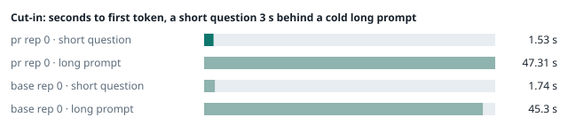
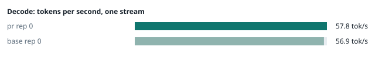
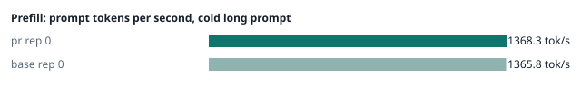
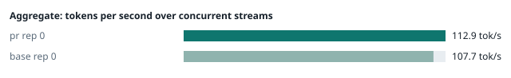
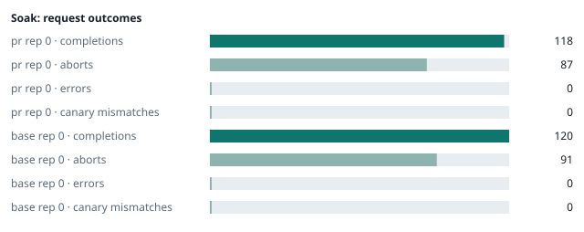

### Evidence: pr vs base

| target | role | image / artifact | model | settings that differ from the control |
|---|---|---|---|---|
| `pr` | candidate | `tensorfold-dsv41:pr-e4b22920` (c19b9fa52529) | `DeepSeek-V4.1-Flash-1017` | - |
| `base` | control | `tensorfold-dsv41:base-d24e79ee` (5a94966d9621) | `DeepSeek-V4.1-Flash-1017` | baseline |

Conditions: fabric ring; order: A then B, one repetition (no reverse order: pass --opt reps=2 for a counterbalanced run); repetitions: 1; kit 2825d9f.
Restore: live restored (verified: API answers, running artifact is live's).

#### smoke

| target | rep | arithmetic | greedy repeat equal | stream matches | JSON mode | first token (stream) | errors |
|---|---|---|---|---|---|---|---|
| `pr` | 0 | ✓ | ✓ | ✓ | ✓ | 0.099 s | - |
| `base` | 0 | ✓ | ✓ | ✓ | ✓ | 0.102 s | - |

machine state after the suite

- `pr` rep 0: `{"head": {"gpus": ["0, NVIDIA GB10, 2444 MHz, 52, [N/A], [N/A], 0 %"], "load": "load average: 6.04, 2.46, 2.00", "container": "90 pids 3.044GiB / 121.7GiB", "mem_available_mb": "29526"}}`
- `base` rep 0: `{"head": {"gpus": ["0, NVIDIA GB10, 2444 MHz, 59, [N/A], [N/A], 0 %"], "load": "load average: 7.50, 5.59, 4.83", "container": "90 pids 3.009GiB / 121.7GiB", "mem_available_mb": "28679"}}`

#### boundary

**19 of 19** greedy reply hashes identical, `pr` against `base`, over 1 repetition(s).

| rep | prompt | tokens (pr / base) | `pr` | `base` | same |
|---|---|---|---|---|---|
| 0 | len5 | 5 / 5 | `38127fef0fbb` | `38127fef0fbb` | ✓ |
| 0 | len2047 | 2047 / 2047 | `8488ccfbcf35` | `8488ccfbcf35` | ✓ |
| 0 | len2048 | 2048 / 2048 | `c5ac2fb76516` | `c5ac2fb76516` | ✓ |
| 0 | len2049 | 2049 / 2049 | `6766401c9caa` | `6766401c9caa` | ✓ |
| 0 | len4095 | 4095 / 4095 | `ed9e5086f520` | `ed9e5086f520` | ✓ |
| 0 | len4096 | 4096 / 4096 | `52584e31f990` | `52584e31f990` | ✓ |
| 0 | len4097 | 4097 / 4097 | `1a71db317ee7` | `1a71db317ee7` | ✓ |
| 0 | len6143 | 6143 / 6143 | `2f9626e9baf5` | `2f9626e9baf5` | ✓ |
| 0 | len6144 | 6144 / 6144 | `11933f2d4bd7` | `11933f2d4bd7` | ✓ |
| 0 | len6145 | 6145 / 6145 | `7aa2f63b2547` | `7aa2f63b2547` | ✓ |
| 0 | len8193 | 8193 / 8193 | `2ef3dc011922` | `2ef3dc011922` | ✓ |
| 0 | len12289 | 12289 / 12289 | `4fcfbd64881f` | `4fcfbd64881f` | ✓ |
| 0 | pfx_base | 5124 / 5124 | `52afe4842e5d` | `52afe4842e5d` | ✓ |
| 0 | pfx_div3072 | 3376 / 3376 | `64d23fe171dc` | `64d23fe171dc` | ✓ |
| 0 | pfx_div2044 | 2348 / 2348 | `16db99ba02f2` | `16db99ba02f2` | ✓ |
| 0 | pfx_div4092 | 4396 / 4396 | `63798c5ba36c` | `63798c5ba36c` | ✓ |
| 0 | pfx_div4093 | 4397 / 4397 | `6b1cfc31884d` | `6b1cfc31884d` | ✓ |
| 0 | pfx_base_again | 5124 / 5124 | `52afe4842e5d` | `52afe4842e5d` | ✓ |
| 0 | pfx_extend | 6660 / 6660 | `357a869fef18` | `357a869fef18` | ✓ |

machine state after the suite

- `pr` rep 0: `{"head": {"gpus": ["0, NVIDIA GB10, 2398 MHz, 63, [N/A], [N/A], 0 %"], "load": "load average: 6.45, 3.37, 2.35", "container": "90 pids 3.201GiB / 121.7GiB", "mem_available_mb": "29233"}}`
- `base` rep 0: `{"head": {"gpus": ["0, NVIDIA GB10, 2392 MHz, 67, [N/A], [N/A], 0 %"], "load": "load average: 6.05, 5.58, 4.89", "container": "90 pids 3.166GiB / 121.7GiB", "mem_available_mb": "28367"}}`

#### cutin

`pr` rep 0: short question first token **1.53 s** (rounds 0.608–2.337), long prompt first token 47.31 s (rounds 45.664–72.73); 3 rounds; admitted during the long prefill in 3 of 3 rounds
`base` rep 0: short question first token **1.74 s** (rounds 1.715–1.744), long prompt first token 45.3 s (rounds 45.272–45.385); 3 rounds; admitted during the long prefill in 3 of 3 rounds

machine state after the suite

- `pr` rep 0: `{"head": {"gpus": ["0, NVIDIA GB10, 2392 MHz, 67, [N/A], [N/A], 0 %"], "load": "load average: 7.10, 4.91, 3.12", "container": "90 pids 3.306GiB / 121.7GiB", "mem_available_mb": "28181"}}`
- `base` rep 0: `{"head": {"gpus": ["0, NVIDIA GB10, 2392 MHz, 67, [N/A], [N/A], 26 %"], "load": "load average: 7.01, 6.16, 5.20", "container": "90 pids 3.205GiB / 121.7GiB", "mem_available_mb": "28277"}}`

#### perf

| target | rep | decode tok/s, one stream | prefill tok/s, cold long prompt | aggregate tok/s, concurrent streams | errors |
|---|---|---|---|---|---|
| `pr` | 0 | **57.8** (55.3–58.9) | **1368.3** (1358.5–1371.6; 12004 tokens) | **112.9** (107.0–113.7; 4 streams) | - |
| `base` | 0 | **56.9** (54.6–57.9) | **1365.8** (1363.5–1366.9; 12004 tokens) | **107.7** (107.5–114.7; 4 streams) | - |

`pr` against `base`: decode +1.6%, prefill +0.2%, aggregate +4.8% (medians over repetitions; the verdict counts a difference only beyond the rounds' spread, at least ±3 %).

machine state after the suite

- `pr` rep 0: `{"head": {"gpus": ["0, NVIDIA GB10, 2437 MHz, 67, [N/A], [N/A], 0 %"], "load": "load average: 5.98, 4.95, 3.24", "container": "90 pids 3.502GiB / 121.7GiB", "mem_available_mb": "28048"}}`
- `base` rep 0: `{"head": {"gpus": ["0, NVIDIA GB10, 2392 MHz, 66, [N/A], [N/A], 0 %"], "load": "load average: 5.85, 5.94, 5.18", "container": "90 pids 3.402GiB / 121.7GiB", "mem_available_mb": "27883"}}`

#### startup

`pr`: 100.5 s from the switch to the API answering (1 start(s))
`base`: 98.6 s from the switch to the API answering (1 start(s))

#### soak

`pr` rep 0: 118 completions, 87 client aborts, **0 errors**, 38 canary checks with **0 mismatches**
  machine samples, first and last: `{"head": {"gpus": ["0, NVIDIA GB10, 2483 MHz, 66, [N/A], [N/A], 96 %"], "load": "load average: 5.98, 4.95, 3.24", "container": "94 pids 3.532GiB / 121.7GiB", "m` → `{"head": {"gpus": ["0, NVIDIA GB10, 2483 MHz, 67, [N/A], [N/A], 96 %"], "load": "load average: 6.20, 6.14, 4.67", "container": "93 pids 3.81GiB / 121.7GiB", "me`
`base` rep 0: 120 completions, 91 client aborts, **0 errors**, 40 canary checks with **0 mismatches**
  machine samples, first and last: `{"head": {"gpus": ["0, NVIDIA GB10, 2489 MHz, 66, [N/A], [N/A], 96 %"], "load": "load average: 5.85, 5.94, 5.18", "container": "94 pids 3.431GiB / 121.7GiB", "m` → `{"head": {"gpus": ["0, NVIDIA GB10, 2483 MHz, 69, [N/A], [N/A], 96 %"], "load": "load average: 6.07, 6.17, 5.69", "container": "94 pids 3.783GiB / 121.7GiB", "m`

machine state after the suite

- `pr` rep 0: `{"head": {"gpus": ["0, NVIDIA GB10, 2411 MHz, 59, [N/A], [N/A], 0 %"], "load": "load average: 4.44, 5.74, 4.63", "container": "90 pids 3.799GiB / 121.7GiB", "mem_available_mb": "27001"}}`
- `base` rep 0: `{"head": {"gpus": ["0, NVIDIA GB10, 2411 MHz, 61, [N/A], [N/A], 0 %"], "load": "load average: 4.44, 5.78, 5.59", "container": "90 pids 3.749GiB / 121.7GiB", "mem_available_mb": "27840"}}`

#### concurrency

| target | rep | streams | aggregate tok/s | first token p50 / p95 | batched replies ≠ serial | errors |
|---|---|---|---|---|---|---|
| `pr` | 0 | 1 (round 0) | **52.4** | 0.392 / 0.411 s | — |  |
| `pr` | 0 | 4 (round 0) | **80.7** | 1.234 / 1.713 s | 0 of 16 |  |
| `pr` | 0 | 8 (round 0) | **88.3** | 2.099 / 3.623 s | 0 of 16 |  |
| `pr` | 0 | 16 (round 0) | **92.0** | 4.06 / 7.968 s | 0 of 16 | 0 |
| `pr` | 0 | 1 (round 1) | **52.6** | 0.387 / 0.397 s | — |  |
| `pr` | 0 | 4 (round 1) | **81.2** | 1.23 / 1.697 s | 0 of 16 |  |
| `pr` | 0 | 8 (round 1) | **89.1** | 2.121 / 3.547 s | 0 of 16 |  |
| `pr` | 0 | 16 (round 1) | **92.4** | 3.977 / 7.856 s | 0 of 16 | 0 |
| `base` | 0 | 1 (round 0) | **51.7** | 0.385 / 0.409 s | — |  |
| `base` | 0 | 4 (round 0) | **79.9** | 1.244 / 1.747 s | 0 of 16 |  |
| `base` | 0 | 8 (round 0) | **89.2** | 2.115 / 3.589 s | 0 of 16 |  |
| `base` | 0 | 16 (round 0) | **92.6** | 4.034 / 7.904 s | 0 of 16 | 0 |
| `base` | 0 | 1 (round 1) | **51.7** | 0.382 / 0.429 s | — |  |
| `base` | 0 | 4 (round 1) | **81.2** | 1.22 / 1.673 s | 0 of 16 |  |
| `base` | 0 | 8 (round 1) | **89.5** | 2.129 / 3.54 s | 0 of 16 |  |
| `base` | 0 | 16 (round 1) | **92.6** | 4.019 / 7.854 s | 0 of 16 | 0 |

`pr` rep 0: 128 requests; batched replies identical to serial in 96 of 96 comparisons
- host `spark-161`: container memory 2889.7 → 2957.3 MB after the drain (**+67.6 MB**, +528.1 MB per 1000 requests); descriptors 150 → 147
- host `spark-197`: container memory 4182.0 → 4250.6 MB after the drain (**+68.6 MB**, +535.9 MB per 1000 requests); descriptors 221 → 221
- host `gx10-126`: container memory 2889.7 → 2958.3 MB after the drain (**+68.6 MB**, +535.9 MB per 1000 requests); descriptors 150 → 150
- host `dell-113`: container memory 2930.7 → 2998.3 MB after the drain (**+67.6 MB**, +528.1 MB per 1000 requests); descriptors 150 → 150

`base` rep 0: 128 requests; batched replies identical to serial in 96 of 96 comparisons
- host `spark-161`: container memory 2865.2 → 2935.8 MB after the drain (**+70.6 MB**, +551.6 MB per 1000 requests); descriptors 150 → 150
- host `spark-197`: container memory 4131.8 → 4203.5 MB after the drain (**+71.7 MB**, +560.2 MB per 1000 requests); descriptors 221 → 218
- host `gx10-126`: container memory 2889.7 → 2960.4 MB after the drain (**+70.7 MB**, +552.3 MB per 1000 requests); descriptors 150 → 150
- host `dell-113`: container memory 2894.8 → 2965.5 MB after the drain (**+70.7 MB**, +552.3 MB per 1000 requests); descriptors 150 → 150

machine state after the suite

- `pr` rep 0: `{"head": {"gpus": ["0, NVIDIA GB10, 2411 MHz, 55, [N/A], [N/A], 0 %"], "load": "load average: 2.17, 4.29, 4.37", "container": "90 pids 4.151GiB / 121.7GiB", "mem_available_mb": "26293"}}`
- `base` rep 0: `{"head": {"gpus": ["0, NVIDIA GB10, 2411 MHz, 59, [N/A], [N/A], 0 %"], "load": "load average: 2.02, 4.26, 5.05", "container": "90 pids 4.104GiB / 121.7GiB", "mem_available_mb": "27297"}}`

#### the pull request's own tests

**confirmed** — 1 test file(s) added or changed by the PR (`tests/test_scripts.py`): on the PR **passes** (exit 0), on the base with the PR's tests copied in **fails** (exit 1).

- PR: `............................................... [ 78%] .............                                                      [100%] 60 passed, 31 subtests passed in 21.27s`
- base + PR tests: `Stop     ./stop.sh FAILED tests/test_scripts.py::PreparedState::test_ablit_revision_changes_the_marker_only_when_ablit_is_on - AssertionError: 'model=deepseek-ai/[user@host] image=image-ident kit=6033ea48a27004b2715db82190e2a61f33411d92 order`

#### What this run does not show

- one process under mixed load for hours: throughput probes every few minutes, a canary reply, host memory and descriptors over the run (`endurance` did not run)
- a clean pair exit and recovery after an injected read fault (`fault` did not run)
- an external benchmark against a control (The Grill or similar) (`bench` did not run)
- <!-- add: paths only checked by reading, faults not injected, configurations not run -->

_Generated by inference-agent-kit `report.py` from `20261118T102107/results.json`._
