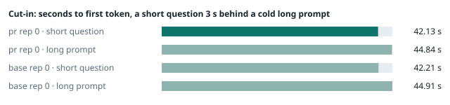
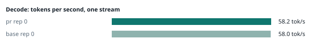
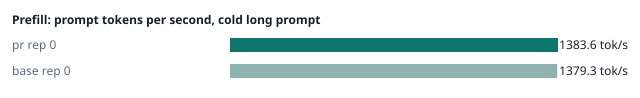
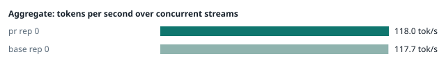
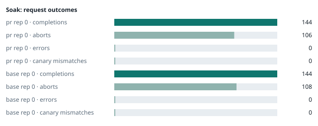

### Evidence: pr vs base

| target | role | image / artifact | model | settings that differ from the control |
|---|---|---|---|---|
| `pr` | candidate | `tensorfold-dsv41:pr-e4b22920` (c19b9fa52529) | `DeepSeek-V4.1-Flash-1017` | - |
| `base` | control | `tensorfold-dsv41:base-d24e79ee` (5a94966d9621) | `DeepSeek-V4.1-Flash-1017` | baseline |

Conditions: fabric ring; order: A then B, one repetition (no reverse order: pass --opt reps=2 for a counterbalanced run); repetitions: 1; kit 2825d9f; defaults.
Restore: live restored (verified: API answers, running artifact is live's).

#### smoke

| target | rep | arithmetic | greedy repeat equal | stream matches | JSON mode | first token (stream) | errors |
|---|---|---|---|---|---|---|---|
| `pr` | 0 | ✓ | ✓ | ✓ | ✓ | 0.1 s | - |
| `base` | 0 | ✓ | ✓ | ✓ | ✓ | 0.101 s | - |

machine state after the suite

- `pr` rep 0: `{"head": {"gpus": ["0, NVIDIA GB10, 2431 MHz, 62, [N/A], [N/A], 0 %"], "load": "load average: 8.60, 6.44, 5.75", "container": "90 pids 3.04GiB / 121.7GiB", "mem_available_mb": "28650"}}`
- `base` rep 0: `{"head": {"gpus": ["0, NVIDIA GB10, 2437 MHz, 62, [N/A], [N/A], 0 %"], "load": "load average: 7.48, 5.52, 5.50", "container": "90 pids 3.032GiB / 121.7GiB", "mem_available_mb": "29495"}}`

#### boundary

**19 of 19** greedy reply hashes identical, `pr` against `base`, over 1 repetition(s).

| rep | prompt | tokens (pr / base) | `pr` | `base` | same |
|---|---|---|---|---|---|
| 0 | len5 | 5 / 5 | `38127fef0fbb` | `38127fef0fbb` | ✓ |
| 0 | len2047 | 2047 / 2047 | `8488ccfbcf35` | `8488ccfbcf35` | ✓ |
| 0 | len2048 | 2048 / 2048 | `c5ac2fb76516` | `c5ac2fb76516` | ✓ |
| 0 | len2049 | 2049 / 2049 | `6766401c9caa` | `6766401c9caa` | ✓ |
| 0 | len4095 | 4095 / 4095 | `ed9e5086f520` | `ed9e5086f520` | ✓ |
| 0 | len4096 | 4096 / 4096 | `52584e31f990` | `52584e31f990` | ✓ |
| 0 | len4097 | 4097 / 4097 | `1a71db317ee7` | `1a71db317ee7` | ✓ |
| 0 | len6143 | 6143 / 6143 | `2f9626e9baf5` | `2f9626e9baf5` | ✓ |
| 0 | len6144 | 6144 / 6144 | `11933f2d4bd7` | `11933f2d4bd7` | ✓ |
| 0 | len6145 | 6145 / 6145 | `7aa2f63b2547` | `7aa2f63b2547` | ✓ |
| 0 | len8193 | 8193 / 8193 | `2ef3dc011922` | `2ef3dc011922` | ✓ |
| 0 | len12289 | 12289 / 12289 | `4fcfbd64881f` | `4fcfbd64881f` | ✓ |
| 0 | pfx_base | 5124 / 5124 | `52afe4842e5d` | `52afe4842e5d` | ✓ |
| 0 | pfx_div3072 | 3376 / 3376 | `64d23fe171dc` | `64d23fe171dc` | ✓ |
| 0 | pfx_div2044 | 2348 / 2348 | `16db99ba02f2` | `16db99ba02f2` | ✓ |
| 0 | pfx_div4092 | 4396 / 4396 | `63798c5ba36c` | `63798c5ba36c` | ✓ |
| 0 | pfx_div4093 | 4397 / 4397 | `6b1cfc31884d` | `6b1cfc31884d` | ✓ |
| 0 | pfx_base_again | 5124 / 5124 | `52afe4842e5d` | `52afe4842e5d` | ✓ |
| 0 | pfx_extend | 6660 / 6660 | `357a869fef18` | `357a869fef18` | ✓ |

machine state after the suite

- `pr` rep 0: `{"head": {"gpus": ["0, NVIDIA GB10, 2398 MHz, 69, [N/A], [N/A], 0 %"], "load": "load average: 6.62, 6.31, 5.76", "container": "90 pids 3.196GiB / 121.7GiB", "mem_available_mb": "28209"}}`
- `base` rep 0: `{"head": {"gpus": ["0, NVIDIA GB10, 2424 MHz, 68, [N/A], [N/A], 0 %"], "load": "load average: 6.59, 5.66, 5.55", "container": "90 pids 3.189GiB / 121.7GiB", "mem_available_mb": "29152"}}`

#### cutin

`pr` rep 0: short question first token **42.13 s** (rounds 42.083–42.193), long prompt first token 44.84 s (rounds 44.808–44.881); 3 rounds; admitted during the long prefill in 3 of 3 rounds
`base` rep 0: short question first token **42.21 s** (rounds 42.154–42.232), long prompt first token 44.91 s (rounds 44.879–44.926); 3 rounds; admitted during the long prefill in 3 of 3 rounds

machine state after the suite

- `pr` rep 0: `{"head": {"gpus": ["0, NVIDIA GB10, 2437 MHz, 69, [N/A], [N/A], 0 %"], "load": "load average: 6.88, 6.54, 5.92", "container": "90 pids 3.236GiB / 121.7GiB", "mem_available_mb": "28211"}}`
- `base` rep 0: `{"head": {"gpus": ["0, NVIDIA GB10, 2431 MHz, 69, [N/A], [N/A], 0 %"], "load": "load average: 6.82, 6.10, 5.73", "container": "90 pids 3.228GiB / 121.7GiB", "mem_available_mb": "29099"}}`

#### perf

| target | rep | decode tok/s, one stream | prefill tok/s, cold long prompt | aggregate tok/s, concurrent streams | errors |
|---|---|---|---|---|---|
| `pr` | 0 | **58.2** (55.5–59.2) | **1383.6** (1378.5–1390.5; 12004 tokens) | **118.0** (110.7–118.5; 4 streams) | - |
| `base` | 0 | **58.0** (55.4–59.1) | **1379.3** (1377.4–1392.9; 12004 tokens) | **117.7** (110.8–117.9; 4 streams) | - |

`pr` against `base`: decode +0.3%, prefill +0.3%, aggregate +0.3% (medians over repetitions; the verdict counts a difference only beyond the rounds' spread, at least ±3 %).

machine state after the suite

- `pr` rep 0: `{"head": {"gpus": ["0, NVIDIA GB10, 2405 MHz, 68, [N/A], [N/A], 0 %"], "load": "load average: 5.84, 6.30, 5.88", "container": "90 pids 3.432GiB / 121.7GiB", "mem_available_mb": "27853"}}`
- `base` rep 0: `{"head": {"gpus": ["0, NVIDIA GB10, 2424 MHz, 69, [N/A], [N/A], 22 %"], "load": "load average: 5.84, 5.95, 5.70", "container": "90 pids 3.424GiB / 121.7GiB", "mem_available_mb": "27866"}}`

#### startup

`pr`: 97.8 s from the switch to the API answering (1 start(s))
`base`: 98.4 s from the switch to the API answering (1 start(s))

#### soak

`pr` rep 0: 144 completions, 106 client aborts, **0 errors**, 47 canary checks with **0 mismatches**
  machine samples, first and last: `{"head": {"gpus": ["0, NVIDIA GB10, 2470 MHz, 67, [N/A], [N/A], 88 %"], "load": "load average: 5.37, 6.19, 5.85", "container": "94 pids 3.459GiB / 121.7GiB", "m` → `{"head": {"gpus": ["0, NVIDIA GB10, 2483 MHz, 71, [N/A], [N/A], 96 %"], "load": "load average: 6.11, 5.96, 5.84", "container": "94 pids 3.731GiB / 121.7GiB", "m`
`base` rep 0: 144 completions, 108 client aborts, **0 errors**, 48 canary checks with **0 mismatches**
  machine samples, first and last: `{"head": {"gpus": ["0, NVIDIA GB10, 2476 MHz, 68, [N/A], [N/A], 96 %"], "load": "load average: 5.84, 5.95, 5.70", "container": "94 pids 3.45GiB / 121.7GiB", "me` → `{"head": {"gpus": ["0, NVIDIA GB10, 2483 MHz, 71, [N/A], [N/A], 96 %"], "load": "load average: 5.78, 5.85, 5.76", "container": "94 pids 3.794GiB / 121.7GiB", "m`

machine state after the suite

- `pr` rep 0: `{"head": {"gpus": ["0, NVIDIA GB10, 2411 MHz, 56, [N/A], [N/A], 0 %"], "load": "load average: 3.86, 5.45, 5.68", "container": "90 pids 3.73GiB / 121.7GiB", "mem_available_mb": "27030"}}`
- `base` rep 0: `{"head": {"gpus": ["0, NVIDIA GB10, 2411 MHz, 59, [N/A], [N/A], 0 %"], "load": "load average: 4.27, 5.51, 5.65", "container": "90 pids 3.736GiB / 121.7GiB", "mem_available_mb": "26938"}}`

#### concurrency

| target | rep | streams | aggregate tok/s | first token p50 / p95 | batched replies ≠ serial | errors |
|---|---|---|---|---|---|---|
| `pr` | 0 | 1 (round 0) | **51.2** | 0.393 / 0.419 s | — |  |
| `pr` | 0 | 4 (round 0) | **80.5** | 1.176 / 1.661 s | 0 of 16 |  |
| `pr` | 0 | 8 (round 0) | **91.4** | 1.955 / 3.125 s | 0 of 16 |  |
| `pr` | 0 | 16 (round 0) | **94.8** | 3.486 / 6.115 s | 0 of 16 | 0 |
| `pr` | 0 | 1 (round 1) | **52.0** | 0.394 / 0.432 s | — |  |
| `pr` | 0 | 4 (round 1) | **83.3** | 1.119 / 1.572 s | 0 of 16 |  |
| `pr` | 0 | 8 (round 1) | **92.3** | 1.911 / 3.089 s | 0 of 16 |  |
| `pr` | 0 | 16 (round 1) | **96.8** | 3.397 / 6.011 s | 0 of 16 | 0 |
| `base` | 0 | 1 (round 0) | **51.7** | 0.401 / 0.432 s | — |  |
| `base` | 0 | 4 (round 0) | **82.0** | 1.171 / 1.591 s | 0 of 16 |  |
| `base` | 0 | 8 (round 0) | **91.6** | 1.946 / 3.14 s | 0 of 16 |  |
| `base` | 0 | 16 (round 0) | **94.4** | 3.551 / 6.298 s | 0 of 16 | 0 |
| `base` | 0 | 1 (round 1) | **52.0** | 0.397 / 0.44 s | — |  |
| `base` | 0 | 4 (round 1) | **82.6** | 1.153 / 1.578 s | 0 of 16 |  |
| `base` | 0 | 8 (round 1) | **90.9** | 2.003 / 3.199 s | 0 of 16 |  |
| `base` | 0 | 16 (round 1) | **95.8** | 3.569 / 6.277 s | 0 of 16 | 0 |

`pr` rep 0: 128 requests; batched replies identical to serial in 96 of 96 comparisons
- host `spark-161`: container memory 2850.8 → 2912.3 MB after the drain (**+61.5 MB**, +480.5 MB per 1000 requests); descriptors 150 → 147
- host `spark-197`: container memory 4147.2 → 4206.6 MB after the drain (**+59.4 MB**, +464.1 MB per 1000 requests); descriptors 218 → 221
- host `gx10-126`: container memory 2875.4 → 2935.8 MB after the drain (**+60.4 MB**, +471.9 MB per 1000 requests); descriptors 150 → 150
- host `dell-113`: container memory 2880.5 → 2940.9 MB after the drain (**+60.4 MB**, +471.9 MB per 1000 requests); descriptors 150 → 150

`base` rep 0: 128 requests; batched replies identical to serial in 96 of 96 comparisons
- host `spark-161`: container memory 2851.8 → 2926.6 MB after the drain (**+74.8 MB**, +584.4 MB per 1000 requests); descriptors 150 → 150
- host `spark-197`: container memory 4139.0 → 4212.7 MB after the drain (**+73.7 MB**, +575.8 MB per 1000 requests); descriptors 221 → 221
- host `gx10-126`: container memory 2857.0 → 2930.7 MB after the drain (**+73.7 MB**, +575.8 MB per 1000 requests); descriptors 150 → 150
- host `dell-113`: container memory 2874.4 → 2948.1 MB after the drain (**+73.7 MB**, +575.8 MB per 1000 requests); descriptors 150 → 150

machine state after the suite

- `pr` rep 0: `{"head": {"gpus": ["0, NVIDIA GB10, 2411 MHz, 59, [N/A], [N/A], 0 %"], "load": "load average: 2.34, 4.19, 5.12", "container": "90 pids 4.108GiB / 121.7GiB", "mem_available_mb": "26426"}}`
- `base` rep 0: `{"head": {"gpus": ["0, NVIDIA GB10, 2411 MHz, 59, [N/A], [N/A], 0 %"], "load": "load average: 2.45, 4.30, 5.12", "container": "90 pids 4.114GiB / 121.7GiB", "mem_available_mb": "27255"}}`

#### the pull request's own tests

**confirmed** — 1 test file(s) added or changed by the PR (`tests/test_scripts.py`): on the PR **passes** (exit 0), on the base with the PR's tests copied in **fails** (exit 1).

- PR: `............................................... [ 78%] .............                                                      [100%] 60 passed, 31 subtests passed in 21.27s`
- base + PR tests: `Stop     ./stop.sh FAILED tests/test_scripts.py::PreparedState::test_ablit_revision_changes_the_marker_only_when_ablit_is_on - AssertionError: 'model=deepseek-ai/[user@host] image=image-ident kit=6033ea48a27004b2715db82190e2a61f33411d92 order`

#### What this run does not show

- one process under mixed load for hours: throughput probes every few minutes, a canary reply, host memory and descriptors over the run (`endurance` did not run)
- a clean pair exit and recovery after an injected read fault (`fault` did not run)
- an external benchmark against a control (The Grill or similar) (`bench` did not run)
- <!-- add: paths only checked by reading, faults not injected, configurations not run -->

_Generated by inference-agent-kit `report.py` from `20261118T110644/results.json`._
