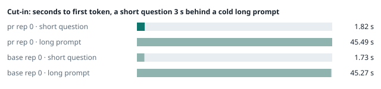
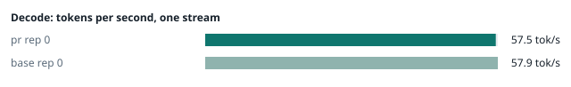
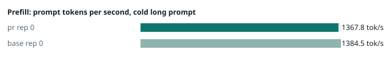
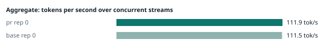
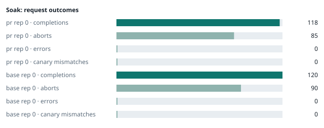

### Evidence: pr vs base

| target | role | image / artifact | model | settings that differ from the control |
|---|---|---|---|---|
| `pr` | candidate | `tensorfold-dsv41:pr-a24647d3` (514c25b2fc0b) | `DeepSeek-V4.1-Flash-1017` | - |
| `base` | control | `tensorfold-dsv41:base-8ffa67d5` (b3ebb6f612e4) | `DeepSeek-V4.1-Flash-1017` | baseline |

Conditions: fabric ring; order: A then B, one repetition (no reverse order: pass --opt reps=2 for a counterbalanced run); repetitions: 1; kit 2825d9f.
Restore: live restored (verified: API answers, running artifact is live's).

#### smoke

| target | rep | arithmetic | greedy repeat equal | stream matches | JSON mode | first token (stream) | errors |
|---|---|---|---|---|---|---|---|
| `pr` | 0 | ✓ | ✓ | ✓ | ✓ | 0.101 s | - |
| `base` | 0 | ✓ | ✓ | ✓ | ✓ | 0.099 s | - |

machine state after the suite

- `pr` rep 0: `{"head": {"gpus": ["0, NVIDIA GB10, 2411 MHz, 56, [N/A], [N/A], 0 %"], "load": "load average: 6.58, 2.65, 1.65", "container": "90 pids 3.041GiB / 121.7GiB", "mem_available_mb": "29511"}}`
- `base` rep 0: `{"head": {"gpus": ["0, NVIDIA GB10, 2405 MHz, 62, [N/A], [N/A], 0 %"], "load": "load average: 7.44, 5.49, 4.61", "container": "90 pids 3.04GiB / 121.7GiB", "mem_available_mb": "28740"}}`

#### boundary

**19 of 19** greedy reply hashes identical, `pr` against `base`, over 1 repetition(s).

| rep | prompt | tokens (pr / base) | `pr` | `base` | same |
|---|---|---|---|---|---|
| 0 | len5 | 5 / 5 | `38127fef0fbb` | `38127fef0fbb` | ✓ |
| 0 | len2047 | 2047 / 2047 | `8488ccfbcf35` | `8488ccfbcf35` | ✓ |
| 0 | len2048 | 2048 / 2048 | `c5ac2fb76516` | `c5ac2fb76516` | ✓ |
| 0 | len2049 | 2049 / 2049 | `6766401c9caa` | `6766401c9caa` | ✓ |
| 0 | len4095 | 4095 / 4095 | `ed9e5086f520` | `ed9e5086f520` | ✓ |
| 0 | len4096 | 4096 / 4096 | `52584e31f990` | `52584e31f990` | ✓ |
| 0 | len4097 | 4097 / 4097 | `1a71db317ee7` | `1a71db317ee7` | ✓ |
| 0 | len6143 | 6143 / 6143 | `2f9626e9baf5` | `2f9626e9baf5` | ✓ |
| 0 | len6144 | 6144 / 6144 | `11933f2d4bd7` | `11933f2d4bd7` | ✓ |
| 0 | len6145 | 6145 / 6145 | `7aa2f63b2547` | `7aa2f63b2547` | ✓ |
| 0 | len8193 | 8193 / 8193 | `2ef3dc011922` | `2ef3dc011922` | ✓ |
| 0 | len12289 | 12289 / 12289 | `4fcfbd64881f` | `4fcfbd64881f` | ✓ |
| 0 | pfx_base | 5124 / 5124 | `52afe4842e5d` | `52afe4842e5d` | ✓ |
| 0 | pfx_div3072 | 3376 / 3376 | `64d23fe171dc` | `64d23fe171dc` | ✓ |
| 0 | pfx_div2044 | 2348 / 2348 | `16db99ba02f2` | `16db99ba02f2` | ✓ |
| 0 | pfx_div4092 | 4396 / 4396 | `63798c5ba36c` | `63798c5ba36c` | ✓ |
| 0 | pfx_div4093 | 4397 / 4397 | `6b1cfc31884d` | `6b1cfc31884d` | ✓ |
| 0 | pfx_base_again | 5124 / 5124 | `52afe4842e5d` | `52afe4842e5d` | ✓ |
| 0 | pfx_extend | 6660 / 6660 | `357a869fef18` | `357a869fef18` | ✓ |

machine state after the suite

- `pr` rep 0: `{"head": {"gpus": ["0, NVIDIA GB10, 2457 MHz, 66, [N/A], [N/A], 0 %"], "load": "load average: 6.38, 3.47, 2.02", "container": "90 pids 3.198GiB / 121.7GiB", "mem_available_mb": "29208"}}`
- `base` rep 0: `{"head": {"gpus": ["0, NVIDIA GB10, 2392 MHz, 68, [N/A], [N/A], 0 %"], "load": "load average: 6.45, 5.60, 4.71", "container": "90 pids 3.197GiB / 121.7GiB", "mem_available_mb": "28457"}}`

#### cutin

`pr` rep 0: short question first token **1.82 s** (rounds 0.919–1.832), long prompt first token 45.49 s (rounds 45.46–47.105); 3 rounds; admitted during the long prefill in 3 of 3 rounds
`base` rep 0: short question first token **1.73 s** (rounds 1.709–1.751), long prompt first token 45.27 s (rounds 45.224–45.28); 3 rounds; admitted during the long prefill in 3 of 3 rounds

machine state after the suite

- `pr` rep 0: `{"head": {"gpus": ["0, NVIDIA GB10, 2418 MHz, 68, [N/A], [N/A], 0 %"], "load": "load average: 6.82, 4.76, 2.71", "container": "90 pids 3.237GiB / 121.7GiB", "mem_available_mb": "28355"}}`
- `base` rep 0: `{"head": {"gpus": ["0, NVIDIA GB10, 2392 MHz, 68, [N/A], [N/A], 0 %"], "load": "load average: 6.41, 6.03, 5.00", "container": "90 pids 3.237GiB / 121.7GiB", "mem_available_mb": "28385"}}`

#### perf

| target | rep | decode tok/s, one stream | prefill tok/s, cold long prompt | aggregate tok/s, concurrent streams | errors |
|---|---|---|---|---|---|
| `pr` | 0 | **57.5** (54.7–58.9) | **1367.8** (1365.0–1371.4; 12004 tokens) | **111.9** (106.3–115.7; 4 streams) | - |
| `base` | 0 | **57.9** (55.5–59.3) | **1384.5** (1379.1–1392.3; 12004 tokens) | **111.5** (105.4–115.5; 4 streams) | - |

`pr` against `base`: decode -0.7%, prefill -1.2%, aggregate +0.4% (medians over repetitions; the verdict counts a difference only beyond the rounds' spread, at least ±3 %).

machine state after the suite

- `pr` rep 0: `{"head": {"gpus": ["0, NVIDIA GB10, 2450 MHz, 67, [N/A], [N/A], 0 %"], "load": "load average: 6.26, 4.95, 2.89", "container": "90 pids 3.433GiB / 121.7GiB", "mem_available_mb": "28066"}}`
- `base` rep 0: `{"head": {"gpus": ["0, NVIDIA GB10, 2392 MHz, 68, [N/A], [N/A], 0 %"], "load": "load average: 5.93, 5.96, 5.04", "container": "90 pids 3.432GiB / 121.7GiB", "mem_available_mb": "28047"}}`

#### startup

`pr`: 98.0 s from the switch to the API answering (1 start(s))
`base`: 98.8 s from the switch to the API answering (1 start(s))

#### soak

`pr` rep 0: 118 completions, 85 client aborts, **0 errors**, 37 canary checks with **0 mismatches**
  machine samples, first and last: `{"head": {"gpus": ["0, NVIDIA GB10, 2476 MHz, 66, [N/A], [N/A], 96 %"], "load": "load average: 5.76, 4.87, 2.88", "container": "94 pids 3.463GiB / 121.7GiB", "m` → `{"head": {"gpus": ["0, NVIDIA GB10, 2476 MHz, 71, [N/A], [N/A], 96 %"], "load": "load average: 6.33, 6.03, 4.40", "container": "93 pids 3.787GiB / 121.7GiB", "m`
`base` rep 0: 120 completions, 90 client aborts, **0 errors**, 39 canary checks with **0 mismatches**
  machine samples, first and last: `{"head": {"gpus": ["0, NVIDIA GB10, 2437 MHz, 66, [N/A], [N/A], 80 %"], "load": "load average: 5.93, 5.96, 5.04", "container": "94 pids 3.459GiB / 121.7GiB", "m` → `{"head": {"gpus": ["0, NVIDIA GB10, 2483 MHz, 72, [N/A], [N/A], 96 %"], "load": "load average: 6.09, 6.15, 5.59", "container": "93 pids 3.791GiB / 121.7GiB", "m`

machine state after the suite

- `pr` rep 0: `{"head": {"gpus": ["0, NVIDIA GB10, 2411 MHz, 60, [N/A], [N/A], 0 %"], "load": "load average: 4.00, 5.52, 4.35", "container": "90 pids 3.77GiB / 121.7GiB", "mem_available_mb": "27873"}}`
- `base` rep 0: `{"head": {"gpus": ["0, NVIDIA GB10, 2411 MHz, 60, [N/A], [N/A], 0 %"], "load": "load average: 4.58, 5.79, 5.51", "container": "90 pids 3.771GiB / 121.7GiB", "mem_available_mb": "27852"}}`

#### concurrency

| target | rep | streams | aggregate tok/s | first token p50 / p95 | batched replies ≠ serial | errors |
|---|---|---|---|---|---|---|
| `pr` | 0 | 1 (round 0) | **52.4** | 0.383 / 0.399 s | — |  |
| `pr` | 0 | 4 (round 0) | **80.9** | 1.24 / 1.706 s | 0 of 16 |  |
| `pr` | 0 | 8 (round 0) | **89.9** | 2.114 / 3.56 s | 0 of 16 |  |
| `pr` | 0 | 16 (round 0) | **91.5** | 4.063 / 7.924 s | 0 of 16 | 0 |
| `pr` | 0 | 1 (round 1) | **52.7** | 0.384 / 0.411 s | — |  |
| `pr` | 0 | 4 (round 1) | **81.2** | 1.237 / 1.724 s | 0 of 16 |  |
| `pr` | 0 | 8 (round 1) | **89.0** | 2.151 / 3.624 s | 0 of 16 |  |
| `pr` | 0 | 16 (round 1) | **91.9** | 4.041 / 7.929 s | 0 of 16 | 0 |
| `base` | 0 | 1 (round 0) | **51.7** | 0.399 / 0.428 s | — |  |
| `base` | 0 | 4 (round 0) | **80.2** | 1.253 / 1.763 s | 0 of 16 |  |
| `base` | 0 | 8 (round 0) | **88.2** | 2.186 / 3.632 s | 0 of 16 |  |
| `base` | 0 | 16 (round 0) | **92.0** | 4.057 / 8.04 s | 0 of 16 | 0 |
| `base` | 0 | 1 (round 1) | **52.2** | 0.389 / 0.417 s | — |  |
| `base` | 0 | 4 (round 1) | **80.5** | 1.246 / 1.733 s | 0 of 16 |  |
| `base` | 0 | 8 (round 1) | **88.8** | 2.126 / 3.578 s | 0 of 16 |  |
| `base` | 0 | 16 (round 1) | **92.8** | 4.086 / 7.967 s | 0 of 16 | 0 |

`pr` rep 0: 128 requests; batched replies identical to serial in 96 of 96 comparisons
- host `spark-161`: container memory 2841.6 → 2933.8 MB after the drain (**+92.2 MB**, +720.3 MB per 1000 requests); descriptors 150 → 150
- host `spark-197`: container memory 4141.1 → 4234.2 MB after the drain (**+93.1 MB**, +727.3 MB per 1000 requests); descriptors 221 → 221
- host `gx10-126`: container memory 2905.1 → 2997.2 MB after the drain (**+92.1 MB**, +719.5 MB per 1000 requests); descriptors 150 → 150
- host `dell-113`: container memory 2893.8 → 2986.0 MB after the drain (**+92.2 MB**, +720.3 MB per 1000 requests); descriptors 150 → 150

`base` rep 0: 128 requests; batched replies identical to serial in 96 of 96 comparisons
- host `spark-161`: container memory 2849.8 → 2932.7 MB after the drain (**+82.9 MB**, +647.7 MB per 1000 requests); descriptors 150 → 150
- host `spark-197`: container memory 4156.4 → 4237.3 MB after the drain (**+80.9 MB**, +632.0 MB per 1000 requests); descriptors 221 → 221
- host `gx10-126`: container memory 2881.5 → 2964.5 MB after the drain (**+83.0 MB**, +648.4 MB per 1000 requests); descriptors 150 → 150
- host `dell-113`: container memory 2883.6 → 2966.5 MB after the drain (**+82.9 MB**, +647.7 MB per 1000 requests); descriptors 150 → 150

machine state after the suite

- `pr` rep 0: `{"head": {"gpus": ["0, NVIDIA GB10, 2411 MHz, 59, [N/A], [N/A], 0 %"], "load": "load average: 2.07, 4.12, 4.12", "container": "90 pids 4.135GiB / 121.7GiB", "mem_available_mb": "26578"}}`
- `base` rep 0: `{"head": {"gpus": ["0, NVIDIA GB10, 2411 MHz, 58, [N/A], [N/A], 0 %"], "load": "load average: 2.13, 4.35, 5.02", "container": "90 pids 4.138GiB / 121.7GiB", "mem_available_mb": "27276"}}`

#### the pull request's own tests

**confirmed** — 1 test file(s) added or changed by the PR (`tests/test_body_limit.py`): on the PR **passes** (exit 0), on the base with the PR's tests copied in **fails** (exit 1).

- PR: `.....                                                                    [100%] 5 passed in 0.02s`
- base + PR tests: `FAILED tests/test_body_limit.py::BodyLimit::test_flag_namespace_is_forwarded - FileNotFoundError: [Errno 2] No such file or directory: '/tmp/tmp.drXQdlbAUt/base/tests/../zig/patches/0054-server-max-body.patch' FAILED tests/test_body_limit.py::BodyLimit::test_read_before_serving - FileNotFoundError:`

#### What this run does not show

- one process under mixed load for hours: throughput probes every few minutes, a canary reply, host memory and descriptors over the run (`endurance` did not run)
- a clean pair exit and recovery after an injected read fault (`fault` did not run)
- an external benchmark against a control (The Grill or similar) (`bench` did not run)
- <!-- add: paths only checked by reading, faults not injected, configurations not run -->

_Generated by inference-agent-kit `report.py` from `20261118T122553/results.json`._
