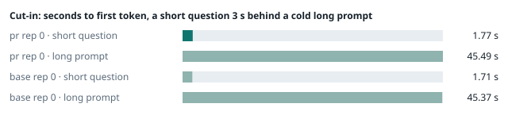
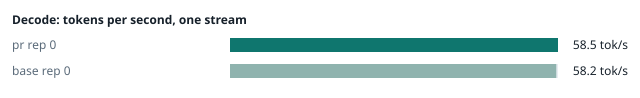
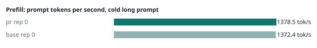
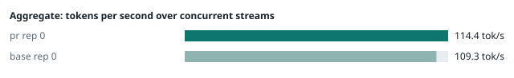
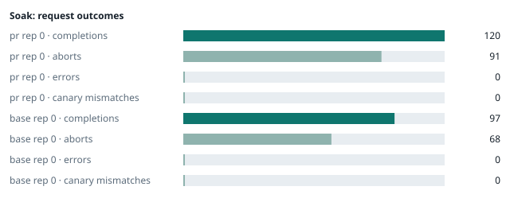

### Evidence: pr vs base

| target | role | image / artifact | model | settings that differ from the control |
|---|---|---|---|---|
| `pr` | candidate | `tensorfold-dsv41:pr-be29ec1b` (9edfdfdbb042) | `DeepSeek-V4.1-Flash-1017` | - |
| `base` | control | `tensorfold-dsv41:base-8ffa67d5` (b3ebb6f612e4) | `DeepSeek-V4.1-Flash-1017` | baseline |

Conditions: fabric ring; order: A then B, one repetition (no reverse order: pass --opt reps=2 for a counterbalanced run); repetitions: 1; kit 2825d9f.
Restore: live restored (verified: API answers, running artifact is live's).

#### smoke

| target | rep | arithmetic | greedy repeat equal | stream matches | JSON mode | first token (stream) | errors |
|---|---|---|---|---|---|---|---|
| `pr` | 0 | ✓ | ✓ | ✓ | ✓ | 0.105 s | - |
| `base` | 0 | ✓ | ✓ | ✓ | ✓ | 0.1 s | - |

machine state after the suite

- `pr` rep 0: `{"head": {"gpus": ["0, NVIDIA GB10, 2437 MHz, 53, [N/A], [N/A], 9 %"], "load": "load average: 6.49, 2.83, 2.51", "container": "90 pids 3.032GiB / 121.7GiB", "mem_available_mb": "28712"}}`
- `base` rep 0: `{"head": {"gpus": ["0, NVIDIA GB10, 2398 MHz, 63, [N/A], [N/A], 0 %"], "load": "load average: 7.55, 5.56, 4.87", "container": "90 pids 3.042GiB / 121.7GiB", "mem_available_mb": "29440"}}`

#### boundary

**19 of 19** greedy reply hashes identical, `pr` against `base`, over 1 repetition(s).

| rep | prompt | tokens (pr / base) | `pr` | `base` | same |
|---|---|---|---|---|---|
| 0 | len5 | 5 / 5 | `38127fef0fbb` | `38127fef0fbb` | ✓ |
| 0 | len2047 | 2047 / 2047 | `8488ccfbcf35` | `8488ccfbcf35` | ✓ |
| 0 | len2048 | 2048 / 2048 | `c5ac2fb76516` | `c5ac2fb76516` | ✓ |
| 0 | len2049 | 2049 / 2049 | `6766401c9caa` | `6766401c9caa` | ✓ |
| 0 | len4095 | 4095 / 4095 | `ed9e5086f520` | `ed9e5086f520` | ✓ |
| 0 | len4096 | 4096 / 4096 | `52584e31f990` | `52584e31f990` | ✓ |
| 0 | len4097 | 4097 / 4097 | `1a71db317ee7` | `1a71db317ee7` | ✓ |
| 0 | len6143 | 6143 / 6143 | `2f9626e9baf5` | `2f9626e9baf5` | ✓ |
| 0 | len6144 | 6144 / 6144 | `11933f2d4bd7` | `11933f2d4bd7` | ✓ |
| 0 | len6145 | 6145 / 6145 | `7aa2f63b2547` | `7aa2f63b2547` | ✓ |
| 0 | len8193 | 8193 / 8193 | `2ef3dc011922` | `2ef3dc011922` | ✓ |
| 0 | len12289 | 12289 / 12289 | `4fcfbd64881f` | `4fcfbd64881f` | ✓ |
| 0 | pfx_base | 5124 / 5124 | `52afe4842e5d` | `52afe4842e5d` | ✓ |
| 0 | pfx_div3072 | 3376 / 3376 | `64d23fe171dc` | `64d23fe171dc` | ✓ |
| 0 | pfx_div2044 | 2348 / 2348 | `16db99ba02f2` | `16db99ba02f2` | ✓ |
| 0 | pfx_div4092 | 4396 / 4396 | `63798c5ba36c` | `63798c5ba36c` | ✓ |
| 0 | pfx_div4093 | 4397 / 4397 | `6b1cfc31884d` | `6b1cfc31884d` | ✓ |
| 0 | pfx_base_again | 5124 / 5124 | `52afe4842e5d` | `52afe4842e5d` | ✓ |
| 0 | pfx_extend | 6660 / 6660 | `357a869fef18` | `357a869fef18` | ✓ |

machine state after the suite

- `pr` rep 0: `{"head": {"gpus": ["0, NVIDIA GB10, 2392 MHz, 63, [N/A], [N/A], 0 %"], "load": "load average: 6.29, 3.58, 2.80", "container": "90 pids 3.188GiB / 121.7GiB", "mem_available_mb": "28426"}}`
- `base` rep 0: `{"head": {"gpus": ["0, NVIDIA GB10, 2437 MHz, 68, [N/A], [N/A], 0 %"], "load": "load average: 7.59, 5.95, 5.05", "container": "90 pids 3.199GiB / 121.7GiB", "mem_available_mb": "29102"}}`

#### cutin

`pr` rep 0: short question first token **1.77 s** (rounds 0.865–1.886), long prompt first token 45.49 s (rounds 45.332–45.934); 3 rounds; admitted during the long prefill in 3 of 3 rounds
`base` rep 0: short question first token **1.71 s** (rounds 1.688–1.788), long prompt first token 45.37 s (rounds 45.364–45.415); 3 rounds; admitted during the long prefill in 3 of 3 rounds

machine state after the suite

- `pr` rep 0: `{"head": {"gpus": ["0, NVIDIA GB10, 2424 MHz, 67, [N/A], [N/A], 0 %"], "load": "load average: 6.90, 4.85, 3.39", "container": "90 pids 3.228GiB / 121.7GiB", "mem_available_mb": "28291"}}`
- `base` rep 0: `{"head": {"gpus": ["0, NVIDIA GB10, 2431 MHz, 70, [N/A], [N/A], 5 %"], "load": "load average: 6.99, 6.43, 5.37", "container": "90 pids 3.239GiB / 121.7GiB", "mem_available_mb": "29081"}}`

#### perf

| target | rep | decode tok/s, one stream | prefill tok/s, cold long prompt | aggregate tok/s, concurrent streams | errors |
|---|---|---|---|---|---|
| `pr` | 0 | **58.5** (55.5–59.0) | **1378.5** (1375.0–1384.4; 12004 tokens) | **114.4** (106.6–114.9; 4 streams) | - |
| `base` | 0 | **58.2** (55.3–58.9) | **1372.4** (1371.6–1373.3; 12004 tokens) | **109.3** (108.0–112.3; 4 streams) | - |

`pr` against `base`: decode +0.5%, prefill +0.4%, aggregate +4.7% (medians over repetitions; the verdict counts a difference only beyond the rounds' spread, at least ±3 %).

machine state after the suite

- `pr` rep 0: `{"head": {"gpus": ["0, NVIDIA GB10, 2398 MHz, 67, [N/A], [N/A], 0 %"], "load": "load average: 6.00, 4.94, 3.51", "container": "90 pids 3.424GiB / 121.7GiB", "mem_available_mb": "28255"}}`
- `base` rep 0: `{"head": {"gpus": ["0, NVIDIA GB10, 2392 MHz, 68, [N/A], [N/A], 0 %"], "load": "load average: 5.98, 6.24, 5.36", "container": "90 pids 3.421GiB / 121.7GiB", "mem_available_mb": "28777"}}`

#### startup

`pr`: 98.5 s from the switch to the API answering (1 start(s))
`base`: 98.5 s from the switch to the API answering (1 start(s))

#### soak

`pr` rep 0: 120 completions, 91 client aborts, **0 errors**, 40 canary checks with **0 mismatches**
  machine samples, first and last: `{"head": {"gpus": ["0, NVIDIA GB10, 2470 MHz, 66, [N/A], [N/A], 96 %"], "load": "load average: 6.00, 4.94, 3.51", "container": "94 pids 3.454GiB / 121.7GiB", "m` → `{"head": {"gpus": ["0, NVIDIA GB10, 2470 MHz, 74, [N/A], [N/A], 96 %"], "load": "load average: 6.27, 6.10, 4.78", "container": "94 pids 3.815GiB / 121.7GiB", "m`
`base` rep 0: 97 completions, 68 client aborts, **0 errors**, 30 canary checks with **0 mismatches**
  machine samples, first and last: `{"head": {"gpus": ["0, NVIDIA GB10, 2457 MHz, 68, [N/A], [N/A], 79 %"], "load": "load average: 6.06, 6.25, 5.37", "container": "94 pids 3.452GiB / 121.7GiB", "m` → `{"head": {"gpus": ["0, NVIDIA GB10, 2476 MHz, 71, [N/A], [N/A], 96 %"], "load": "load average: 6.28, 6.31, 5.80", "container": "94 pids 4.192GiB / 121.7GiB", "m`

machine state after the suite

- `pr` rep 0: `{"head": {"gpus": ["0, NVIDIA GB10, 2411 MHz, 59, [N/A], [N/A], 0 %"], "load": "load average: 4.18, 5.63, 4.71", "container": "90 pids 3.786GiB / 121.7GiB", "mem_available_mb": "27092"}}`
- `base` rep 0: `{"head": {"gpus": ["0, NVIDIA GB10, 2411 MHz, 62, [N/A], [N/A], 0 %"], "load": "load average: 4.58, 5.91, 5.70", "container": "90 pids 4.141GiB / 121.7GiB", "mem_available_mb": "26575"}}`

#### concurrency

| target | rep | streams | aggregate tok/s | first token p50 / p95 | batched replies ≠ serial | errors |
|---|---|---|---|---|---|---|
| `pr` | 0 | 1 (round 0) | **52.5** | 0.388 / 0.417 s | — |  |
| `pr` | 0 | 4 (round 0) | **81.2** | 1.222 / 1.741 s | 0 of 16 |  |
| `pr` | 0 | 8 (round 0) | **88.6** | 2.149 / 3.607 s | 0 of 16 |  |
| `pr` | 0 | 16 (round 0) | **91.2** | 4.087 / 8.043 s | 0 of 16 | 0 |
| `pr` | 0 | 1 (round 1) | **52.5** | 0.386 / 0.408 s | — |  |
| `pr` | 0 | 4 (round 1) | **80.5** | 1.232 / 1.777 s | 0 of 16 |  |
| `pr` | 0 | 8 (round 1) | **87.6** | 2.169 / 3.711 s | 0 of 16 |  |
| `pr` | 0 | 16 (round 1) | **90.7** | 4.173 / 8.108 s | 0 of 16 | 0 |
| `base` | 0 | 1 (round 0) | **52.6** | 0.383 / 0.411 s | — |  |
| `base` | 0 | 4 (round 0) | **81.0** | 1.231 / 1.732 s | 0 of 16 |  |
| `base` | 0 | 8 (round 0) | **88.6** | 2.159 / 3.647 s | 0 of 16 |  |
| `base` | 0 | 16 (round 0) | **91.1** | 4.155 / 8.105 s | 0 of 16 | 0 |
| `base` | 0 | 1 (round 1) | **51.9** | 0.398 / 0.422 s | — |  |
| `base` | 0 | 4 (round 1) | **79.7** | 1.29 / 1.772 s | 0 of 16 |  |
| `base` | 0 | 8 (round 1) | **87.1** | 2.232 / 3.796 s | 0 of 16 |  |
| `base` | 0 | 16 (round 1) | **89.8** | 4.273 / 8.273 s | 0 of 16 | 0 |

`pr` rep 0: 128 requests; batched replies identical to serial in 96 of 96 comparisons
- host `spark-161`: container memory 2879.5 → 2948.1 MB after the drain (**+68.6 MB**, +535.9 MB per 1000 requests); descriptors 150 → 150
- host `spark-197`: container memory 4171.8 → 4238.3 MB after the drain (**+66.5 MB**, +519.5 MB per 1000 requests); descriptors 221 → 221
- host `gx10-126`: container memory 2997.2 → 3065.9 MB after the drain (**+68.7 MB**, +536.7 MB per 1000 requests); descriptors 150 → 150
- host `dell-113`: container memory 2930.7 → 3000.3 MB after the drain (**+69.6 MB**, +543.8 MB per 1000 requests); descriptors 150 → 150

`base` rep 0: 128 requests; batched replies identical to serial in 96 of 96 comparisons
- host `spark-161`: container memory 3237.9 → 3307.5 MB after the drain (**+69.6 MB**, +543.7 MB per 1000 requests); descriptors 150 → 150
- host `spark-197`: container memory 4543.5 → 4613.1 MB after the drain (**+69.6 MB**, +543.8 MB per 1000 requests); descriptors 221 → 218
- host `gx10-126`: container memory 3366.9 → 3437.6 MB after the drain (**+70.7 MB**, +552.3 MB per 1000 requests); descriptors 150 → 150
- host `dell-113`: container memory 3266.6 → 3337.2 MB after the drain (**+70.6 MB**, +551.6 MB per 1000 requests); descriptors 150 → 150

machine state after the suite

- `pr` rep 0: `{"head": {"gpus": ["0, NVIDIA GB10, 2411 MHz, 59, [N/A], [N/A], 0 %"], "load": "load average: 2.37, 4.28, 4.43", "container": "90 pids 4.139GiB / 121.7GiB", "mem_available_mb": "26417"}}`
- `base` rep 0: `{"head": {"gpus": ["0, NVIDIA GB10, 2411 MHz, 57, [N/A], [N/A], 0 %"], "load": "load average: 2.32, 4.33, 5.12", "container": "90 pids 4.505GiB / 121.7GiB", "mem_available_mb": "25964"}}`

#### the pull request's own tests

The pull request adds or changes no test file under `tests/`.

#### What this run does not show

- one process under mixed load for hours: throughput probes every few minutes, a canary reply, host memory and descriptors over the run (`endurance` did not run)
- a clean pair exit and recovery after an injected read fault (`fault` did not run)
- an external benchmark against a control (The Grill or similar) (`bench` did not run)
- <!-- add: paths only checked by reading, faults not injected, configurations not run -->

_Generated by inference-agent-kit `report.py` from `20261118T133017/results.json`._
