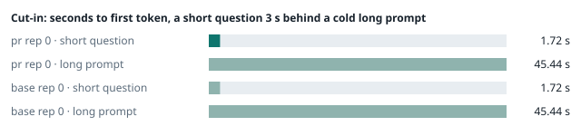
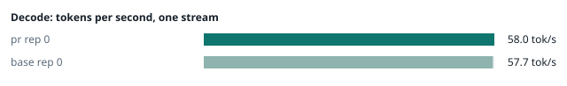
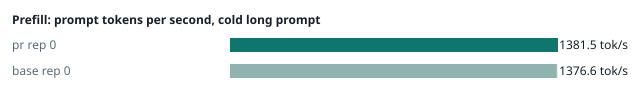
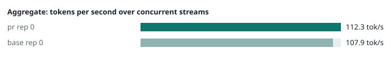
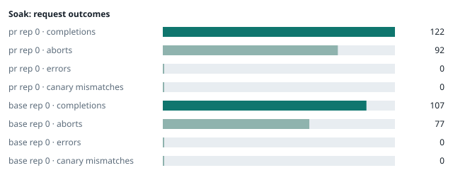

### Evidence: pr vs base

| target | role | image / artifact | model | settings that differ from the control |
|---|---|---|---|---|
| `pr` | candidate | `tensorfold-dsv41:pr-1cac39ce` (3e654261c36c) | `DeepSeek-V4.1-Flash-1017` | - |
| `base` | control | `tensorfold-dsv41:base-8ffa67d5` (b3ebb6f612e4) | `DeepSeek-V4.1-Flash-1017` | baseline |

Conditions: fabric ring; order: A then B, one repetition (no reverse order: pass --opt reps=2 for a counterbalanced run); repetitions: 1; kit 2825d9f.
Restore: live restored (verified: API answers, running artifact is live's).

#### smoke

| target | rep | arithmetic | greedy repeat equal | stream matches | JSON mode | first token (stream) | errors |
|---|---|---|---|---|---|---|---|
| `pr` | 0 | ✓ | ✓ | ✓ | ✓ | 0.1 s | - |
| `base` | 0 | ✓ | ✓ | ✓ | ✓ | 0.1 s | - |

machine state after the suite

- `pr` rep 0: `{"head": {"gpus": ["0, NVIDIA GB10, 2411 MHz, 59, [N/A], [N/A], 0 %"], "load": "load average: 6.30, 2.72, 2.46", "container": "90 pids 3.04GiB / 121.7GiB", "mem_available_mb": "28763"}}`
- `base` rep 0: `{"head": {"gpus": ["0, NVIDIA GB10, 2398 MHz, 62, [N/A], [N/A], 0 %"], "load": "load average: 7.41, 5.76, 4.96", "container": "90 pids 3.009GiB / 121.7GiB", "mem_available_mb": "28759"}}`

#### boundary

**19 of 19** greedy reply hashes identical, `pr` against `base`, over 1 repetition(s).

| rep | prompt | tokens (pr / base) | `pr` | `base` | same |
|---|---|---|---|---|---|
| 0 | len5 | 5 / 5 | `38127fef0fbb` | `38127fef0fbb` | ✓ |
| 0 | len2047 | 2047 / 2047 | `8488ccfbcf35` | `8488ccfbcf35` | ✓ |
| 0 | len2048 | 2048 / 2048 | `c5ac2fb76516` | `c5ac2fb76516` | ✓ |
| 0 | len2049 | 2049 / 2049 | `6766401c9caa` | `6766401c9caa` | ✓ |
| 0 | len4095 | 4095 / 4095 | `ed9e5086f520` | `ed9e5086f520` | ✓ |
| 0 | len4096 | 4096 / 4096 | `52584e31f990` | `52584e31f990` | ✓ |
| 0 | len4097 | 4097 / 4097 | `1a71db317ee7` | `1a71db317ee7` | ✓ |
| 0 | len6143 | 6143 / 6143 | `2f9626e9baf5` | `2f9626e9baf5` | ✓ |
| 0 | len6144 | 6144 / 6144 | `11933f2d4bd7` | `11933f2d4bd7` | ✓ |
| 0 | len6145 | 6145 / 6145 | `7aa2f63b2547` | `7aa2f63b2547` | ✓ |
| 0 | len8193 | 8193 / 8193 | `2ef3dc011922` | `2ef3dc011922` | ✓ |
| 0 | len12289 | 12289 / 12289 | `4fcfbd64881f` | `4fcfbd64881f` | ✓ |
| 0 | pfx_base | 5124 / 5124 | `52afe4842e5d` | `52afe4842e5d` | ✓ |
| 0 | pfx_div3072 | 3376 / 3376 | `64d23fe171dc` | `64d23fe171dc` | ✓ |
| 0 | pfx_div2044 | 2348 / 2348 | `16db99ba02f2` | `16db99ba02f2` | ✓ |
| 0 | pfx_div4092 | 4396 / 4396 | `63798c5ba36c` | `63798c5ba36c` | ✓ |
| 0 | pfx_div4093 | 4397 / 4397 | `6b1cfc31884d` | `6b1cfc31884d` | ✓ |
| 0 | pfx_base_again | 5124 / 5124 | `52afe4842e5d` | `52afe4842e5d` | ✓ |
| 0 | pfx_extend | 6660 / 6660 | `357a869fef18` | `357a869fef18` | ✓ |

machine state after the suite

- `pr` rep 0: `{"head": {"gpus": ["0, NVIDIA GB10, 2457 MHz, 65, [N/A], [N/A], 7 %"], "load": "load average: 5.72, 3.34, 2.71", "container": "90 pids 3.196GiB / 121.7GiB", "mem_available_mb": "28415"}}`
- `base` rep 0: `{"head": {"gpus": ["0, NVIDIA GB10, 2444 MHz, 70, [N/A], [N/A], 0 %"], "load": "load average: 6.61, 5.88, 5.06", "container": "90 pids 3.166GiB / 121.7GiB", "mem_available_mb": "28407"}}`

#### cutin

`pr` rep 0: short question first token **1.72 s** (rounds 0.779–1.848), long prompt first token 45.44 s (rounds 45.265–45.815); 3 rounds; admitted during the long prefill in 3 of 3 rounds
`base` rep 0: short question first token **1.72 s** (rounds 1.719–1.845), long prompt first token 45.44 s (rounds 45.351–45.48); 3 rounds; admitted during the long prefill in 3 of 3 rounds

machine state after the suite

- `pr` rep 0: `{"head": {"gpus": ["0, NVIDIA GB10, 2405 MHz, 69, [N/A], [N/A], 0 %"], "load": "load average: 6.84, 4.68, 3.30", "container": "90 pids 3.249GiB / 121.7GiB", "mem_available_mb": "28325"}}`
- `base` rep 0: `{"head": {"gpus": ["0, NVIDIA GB10, 2450 MHz, 71, [N/A], [N/A], 52 %"], "load": "load average: 6.81, 6.23, 5.31", "container": "90 pids 3.205GiB / 121.7GiB", "mem_available_mb": "28331"}}`

#### perf

| target | rep | decode tok/s, one stream | prefill tok/s, cold long prompt | aggregate tok/s, concurrent streams | errors |
|---|---|---|---|---|---|
| `pr` | 0 | **58.0** (55.3–58.9) | **1381.5** (1376.8–1383.4; 12004 tokens) | **112.3** (106.7–113.7; 4 streams) | - |
| `base` | 0 | **57.7** (55.2–58.2) | **1376.6** (1373.1–1383.6; 12004 tokens) | **107.9** (106.9–115.5; 4 streams) | - |

`pr` against `base`: decode +0.5%, prefill +0.4%, aggregate +4.1% (medians over repetitions; the verdict counts a difference only beyond the rounds' spread, at least ±3 %).

machine state after the suite

- `pr` rep 0: `{"head": {"gpus": ["0, NVIDIA GB10, 2424 MHz, 69, [N/A], [N/A], 27 %"], "load": "load average: 6.42, 4.91, 3.45", "container": "90 pids 3.431GiB / 121.7GiB", "mem_available_mb": "28028"}}`
- `base` rep 0: `{"head": {"gpus": ["0, NVIDIA GB10, 2398 MHz, 68, [N/A], [N/A], 0 %"], "load": "load average: 6.21, 6.16, 5.34", "container": "90 pids 3.39GiB / 121.7GiB", "mem_available_mb": "28006"}}`

#### startup

`pr`: 97.2 s from the switch to the API answering (1 start(s))
`base`: 98.8 s from the switch to the API answering (1 start(s))

#### soak

`pr` rep 0: 122 completions, 92 client aborts, **0 errors**, 41 canary checks with **0 mismatches**
  machine samples, first and last: `{"head": {"gpus": ["0, NVIDIA GB10, 2470 MHz, 68, [N/A], [N/A], 96 %"], "load": "load average: 5.90, 4.82, 3.44", "container": "94 pids 3.458GiB / 121.7GiB", "m` → `{"head": {"gpus": ["0, NVIDIA GB10, 2470 MHz, 71, [N/A], [N/A], 96 %"], "load": "load average: 5.83, 5.92, 4.69", "container": "95 pids 3.812GiB / 121.7GiB", "m`
`base` rep 0: 107 completions, 77 client aborts, **0 errors**, 33 canary checks with **0 mismatches**
  machine samples, first and last: `{"head": {"gpus": ["0, NVIDIA GB10, 2463 MHz, 68, [N/A], [N/A], 75 %"], "load": "load average: 5.71, 6.06, 5.31", "container": "94 pids 3.419GiB / 121.7GiB", "m` → `{"head": {"gpus": ["0, NVIDIA GB10, 2489 MHz, 68, [N/A], [N/A], 96 %"], "load": "load average: 6.34, 6.31, 5.81", "container": "94 pids 3.955GiB / 121.7GiB", "m`

machine state after the suite

- `pr` rep 0: `{"head": {"gpus": ["0, NVIDIA GB10, 2411 MHz, 61, [N/A], [N/A], 0 %"], "load": "load average: 3.89, 5.47, 4.62", "container": "90 pids 3.754GiB / 121.7GiB", "mem_available_mb": "27865"}}`
- `base` rep 0: `{"head": {"gpus": ["0, NVIDIA GB10, 2411 MHz, 58, [N/A], [N/A], 0 %"], "load": "load average: 4.30, 5.83, 5.68", "container": "90 pids 3.917GiB / 121.7GiB", "mem_available_mb": "27601"}}`

#### concurrency

| target | rep | streams | aggregate tok/s | first token p50 / p95 | batched replies ≠ serial | errors |
|---|---|---|---|---|---|---|
| `pr` | 0 | 1 (round 0) | **52.5** | 0.388 / 0.409 s | — |  |
| `pr` | 0 | 4 (round 0) | **81.4** | 1.22 / 1.704 s | 0 of 16 |  |
| `pr` | 0 | 8 (round 0) | **88.4** | 2.158 / 3.6 s | 0 of 16 |  |
| `pr` | 0 | 16 (round 0) | **92.0** | 4.064 / 7.974 s | 0 of 16 | 0 |
| `pr` | 0 | 1 (round 1) | **51.9** | 0.385 / 0.414 s | — |  |
| `pr` | 0 | 4 (round 1) | **80.5** | 1.245 / 1.714 s | 0 of 16 |  |
| `pr` | 0 | 8 (round 1) | **40.7** | 2.15 / 3.602 s | 0 of 16 |  |
| `pr` | 0 | 16 (round 1) | **90.1** | 4.345 / 8.288 s | 0 of 16 | 0 |
| `base` | 0 | 1 (round 0) | **52.1** | 0.388 / 0.415 s | — |  |
| `base` | 0 | 4 (round 0) | **80.3** | 1.255 / 1.751 s | 0 of 16 |  |
| `base` | 0 | 8 (round 0) | **88.6** | 2.183 / 3.639 s | 0 of 16 |  |
| `base` | 0 | 16 (round 0) | **91.6** | 4.126 / 8.095 s | 0 of 16 | 0 |
| `base` | 0 | 1 (round 1) | **52.0** | 0.391 / 0.43 s | — |  |
| `base` | 0 | 4 (round 1) | **80.9** | 1.231 / 1.729 s | 0 of 16 |  |
| `base` | 0 | 8 (round 1) | **89.4** | 2.1 / 3.591 s | 0 of 16 |  |
| `base` | 0 | 16 (round 1) | **92.2** | 4.05 / 7.987 s | 0 of 16 | 0 |

`pr` rep 0: 128 requests; batched replies identical to serial in 96 of 96 comparisons
- host `spark-161`: container memory 2853.9 → 3025.9 MB after the drain (**+172.0 MB**, +1343.8 MB per 1000 requests); descriptors 150 → 150
- host `spark-197`: container memory 4150.3 → 4323.3 MB after the drain (**+173.0 MB**, +1351.6 MB per 1000 requests); descriptors 221 → 221
- host `gx10-126`: container memory 2981.9 → 3153.9 MB after the drain (**+172.0 MB**, +1343.8 MB per 1000 requests); descriptors 150 → 150
- host `dell-113`: container memory 2898.9 → 3072.0 MB after the drain (**+173.1 MB**, +1352.3 MB per 1000 requests); descriptors 150 → 150

`base` rep 0: 128 requests; batched replies identical to serial in 96 of 96 comparisons
- host `spark-161`: container memory 3043.3 → 3114.0 MB after the drain (**+70.7 MB**, +552.3 MB per 1000 requests); descriptors 150 → 147
- host `spark-197`: container memory 4319.2 → 4387.8 MB after the drain (**+68.6 MB**, +535.9 MB per 1000 requests); descriptors 221 → 221
- host `gx10-126`: container memory 3157.0 → 3227.6 MB after the drain (**+70.6 MB**, +551.6 MB per 1000 requests); descriptors 150 → 150
- host `dell-113`: container memory 3076.1 → 3146.8 MB after the drain (**+70.7 MB**, +552.3 MB per 1000 requests); descriptors 150 → 150

machine state after the suite

- `pr` rep 0: `{"head": {"gpus": ["0, NVIDIA GB10, 2411 MHz, 57, [N/A], [N/A], 0 %"], "load": "load average: 2.75, 4.58, 4.53", "container": "90 pids 4.222GiB / 121.7GiB", "mem_available_mb": "27136"}}`
- `base` rep 0: `{"head": {"gpus": ["0, NVIDIA GB10, 2411 MHz, 59, [N/A], [N/A], 0 %"], "load": "load average: 2.41, 4.33, 5.11", "container": "90 pids 4.285GiB / 121.7GiB", "mem_available_mb": "26113"}}`

#### the pull request's own tests

The pull request adds or changes no test file under `tests/`.

#### What this run does not show

- one process under mixed load for hours: throughput probes every few minutes, a canary reply, host memory and descriptors over the run (`endurance` did not run)
- a clean pair exit and recovery after an injected read fault (`fault` did not run)
- an external benchmark against a control (The Grill or similar) (`bench` did not run)
- <!-- add: paths only checked by reading, faults not injected, configurations not run -->

_Generated by inference-agent-kit `report.py` from `20261118T143434/results.json`._
