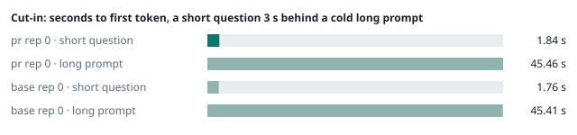
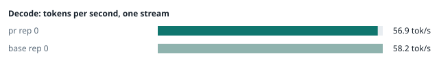
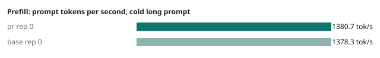
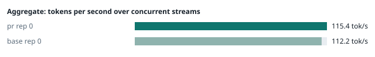
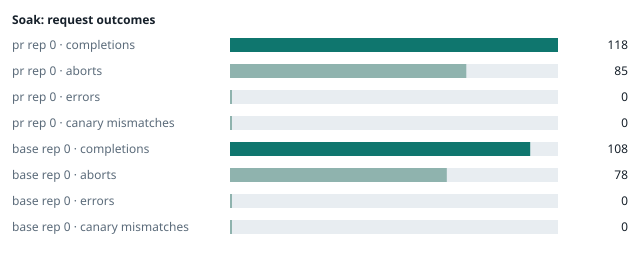

### Evidence: pr vs base

| target | role | image / artifact | model | settings that differ from the control |
|---|---|---|---|---|
| `pr` | candidate | `tensorfold-dsv41:pr-7360618c` (a05e115cd668) | `DeepSeek-V4.1-Flash-1017` | - |
| `base` | control | `tensorfold-dsv41:base-8ffa67d5` (b3ebb6f612e4) | `DeepSeek-V4.1-Flash-1017` | baseline |

Conditions: fabric ring; order: A then B, one repetition (no reverse order: pass --opt reps=2 for a counterbalanced run); repetitions: 1; kit 2825d9f.
Restore: live restored (verified: API answers, running artifact is live's).

#### smoke

| target | rep | arithmetic | greedy repeat equal | stream matches | JSON mode | first token (stream) | errors |
|---|---|---|---|---|---|---|---|
| `pr` | 0 | ✓ | ✓ | ✓ | ✓ | 0.101 s | - |
| `base` | 0 | ✓ | ✓ | ✓ | ✓ | 0.1 s | - |

machine state after the suite

- `pr` rep 0: `{"head": {"gpus": ["0, NVIDIA GB10, 2411 MHz, 61, [N/A], [N/A], 0 %"], "load": "load average: 6.91, 5.14, 5.20", "container": "90 pids 3.013GiB / 121.7GiB", "mem_available_mb": "28713"}}`
- `base` rep 0: `{"head": {"gpus": ["0, NVIDIA GB10, 2392 MHz, 63, [N/A], [N/A], 0 %"], "load": "load average: 8.05, 5.74, 5.53", "container": "90 pids 3.037GiB / 121.7GiB", "mem_available_mb": "28721"}}`

#### boundary

**19 of 19** greedy reply hashes identical, `pr` against `base`, over 1 repetition(s).

| rep | prompt | tokens (pr / base) | `pr` | `base` | same |
|---|---|---|---|---|---|
| 0 | len5 | 5 / 5 | `38127fef0fbb` | `38127fef0fbb` | ✓ |
| 0 | len2047 | 2047 / 2047 | `8488ccfbcf35` | `8488ccfbcf35` | ✓ |
| 0 | len2048 | 2048 / 2048 | `c5ac2fb76516` | `c5ac2fb76516` | ✓ |
| 0 | len2049 | 2049 / 2049 | `6766401c9caa` | `6766401c9caa` | ✓ |
| 0 | len4095 | 4095 / 4095 | `ed9e5086f520` | `ed9e5086f520` | ✓ |
| 0 | len4096 | 4096 / 4096 | `52584e31f990` | `52584e31f990` | ✓ |
| 0 | len4097 | 4097 / 4097 | `1a71db317ee7` | `1a71db317ee7` | ✓ |
| 0 | len6143 | 6143 / 6143 | `2f9626e9baf5` | `2f9626e9baf5` | ✓ |
| 0 | len6144 | 6144 / 6144 | `11933f2d4bd7` | `11933f2d4bd7` | ✓ |
| 0 | len6145 | 6145 / 6145 | `7aa2f63b2547` | `7aa2f63b2547` | ✓ |
| 0 | len8193 | 8193 / 8193 | `2ef3dc011922` | `2ef3dc011922` | ✓ |
| 0 | len12289 | 12289 / 12289 | `4fcfbd64881f` | `4fcfbd64881f` | ✓ |
| 0 | pfx_base | 5124 / 5124 | `52afe4842e5d` | `52afe4842e5d` | ✓ |
| 0 | pfx_div3072 | 3376 / 3376 | `64d23fe171dc` | `64d23fe171dc` | ✓ |
| 0 | pfx_div2044 | 2348 / 2348 | `16db99ba02f2` | `16db99ba02f2` | ✓ |
| 0 | pfx_div4092 | 4396 / 4396 | `63798c5ba36c` | `63798c5ba36c` | ✓ |
| 0 | pfx_div4093 | 4397 / 4397 | `6b1cfc31884d` | `6b1cfc31884d` | ✓ |
| 0 | pfx_base_again | 5124 / 5124 | `52afe4842e5d` | `52afe4842e5d` | ✓ |
| 0 | pfx_extend | 6660 / 6660 | `357a869fef18` | `357a869fef18` | ✓ |

machine state after the suite

- `pr` rep 0: `{"head": {"gpus": ["0, NVIDIA GB10, 2392 MHz, 67, [N/A], [N/A], 0 %"], "load": "load average: 6.23, 5.32, 5.26", "container": "90 pids 3.17GiB / 121.7GiB", "mem_available_mb": "28370"}}`
- `base` rep 0: `{"head": {"gpus": ["0, NVIDIA GB10, 2418 MHz, 70, [N/A], [N/A], 0 %"], "load": "load average: 6.51, 5.76, 5.55", "container": "90 pids 3.194GiB / 121.7GiB", "mem_available_mb": "28393"}}`

#### cutin

`pr` rep 0: short question first token **1.84 s** (rounds 1.707–2.235), long prompt first token 45.46 s (rounds 45.279–46.236); 3 rounds; admitted during the long prefill in 3 of 3 rounds
`base` rep 0: short question first token **1.76 s** (rounds 1.749–1.786), long prompt first token 45.41 s (rounds 45.4–45.454); 3 rounds; admitted during the long prefill in 3 of 3 rounds

machine state after the suite

- `pr` rep 0: `{"head": {"gpus": ["0, NVIDIA GB10, 2405 MHz, 69, [N/A], [N/A], 0 %"], "load": "load average: 6.76, 5.90, 5.49", "container": "90 pids 3.209GiB / 121.7GiB", "mem_available_mb": "28306"}}`
- `base` rep 0: `{"head": {"gpus": ["0, NVIDIA GB10, 2450 MHz, 69, [N/A], [N/A], 0 %"], "load": "load average: 6.67, 6.11, 5.72", "container": "90 pids 3.233GiB / 121.7GiB", "mem_available_mb": "28300"}}`

#### perf

| target | rep | decode tok/s, one stream | prefill tok/s, cold long prompt | aggregate tok/s, concurrent streams | errors |
|---|---|---|---|---|---|
| `pr` | 0 | **56.9** (55.3–58.8) | **1380.7** (1379.8–1383.7; 12004 tokens) | **115.4** (106.9–115.8; 4 streams) | - |
| `base` | 0 | **58.2** (55.3–58.9) | **1378.3** (1376.4–1381.8; 12004 tokens) | **112.2** (107.8–112.9; 4 streams) | - |

`pr` against `base`: decode -2.2%, prefill +0.2%, aggregate +2.9% (medians over repetitions; the verdict counts a difference only beyond the rounds' spread, at least ±3 %).

machine state after the suite

- `pr` rep 0: `{"head": {"gpus": ["0, NVIDIA GB10, 2398 MHz, 69, [N/A], [N/A], 0 %"], "load": "load average: 6.19, 5.87, 5.50", "container": "90 pids 3.395GiB / 121.7GiB", "mem_available_mb": "27999"}}`
- `base` rep 0: `{"head": {"gpus": ["0, NVIDIA GB10, 2392 MHz, 69, [N/A], [N/A], 0 %"], "load": "load average: 5.77, 5.95, 5.69", "container": "90 pids 3.417GiB / 121.7GiB", "mem_available_mb": "27981"}}`

#### startup

`pr`: 97.9 s from the switch to the API answering (1 start(s))
`base`: 97.5 s from the switch to the API answering (1 start(s))

#### soak

`pr` rep 0: 118 completions, 85 client aborts, **0 errors**, 37 canary checks with **0 mismatches**
  machine samples, first and last: `{"head": {"gpus": ["0, NVIDIA GB10, 2470 MHz, 68, [N/A], [N/A], 96 %"], "load": "load average: 6.09, 5.86, 5.50", "container": "94 pids 3.423GiB / 121.7GiB", "m` → `{"head": {"gpus": ["0, NVIDIA GB10, 2470 MHz, 73, [N/A], [N/A], 96 %"], "load": "load average: 6.17, 6.07, 5.77", "container": "93 pids 3.759GiB / 121.7GiB", "m`
`base` rep 0: 108 completions, 78 client aborts, **0 errors**, 34 canary checks with **0 mismatches**
  machine samples, first and last: `{"head": {"gpus": ["0, NVIDIA GB10, 2470 MHz, 68, [N/A], [N/A], 96 %"], "load": "load average: 5.95, 5.99, 5.70", "container": "94 pids 3.445GiB / 121.7GiB", "m` → `{"head": {"gpus": ["0, NVIDIA GB10, 2476 MHz, 71, [N/A], [N/A], 96 %"], "load": "load average: 6.50, 6.33, 6.00", "container": "93 pids 3.945GiB / 121.7GiB", "m`

machine state after the suite

- `pr` rep 0: `{"head": {"gpus": ["0, NVIDIA GB10, 2411 MHz, 61, [N/A], [N/A], 0 %"], "load": "load average: 4.46, 5.70, 5.67", "container": "90 pids 3.754GiB / 121.7GiB", "mem_available_mb": "27038"}}`
- `base` rep 0: `{"head": {"gpus": ["0, NVIDIA GB10, 2489 MHz, 71, [N/A], [N/A], 95 %"], "load": "load average: 6.45, 6.31, 6.02", "container": "92 pids 4.04GiB / 121.7GiB", "mem_available_mb": "27455"}}`

#### concurrency

| target | rep | streams | aggregate tok/s | first token p50 / p95 | batched replies ≠ serial | errors |
|---|---|---|---|---|---|---|
| `pr` | 0 | 1 (round 0) | **52.0** | 0.394 / 0.422 s | — |  |
| `pr` | 0 | 4 (round 0) | **80.9** | 1.232 / 1.737 s | 0 of 16 |  |
| `pr` | 0 | 8 (round 0) | **89.0** | 2.118 / 3.579 s | 0 of 16 |  |
| `pr` | 0 | 16 (round 0) | **92.1** | 4.063 / 7.95 s | 0 of 16 | 0 |
| `pr` | 0 | 1 (round 1) | **52.3** | 0.384 / 0.406 s | — |  |
| `pr` | 0 | 4 (round 1) | **80.5** | 1.221 / 1.734 s | 0 of 16 |  |
| `pr` | 0 | 8 (round 1) | **89.0** | 2.127 / 3.583 s | 0 of 16 |  |
| `pr` | 0 | 16 (round 1) | **91.9** | 4.117 / 7.959 s | 0 of 16 | 0 |
| `base` | 0 | 1 (round 0) | **51.9** | 0.383 / 0.411 s | — |  |
| `base` | 0 | 4 (round 0) | **80.5** | 1.216 / 1.71 s | 0 of 16 |  |
| `base` | 0 | 8 (round 0) | **89.3** | 2.148 / 3.667 s | 0 of 16 |  |
| `base` | 0 | 16 (round 0) | **92.0** | 4.036 / 7.933 s | 0 of 16 | 0 |
| `base` | 0 | 1 (round 1) | **52.3** | 0.382 / 0.404 s | — |  |
| `base` | 0 | 4 (round 1) | **81.5** | 1.224 / 1.698 s | 0 of 16 |  |
| `base` | 0 | 8 (round 1) | **89.0** | 2.145 / 3.621 s | 0 of 16 |  |
| `base` | 0 | 16 (round 1) | **91.9** | 4.041 / 7.901 s | 0 of 16 | 0 |

`pr` rep 0: 128 requests; batched replies identical to serial in 96 of 96 comparisons
- host `spark-161`: container memory 2862.1 → 2944.0 MB after the drain (**+81.9 MB**, +639.8 MB per 1000 requests); descriptors 150 → 150
- host `spark-197`: container memory 4140.0 → 4219.9 MB after the drain (**+79.9 MB**, +624.2 MB per 1000 requests); descriptors 221 → 221
- host `gx10-126`: container memory 2972.7 → 3055.6 MB after the drain (**+82.9 MB**, +647.7 MB per 1000 requests); descriptors 150 → 147
- host `dell-113`: container memory 2894.8 → 2976.8 MB after the drain (**+82.0 MB**, +640.6 MB per 1000 requests); descriptors 150 → 150

`base` rep 0: 128 requests; batched replies identical to serial in 96 of 96 comparisons
- host `spark-161`: container memory 3215.4 → 3285.0 MB after the drain (**+69.6 MB**, +543.7 MB per 1000 requests); descriptors 150 → 150
- host `spark-197`: container memory 4517.9 → 4585.5 MB after the drain (**+67.6 MB**, +528.1 MB per 1000 requests); descriptors 221 → 221
- host `gx10-126`: container memory 3342.3 → 3412.0 MB after the drain (**+69.7 MB**, +544.5 MB per 1000 requests); descriptors 150 → 150
- host `dell-113`: container memory 3246.1 → 3315.7 MB after the drain (**+69.6 MB**, +543.7 MB per 1000 requests); descriptors 150 → 150

machine state after the suite

- `pr` rep 0: `{"head": {"gpus": ["0, NVIDIA GB10, 2411 MHz, 60, [N/A], [N/A], 0 %"], "load": "load average: 2.07, 4.22, 5.08", "container": "90 pids 4.12GiB / 121.7GiB", "mem_available_mb": "26473"}}`
- `base` rep 0: `{"head": {"gpus": ["0, NVIDIA GB10, 2411 MHz, 59, [N/A], [N/A], 0 %"], "load": "load average: 2.22, 4.51, 5.37", "container": "90 pids 4.478GiB / 121.7GiB", "mem_available_mb": "26726"}}`

#### the pull request's own tests

**confirmed** — 1 test file(s) added or changed by the PR (`tests/test_scripts.py`): on the PR **passes** (exit 0), on the base with the PR's tests copied in **fails** (exit 1).

- PR: `............................................... [ 74%] ................                                                   [100%] 63 passed, 31 subtests passed in 27.01s`
- base + PR tests: `FAILED tests/test_scripts.py::PrepareWorkerCopies::test_copies_on_the_runtime_image_and_keeps_the_time - AssertionError: 1 != 0 : /usr/bin/bash: line 5: HEAD_RANK_DIR: unbound variable FAILED tests/test_scripts.py::PrepareWorkerCopies::test_rank_0s_own_copy_on_this_spark - AssertionError: 1 != 0 : /`

#### What this run does not show

- one process under mixed load for hours: throughput probes every few minutes, a canary reply, host memory and descriptors over the run (`endurance` did not run)
- a clean pair exit and recovery after an injected read fault (`fault` did not run)
- an external benchmark against a control (The Grill or similar) (`bench` did not run)
- <!-- add: paths only checked by reading, faults not injected, configurations not run -->

_Generated by inference-agent-kit `report.py` from `20261118T152209/results.json`._
