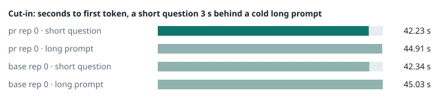
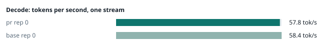
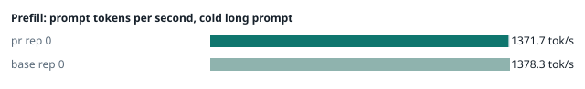
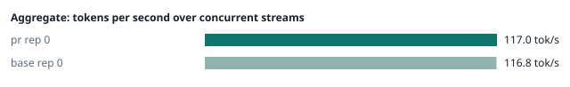
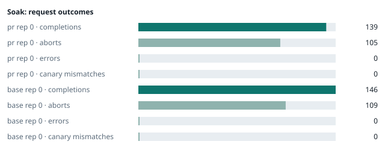

### Evidence: pr vs base

| target | role | image / artifact | model | settings that differ from the control |
|---|---|---|---|---|
| `pr` | candidate | `tensorfold-dsv41:pr-7360618c` (a05e115cd668) | `DeepSeek-V4.1-Flash-1017` | - |
| `base` | control | `tensorfold-dsv41:base-8ffa67d5` (b3ebb6f612e4) | `DeepSeek-V4.1-Flash-1017` | baseline |

Conditions: fabric ring; order: A then B, one repetition (no reverse order: pass --opt reps=2 for a counterbalanced run); repetitions: 1; kit 2825d9f; defaults.
Restore: live restored (verified: API answers, running artifact is live's).

#### smoke

| target | rep | arithmetic | greedy repeat equal | stream matches | JSON mode | first token (stream) | errors |
|---|---|---|---|---|---|---|---|
| `pr` | 0 | ✓ | ✓ | ✓ | ✓ | 0.098 s | - |
| `base` | 0 | ✓ | ✓ | ✓ | ✓ | 0.098 s | - |

machine state after the suite

- `pr` rep 0: `{"head": {"gpus": ["0, NVIDIA GB10, 2450 MHz, 59, [N/A], [N/A], 0 %"], "load": "load average: 8.33, 6.59, 6.02", "container": "90 pids 3.031GiB / 121.7GiB", "mem_available_mb": "28727"}}`
- `base` rep 0: `{"head": {"gpus": ["0, NVIDIA GB10, 2411 MHz, 61, [N/A], [N/A], 0 %"], "load": "load average: 7.40, 5.68, 5.77", "container": "90 pids 2.998GiB / 121.7GiB", "mem_available_mb": "28567"}}`

#### boundary

**19 of 19** greedy reply hashes identical, `pr` against `base`, over 1 repetition(s).

| rep | prompt | tokens (pr / base) | `pr` | `base` | same |
|---|---|---|---|---|---|
| 0 | len5 | 5 / 5 | `38127fef0fbb` | `38127fef0fbb` | ✓ |
| 0 | len2047 | 2047 / 2047 | `8488ccfbcf35` | `8488ccfbcf35` | ✓ |
| 0 | len2048 | 2048 / 2048 | `c5ac2fb76516` | `c5ac2fb76516` | ✓ |
| 0 | len2049 | 2049 / 2049 | `6766401c9caa` | `6766401c9caa` | ✓ |
| 0 | len4095 | 4095 / 4095 | `ed9e5086f520` | `ed9e5086f520` | ✓ |
| 0 | len4096 | 4096 / 4096 | `52584e31f990` | `52584e31f990` | ✓ |
| 0 | len4097 | 4097 / 4097 | `1a71db317ee7` | `1a71db317ee7` | ✓ |
| 0 | len6143 | 6143 / 6143 | `2f9626e9baf5` | `2f9626e9baf5` | ✓ |
| 0 | len6144 | 6144 / 6144 | `11933f2d4bd7` | `11933f2d4bd7` | ✓ |
| 0 | len6145 | 6145 / 6145 | `7aa2f63b2547` | `7aa2f63b2547` | ✓ |
| 0 | len8193 | 8193 / 8193 | `2ef3dc011922` | `2ef3dc011922` | ✓ |
| 0 | len12289 | 12289 / 12289 | `4fcfbd64881f` | `4fcfbd64881f` | ✓ |
| 0 | pfx_base | 5124 / 5124 | `52afe4842e5d` | `52afe4842e5d` | ✓ |
| 0 | pfx_div3072 | 3376 / 3376 | `64d23fe171dc` | `64d23fe171dc` | ✓ |
| 0 | pfx_div2044 | 2348 / 2348 | `16db99ba02f2` | `16db99ba02f2` | ✓ |
| 0 | pfx_div4092 | 4396 / 4396 | `63798c5ba36c` | `63798c5ba36c` | ✓ |
| 0 | pfx_div4093 | 4397 / 4397 | `6b1cfc31884d` | `6b1cfc31884d` | ✓ |
| 0 | pfx_base_again | 5124 / 5124 | `52afe4842e5d` | `52afe4842e5d` | ✓ |
| 0 | pfx_extend | 6660 / 6660 | `357a869fef18` | `357a869fef18` | ✓ |

machine state after the suite

- `pr` rep 0: `{"head": {"gpus": ["0, NVIDIA GB10, 2392 MHz, 66, [N/A], [N/A], 0 %"], "load": "load average: 6.72, 6.45, 6.02", "container": "90 pids 3.187GiB / 121.7GiB", "mem_available_mb": "28359"}}`
- `base` rep 0: `{"head": {"gpus": ["0, NVIDIA GB10, 2431 MHz, 66, [N/A], [N/A], 0 %"], "load": "load average: 6.30, 5.70, 5.76", "container": "90 pids 3.155GiB / 121.7GiB", "mem_available_mb": "28352"}}`

#### cutin

`pr` rep 0: short question first token **42.23 s** (rounds 42.136–42.331), long prompt first token 44.91 s (rounds 44.864–45.019); 3 rounds; admitted during the long prefill in 3 of 3 rounds
`base` rep 0: short question first token **42.34 s** (rounds 42.168–42.432), long prompt first token 45.03 s (rounds 44.899–45.126); 3 rounds; admitted during the long prefill in 3 of 3 rounds

machine state after the suite

- `pr` rep 0: `{"head": {"gpus": ["0, NVIDIA GB10, 2437 MHz, 69, [N/A], [N/A], 0 %"], "load": "load average: 6.72, 6.54, 6.11", "container": "90 pids 3.24GiB / 121.7GiB", "mem_available_mb": "28268"}}`
- `base` rep 0: `{"head": {"gpus": ["0, NVIDIA GB10, 2392 MHz, 68, [N/A], [N/A], 17 %"], "load": "load average: 6.52, 6.11, 5.92", "container": "90 pids 3.194GiB / 121.7GiB", "mem_available_mb": "28237"}}`

#### perf

| target | rep | decode tok/s, one stream | prefill tok/s, cold long prompt | aggregate tok/s, concurrent streams | errors |
|---|---|---|---|---|---|
| `pr` | 0 | **57.8** (55.7–59.1) | **1371.7** (1367.5–1384.5; 12004 tokens) | **117.0** (110.5–117.4; 4 streams) | - |
| `base` | 0 | **58.4** (55.5–59.4) | **1378.3** (1375.3–1379.8; 12004 tokens) | **116.8** (110.9–118.3; 4 streams) | - |

`pr` against `base`: decode -1.0%, prefill -0.5%, aggregate +0.2% (medians over repetitions; the verdict counts a difference only beyond the rounds' spread, at least ±3 %).

machine state after the suite

- `pr` rep 0: `{"head": {"gpus": ["0, NVIDIA GB10, 2418 MHz, 68, [N/A], [N/A], 0 %"], "load": "load average: 6.07, 6.38, 6.08", "container": "90 pids 3.423GiB / 121.7GiB", "mem_available_mb": "27953"}}`
- `base` rep 0: `{"head": {"gpus": ["0, NVIDIA GB10, 2392 MHz, 68, [N/A], [N/A], 0 %"], "load": "load average: 5.45, 5.90, 5.86", "container": "90 pids 3.402GiB / 121.7GiB", "mem_available_mb": "27864"}}`

#### startup

`pr`: 98.2 s from the switch to the API answering (1 start(s))
`base`: 98.3 s from the switch to the API answering (1 start(s))

#### soak

`pr` rep 0: 139 completions, 105 client aborts, **0 errors**, 47 canary checks with **0 mismatches**
  machine samples, first and last: `{"head": {"gpus": ["0, NVIDIA GB10, 2476 MHz, 67, [N/A], [N/A], 80 %"], "load": "load average: 5.67, 6.29, 6.05", "container": "94 pids 3.45GiB / 121.7GiB", "me` → `{"head": {"gpus": ["0, NVIDIA GB10, 2476 MHz, 71, [N/A], [N/A], 86 %"], "load": "load average: 6.37, 6.30, 6.17", "container": "94 pids 3.806GiB / 121.7GiB", "m`
`base` rep 0: 146 completions, 109 client aborts, **0 errors**, 47 canary checks with **0 mismatches**
  machine samples, first and last: `{"head": {"gpus": ["0, NVIDIA GB10, 2476 MHz, 67, [N/A], [N/A], 96 %"], "load": "load average: 5.45, 5.90, 5.86", "container": "94 pids 3.432GiB / 121.7GiB", "m` → `{"head": {"gpus": ["0, NVIDIA GB10, 2489 MHz, 71, [N/A], [N/A], 96 %"], "load": "load average: 5.76, 5.87, 5.85", "container": "94 pids 3.836GiB / 121.7GiB", "m`

machine state after the suite

- `pr` rep 0: `{"head": {"gpus": ["0, NVIDIA GB10, 2411 MHz, 61, [N/A], [N/A], 0 %"], "load": "load average: 4.71, 5.96, 6.07", "container": "90 pids 3.76GiB / 121.7GiB", "mem_available_mb": "27021"}}`
- `base` rep 0: `{"head": {"gpus": ["0, NVIDIA GB10, 2411 MHz, 60, [N/A], [N/A], 0 %"], "load": "load average: 4.43, 5.58, 5.76", "container": "90 pids 3.752GiB / 121.7GiB", "mem_available_mb": "26836"}}`

#### concurrency

| target | rep | streams | aggregate tok/s | first token p50 / p95 | batched replies ≠ serial | errors |
|---|---|---|---|---|---|---|
| `pr` | 0 | 1 (round 0) | **51.6** | 0.405 / 0.442 s | — |  |
| `pr` | 0 | 4 (round 0) | **80.6** | 1.19 / 1.663 s | 0 of 16 |  |
| `pr` | 0 | 8 (round 0) | **90.2** | 1.982 / 3.218 s | 0 of 16 |  |
| `pr` | 0 | 16 (round 0) | **93.5** | 3.652 / 6.428 s | 0 of 16 | 0 |
| `pr` | 0 | 1 (round 1) | **51.4** | 0.407 / 0.487 s | — |  |
| `pr` | 0 | 4 (round 1) | **81.7** | 1.176 / 1.652 s | 0 of 16 |  |
| `pr` | 0 | 8 (round 1) | **90.5** | 1.964 / 3.196 s | 0 of 16 |  |
| `pr` | 0 | 16 (round 1) | **94.8** | 3.624 / 6.441 s | 0 of 16 | 0 |
| `base` | 0 | 1 (round 0) | **52.3** | 0.387 / 0.434 s | — |  |
| `base` | 0 | 4 (round 0) | **82.3** | 1.151 / 1.576 s | 0 of 16 |  |
| `base` | 0 | 8 (round 0) | **91.9** | 1.963 / 3.118 s | 0 of 16 |  |
| `base` | 0 | 16 (round 0) | **94.3** | 3.529 / 6.181 s | 0 of 16 | 0 |
| `base` | 0 | 1 (round 1) | **52.1** | 0.393 / 0.426 s | — |  |
| `base` | 0 | 4 (round 1) | **82.1** | 1.154 / 1.598 s | 0 of 16 |  |
| `base` | 0 | 8 (round 1) | **91.6** | 1.931 / 3.112 s | 0 of 16 |  |
| `base` | 0 | 16 (round 1) | **96.3** | 3.444 / 6.09 s | 0 of 16 | 0 |

`pr` rep 0: 128 requests; batched replies identical to serial in 96 of 96 comparisons
- host `spark-161`: container memory 3003.4 → 3046.4 MB after the drain (**+43.0 MB**, +335.9 MB per 1000 requests); descriptors 150 → 147
- host `spark-197`: container memory 4295.7 → 4337.7 MB after the drain (**+42.0 MB**, +328.1 MB per 1000 requests); descriptors 221 → 221
- host `gx10-126`: container memory 3114.0 → 3157.0 MB after the drain (**+43.0 MB**, +335.9 MB per 1000 requests); descriptors 147 → 150
- host `dell-113`: container memory 3036.2 → 3079.2 MB after the drain (**+43.0 MB**, +335.9 MB per 1000 requests); descriptors 150 → 147

`base` rep 0: 128 requests; batched replies identical to serial in 96 of 96 comparisons
- host `spark-161`: container memory 2857.0 → 2945.0 MB after the drain (**+88.0 MB**, +687.5 MB per 1000 requests); descriptors 150 → 150
- host `spark-197`: container memory 4117.5 → 4205.6 MB after the drain (**+88.1 MB**, +688.3 MB per 1000 requests); descriptors 221 → 221
- host `gx10-126`: container memory 2955.3 → 3043.3 MB after the drain (**+88.0 MB**, +687.5 MB per 1000 requests); descriptors 150 → 150
- host `dell-113`: container memory 2889.7 → 2977.8 MB after the drain (**+88.1 MB**, +688.3 MB per 1000 requests); descriptors 150 → 147

machine state after the suite

- `pr` rep 0: `{"head": {"gpus": ["0, NVIDIA GB10, 2411 MHz, 58, [N/A], [N/A], 0 %"], "load": "load average: 2.17, 4.43, 5.42", "container": "90 pids 4.236GiB / 121.7GiB", "mem_available_mb": "26226"}}`
- `base` rep 0: `{"head": {"gpus": ["0, NVIDIA GB10, 2411 MHz, 59, [N/A], [N/A], 0 %"], "load": "load average: 2.11, 4.25, 5.18", "container": "90 pids 4.107GiB / 121.7GiB", "mem_available_mb": "26283"}}`

#### the pull request's own tests

**confirmed** — 1 test file(s) added or changed by the PR (`tests/test_scripts.py`): on the PR **passes** (exit 0), on the base with the PR's tests copied in **fails** (exit 1).

- PR: `............................................... [ 74%] ................                                                   [100%] 63 passed, 31 subtests passed in 27.01s`
- base + PR tests: `FAILED tests/test_scripts.py::PrepareWorkerCopies::test_copies_on_the_runtime_image_and_keeps_the_time - AssertionError: 1 != 0 : /usr/bin/bash: line 5: HEAD_RANK_DIR: unbound variable FAILED tests/test_scripts.py::PrepareWorkerCopies::test_rank_0s_own_copy_on_this_spark - AssertionError: 1 != 0 : /`

#### What this run does not show

- one process under mixed load for hours: throughput probes every few minutes, a canary reply, host memory and descriptors over the run (`endurance` did not run)
- a clean pair exit and recovery after an injected read fault (`fault` did not run)
- an external benchmark against a control (The Grill or similar) (`bench` did not run)
- <!-- add: paths only checked by reading, faults not injected, configurations not run -->

_Generated by inference-agent-kit `report.py` from `20261118T160743/results.json`._
