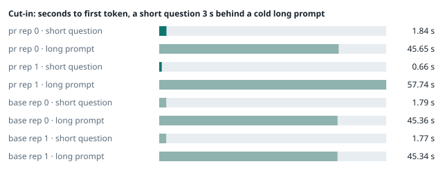
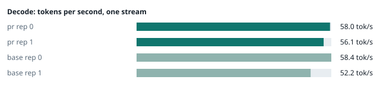
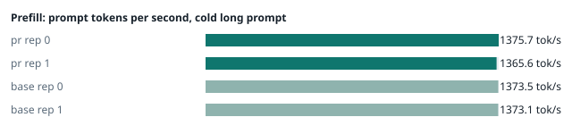
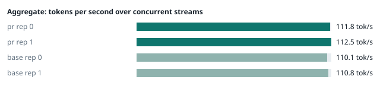
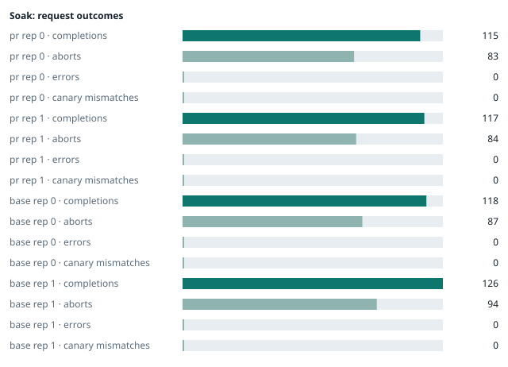

### Evidence: pr vs base

| target | role | image / artifact | model | settings that differ from the control |
|---|---|---|---|---|
| `pr` | candidate | `tensorfold-dsv41:pr-a24647d3` (514c25b2fc0b) | `DeepSeek-V4.1-Flash-1017` | - |
| `base` | control | `tensorfold-dsv41:base-8ffa67d5` (b3ebb6f612e4) | `DeepSeek-V4.1-Flash-1017` | baseline |

Conditions: fabric ring; order: counterbalanced over 2 repetitions: A B, then B A; repetitions: 2; kit 2825d9f.
Restore: live restored (verified: API answers, running artifact is live's).

#### smoke

| target | rep | arithmetic | greedy repeat equal | stream matches | JSON mode | first token (stream) | errors |
|---|---|---|---|---|---|---|---|
| `pr` | 0 | ✓ | ✓ | ✓ | ✓ | 0.101 s | - |
| `pr` | 1 | ✓ | ✓ | ✓ | ✓ | 0.102 s | - |
| `base` | 0 | ✓ | ✓ | ✓ | ✓ | 0.11 s | - |
| `base` | 1 | ✓ | ✓ | ✓ | ✓ | 0.1 s | - |

machine state after the suite

- `pr` rep 0: `{"head": {"gpus": ["0, NVIDIA GB10, 2418 MHz, 53, [N/A], [N/A], 0 %"], "load": "load average: 6.91, 2.96, 1.47", "container": "90 pids 3.009GiB / 121.7GiB", "mem_available_mb": "29409"}}`
- `pr` rep 1: `{"head": {"gpus": ["0, NVIDIA GB10, 2424 MHz, 63, [N/A], [N/A], 0 %"], "load": "load average: 6.84, 5.54, 5.47", "container": "90 pids 3.039GiB / 121.7GiB", "mem_available_mb": "28494"}}`
- `base` rep 0: `{"head": {"gpus": ["0, NVIDIA GB10, 2418 MHz, 62, [N/A], [N/A], 0 %"], "load": "load average: 7.36, 5.63, 4.71", "container": "90 pids 3.041GiB / 121.7GiB", "mem_available_mb": "28624"}}`
- `base` rep 1: `{"head": {"gpus": ["0, NVIDIA GB10, 2437 MHz, 60, [N/A], [N/A], 0 %"], "load": "load average: 2.29, 4.28, 5.00", "container": "90 pids 4.467GiB / 121.7GiB", "mem_available_mb": "26627"}}`

#### boundary

**38 of 38** greedy reply hashes identical, `pr` against `base`, over 2 repetition(s).

| rep | prompt | tokens (pr / base) | `pr` | `base` | same |
|---|---|---|---|---|---|
| 0 | len5 | 5 / 5 | `38127fef0fbb` | `38127fef0fbb` | ✓ |
| 0 | len2047 | 2047 / 2047 | `8488ccfbcf35` | `8488ccfbcf35` | ✓ |
| 0 | len2048 | 2048 / 2048 | `c5ac2fb76516` | `c5ac2fb76516` | ✓ |
| 0 | len2049 | 2049 / 2049 | `6766401c9caa` | `6766401c9caa` | ✓ |
| 0 | len4095 | 4095 / 4095 | `ed9e5086f520` | `ed9e5086f520` | ✓ |
| 0 | len4096 | 4096 / 4096 | `52584e31f990` | `52584e31f990` | ✓ |
| 0 | len4097 | 4097 / 4097 | `1a71db317ee7` | `1a71db317ee7` | ✓ |
| 0 | len6143 | 6143 / 6143 | `2f9626e9baf5` | `2f9626e9baf5` | ✓ |
| 0 | len6144 | 6144 / 6144 | `11933f2d4bd7` | `11933f2d4bd7` | ✓ |
| 0 | len6145 | 6145 / 6145 | `7aa2f63b2547` | `7aa2f63b2547` | ✓ |
| 0 | len8193 | 8193 / 8193 | `2ef3dc011922` | `2ef3dc011922` | ✓ |
| 0 | len12289 | 12289 / 12289 | `4fcfbd64881f` | `4fcfbd64881f` | ✓ |
| 0 | pfx_base | 5124 / 5124 | `52afe4842e5d` | `52afe4842e5d` | ✓ |
| 0 | pfx_div3072 | 3376 / 3376 | `64d23fe171dc` | `64d23fe171dc` | ✓ |
| 0 | pfx_div2044 | 2348 / 2348 | `16db99ba02f2` | `16db99ba02f2` | ✓ |
| 0 | pfx_div4092 | 4396 / 4396 | `63798c5ba36c` | `63798c5ba36c` | ✓ |
| 0 | pfx_div4093 | 4397 / 4397 | `6b1cfc31884d` | `6b1cfc31884d` | ✓ |
| 0 | pfx_base_again | 5124 / 5124 | `52afe4842e5d` | `52afe4842e5d` | ✓ |
| 0 | pfx_extend | 6660 / 6660 | `357a869fef18` | `357a869fef18` | ✓ |
| 1 | len5 | 5 / 5 | `38127fef0fbb` | `38127fef0fbb` | ✓ |
| 1 | len2047 | 2047 / 2047 | `8488ccfbcf35` | `8488ccfbcf35` | ✓ |
| 1 | len2048 | 2048 / 2048 | `c5ac2fb76516` | `c5ac2fb76516` | ✓ |
| 1 | len2049 | 2049 / 2049 | `6766401c9caa` | `6766401c9caa` | ✓ |
| 1 | len4095 | 4095 / 4095 | `ed9e5086f520` | `ed9e5086f520` | ✓ |
| 1 | len4096 | 4096 / 4096 | `52584e31f990` | `52584e31f990` | ✓ |
| 1 | len4097 | 4097 / 4097 | `1a71db317ee7` | `1a71db317ee7` | ✓ |
| 1 | len6143 | 6143 / 6143 | `2f9626e9baf5` | `2f9626e9baf5` | ✓ |
| 1 | len6144 | 6144 / 6144 | `11933f2d4bd7` | `11933f2d4bd7` | ✓ |
| 1 | len6145 | 6145 / 6145 | `7aa2f63b2547` | `7aa2f63b2547` | ✓ |
| 1 | len8193 | 8193 / 8193 | `2ef3dc011922` | `2ef3dc011922` | ✓ |
| 1 | len12289 | 12289 / 12289 | `4fcfbd64881f` | `4fcfbd64881f` | ✓ |
| 1 | pfx_base | 5124 / 5124 | `52afe4842e5d` | `52afe4842e5d` | ✓ |
| 1 | pfx_div3072 | 3376 / 3376 | `64d23fe171dc` | `64d23fe171dc` | ✓ |
| 1 | pfx_div2044 | 2348 / 2348 | `16db99ba02f2` | `16db99ba02f2` | ✓ |
| 1 | pfx_div4092 | 4396 / 4396 | `63798c5ba36c` | `63798c5ba36c` | ✓ |
| 1 | pfx_div4093 | 4397 / 4397 | `6b1cfc31884d` | `6b1cfc31884d` | ✓ |
| 1 | pfx_base_again | 5124 / 5124 | `52afe4842e5d` | `52afe4842e5d` | ✓ |
| 1 | pfx_extend | 6660 / 6660 | `357a869fef18` | `357a869fef18` | ✓ |

machine state after the suite

- `pr` rep 0: `{"head": {"gpus": ["0, NVIDIA GB10, 2463 MHz, 64, [N/A], [N/A], 0 %"], "load": "load average: 6.46, 3.68, 1.84", "container": "90 pids 3.166GiB / 121.7GiB", "mem_available_mb": "29041"}}`
- `pr` rep 1: `{"head": {"gpus": ["0, NVIDIA GB10, 2392 MHz, 68, [N/A], [N/A], 0 %"], "load": "load average: 6.14, 5.62, 5.51", "container": "90 pids 3.195GiB / 121.7GiB", "mem_available_mb": "28284"}}`
- `base` rep 0: `{"head": {"gpus": ["0, NVIDIA GB10, 2392 MHz, 67, [N/A], [N/A], 0 %"], "load": "load average: 6.28, 5.67, 4.80", "container": "90 pids 3.197GiB / 121.7GiB", "mem_available_mb": "28279"}}`
- `base` rep 1: `{"head": {"gpus": ["0, NVIDIA GB10, 2405 MHz, 68, [N/A], [N/A], 18 %"], "load": "load average: 4.42, 4.51, 5.04", "container": "90 pids 4.466GiB / 121.7GiB", "mem_available_mb": "26626"}}`

#### cutin

`pr` rep 0: short question first token **1.84 s** (rounds 0.599–1.85), long prompt first token 45.65 s (rounds 45.527–48.162); 3 rounds; admitted during the long prefill in 3 of 3 rounds
`pr` rep 1: short question first token **0.66 s** (rounds 0.574–1.782), long prompt first token 57.74 s (rounds 57.69–60.528); 3 rounds; admitted during the long prefill in 3 of 3 rounds
`base` rep 0: short question first token **1.79 s** (rounds 1.742–1.817), long prompt first token 45.36 s (rounds 45.273–45.391); 3 rounds; admitted during the long prefill in 3 of 3 rounds
`base` rep 1: short question first token **1.77 s** (rounds 1.759–1.788), long prompt first token 45.34 s (rounds 45.305–45.383); 3 rounds; admitted during the long prefill in 3 of 3 rounds

machine state after the suite

- `pr` rep 0: `{"head": {"gpus": ["0, NVIDIA GB10, 2418 MHz, 67, [N/A], [N/A], 31 %"], "load": "load average: 7.01, 4.97, 2.58", "container": "90 pids 3.205GiB / 121.7GiB", "mem_available_mb": "28994"}}`
- `pr` rep 1: `{"head": {"gpus": ["0, NVIDIA GB10, 2398 MHz, 69, [N/A], [N/A], 0 %"], "load": "load average: 6.65, 6.12, 5.73", "container": "90 pids 3.341GiB / 121.7GiB", "mem_available_mb": "28803"}}`
- `base` rep 0: `{"head": {"gpus": ["0, NVIDIA GB10, 2398 MHz, 69, [N/A], [N/A], 0 %"], "load": "load average: 7.01, 6.21, 5.12", "container": "90 pids 3.237GiB / 121.7GiB", "mem_available_mb": "28197"}}`
- `base` rep 1: `{"head": {"gpus": ["0, NVIDIA GB10, 2437 MHz, 68, [N/A], [N/A], 0 %"], "load": "load average: 6.56, 5.33, 5.27", "container": "90 pids 4.467GiB / 121.7GiB", "mem_available_mb": "26635"}}`

#### perf

| target | rep | decode tok/s, one stream | prefill tok/s, cold long prompt | aggregate tok/s, concurrent streams | errors |
|---|---|---|---|---|---|
| `pr` | 0 | **58.0** (55.3–58.8) | **1375.7** (1375.5–1382.0; 12004 tokens) | **111.8** (103.0–115.5; 4 streams) | - |
| `pr` | 1 | **56.1** (54.3–59.9) | **1365.6** (1361.5–1371.3; 12004 tokens) | **112.5** (109.2–115.2; 4 streams) | - |
| `base` | 0 | **58.4** (9.5–59.3) | **1373.5** (1366.9–1378.2; 12004 tokens) | **110.1** (105.6–114.9; 4 streams) | - |
| `base` | 1 | **52.2** (17.9–60.5) | **1373.1** (956.9–1374.2; 12004 tokens) | **110.8** (35.5–112.1; 4 streams) | - |

`pr` against `base`: decode +3.2%, prefill -0.2%, aggregate +1.5% (medians over repetitions; the verdict counts a difference only beyond the rounds' spread, at least ±3 %).

machine state after the suite

- `pr` rep 0: `{"head": {"gpus": ["0, NVIDIA GB10, 2418 MHz, 66, [N/A], [N/A], 0 %"], "load": "load average: 5.96, 5.02, 2.75", "container": "90 pids 3.402GiB / 121.7GiB", "mem_available_mb": "28657"}}`
- `pr` rep 1: `{"head": {"gpus": ["0, NVIDIA GB10, 2424 MHz, 69, [N/A], [N/A], 0 %"], "load": "load average: 5.87, 6.00, 5.72", "container": "90 pids 3.547GiB / 121.7GiB", "mem_available_mb": "28477"}}`
- `base` rep 0: `{"head": {"gpus": ["0, NVIDIA GB10, 2392 MHz, 68, [N/A], [N/A], 0 %"], "load": "load average: 5.73, 5.98, 5.12", "container": "90 pids 3.561GiB / 121.7GiB", "mem_available_mb": "27553"}}`
- `base` rep 1: `{"head": {"gpus": ["0, NVIDIA GB10, 2392 MHz, 68, [N/A], [N/A], 0 %"], "load": "load average: 5.89, 5.43, 5.31", "container": "90 pids 4.557GiB / 121.7GiB", "mem_available_mb": "26484"}}`

#### startup

`pr`: 97.8 s, 98.6 s from the switch to the API answering (2 start(s))
`base`: 98.6 s from the switch to the API answering (1 start(s))

#### soak

`pr` rep 0: 115 completions, 83 client aborts, **0 errors**, 37 canary checks with **0 mismatches**
  machine samples, first and last: `{"head": {"gpus": ["0, NVIDIA GB10, 2470 MHz, 66, [N/A], [N/A], 94 %"], "load": "load average: 5.96, 5.02, 2.75", "container": "94 pids 3.43GiB / 121.7GiB", "me` → `{"head": {"gpus": ["0, NVIDIA GB10, 2489 MHz, 70, [N/A], [N/A], 96 %"], "load": "load average: 6.50, 6.19, 4.42", "container": "93 pids 3.92GiB / 121.7GiB", "me`
`pr` rep 1: 117 completions, 84 client aborts, **0 errors**, 37 canary checks with **0 mismatches**
  machine samples, first and last: `{"head": {"gpus": ["0, NVIDIA GB10, 2476 MHz, 69, [N/A], [N/A], 96 %"], "load": "load average: 6.12, 6.05, 5.73", "container": "94 pids 3.576GiB / 121.7GiB", "m` → `{"head": {"gpus": ["0, NVIDIA GB10, 2489 MHz, 70, [N/A], [N/A], 96 %"], "load": "load average: 5.85, 6.09, 5.91", "container": "93 pids 4.174GiB / 121.7GiB", "m`
`base` rep 0: 118 completions, 87 client aborts, **0 errors**, 37 canary checks with **0 mismatches**
  machine samples, first and last: `{"head": {"gpus": ["0, NVIDIA GB10, 2476 MHz, 67, [N/A], [N/A], 96 %"], "load": "load average: 5.27, 5.88, 5.10", "container": "94 pids 3.592GiB / 121.7GiB", "m` → `{"head": {"gpus": ["0, NVIDIA GB10, 2489 MHz, 68, [N/A], [N/A], 81 %"], "load": "load average: 6.23, 6.19, 5.66", "container": "95 pids 4.03GiB / 121.7GiB", "me`
`base` rep 1: 126 completions, 94 client aborts, **0 errors**, 42 canary checks with **0 mismatches**
  machine samples, first and last: `{"head": {"gpus": ["0, NVIDIA GB10, 2476 MHz, 67, [N/A], [N/A], 85 %"], "load": "load average: 5.98, 5.45, 5.32", "container": "93 pids 4.573GiB / 121.7GiB", "m` → `{"head": {"gpus": ["0, NVIDIA GB10, 2470 MHz, 68, [N/A], [N/A], 71 %"], "load": "load average: 6.39, 6.15, 5.74", "container": "94 pids 4.668GiB / 121.7GiB", "m`

machine state after the suite

- `pr` rep 0: `{"head": {"gpus": ["0, NVIDIA GB10, 2411 MHz, 61, [N/A], [N/A], 0 %"], "load": "load average: 4.52, 5.79, 4.40", "container": "90 pids 3.916GiB / 121.7GiB", "mem_available_mb": "27461"}}`
- `pr` rep 1: `{"head": {"gpus": ["0, NVIDIA GB10, 2411 MHz, 60, [N/A], [N/A], 0 %"], "load": "load average: 4.51, 5.77, 5.82", "container": "90 pids 4.159GiB / 121.7GiB", "mem_available_mb": "26264"}}`
- `base` rep 0: `{"head": {"gpus": ["0, NVIDIA GB10, 2411 MHz, 59, [N/A], [N/A], 0 %"], "load": "load average: 4.17, 5.70, 5.53", "container": "90 pids 4.113GiB / 121.7GiB", "mem_available_mb": "27186"}}`
- `base` rep 1: `{"head": {"gpus": ["0, NVIDIA GB10, 2476 MHz, 72, [N/A], [N/A], 96 %"], "load": "load average: 5.60, 5.97, 5.71", "container": "91 pids 4.701GiB / 121.7GiB", "mem_available_mb": "26279"}}`

#### concurrency

| target | rep | streams | aggregate tok/s | first token p50 / p95 | batched replies ≠ serial | errors |
|---|---|---|---|---|---|---|
| `pr` | 0 | 1 (round 0) | **52.1** | 0.395 / 0.411 s | — |  |
| `pr` | 0 | 4 (round 0) | **80.3** | 1.239 / 1.733 s | 0 of 16 |  |
| `pr` | 0 | 8 (round 0) | **87.9** | 2.144 / 3.589 s | 0 of 16 |  |
| `pr` | 0 | 16 (round 0) | **92.2** | 4.177 / 8.035 s | 0 of 16 | 0 |
| `pr` | 0 | 1 (round 1) | **52.4** | 0.381 / 0.4 s | — |  |
| `pr` | 0 | 4 (round 1) | **80.7** | 1.253 / 1.716 s | 0 of 16 |  |
| `pr` | 0 | 8 (round 1) | **89.2** | 2.165 / 3.606 s | 0 of 16 |  |
| `pr` | 0 | 16 (round 1) | **91.2** | 4.092 / 8.019 s | 0 of 16 | 0 |
| `pr` | 1 | 1 (round 0) | **48.0** | 0.399 / 0.42 s | — |  |
| `pr` | 1 | 4 (round 0) | **74.1** | 1.261 / 1.76 s | 0 of 16 |  |
| `pr` | 1 | 8 (round 0) | **81.8** | 2.171 / 3.661 s | 0 of 16 |  |
| `pr` | 1 | 16 (round 0) | **83.9** | 4.062 / 8.011 s | 0 of 16 | 0 |
| `pr` | 1 | 1 (round 1) | **47.7** | 0.392 / 0.461 s | — |  |
| `pr` | 1 | 4 (round 1) | **74.9** | 1.243 / 1.734 s | 0 of 16 |  |
| `pr` | 1 | 8 (round 1) | **81.9** | 2.167 / 3.631 s | 0 of 16 |  |
| `pr` | 1 | 16 (round 1) | **81.6** | 4.178 / 8.202 s | 0 of 16 | 0 |
| `base` | 0 | 1 (round 0) | **52.4** | 0.389 / 0.408 s | — |  |
| `base` | 0 | 4 (round 0) | **80.6** | 1.242 / 1.756 s | 0 of 16 |  |
| `base` | 0 | 8 (round 0) | **88.2** | 2.17 / 3.649 s | 0 of 16 |  |
| `base` | 0 | 16 (round 0) | **92.2** | 4.051 / 7.968 s | 0 of 16 | 0 |
| `base` | 0 | 1 (round 1) | **52.5** | 0.393 / 0.41 s | — |  |
| `base` | 0 | 4 (round 1) | **80.3** | 1.278 / 1.811 s | 0 of 16 |  |
| `base` | 0 | 8 (round 1) | **87.1** | 2.2 / 3.733 s | 0 of 16 |  |
| `base` | 0 | 16 (round 1) | **91.0** | 4.197 / 8.071 s | 0 of 16 | 0 |
| `base` | 1 | 1 (round 0) | **48.2** | 0.397 / 0.417 s | — |  |
| `base` | 1 | 4 (round 0) | **73.8** | 1.28 / 1.768 s | 0 of 16 |  |
| `base` | 1 | 8 (round 0) | **81.6** | 2.178 / 3.686 s | 0 of 16 |  |
| `base` | 1 | 16 (round 0) | **84.0** | 4.139 / 7.944 s | 0 of 16 | 0 |
| `base` | 1 | 1 (round 1) | **48.3** | 0.395 / 0.405 s | — |  |
| `base` | 1 | 4 (round 1) | **36.0** | 1.218 / 1.725 s | 0 of 16 |  |
| `base` | 1 | 8 (round 1) | **69.9** | 2.223 / 5.847 s | 0 of 16 |  |
| `base` | 1 | 16 (round 1) | **84.0** | 4.139 / 8.068 s | 0 of 16 | 0 |

`pr` rep 0: 128 requests; batched replies identical to serial in 96 of 96 comparisons
- host `spark-161`: container memory 3357.7 → 3401.7 MB after the drain (**+44.0 MB**, +343.8 MB per 1000 requests); descriptors 150 → 150
- host `spark-197`: container memory 4625.4 → 4669.4 MB after the drain (**+44.0 MB**, +343.8 MB per 1000 requests); descriptors 221 → 221
- host `gx10-126`: container memory 3456.0 → 3500.0 MB after the drain (**+44.0 MB**, +343.8 MB per 1000 requests); descriptors 150 → 150
- host `dell-113`: container memory 3388.4 → 3432.4 MB after the drain (**+44.0 MB**, +343.8 MB per 1000 requests); descriptors 147 → 150

`pr` rep 1: 128 requests; batched replies identical to serial in 96 of 96 comparisons
- host `spark-161`: container memory 3210.2 → 3307.5 MB after the drain (**+97.3 MB**, +760.2 MB per 1000 requests); descriptors 150 → 147
- host `spark-197`: container memory 4512.8 → 4610.0 MB after the drain (**+97.2 MB**, +759.4 MB per 1000 requests); descriptors 221 → 221
- host `gx10-126`: container memory 3289.1 → 3383.3 MB after the drain (**+94.2 MB**, +735.9 MB per 1000 requests); descriptors 150 → 150
- host `dell-113`: container memory 3241.0 → 3338.2 MB after the drain (**+97.2 MB**, +759.4 MB per 1000 requests); descriptors 147 → 150

`base` rep 0: 128 requests; batched replies identical to serial in 96 of 96 comparisons
- host `spark-161`: container memory 3202.0 → 3271.7 MB after the drain (**+69.7 MB**, +544.5 MB per 1000 requests); descriptors 150 → 150
- host `spark-197`: container memory 4506.6 → 4574.2 MB after the drain (**+67.6 MB**, +528.1 MB per 1000 requests); descriptors 221 → 221
- host `gx10-126`: container memory 3318.8 → 3389.4 MB after the drain (**+70.6 MB**, +551.6 MB per 1000 requests); descriptors 150 → 150
- host `dell-113`: container memory 3232.8 → 3303.4 MB after the drain (**+70.6 MB**, +551.6 MB per 1000 requests); descriptors 147 → 150

`base` rep 1: 128 requests; batched replies identical to serial in 96 of 96 comparisons
- host `spark-161`: container memory 3457.0 → 3497.0 MB after the drain (**+40.0 MB**, +312.5 MB per 1000 requests); descriptors 150 → 147
- host `spark-197`: container memory 4763.6 → 4802.6 MB after the drain (**+39.0 MB**, +304.7 MB per 1000 requests); descriptors 221 → 221
- host `gx10-126`: container memory 3573.8 → 3614.7 MB after the drain (**+40.9 MB**, +319.5 MB per 1000 requests); descriptors 150 → 150
- host `dell-113`: container memory 3487.7 → 3528.7 MB after the drain (**+41.0 MB**, +320.3 MB per 1000 requests); descriptors 150 → 150

machine state after the suite

- `pr` rep 0: `{"head": {"gpus": ["0, NVIDIA GB10, 2411 MHz, 59, [N/A], [N/A], 0 %"], "load": "load average: 2.24, 4.36, 4.24", "container": "90 pids 4.56GiB / 121.7GiB", "mem_available_mb": "25653"}}`
- `pr` rep 1: `{"head": {"gpus": ["0, NVIDIA GB10, 2411 MHz, 59, [N/A], [N/A], 0 %"], "load": "load average: 2.29, 4.40, 5.27", "container": "90 pids 4.502GiB / 121.7GiB", "mem_available_mb": "25623"}}`
- `base` rep 0: `{"head": {"gpus": ["0, NVIDIA GB10, 2411 MHz, 58, [N/A], [N/A], 0 %"], "load": "load average: 2.29, 4.28, 5.00", "container": "90 pids 4.467GiB / 121.7GiB", "mem_available_mb": "26625"}}`
- `base` rep 1: `{"head": {"gpus": ["0, NVIDIA GB10, 2411 MHz, 60, [N/A], [N/A], 0 %"], "load": "load average: 2.38, 4.42, 5.14", "container": "90 pids 4.689GiB / 121.7GiB", "mem_available_mb": "26308"}}`

#### the pull request's own tests

**confirmed** — 1 test file(s) added or changed by the PR (`tests/test_body_limit.py`): on the PR **passes** (exit 0), on the base with the PR's tests copied in **fails** (exit 1).

- PR: `.....                                                                    [100%] 5 passed in 0.02s`
- base + PR tests: `FAILED tests/test_body_limit.py::BodyLimit::test_flag_namespace_is_forwarded - FileNotFoundError: [Errno 2] No such file or directory: '/tmp/tmp.I0lJcspKht/base/tests/../zig/patches/0054-server-max-body.patch' FAILED tests/test_body_limit.py::BodyLimit::test_read_before_serving - FileNotFoundError:`

#### What this run does not show

- one process under mixed load for hours: throughput probes every few minutes, a canary reply, host memory and descriptors over the run (`endurance` did not run)
- a clean pair exit and recovery after an injected read fault (`fault` did not run)
- an external benchmark against a control (The Grill or similar) (`bench` did not run)
- <!-- add: paths only checked by reading, faults not injected, configurations not run -->

_Generated by inference-agent-kit `report.py` from `20261119T002236/results.json`._
