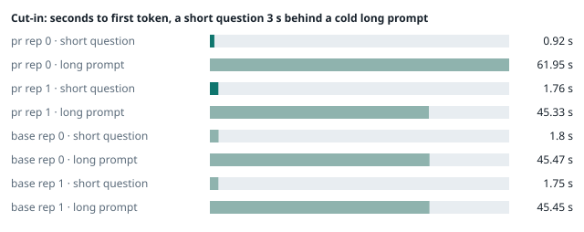
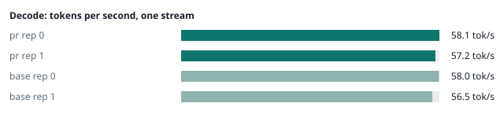
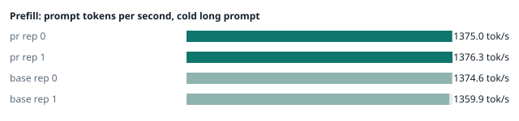
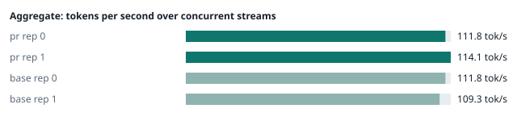
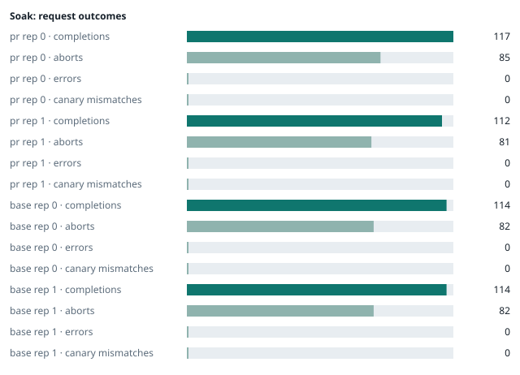

### Evidence: pr vs base

| target | role | image / artifact | model | settings that differ from the control |
|---|---|---|---|---|
| `pr` | candidate | `tensorfold-dsv41:pr-be29ec1b` (9edfdfdbb042) | `DeepSeek-V4.1-Flash-1017` | - |
| `base` | control | `tensorfold-dsv41:base-8ffa67d5` (b3ebb6f612e4) | `DeepSeek-V4.1-Flash-1017` | baseline |

Conditions: fabric ring; order: counterbalanced over 2 repetitions: A B, then B A; repetitions: 2; kit 2825d9f.
Restore: live restored (verified: API answers, running artifact is live's).

#### smoke

| target | rep | arithmetic | greedy repeat equal | stream matches | JSON mode | first token (stream) | errors |
|---|---|---|---|---|---|---|---|
| `pr` | 0 | ✓ | ✓ | ✓ | ✓ | 0.098 s | - |
| `pr` | 1 | ✓ | ✓ | ✓ | ✓ | 0.1 s | - |
| `base` | 0 | ✓ | ✓ | ✓ | ✓ | 0.099 s | - |
| `base` | 1 | ✓ | ✓ | ✓ | ✓ | 0.101 s | - |

machine state after the suite

- `pr` rep 0: `{"head": {"gpus": ["0, NVIDIA GB10, 2437 MHz, 52, [N/A], [N/A], 0 %"], "load": "load average: 7.10, 2.97, 2.92", "container": "90 pids 3.041GiB / 121.7GiB", "mem_available_mb": "28740"}}`
- `pr` rep 1: `{"head": {"gpus": ["0, NVIDIA GB10, 2418 MHz, 62, [N/A], [N/A], 0 %"], "load": "load average: 7.41, 5.85, 5.63", "container": "90 pids 3.041GiB / 121.7GiB", "mem_available_mb": "29464"}}`
- `base` rep 0: `{"head": {"gpus": ["0, NVIDIA GB10, 2405 MHz, 62, [N/A], [N/A], 0 %"], "load": "load average: 7.91, 5.67, 5.02", "container": "90 pids 3.009GiB / 121.7GiB", "mem_available_mb": "28738"}}`
- `base` rep 1: `{"head": {"gpus": ["0, NVIDIA GB10, 2411 MHz, 60, [N/A], [N/A], 0 %"], "load": "load average: 2.08, 4.22, 5.05", "container": "90 pids 4.625GiB / 121.7GiB", "mem_available_mb": "26394"}}`

#### boundary

**38 of 38** greedy reply hashes identical, `pr` against `base`, over 2 repetition(s).

| rep | prompt | tokens (pr / base) | `pr` | `base` | same |
|---|---|---|---|---|---|
| 0 | len5 | 5 / 5 | `38127fef0fbb` | `38127fef0fbb` | ✓ |
| 0 | len2047 | 2047 / 2047 | `8488ccfbcf35` | `8488ccfbcf35` | ✓ |
| 0 | len2048 | 2048 / 2048 | `c5ac2fb76516` | `c5ac2fb76516` | ✓ |
| 0 | len2049 | 2049 / 2049 | `6766401c9caa` | `6766401c9caa` | ✓ |
| 0 | len4095 | 4095 / 4095 | `ed9e5086f520` | `ed9e5086f520` | ✓ |
| 0 | len4096 | 4096 / 4096 | `52584e31f990` | `52584e31f990` | ✓ |
| 0 | len4097 | 4097 / 4097 | `1a71db317ee7` | `1a71db317ee7` | ✓ |
| 0 | len6143 | 6143 / 6143 | `2f9626e9baf5` | `2f9626e9baf5` | ✓ |
| 0 | len6144 | 6144 / 6144 | `11933f2d4bd7` | `11933f2d4bd7` | ✓ |
| 0 | len6145 | 6145 / 6145 | `7aa2f63b2547` | `7aa2f63b2547` | ✓ |
| 0 | len8193 | 8193 / 8193 | `2ef3dc011922` | `2ef3dc011922` | ✓ |
| 0 | len12289 | 12289 / 12289 | `4fcfbd64881f` | `4fcfbd64881f` | ✓ |
| 0 | pfx_base | 5124 / 5124 | `52afe4842e5d` | `52afe4842e5d` | ✓ |
| 0 | pfx_div3072 | 3376 / 3376 | `64d23fe171dc` | `64d23fe171dc` | ✓ |
| 0 | pfx_div2044 | 2348 / 2348 | `16db99ba02f2` | `16db99ba02f2` | ✓ |
| 0 | pfx_div4092 | 4396 / 4396 | `63798c5ba36c` | `63798c5ba36c` | ✓ |
| 0 | pfx_div4093 | 4397 / 4397 | `6b1cfc31884d` | `6b1cfc31884d` | ✓ |
| 0 | pfx_base_again | 5124 / 5124 | `52afe4842e5d` | `52afe4842e5d` | ✓ |
| 0 | pfx_extend | 6660 / 6660 | `357a869fef18` | `357a869fef18` | ✓ |
| 1 | len5 | 5 / 5 | `38127fef0fbb` | `38127fef0fbb` | ✓ |
| 1 | len2047 | 2047 / 2047 | `8488ccfbcf35` | `8488ccfbcf35` | ✓ |
| 1 | len2048 | 2048 / 2048 | `c5ac2fb76516` | `c5ac2fb76516` | ✓ |
| 1 | len2049 | 2049 / 2049 | `6766401c9caa` | `6766401c9caa` | ✓ |
| 1 | len4095 | 4095 / 4095 | `ed9e5086f520` | `ed9e5086f520` | ✓ |
| 1 | len4096 | 4096 / 4096 | `52584e31f990` | `52584e31f990` | ✓ |
| 1 | len4097 | 4097 / 4097 | `1a71db317ee7` | `1a71db317ee7` | ✓ |
| 1 | len6143 | 6143 / 6143 | `2f9626e9baf5` | `2f9626e9baf5` | ✓ |
| 1 | len6144 | 6144 / 6144 | `11933f2d4bd7` | `11933f2d4bd7` | ✓ |
| 1 | len6145 | 6145 / 6145 | `7aa2f63b2547` | `7aa2f63b2547` | ✓ |
| 1 | len8193 | 8193 / 8193 | `2ef3dc011922` | `2ef3dc011922` | ✓ |
| 1 | len12289 | 12289 / 12289 | `4fcfbd64881f` | `4fcfbd64881f` | ✓ |
| 1 | pfx_base | 5124 / 5124 | `52afe4842e5d` | `52afe4842e5d` | ✓ |
| 1 | pfx_div3072 | 3376 / 3376 | `64d23fe171dc` | `64d23fe171dc` | ✓ |
| 1 | pfx_div2044 | 2348 / 2348 | `16db99ba02f2` | `16db99ba02f2` | ✓ |
| 1 | pfx_div4092 | 4396 / 4396 | `63798c5ba36c` | `63798c5ba36c` | ✓ |
| 1 | pfx_div4093 | 4397 / 4397 | `6b1cfc31884d` | `6b1cfc31884d` | ✓ |
| 1 | pfx_base_again | 5124 / 5124 | `52afe4842e5d` | `52afe4842e5d` | ✓ |
| 1 | pfx_extend | 6660 / 6660 | `357a869fef18` | `357a869fef18` | ✓ |

machine state after the suite

- `pr` rep 0: `{"head": {"gpus": ["0, NVIDIA GB10, 2392 MHz, 63, [N/A], [N/A], 0 %"], "load": "load average: 5.94, 3.60, 3.14", "container": "90 pids 3.198GiB / 121.7GiB", "mem_available_mb": "29130"}}`
- `pr` rep 1: `{"head": {"gpus": ["0, NVIDIA GB10, 2392 MHz, 67, [N/A], [N/A], 0 %"], "load": "load average: 6.40, 5.83, 5.64", "container": "90 pids 3.198GiB / 121.7GiB", "mem_available_mb": "29114"}}`
- `base` rep 0: `{"head": {"gpus": ["0, NVIDIA GB10, 2424 MHz, 67, [N/A], [N/A], 16 %"], "load": "load average: 6.58, 5.74, 5.10", "container": "90 pids 3.165GiB / 121.7GiB", "mem_available_mb": "28806"}}`
- `base` rep 1: `{"head": {"gpus": ["0, NVIDIA GB10, 2411 MHz, 66, [N/A], [N/A], 0 %"], "load": "load average: 3.41, 4.26, 5.02", "container": "90 pids 4.625GiB / 121.7GiB", "mem_available_mb": "25655"}}`

#### cutin

`pr` rep 0: short question first token **0.92 s** (rounds 0.589–0.961), long prompt first token 61.95 s (rounds 47.767–74.275); 3 rounds; admitted during the long prefill in 3 of 3 rounds
`pr` rep 1: short question first token **1.76 s** (rounds 1.744–1.764), long prompt first token 45.33 s (rounds 45.329–45.339); 3 rounds; admitted during the long prefill in 3 of 3 rounds
`base` rep 0: short question first token **1.8 s** (rounds 1.797–2.074), long prompt first token 45.47 s (rounds 45.456–46.052); 3 rounds; admitted during the long prefill in 3 of 3 rounds
`base` rep 1: short question first token **1.75 s** (rounds 0.584–1.801), long prompt first token 45.45 s (rounds 45.433–45.522); 3 rounds; admitted during the long prefill in 3 of 3 rounds

machine state after the suite

- `pr` rep 0: `{"head": {"gpus": ["0, NVIDIA GB10, 2392 MHz, 67, [N/A], [N/A], 0 %"], "load": "load average: 6.66, 5.07, 3.81", "container": "90 pids 3.329GiB / 121.7GiB", "mem_available_mb": "28906"}}`
- `pr` rep 1: `{"head": {"gpus": ["0, NVIDIA GB10, 2424 MHz, 69, [N/A], [N/A], 0 %"], "load": "load average: 6.82, 6.20, 5.81", "container": "90 pids 3.212GiB / 121.7GiB", "mem_available_mb": "29107"}}`
- `base` rep 0: `{"head": {"gpus": ["0, NVIDIA GB10, 2392 MHz, 68, [N/A], [N/A], 0 %"], "load": "load average: 6.92, 6.16, 5.34", "container": "90 pids 3.204GiB / 121.7GiB", "mem_available_mb": "28263"}}`
- `base` rep 1: `{"head": {"gpus": ["0, NVIDIA GB10, 2392 MHz, 69, [N/A], [N/A], 0 %"], "load": "load average: 7.25, 5.38, 5.32", "container": "90 pids 4.626GiB / 121.7GiB", "mem_available_mb": "26351"}}`

#### perf

| target | rep | decode tok/s, one stream | prefill tok/s, cold long prompt | aggregate tok/s, concurrent streams | errors |
|---|---|---|---|---|---|
| `pr` | 0 | **58.1** (55.4–58.5) | **1375.0** (1375.0–1380.6; 12004 tokens) | **111.8** (108.2–113.7; 4 streams) | - |
| `pr` | 1 | **57.2** (54.4–58.4) | **1376.3** (1370.5–1386.6; 12004 tokens) | **114.1** (110.9–116.2; 4 streams) | - |
| `base` | 0 | **58.0** (55.4–59.3) | **1374.6** (1354.9–1383.3; 12004 tokens) | **111.8** (105.3–113.9; 4 streams) | - |
| `base` | 1 | **56.5** (54.4–60.1) | **1359.9** (856.8–1363.3; 12004 tokens) | **109.3** (26.6–118.3; 4 streams) | - |

`pr` against `base`: decode +0.7%, prefill +0.6%, aggregate +2.2% (medians over repetitions; the verdict counts a difference only beyond the rounds' spread, at least ±3 %).

machine state after the suite

- `pr` rep 0: `{"head": {"gpus": ["0, NVIDIA GB10, 2444 MHz, 67, [N/A], [N/A], 0 %"], "load": "load average: 5.93, 5.13, 3.91", "container": "90 pids 3.523GiB / 121.7GiB", "mem_available_mb": "27569"}}`
- `pr` rep 1: `{"head": {"gpus": ["0, NVIDIA GB10, 2392 MHz, 68, [N/A], [N/A], 0 %"], "load": "load average: 6.53, 6.22, 5.83", "container": "90 pids 3.382GiB / 121.7GiB", "mem_available_mb": "28804"}}`
- `base` rep 0: `{"head": {"gpus": ["0, NVIDIA GB10, 2398 MHz, 68, [N/A], [N/A], 0 %"], "load": "load average: 5.86, 5.97, 5.33", "container": "90 pids 3.389GiB / 121.7GiB", "mem_available_mb": "27927"}}`
- `base` rep 1: `{"head": {"gpus": ["0, NVIDIA GB10, 2392 MHz, 68, [N/A], [N/A], 0 %"], "load": "load average: 6.08, 5.46, 5.36", "container": "90 pids 4.664GiB / 121.7GiB", "mem_available_mb": "26341"}}`

#### startup

`pr`: 97.8 s, 98.6 s from the switch to the API answering (2 start(s))
`base`: 99.0 s from the switch to the API answering (1 start(s))

#### soak

`pr` rep 0: 117 completions, 85 client aborts, **0 errors**, 37 canary checks with **0 mismatches**
  machine samples, first and last: `{"head": {"gpus": ["0, NVIDIA GB10, 2463 MHz, 66, [N/A], [N/A], 72 %"], "load": "load average: 5.93, 5.13, 3.91", "container": "94 pids 3.555GiB / 121.7GiB", "m` → `{"head": {"gpus": ["0, NVIDIA GB10, 2483 MHz, 72, [N/A], [N/A], 96 %"], "load": "load average: 6.22, 6.04, 4.96", "container": "94 pids 4.127GiB / 121.7GiB", "m`
`pr` rep 1: 112 completions, 81 client aborts, **0 errors**, 37 canary checks with **0 mismatches**
  machine samples, first and last: `{"head": {"gpus": ["0, NVIDIA GB10, 2483 MHz, 67, [N/A], [N/A], 96 %"], "load": "load average: 6.01, 6.11, 5.80", "container": "94 pids 3.412GiB / 121.7GiB", "m` → `{"head": {"gpus": ["0, NVIDIA GB10, 2489 MHz, 70, [N/A], [N/A], 96 %"], "load": "load average: 6.43, 6.36, 6.06", "container": "93 pids 3.987GiB / 121.7GiB", "m`
`base` rep 0: 114 completions, 82 client aborts, **0 errors**, 37 canary checks with **0 mismatches**
  machine samples, first and last: `{"head": {"gpus": ["0, NVIDIA GB10, 2470 MHz, 67, [N/A], [N/A], 77 %"], "load": "load average: 5.86, 5.97, 5.33", "container": "94 pids 3.419GiB / 121.7GiB", "m` → `{"head": {"gpus": ["0, NVIDIA GB10, 2489 MHz, 69, [N/A], [N/A], 96 %"], "load": "load average: 6.38, 6.29, 5.78", "container": "93 pids 3.961GiB / 121.7GiB", "m`
`base` rep 1: 114 completions, 82 client aborts, **0 errors**, 37 canary checks with **0 mismatches**
  machine samples, first and last: `{"head": {"gpus": ["0, NVIDIA GB10, 2470 MHz, 68, [N/A], [N/A], 96 %"], "load": "load average: 5.60, 5.37, 5.33", "container": "94 pids 4.696GiB / 121.7GiB", "m` → `{"head": {"gpus": ["0, NVIDIA GB10, 2470 MHz, 70, [N/A], [N/A], 96 %"], "load": "load average: 6.20, 6.07, 5.72", "container": "94 pids 4.904GiB / 121.7GiB", "m`

machine state after the suite

- `pr` rep 0: `{"head": {"gpus": ["0, NVIDIA GB10, 2411 MHz, 60, [N/A], [N/A], 0 %"], "load": "load average: 4.41, 5.64, 4.90", "container": "90 pids 4.087GiB / 121.7GiB", "mem_available_mb": "26552"}}`
- `pr` rep 1: `{"head": {"gpus": ["0, NVIDIA GB10, 2411 MHz, 59, [N/A], [N/A], 0 %"], "load": "load average: 4.26, 5.84, 5.91", "container": "90 pids 3.986GiB / 121.7GiB", "mem_available_mb": "26681"}}`
- `base` rep 0: `{"head": {"gpus": ["0, NVIDIA GB10, 2411 MHz, 60, [N/A], [N/A], 0 %"], "load": "load average: 4.21, 5.80, 5.65", "container": "90 pids 3.954GiB / 121.7GiB", "mem_available_mb": "26723"}}`
- `base` rep 1: `{"head": {"gpus": ["0, NVIDIA GB10, 2489 MHz, 71, [N/A], [N/A], 95 %"], "load": "load average: 5.91, 6.04, 5.74", "container": "90 pids 4.845GiB / 121.7GiB", "mem_available_mb": "26055"}}`

#### concurrency

| target | rep | streams | aggregate tok/s | first token p50 / p95 | batched replies ≠ serial | errors |
|---|---|---|---|---|---|---|
| `pr` | 0 | 1 (round 0) | **51.7** | 0.404 / 0.425 s | — |  |
| `pr` | 0 | 4 (round 0) | **80.4** | 1.25 / 1.767 s | 0 of 16 |  |
| `pr` | 0 | 8 (round 0) | **88.8** | 2.157 / 3.621 s | 0 of 16 |  |
| `pr` | 0 | 16 (round 0) | **90.8** | 4.153 / 8.016 s | 0 of 16 | 0 |
| `pr` | 0 | 1 (round 1) | **51.9** | 0.398 / 0.431 s | — |  |
| `pr` | 0 | 4 (round 1) | **80.8** | 1.26 / 1.737 s | 0 of 16 |  |
| `pr` | 0 | 8 (round 1) | **87.7** | 2.171 / 3.67 s | 0 of 16 |  |
| `pr` | 0 | 16 (round 1) | **91.5** | 4.142 / 8.031 s | 0 of 16 | 0 |
| `pr` | 1 | 1 (round 0) | **47.8** | 0.392 / 0.41 s | — |  |
| `pr` | 1 | 4 (round 0) | **74.2** | 1.246 / 1.72 s | 0 of 16 |  |
| `pr` | 1 | 8 (round 0) | **55.8** | 2.136 / 3.652 s | 0 of 16 |  |
| `pr` | 1 | 16 (round 0) | **51.6** | 4.649 / 9.036 s | 0 of 16 | 0 |
| `pr` | 1 | 1 (round 1) | **47.9** | 0.398 / 0.412 s | — |  |
| `pr` | 1 | 4 (round 1) | **74.3** | 1.272 / 1.768 s | 0 of 16 |  |
| `pr` | 1 | 8 (round 1) | **81.8** | 2.152 / 3.66 s | 0 of 16 |  |
| `pr` | 1 | 16 (round 1) | **82.3** | 4.128 / 8.197 s | 0 of 16 | 0 |
| `base` | 0 | 1 (round 0) | **52.0** | 0.396 / 0.429 s | — |  |
| `base` | 0 | 4 (round 0) | **79.1** | 1.25 / 1.935 s | 0 of 16 |  |
| `base` | 0 | 8 (round 0) | **88.5** | 2.173 / 3.638 s | 0 of 16 |  |
| `base` | 0 | 16 (round 0) | **90.6** | 4.108 / 8.007 s | 0 of 16 | 0 |
| `base` | 0 | 1 (round 1) | **52.0** | 0.399 / 0.43 s | — |  |
| `base` | 0 | 4 (round 1) | **80.8** | 1.247 / 1.758 s | 0 of 16 |  |
| `base` | 0 | 8 (round 1) | **47.0** | 2.152 / 3.91 s | 0 of 16 |  |
| `base` | 0 | 16 (round 1) | **85.1** | 4.583 / 10.228 s | 0 of 16 | 0 |
| `base` | 1 | 1 (round 0) | **48.1** | 0.397 / 0.419 s | — |  |
| `base` | 1 | 4 (round 0) | **75.2** | 1.221 / 1.758 s | 0 of 16 |  |
| `base` | 1 | 8 (round 0) | **83.4** | 2.12 / 3.564 s | 0 of 16 |  |
| `base` | 1 | 16 (round 0) | **83.3** | 4.016 / 7.923 s | 0 of 16 | 0 |
| `base` | 1 | 1 (round 1) | **48.7** | 0.378 / 0.398 s | — |  |
| `base` | 1 | 4 (round 1) | **75.2** | 1.24 / 1.696 s | 0 of 16 |  |
| `base` | 1 | 8 (round 1) | **82.4** | 2.136 / 3.572 s | 0 of 16 |  |
| `base` | 1 | 16 (round 1) | **46.1** | 4.097 / 7.973 s | 0 of 16 | 0 |

`pr` rep 0: 128 requests; batched replies identical to serial in 96 of 96 comparisons
- host `spark-161`: container memory 3176.4 → 3259.4 MB after the drain (**+83.0 MB**, +648.4 MB per 1000 requests); descriptors 147 → 150
- host `spark-197`: container memory 4478.0 → 4559.9 MB after the drain (**+81.9 MB**, +639.8 MB per 1000 requests); descriptors 221 → 221
- host `gx10-126`: container memory 3269.6 → 3352.6 MB after the drain (**+83.0 MB**, +648.4 MB per 1000 requests); descriptors 150 → 150
- host `dell-113`: container memory 3206.1 → 3289.1 MB after the drain (**+83.0 MB**, +648.4 MB per 1000 requests); descriptors 150 → 147

`pr` rep 1: 128 requests; batched replies identical to serial in 96 of 96 comparisons
- host `spark-161`: container memory 3071.0 → 3517.4 MB after the drain (**+446.4 MB**, +3487.5 MB per 1000 requests); descriptors 150 → 150
- host `spark-197`: container memory 4376.6 → 4822.0 MB after the drain (**+445.4 MB**, +3479.7 MB per 1000 requests); descriptors 221 → 221
- host `gx10-126`: container memory 3171.3 → 3617.8 MB after the drain (**+446.5 MB**, +3488.3 MB per 1000 requests); descriptors 147 → 150
- host `dell-113`: container memory 3102.7 → 3549.2 MB after the drain (**+446.5 MB**, +3488.3 MB per 1000 requests); descriptors 147 → 147

`base` rep 0: 128 requests; batched replies identical to serial in 96 of 96 comparisons
- host `spark-161`: container memory 3070.0 → 3466.2 MB after the drain (**+396.2 MB**, +3095.3 MB per 1000 requests); descriptors 150 → 150
- host `spark-197`: container memory 4339.7 → 4736.0 MB after the drain (**+396.3 MB**, +3096.1 MB per 1000 requests); descriptors 221 → 221
- host `gx10-126`: container memory 3183.6 → 3579.9 MB after the drain (**+396.3 MB**, +3096.1 MB per 1000 requests); descriptors 150 → 150
- host `dell-113`: container memory 3100.7 → 3497.0 MB after the drain (**+396.3 MB**, +3096.1 MB per 1000 requests); descriptors 150 → 150

`base` rep 1: 128 requests; batched replies identical to serial in 96 of 96 comparisons
- host `spark-161`: container memory 3690.5 → 3745.8 MB after the drain (**+55.3 MB**, +432.0 MB per 1000 requests); descriptors 147 → 147
- host `spark-197`: container memory 4962.3 → 5017.6 MB after the drain (**+55.3 MB**, +432.0 MB per 1000 requests); descriptors 221 → 221
- host `gx10-126`: container memory 3804.2 → 3859.5 MB after the drain (**+55.3 MB**, +432.0 MB per 1000 requests); descriptors 150 → 150
- host `dell-113`: container memory 3721.2 → 3777.5 MB after the drain (**+56.3 MB**, +439.8 MB per 1000 requests); descriptors 147 → 147

machine state after the suite

- `pr` rep 0: `{"head": {"gpus": ["0, NVIDIA GB10, 2411 MHz, 59, [N/A], [N/A], 0 %"], "load": "load average: 2.26, 4.25, 4.55", "container": "90 pids 4.453GiB / 121.7GiB", "mem_available_mb": "26729"}}`
- `pr` rep 1: `{"head": {"gpus": ["0, NVIDIA GB10, 2411 MHz, 59, [N/A], [N/A], 0 %"], "load": "load average: 2.43, 4.54, 5.38", "container": "90 pids 4.709GiB / 121.7GiB", "mem_available_mb": "25911"}}`
- `base` rep 0: `{"head": {"gpus": ["0, NVIDIA GB10, 2411 MHz, 59, [N/A], [N/A], 0 %"], "load": "load average: 2.26, 4.29, 5.08", "container": "90 pids 4.625GiB / 121.7GiB", "mem_available_mb": "26439"}}`
- `base` rep 1: `{"head": {"gpus": ["0, NVIDIA GB10, 2411 MHz, 59, [N/A], [N/A], 0 %"], "load": "load average: 2.83, 4.66, 5.26", "container": "90 pids 4.9GiB / 121.7GiB", "mem_available_mb": "26011"}}`

#### the pull request's own tests

The pull request adds or changes no test file under `tests/`.

#### What this run does not show

- one process under mixed load for hours: throughput probes every few minutes, a canary reply, host memory and descriptors over the run (`endurance` did not run)
- a clean pair exit and recovery after an injected read fault (`fault` did not run)
- an external benchmark against a control (The Grill or similar) (`bench` did not run)
- <!-- add: paths only checked by reading, faults not injected, configurations not run -->

_Generated by inference-agent-kit `report.py` from `20261119T020659/results.json`._
