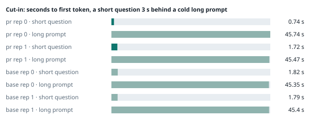
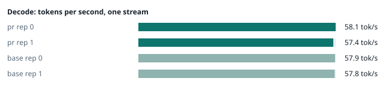
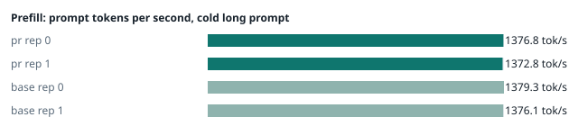
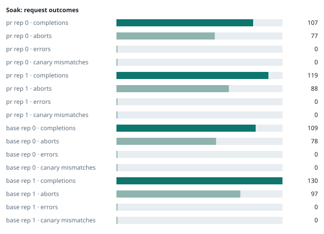

### Evidence: pr vs base

| target | role | image / artifact | model | settings that differ from the control |
|---|---|---|---|---|
| `pr` | candidate | `tensorfold-dsv41:pr-1cac39ce` (3e654261c36c) | `DeepSeek-V4.1-Flash-1017` | - |
| `base` | control | `tensorfold-dsv41:base-8ffa67d5` (b3ebb6f612e4) | `DeepSeek-V4.1-Flash-1017` | baseline |

Conditions: fabric ring; order: counterbalanced over 2 repetitions: A B, then B A; repetitions: 2; kit 2825d9f.
Restore: live restored (verified: API answers, running artifact is live's).

#### smoke

| target | rep | arithmetic | greedy repeat equal | stream matches | JSON mode | first token (stream) | errors |
|---|---|---|---|---|---|---|---|
| `pr` | 0 | ✓ | ✓ | ✓ | ✓ | 0.099 s | - |
| `pr` | 1 | ✓ | ✓ | ✓ | ✓ | 0.098 s | - |
| `base` | 0 | ✓ | ✓ | ✓ | ✓ | 0.097 s | - |
| `base` | 1 | ✓ | ✓ | ✓ | ✓ | 0.1 s | - |

machine state after the suite

- `pr` rep 0: `{"head": {"gpus": ["0, NVIDIA GB10, 2476 MHz, 51, [N/A], [N/A], 0 %"], "load": "load average: 7.12, 3.15, 3.01", "container": "90 pids 3.044GiB / 121.7GiB", "mem_available_mb": "28773"}}`
- `pr` rep 1: `{"head": {"gpus": ["0, NVIDIA GB10, 2411 MHz, 59, [N/A], [N/A], 0 %"], "load": "load average: 7.70, 5.92, 5.64", "container": "90 pids 3.016GiB / 121.7GiB", "mem_available_mb": "28761"}}`
- `base` rep 0: `{"head": {"gpus": ["0, NVIDIA GB10, 2411 MHz, 61, [N/A], [N/A], 0 %"], "load": "load average: 6.74, 5.33, 4.90", "container": "90 pids 2.932GiB / 121.7GiB", "mem_available_mb": "28643"}}`
- `base` rep 1: `{"head": {"gpus": ["0, NVIDIA GB10, 2418 MHz, 59, [N/A], [N/A], 35 %"], "load": "load average: 2.14, 4.25, 5.05", "container": "90 pids 4.294GiB / 121.7GiB", "mem_available_mb": "25902"}}`

#### boundary

**38 of 38** greedy reply hashes identical, `pr` against `base`, over 2 repetition(s).

| rep | prompt | tokens (pr / base) | `pr` | `base` | same |
|---|---|---|---|---|---|
| 0 | len5 | 5 / 5 | `38127fef0fbb` | `38127fef0fbb` | ✓ |
| 0 | len2047 | 2047 / 2047 | `8488ccfbcf35` | `8488ccfbcf35` | ✓ |
| 0 | len2048 | 2048 / 2048 | `c5ac2fb76516` | `c5ac2fb76516` | ✓ |
| 0 | len2049 | 2049 / 2049 | `6766401c9caa` | `6766401c9caa` | ✓ |
| 0 | len4095 | 4095 / 4095 | `ed9e5086f520` | `ed9e5086f520` | ✓ |
| 0 | len4096 | 4096 / 4096 | `52584e31f990` | `52584e31f990` | ✓ |
| 0 | len4097 | 4097 / 4097 | `1a71db317ee7` | `1a71db317ee7` | ✓ |
| 0 | len6143 | 6143 / 6143 | `2f9626e9baf5` | `2f9626e9baf5` | ✓ |
| 0 | len6144 | 6144 / 6144 | `11933f2d4bd7` | `11933f2d4bd7` | ✓ |
| 0 | len6145 | 6145 / 6145 | `7aa2f63b2547` | `7aa2f63b2547` | ✓ |
| 0 | len8193 | 8193 / 8193 | `2ef3dc011922` | `2ef3dc011922` | ✓ |
| 0 | len12289 | 12289 / 12289 | `4fcfbd64881f` | `4fcfbd64881f` | ✓ |
| 0 | pfx_base | 5124 / 5124 | `52afe4842e5d` | `52afe4842e5d` | ✓ |
| 0 | pfx_div3072 | 3376 / 3376 | `64d23fe171dc` | `64d23fe171dc` | ✓ |
| 0 | pfx_div2044 | 2348 / 2348 | `16db99ba02f2` | `16db99ba02f2` | ✓ |
| 0 | pfx_div4092 | 4396 / 4396 | `63798c5ba36c` | `63798c5ba36c` | ✓ |
| 0 | pfx_div4093 | 4397 / 4397 | `6b1cfc31884d` | `6b1cfc31884d` | ✓ |
| 0 | pfx_base_again | 5124 / 5124 | `52afe4842e5d` | `52afe4842e5d` | ✓ |
| 0 | pfx_extend | 6660 / 6660 | `357a869fef18` | `357a869fef18` | ✓ |
| 1 | len5 | 5 / 5 | `38127fef0fbb` | `38127fef0fbb` | ✓ |
| 1 | len2047 | 2047 / 2047 | `8488ccfbcf35` | `8488ccfbcf35` | ✓ |
| 1 | len2048 | 2048 / 2048 | `c5ac2fb76516` | `c5ac2fb76516` | ✓ |
| 1 | len2049 | 2049 / 2049 | `6766401c9caa` | `6766401c9caa` | ✓ |
| 1 | len4095 | 4095 / 4095 | `ed9e5086f520` | `ed9e5086f520` | ✓ |
| 1 | len4096 | 4096 / 4096 | `52584e31f990` | `52584e31f990` | ✓ |
| 1 | len4097 | 4097 / 4097 | `1a71db317ee7` | `1a71db317ee7` | ✓ |
| 1 | len6143 | 6143 / 6143 | `2f9626e9baf5` | `2f9626e9baf5` | ✓ |
| 1 | len6144 | 6144 / 6144 | `11933f2d4bd7` | `11933f2d4bd7` | ✓ |
| 1 | len6145 | 6145 / 6145 | `7aa2f63b2547` | `7aa2f63b2547` | ✓ |
| 1 | len8193 | 8193 / 8193 | `2ef3dc011922` | `2ef3dc011922` | ✓ |
| 1 | len12289 | 12289 / 12289 | `4fcfbd64881f` | `4fcfbd64881f` | ✓ |
| 1 | pfx_base | 5124 / 5124 | `52afe4842e5d` | `52afe4842e5d` | ✓ |
| 1 | pfx_div3072 | 3376 / 3376 | `64d23fe171dc` | `64d23fe171dc` | ✓ |
| 1 | pfx_div2044 | 2348 / 2348 | `16db99ba02f2` | `16db99ba02f2` | ✓ |
| 1 | pfx_div4092 | 4396 / 4396 | `63798c5ba36c` | `63798c5ba36c` | ✓ |
| 1 | pfx_div4093 | 4397 / 4397 | `6b1cfc31884d` | `6b1cfc31884d` | ✓ |
| 1 | pfx_base_again | 5124 / 5124 | `52afe4842e5d` | `52afe4842e5d` | ✓ |
| 1 | pfx_extend | 6660 / 6660 | `357a869fef18` | `357a869fef18` | ✓ |

machine state after the suite

- `pr` rep 0: `{"head": {"gpus": ["0, NVIDIA GB10, 2424 MHz, 62, [N/A], [N/A], 0 %"], "load": "load average: 6.44, 3.82, 3.26", "container": "90 pids 3.201GiB / 121.7GiB", "mem_available_mb": "29122"}}`
- `pr` rep 1: `{"head": {"gpus": ["0, NVIDIA GB10, 2463 MHz, 67, [N/A], [N/A], 0 %"], "load": "load average: 6.15, 5.85, 5.64", "container": "90 pids 3.172GiB / 121.7GiB", "mem_available_mb": "28390"}}`
- `base` rep 0: `{"head": {"gpus": ["0, NVIDIA GB10, 2392 MHz, 66, [N/A], [N/A], 0 %"], "load": "load average: 6.46, 5.53, 5.01", "container": "90 pids 3.089GiB / 121.7GiB", "mem_available_mb": "28127"}}`
- `base` rep 1: `{"head": {"gpus": ["0, NVIDIA GB10, 2392 MHz, 67, [N/A], [N/A], 0 %"], "load": "load average: 3.62, 4.37, 5.06", "container": "90 pids 4.294GiB / 121.7GiB", "mem_available_mb": "25883"}}`

#### cutin

`pr` rep 0: short question first token **0.74 s** (rounds 0.731–1.817), long prompt first token 45.74 s (rounds 45.446–48.849); 3 rounds; admitted during the long prefill in 3 of 3 rounds
`pr` rep 1: short question first token **1.72 s** (rounds 0.587–1.77), long prompt first token 45.47 s (rounds 45.399–45.597); 3 rounds; admitted during the long prefill in 3 of 3 rounds
`base` rep 0: short question first token **1.82 s** (rounds 1.704–1.847), long prompt first token 45.35 s (rounds 45.252–45.388); 3 rounds; admitted during the long prefill in 3 of 3 rounds
`base` rep 1: short question first token **1.79 s** (rounds 1.765–1.794), long prompt first token 45.4 s (rounds 45.337–45.413); 3 rounds; admitted during the long prefill in 3 of 3 rounds

machine state after the suite

- `pr` rep 0: `{"head": {"gpus": ["0, NVIDIA GB10, 2431 MHz, 66, [N/A], [N/A], 0 %"], "load": "load average: 7.16, 5.20, 3.86", "container": "90 pids 3.24GiB / 121.7GiB", "mem_available_mb": "29062"}}`
- `pr` rep 1: `{"head": {"gpus": ["0, NVIDIA GB10, 2392 MHz, 68, [N/A], [N/A], 0 %"], "load": "load average: 7.00, 6.32, 5.85", "container": "90 pids 3.187GiB / 121.7GiB", "mem_available_mb": "28372"}}`
- `base` rep 0: `{"head": {"gpus": ["0, NVIDIA GB10, 2424 MHz, 69, [N/A], [N/A], 0 %"], "load": "load average: 6.71, 6.01, 5.27", "container": "90 pids 3.128GiB / 121.7GiB", "mem_available_mb": "28231"}}`
- `base` rep 1: `{"head": {"gpus": ["0, NVIDIA GB10, 2437 MHz, 69, [N/A], [N/A], 0 %"], "load": "load average: 6.80, 5.37, 5.34", "container": "90 pids 4.296GiB / 121.7GiB", "mem_available_mb": "26024"}}`

#### perf

| target | rep | decode tok/s, one stream | prefill tok/s, cold long prompt | aggregate tok/s, concurrent streams | errors |
|---|---|---|---|---|---|
| `pr` | 0 | **58.1** (54.8–58.5) | **1376.8** (1372.2–1377.2; 12004 tokens) | **113.6** (102.9–114.4; 4 streams) | - |
| `pr` | 1 | **57.4** (54.6–59.4) | **1372.8** (1366.6–1378.2; 12004 tokens) | **113.5** (112.9–116.7; 4 streams) | - |
| `base` | 0 | **57.9** (55.6–58.2) | **1379.3** (1378.5–1382.0; 12004 tokens) | **113.6** (107.9–115.2; 4 streams) | - |
| `base` | 1 | **57.8** (54.8–60.1) | **1376.1** (1367.5–1386.3; 12004 tokens) | **113.6** (112.1–118.0; 4 streams) | - |

`pr` against `base`: decode -0.2%, prefill -0.2%, aggregate -0.0% (medians over repetitions; the verdict counts a difference only beyond the rounds' spread, at least ±3 %).

machine state after the suite

- `pr` rep 0: `{"head": {"gpus": ["0, NVIDIA GB10, 2392 MHz, 66, [N/A], [N/A], 0 %"], "load": "load average: 6.15, 5.24, 3.96", "container": "90 pids 3.437GiB / 121.7GiB", "mem_available_mb": "28727"}}`
- `pr` rep 1: `{"head": {"gpus": ["0, NVIDIA GB10, 2457 MHz, 68, [N/A], [N/A], 0 %"], "load": "load average: 5.77, 6.07, 5.79", "container": "90 pids 3.357GiB / 121.7GiB", "mem_available_mb": "28089"}}`
- `base` rep 0: `{"head": {"gpus": ["0, NVIDIA GB10, 2405 MHz, 66, [N/A], [N/A], 0 %"], "load": "load average: 5.91, 5.90, 5.27", "container": "90 pids 3.311GiB / 121.7GiB", "mem_available_mb": "27867"}}`
- `base` rep 1: `{"head": {"gpus": ["0, NVIDIA GB10, 2392 MHz, 68, [N/A], [N/A], 0 %"], "load": "load average: 6.64, 5.56, 5.40", "container": "90 pids 4.296GiB / 121.7GiB", "mem_available_mb": "25991"}}`

#### startup

`pr`: 102.2 s, 98.9 s from the switch to the API answering (2 start(s))
`base`: 104.6 s from the switch to the API answering (1 start(s))

#### soak

`pr` rep 0: 107 completions, 77 client aborts, **0 errors**, 33 canary checks with **0 mismatches**
  machine samples, first and last: `{"head": {"gpus": ["0, NVIDIA GB10, 2444 MHz, 65, [N/A], [N/A], 96 %"], "load": "load average: 5.66, 5.16, 3.94", "container": "94 pids 3.466GiB / 121.7GiB", "m` → `{"head": {"gpus": ["0, NVIDIA GB10, 2483 MHz, 69, [N/A], [N/A], 96 %"], "load": "load average: 6.23, 6.07, 4.99", "container": "94 pids 4.146GiB / 121.7GiB", "m`
`pr` rep 1: 119 completions, 88 client aborts, **0 errors**, 39 canary checks with **0 mismatches**
  machine samples, first and last: `{"head": {"gpus": ["0, NVIDIA GB10, 2457 MHz, 67, [N/A], [N/A], 69 %"], "load": "load average: 5.77, 6.07, 5.79", "container": "94 pids 3.387GiB / 121.7GiB", "m` → `{"head": {"gpus": ["0, NVIDIA GB10, 2489 MHz, 65, [N/A], [N/A], 96 %"], "load": "load average: 6.51, 6.30, 6.02", "container": "93 pids 3.709GiB / 121.7GiB", "m`
`base` rep 0: 109 completions, 78 client aborts, **0 errors**, 34 canary checks with **0 mismatches**
  machine samples, first and last: `{"head": {"gpus": ["0, NVIDIA GB10, 2470 MHz, 65, [N/A], [N/A], 72 %"], "load": "load average: 5.91, 5.90, 5.27", "container": "94 pids 3.341GiB / 121.7GiB", "m` → `{"head": {"gpus": ["0, NVIDIA GB10, 2483 MHz, 73, [N/A], [N/A], 96 %"], "load": "load average: 6.43, 6.28, 5.75", "container": "93 pids 3.928GiB / 121.7GiB", "m`
`base` rep 1: 130 completions, 97 client aborts, **0 errors**, 44 canary checks with **0 mismatches**
  machine samples, first and last: `{"head": {"gpus": ["0, NVIDIA GB10, 2470 MHz, 68, [N/A], [N/A], 96 %"], "load": "load average: 6.43, 5.54, 5.39", "container": "95 pids 4.326GiB / 121.7GiB", "m` → `{"head": {"gpus": ["0, NVIDIA GB10, 2483 MHz, 71, [N/A], [N/A], 96 %"], "load": "load average: 6.71, 6.26, 5.78", "container": "94 pids 4.433GiB / 121.7GiB", "m`

machine state after the suite

- `pr` rep 0: `{"head": {"gpus": ["0, NVIDIA GB10, 2411 MHz, 59, [N/A], [N/A], 0 %"], "load": "load average: 3.96, 5.54, 4.89", "container": "90 pids 4.105GiB / 121.7GiB", "mem_available_mb": "27352"}}`
- `pr` rep 1: `{"head": {"gpus": ["0, NVIDIA GB10, 2411 MHz, 55, [N/A], [N/A], 0 %"], "load": "load average: 4.81, 5.97, 5.93", "container": "90 pids 3.694GiB / 121.7GiB", "mem_available_mb": "27144"}}`
- `base` rep 0: `{"head": {"gpus": ["0, NVIDIA GB10, 2411 MHz, 59, [N/A], [N/A], 0 %"], "load": "load average: 4.32, 5.79, 5.62", "container": "90 pids 3.914GiB / 121.7GiB", "mem_available_mb": "27350"}}`
- `base` rep 1: `{"head": {"gpus": ["0, NVIDIA GB10, 2411 MHz, 60, [N/A], [N/A], 0 %"], "load": "load average: 4.55, 5.83, 5.67", "container": "90 pids 4.387GiB / 121.7GiB", "mem_available_mb": "25868"}}`

#### concurrency

| target | rep | streams | aggregate tok/s | first token p50 / p95 | batched replies ≠ serial | errors |
|---|---|---|---|---|---|---|
| `pr` | 0 | 1 (round 0) | **51.9** | 0.39 / 0.413 s | — |  |
| `pr` | 0 | 4 (round 0) | **79.8** | 1.251 / 1.779 s | 0 of 16 |  |
| `pr` | 0 | 8 (round 0) | **62.9** | 2.205 / 3.681 s | 0 of 16 |  |
| `pr` | 0 | 16 (round 0) | **59.3** | 4.568 / 8.586 s | 0 of 16 | 0 |
| `pr` | 0 | 1 (round 1) | **51.9** | 0.399 / 0.428 s | — |  |
| `pr` | 0 | 4 (round 1) | **79.6** | 1.257 / 1.822 s | 0 of 16 |  |
| `pr` | 0 | 8 (round 1) | **87.6** | 2.159 / 3.639 s | 0 of 16 |  |
| `pr` | 0 | 16 (round 1) | **91.0** | 4.148 / 8.07 s | 0 of 16 | 0 |
| `pr` | 1 | 1 (round 0) | **48.1** | 0.397 / 0.411 s | — |  |
| `pr` | 1 | 4 (round 0) | **74.1** | 1.25 / 1.751 s | 0 of 16 |  |
| `pr` | 1 | 8 (round 0) | **81.6** | 2.16 / 3.608 s | 0 of 16 |  |
| `pr` | 1 | 16 (round 0) | **83.3** | 4.1 / 8.071 s | 0 of 16 | 0 |
| `pr` | 1 | 1 (round 1) | **48.3** | 0.395 / 0.408 s | — |  |
| `pr` | 1 | 4 (round 1) | **74.8** | 1.251 / 1.752 s | 0 of 16 |  |
| `pr` | 1 | 8 (round 1) | **82.7** | 2.147 / 3.574 s | 0 of 16 |  |
| `pr` | 1 | 16 (round 1) | **84.1** | 4.099 / 7.985 s | 0 of 16 | 0 |
| `base` | 0 | 1 (round 0) | **52.1** | 0.396 / 0.422 s | — |  |
| `base` | 0 | 4 (round 0) | **80.0** | 1.272 / 1.815 s | 0 of 16 |  |
| `base` | 0 | 8 (round 0) | **87.7** | 2.184 / 3.676 s | 0 of 16 |  |
| `base` | 0 | 16 (round 0) | **91.5** | 4.162 / 8.049 s | 0 of 16 | 0 |
| `base` | 0 | 1 (round 1) | **51.9** | 0.399 / 0.435 s | — |  |
| `base` | 0 | 4 (round 1) | **80.5** | 1.259 / 1.728 s | 0 of 16 |  |
| `base` | 0 | 8 (round 1) | **88.7** | 2.18 / 3.615 s | 0 of 16 |  |
| `base` | 0 | 16 (round 1) | **91.5** | 4.102 / 7.955 s | 0 of 16 | 0 |
| `base` | 1 | 1 (round 0) | **48.2** | 0.393 / 0.411 s | — |  |
| `base` | 1 | 4 (round 0) | **73.7** | 1.249 / 1.777 s | 0 of 16 |  |
| `base` | 1 | 8 (round 0) | **81.2** | 2.183 / 3.685 s | 0 of 16 |  |
| `base` | 1 | 16 (round 0) | **83.4** | 4.146 / 8.056 s | 0 of 16 | 0 |
| `base` | 1 | 1 (round 1) | **48.0** | 0.398 / 0.414 s | — |  |
| `base` | 1 | 4 (round 1) | **74.8** | 1.233 / 1.754 s | 0 of 16 |  |
| `base` | 1 | 8 (round 1) | **81.9** | 2.162 / 3.602 s | 0 of 16 |  |
| `base` | 1 | 16 (round 1) | **84.7** | 4.094 / 7.949 s | 0 of 16 | 0 |

`pr` rep 0: 128 requests; batched replies identical to serial in 96 of 96 comparisons
- host `spark-161`: container memory 3150.8 → 3465.2 MB after the drain (**+314.4 MB**, +2456.2 MB per 1000 requests); descriptors 150 → 150
- host `spark-197`: container memory 4456.4 → 4771.8 MB after the drain (**+315.4 MB**, +2464.1 MB per 1000 requests); descriptors 218 → 221
- host `gx10-126`: container memory 3248.1 → 3563.5 MB after the drain (**+315.4 MB**, +2464.1 MB per 1000 requests); descriptors 150 → 150
- host `dell-113`: container memory 3183.6 → 3500.0 MB after the drain (**+316.4 MB**, +2471.9 MB per 1000 requests); descriptors 147 → 150

`pr` rep 1: 128 requests; batched replies identical to serial in 96 of 96 comparisons
- host `spark-161`: container memory 2794.5 → 2867.2 MB after the drain (**+72.7 MB**, +568.0 MB per 1000 requests); descriptors 150 → 150
- host `spark-197`: container memory 4074.5 → 4147.2 MB after the drain (**+72.7 MB**, +568.0 MB per 1000 requests); descriptors 221 → 221
- host `gx10-126`: container memory 2867.2 → 2940.9 MB after the drain (**+73.7 MB**, +575.8 MB per 1000 requests); descriptors 150 → 147
- host `dell-113`: container memory 2818.0 → 2891.8 MB after the drain (**+73.8 MB**, +576.6 MB per 1000 requests); descriptors 150 → 150

`base` rep 0: 128 requests; batched replies identical to serial in 96 of 96 comparisons
- host `spark-161`: container memory 3147.8 → 3206.1 MB after the drain (**+58.3 MB**, +455.5 MB per 1000 requests); descriptors 150 → 150
- host `spark-197`: container memory 4340.7 → 4397.1 MB after the drain (**+56.4 MB**, +440.6 MB per 1000 requests); descriptors 221 → 221
- host `gx10-126`: container memory 3242.0 → 3299.3 MB after the drain (**+57.3 MB**, +447.7 MB per 1000 requests); descriptors 150 → 150
- host `dell-113`: container memory 3178.5 → 3235.8 MB after the drain (**+57.3 MB**, +447.7 MB per 1000 requests); descriptors 150 → 150

`base` rep 1: 128 requests; batched replies identical to serial in 96 of 96 comparisons
- host `spark-161`: container memory 3492.9 → 3507.2 MB after the drain (**+14.3 MB**, +111.7 MB per 1000 requests); descriptors 150 → 150
- host `spark-197`: container memory 4686.8 → 4700.2 MB after the drain (**+13.4 MB**, +104.7 MB per 1000 requests); descriptors 221 → 221
- host `gx10-126`: container memory 3586.0 → 3600.4 MB after the drain (**+14.4 MB**, +112.5 MB per 1000 requests); descriptors 150 → 150
- host `dell-113`: container memory 3522.6 → 3535.9 MB after the drain (**+13.3 MB**, +103.9 MB per 1000 requests); descriptors 150 → 150

machine state after the suite

- `pr` rep 0: `{"head": {"gpus": ["0, NVIDIA GB10, 2411 MHz, 58, [N/A], [N/A], 0 %"], "load": "load average: 2.12, 4.12, 4.50", "container": "90 pids 4.66GiB / 121.7GiB", "mem_available_mb": "25643"}}`
- `pr` rep 1: `{"head": {"gpus": ["0, NVIDIA GB10, 2411 MHz, 58, [N/A], [N/A], 0 %"], "load": "load average: 2.27, 4.48, 5.35", "container": "90 pids 4.05GiB / 121.7GiB", "mem_available_mb": "26585"}}`
- `base` rep 0: `{"head": {"gpus": ["0, NVIDIA GB10, 2411 MHz, 58, [N/A], [N/A], 0 %"], "load": "load average: 2.33, 4.32, 5.07", "container": "90 pids 4.295GiB / 121.7GiB", "mem_available_mb": "25965"}}`
- `base` rep 1: `{"head": {"gpus": ["0, NVIDIA GB10, 2411 MHz, 61, [N/A], [N/A], 0 %"], "load": "load average: 2.98, 4.68, 5.25", "container": "90 pids 4.59GiB / 121.7GiB", "mem_available_mb": "26156"}}`

#### the pull request's own tests

The pull request adds or changes no test file under `tests/`.

#### What this run does not show

- one process under mixed load for hours: throughput probes every few minutes, a canary reply, host memory and descriptors over the run (`endurance` did not run)
- a clean pair exit and recovery after an injected read fault (`fault` did not run)
- an external benchmark against a control (The Grill or similar) (`bench` did not run)
- <!-- add: paths only checked by reading, faults not injected, configurations not run -->

_Generated by inference-agent-kit `report.py` from `20261119T035050/results.json`._
